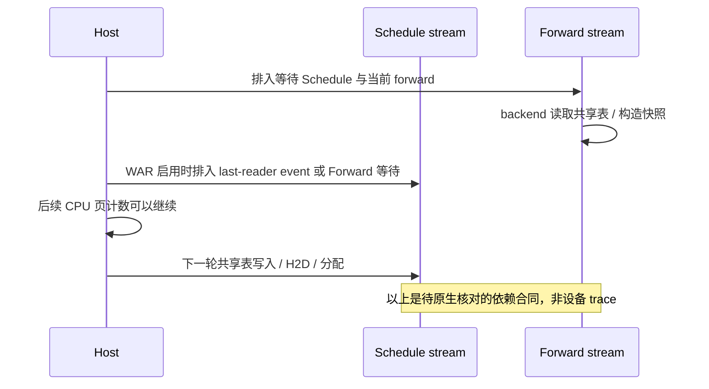

# M005/M017/M018：Ascend plan / WAR / 共享读取事件

L025 的改法是在拥有 CPU 长度的 producer 处显式传页数，省掉 allocator 内的一次设备 `.item()`。本轮核验移除这个同步点之后必须依赖的调度、图执行和最后读取者合同。当前仍是候选；没有生产修改，没有原生性能测量。

安装源码固定为 `ce0a8fea5f4245839d174b2b8c55692be1810a7f`。7 次只读采集获得 32 个唯一文件，均与安装容器的 Git HEAD 内容一致。该容器只提供源码证据，不能作为本任务的 PD＋MTP 服务基线。[文件索引](source-index.json)保留 SHA256、路径与采集 Run。

## 已核实的执行路径

| 边界 | 当前源码行为 | 结论边界 |
| --- | --- | --- |
| plan stream | `get_plan_stream` 由 `SGLANG_ENABLE_OVERLAP_PLAN_STREAM` 决定；声明默认 False | 实际任务环境值未确认；不能把默认当运行事实 |
| WAR 总开关 | `is_cuda() or SGLANG_ENABLE_WAR_BARRIER.get()`；环境声明默认 False | 不能直接推导 NPU 当前运行安全或不安全 |
| 普通 overlap | `run_batch` 后调用 `_apply_war_barrier` | 该调用负责排入依赖，不等于 CPU 等待设备结束 |
| PD prefill / decode overlap | 两套独立循环均在 `run_batch` 后调用屏障；decode 在当前轮前半段执行 `process_decode_queue` | 上一轮排入的流依赖与当前 prealloc 的实际流必须在原生 trace 中核对 |
| PP | 独立 PP 循环未调用这个同名屏障，有自己的流、P2P、query 与 D2H 等待 | 不能将普通 overlap 的结论套到 PP |
| EAGLE 最后读取者 | 拥有 draft 时取 draft runner；不拥有 draft 的 PP rank 取 target runner | target 的事件不能自动替代 draft 的事件 |
| NPU target graph | `NPUGraphRunner.execute` 覆写通用实现，没有调用通用读取边界 resolver / publisher | 不能把通用 runner 的事件策略当成该 NPU override 已执行 |
| EAGLE draft extend graph | NPU 子类继承父类 `replay`；父类 out-graph metadata 后发布普通 device Event，再 replay | 发布位置有源码依据；是否覆盖全部真实读取仍需设备与 backend 审计 |

入口见 [scheduler](sources/installed/python/sglang/srt/managers/scheduler.py#L1899)、[PD prefill](sources/installed/python/sglang/srt/disaggregation/prefill.py#L717)、[PD decode](sources/installed/python/sglang/srt/disaggregation/decode.py#L2892)、[EAGLE 所有者](sources/installed/python/sglang/srt/speculative/eagle_worker_v2.py#L1342)、[NPU execute](sources/installed/python/sglang/srt/hardware_backend/npu/graph_runner/npu_graph_runner.py#L243)。

通用 graph runner 在声明 `IN_REPLAY` 而 external marker 缺失时返回 `PRE_REPLAY`；源码 TODO 自己指出 `POST_REPLAY` 更保守。本轮起初将其列为条件风险，随后实际 NPU override 排除了直接套用该结论。没有据此修改源码，也没有认定现有服务发生故障。外部 persistent marker 工厂只在 CUDA 条件下尝试创建，不表示 NPU 的普通 Event 全部不可用。[通用判定](sources/installed/python/sglang/srt/model_executor/runner/decode_cuda_graph_runner.py#L516)、[marker 工厂](sources/installed/python/sglang/srt/model_executor/runner_utils/shared_read_event.py#L16)。

Ascend attention 继承 base backend 的 decode / target-verify `IN_REPLAY` 默认声明；其 out-graph metadata 路径会从 request table 构造 block tables。这说明必须分开审查“声明”“具体 runner 调用”“实际读取”，不能只搜索到 Event 或枚举便宣布安全。[Ascend metadata](sources/installed/python/sglang/srt/hardware_backend/npu/attention/ascend_backend.py#L975)。

## 源函数 CPU 策略核验

[L026-R008 结果](source-policy-result.json)：66 场景、266 项检查通过。执行 7 个完整 AST 源函数/类体，记录每个原始 body hash；只移除 property 装饰器以直接调用。没有导入完整模块或 Torch，没有 NPU 请求。

| 场景族 | 数量 | 检查内容 |
| --- | ---: | --- |
| 通用 resolver | 8 | 4 种声明 × marker 有无，保留缺 marker 的 PRE 分支反例条件 |
| WAR / owner mailbox | 16 | 开关、强制粗粒度、事件有无、draft 所有权；核验等待选择、消费与非 owner 不变 |
| external marker | 4 | CUDA 条件与 TypeError；非 CUDA 不尝试 external Event |
| plan stream | 2 | 开关控制 Stream / nullcontext |
| 完整 NPU execute | 36 | DSA / DSV4 / 其他架构夹具，load / preplanned / ragged，proxy / logits，decode / verify；通用 resolver / publisher 安装 fail-fast trap |

流、Event、tensor、`load_batch`、backend、输出均是显式边界夹具。NPU execute 的 mailbox 不变结论限于测试的函数体和这些边界；不是整个 forward 没有事件的证明。DFlash、DLLM、真实 metadata / logits、设备计算未执行。NPU draft extend 的继承与发布顺序仅做源码审阅，没有在 R008 执行整个 replay。

R008 的一次 `finish-run` 摘要误写为 326；原始结果与 stdout 均为 266。执行没有重跑，原记录保留，见[更正记录](run-summary-correction.json)。

## 对显式计数候选的影响

启用 WAR 时，scheduler 消费最后读取者邮箱：有事件且不强制 coarse 则 `wait_event`，否则 `wait_stream(forward_stream)`；关闭时不消费。这些是现有策略，不是本轮新增优化。

producer 在 CPU 上算出正确页数，只证明数值来源。它不自动证明 H2D host 缓冲区寿命、计划流与 forward 流可见性、request-table 写入、PD transfer 完成或释放次序。`record_stream_each` 针对 GPU tensor 的使用不能替代 host 缓冲区证明。

保留 L025 候选不接受，整体 serving 证据 **E0**、accepted baseline 为 null。不得把 266 项源策略检查与前轮 819 项组件检查合成原生正确性或性能成绩。

## 下一次最小原生实验与否定条件

[原生准入合同](native-next-contract.json)固定 Ascend、PD 分离与推测解码/MTP。取得本任务资源分配后，先建立未修改 baseline，记录实际 flags、streams、attention / graph runner、cache / allocator / dtype / DCP 与各 rank 的最后读取者，再运行相同输入和页状态的 baseline / candidate。

必须包含成功的小页 native allocator、普通/PD/EAGLE producer、H2D host 生命周期、request-table 覆写、transfer consumer / free，以及短输入和跨 chunk 长输入。页集合、loc、输出、接受长度分布或所有权不一致即拒绝；依赖有未解释读取即不接受。强制 coarse 只作现有配置对照，并记录新增等待与重叠损失。只有同条件 warmup、噪声和暴露时间/端到端结果齐全后才评价收益。

本轮没有新增设备事件或 barrier，因此没有新增运行时成本；代价是候选原生准入仍未完成。潜在回退场景包括 coarse 等待抵消省去 `.item()` 的收益、不同 backend/PP rank 的最后读取阶段变化，以及 PD 异步收发持有的页尚未完成使用。
