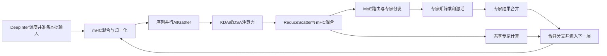

# 126取证后的D2裁决：没有候选通过门槛，本阶段结束

2026年11月13日，北京时间。

**本阶段没有带来新的吞吐收益。保留114，不启动候选或控制测试；完整双档30%目标仍未完成。** 这次取得了实际算子成本证据，但尚未建立一项可安全改变、能补齐C8差距的执行机制。按既定停止条件结束本阶段，不继续增加采样或试验编号。

## 1. 当前成绩与本阶段投入

| 项目 | 已验证状态 |
|---|---|
| 保留实现 | DeepInfer114，源码 `c4ec8e000d04966574970802ae01db76e57a01b5` |
| 固定强参考 | vLLM117；共同优化配方与原有复现清单不变 |
| C4固定负载单批成绩 | 原生306.942、参考228.578 token/s，原生领先34.28% |
| C8固定负载单批成绩 | 原生501.220、参考415.610 token/s，原生领先20.60% |
| 剩余差距 | 同一候选C8还需净省约1.182秒，同时守住C4 |
| D阶段投入 | 1次126取证加载；0次候选加载、0次控制加载；本轮0次新增加载 |
| 资源 | 126已失败结束并释放本任务占用；未声称整机所有设备空闲 |

硬件是Ascend910C、aarch64、8die，使用114/117相同卡组。模型为GLM-5.3-Flash W8A8，固定正式负载为每档32请求、1024输入/256输出、C4后接C8。带采样开销的126不参与提速比较。既有完整文本差异的通用质量影响仍未验收。

## 2. 这次实际看到的模型执行链

下面是固定模型源码与实际算子记录共同支持的简化依赖图。它描述计算依赖，不表示所有节点已经做过独立消融，也不是完整的跨rank关键路径重建。

GLM主模型共有34层KDA、11层DSA。各层执行的主要数学计算仍复用固定SDK/CANN实现；DeepInfer拥有请求、调度和Worker生命周期。当前共享专家重叠、图捕获等能力已有双方共同配方，不能把这些已有机制算作本次新增独有技术。

本次从8个rank各取一个邻近的同形状目标图窗口，均有3,325条主设备计算记录完成算子映射。混合kernel的子记录不重复累加，时间区间按并集计算。

| rank局部观测 | 8个样本的范围 | 结论边界 |
|---|---:|---|
| 目标图外框 | 44.188–44.648毫秒 | 含计算、通信及等待，不是纯计算耗时 |
| 五类通信任务未与其它已记录计算任务重叠的区间 | 8.314–9.891毫秒 | 是时间区间差集，不等于可移除时间 |
| 未被主设备计算记录覆盖的区间 | 0.466–0.564毫秒 | 不能称为真实空闲，也不能外推整批；没有发现大段无记录空白 |

通信分类包含TP AllGather、ReduceScatter、AllToAll，以及MoE Dispatch/Combine。通信kernel内部可能轮询等待，因此“设备上有kernel”也不等于算术单元高利用率。

以rank0窗口为例，专家第一段矩阵乘/激活约5.448毫秒、第二段矩阵乘约2.827毫秒、MatMulV2约3.786毫秒、HcPre约3.633毫秒；MoE Dispatch/Combine分别约2.168/3.398毫秒。这些是各类主记录的时长和，可能与其他流重叠，**不能相加当作整图成本，更不能当作能全部删掉的成本**。

跨rank是按相近时间选择窗口，尚未用执行步身份建立严格配对。因此不使用开始时间之差断言“某个rank迟到几毫秒”，也不据此修改调度或通信顺序。

## 3. 为什么没有放行新实现

本次数据支持把关注点放到真实计算与通信依赖，但还不支持一个具体、安全、足够大的改动。

- 仅删除CPU等待，不能消除图内必要工作。
- 通信有独占区间，不等于移到另一条流就能隐藏；下一层依赖前一层结果，现有共享专家计算也已经部分重叠。
- 把批次拆成两路，涉及GLM混合状态、MTP历史、图缓冲和通信顺序。固定参考源码对部分GDN/线性注意力的MTP微批路径还存在显式限制；这说明需要新的实现契约，不能直接打开通用开关就声称解决。
- `fused_mc2`与共享专家重叠在固定配置源码中互斥。改用共有融合路径属于共同配方取舍，不构成DeepInfer独有机制，也不能单边开启后宣称独有收益。

目前没有一项最小改动同时具备清楚的数据依赖、缓冲所有权、参考实现差异和净收益依据。**因此D3/D4条件不成立，剩余3次条件性加载不使用。** 这不是证明30%不可能，而是没有证据支持本阶段继续投放实现和算力。

## 4. 失败记录的进一步纠正

回收并核验了小份生命周期证据，管理器失败位置是完整采集停止/导出门槛，8个worker均非正常退出，资源清理记录完整。

上一轮曾按状态文件说“4个rank完成导出”。新回收的日志表明：rank 1、2、5、7虽有 `captured` 标记，也有多个解析器失败；它们在退出路径中再次调用停止接口后写出标记。**该标记只说明包装函数返回，不能证明完整轨迹成功导出。** 本文纠正这一点，完整导出通过数不能记为4。

原始设备任务表可以支持上述受限的局部算子分析，但不能据此宣布整个profile成功。整包回收失败也保留；本轮改为小份只读提取，校验了传输压缩包和各文件指纹，没有重跑模型。

## 5. 完整目标之后如何继续

D阶段到此关闭，原起点、失败和投入保留。没有新候选，不自动追加NPU加载。

后续仅保留一个**30分钟、0模型加载的源码可行性问题**：DeepInfer能否保存和恢复完整的混合prefill端点检查点，减少已经实际观测到的重复prompt计算。

依据来自已有122记录：正式C8阶段仍有14次含prefill的运行器调用、12,288个prompt token重算。其主机区间合计6.900秒，**不是设备净成本或收益承诺**。当前1024-token prompt只复用640-token对齐前缀；固定源码中的租约明确要求“对齐且非终点”的前缀。

这个方向只有在以下契约能闭合时才值得进入实现：真实KV、KDA/卷积、DSA压缩与尾部状态、MTP草稿及异步计数全部对应同一位置；缓存预算仍为原4GiB；并发请求不会共享可写状态；采样和输出依然真实执行。不能只把缓存长度改成1024，不能回放缓存答案，也不能增加内存或改变计分负载。

这只是基于已有重复工作证据的下一项源码判断，**不是已批准的新试验、已有性能提升或新的完成日期承诺**。无法形成范围明确的快照/恢复契约，就否决该方向而不加载模型。

## 6. 可复查材料

- [D2裁决、各rank成本表、源码与证据指纹](../validation/shared-features-20261111/native126-D2-decision.json)
- [126此前阶段记录](native126-diagnostic-status-20261113.md)
- [原复盘、门槛与时间预算](performance-reset-after125-20261113.md)
- [114完整参数与环境](../validation/shared-features-20261111/native114.json)
- [117完整参数与环境](../validation/shared-features-20261111/reference117.json)

本次没有改动默认模型源码，没有新的端到端性能结果；Goal仍未完成。
