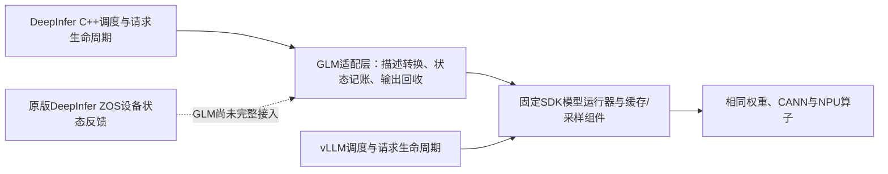

# 98/99后的重新规划：以C8关键路径选择一个可交付候选

日期：2026-11-12，本次用户复盘更新。目标仍是910C、8die、GLM-5.3-Flash、固定AISBench C4/C8；共同适用优化保持一致，DeepInfer实际不同的执行机制支持两档至少领先30%。本文件是当前路线决定；旧版保留在仓库历史。**不重新起算6小时决策、12小时单候选投入预算，不把目标改成“跑通即可”**。

最新补充：一次有界观测101已经完成，80条请求、8个Worker退出及资源释放均已核验。它使用不同卡组并带观测，只用于诊断，没有新增正式性能成绩。**下一步收紧到原生调度与SDK前缀缓存的工作量契约；这是共有能力接入修复，尚不能作为独有特性验收。** 本次没有证据支持“大改decode同步就能跨过30%”，也没有将30%当成必然可以达到的结论。

## 1. 当前结论

适配已经形成可运行的原生引擎路径；这与证明DeepInfer的专有性能优势是两个里程碑。最新公平对比仍未达到目标，也还没有一个被证实足以填补差额的专有方案。继续默认“多跑几轮就会达到30%”缺乏依据。

| 正式负载 | DeepInfer98 | vLLM99 | 领先 | 距30%还需缩短原生整批时间 |
|---|---:|---:|---:|---:|
| C4，32条1024入/256出 | 281.38870 token/s | 223.31462 token/s | 26.01% | 0.89455秒，即3.07% |
| C8，32条1024入/256出 | 412.10826 token/s | 352.49706 token/s | 16.91% | 2.00142秒，即10.07% |

两侧同卡组、同镜像和资源限制、同共同配置，均完成64条正式请求；原生8个模型Worker exit0，双方已退出并释放本任务资源。56/64条完整文本相同，另外8条的通用质量影响未验收。每档仅一批，不代表稳定收益。

这次共同准备消除了所观察两个内核的服务期迟到编译，两侧均为0；每rank各准备18个模板，不增加模型forward或评测预热。**不能把这一共有修复称为独有算法，也不能用原生98除以旧参考95。** 旧C8的36.80%因此不能沿用为本轮结论。

[完整环境、启动参数、计时与限制](matched98-99-common-preparation-20261112.md) · [原生核验](../validation/shared-features-20261111/native98-common-preparation.json) · [参考核验](../validation/shared-features-20261111/reference99.json)

## 2. 为什么以前一直显得忙，却难以形成突破

1. **以30%为出发假设，未先证明收益空间。** 补兼容、共有优化和采集日志算作了同一类进展；局部修复没有对应到端到端还差多少秒。
2. **参考基线补齐太晚。** KDA、MTP图等共同能力逐步加入参考，原有优势被重新解释。此次必须双侧做同样的编译准备，结果已经证明单看原生改善会误判。
3. **把框架名字与执行机制混淆。** 当前是DeepInfer引擎、C++调度器、Worker，加上固定SDK模型运行器。大部分计算相同；不是原版DeepInfer全部模型、采样和设备调度能力已迁入GLM。
4. **把可能性排查当成持续交付。** 重复全模型加载、扩大数值对照、运行器修补占用了时间。性能阶段应只保留受改动影响的语义、状态和生命周期检查，不再重开CPU/NPU逐位精度搜索。

5. **把适配完成与特性迁移完成混在一起。** 用现成SDK建立正确计算路径是合理的；但必须另列原生特性在哪一层被适配器截断，不能把“C++调度器已运行”当作ZOS全部生效。现在需要调整的是框架与计算运行器的接缝，不是重写GLM的数学计算。
6. **实验缺少先验退出条件。** 先提出开关、运行后再解释比例，容易把一次过线误认成路线成立。以后先写可省时间、机制计数、同候选消融和失败条件，缺其中一项就不进入正式计分。

这些是安排和判定方式的问题。必要的资源保护、真实状态检查、可复现记录仍保留；缩减的是不改变路线决策的重复验证，不能通过忽略失败或放宽数据口径提速。

当前请求在客户端几乎连续供给：C4/C8平均在途分别3.994/7.945，客户端空槽折算仅0.044/0.138秒。这不支持把下一阶段花在压测客户端并发或HTTP排队参数上。

## 3. 当前架构真正不同在哪里

已有两批在途异步，98全72请求中590次先提交下一批、584次观察到当前设备工作未结束。它证明路径确有重叠，不等于重叠占比，也不是新的独有性证据。不能再以“实现异步”为任务名重复做一次。

最新实测参考容器的运行器源码已只读核验，SHA-256为`568c3049205b9caff5c656a7f5dd4c6e79fb358abe526f89fb9fb3f70a60a43c`，与本地审查副本相同。它已经有`DeviceMetadataExecutor`和provider注册，**“把元数据放到设备”这个泛称也不能直接宣称参考没有**。

## 4. 突破口与选择顺序

**101之后的路线决定：优先修复调度与缓存之间的工作量信息错位；不进入大规模设备反馈改造。** 以下4.1/4.2保留诊断前的论据，当前决定以本节新证据为准。

### 4.0 已回收的101证据与明确的去留决定

101模型源码与98相同（`58e20789`），但卡组不同；诊断观察到的主机耗时、设备活动区间不能拿来与99算提速，也不能直接外推98能省多少秒。

| 同一次诊断 | C4 | C8 |
|---|---:|---:|
| prefill批次 | 27 | 20 |
| 原生调度记账的prompt token | 32768 | 32768 |
| SDK真正安排计算的prompt token | 31488 | 16768 |
| 实际复用前缀的请求 | 2/32 | 25/32 |
| 有已登记但未选中prompt的prefill批次 | 6 | 13 |
| prefill主机耗时中位数 | 414.75ms | 396.57ms |

现在的调用顺序是：**原生先按完整逻辑长度分批 → SDK再查询并扣除缓存命中 → 执行一个比预算预想更小的批次。** 32768是调度记账量，不是设备重复算了32768。C8有7条请求在登记时没有未保存的640-token检查点，但首块被切成256或512 token，随后没有获得缓存抵扣。源码存在`hit_tokens >= scheduled`时回退重算的保护；缓存是否在登记和执行之间变化仍需由候选的持有协议解决，不能仅凭入队快照推断始终有效。

这解释了一个具体接入缺口，仍不证明13个批次里的所有等待请求均可合并。slot、缓存归属和到达时机仍是硬约束。不能用理想装箱的批次数或“批次数×397ms”作为性能预测。

同一诊断的短设备窗口包含5个prefill及8个稳定decode：prefill主机/设备活动时间中位数约445.60/206.03ms；decode约53.15/48.90ms。各中位数不能相减得到可消除成本。接受数事件等待共138.04ms，其中设备活动重叠129.75ms，可见非活动部分8.28ms；**大部分等待期间设备在有效计算，不支持把138ms全当成可省开销。** 这些是单rank插桩窗口，不能证明其他rank无工作，也没有排除其他更大的设备端改造。

因此，本轮只选择一个后续准备项：**在原生批次扣预算前拿到有有效期/归属保障的前缀信息，按实际未缓存工作量合批。** 固定vLLM已有先扣缓存命中再分配预算的逻辑，所以这项是共有能力接入修复。即使它带来30%的总比例，也不能单独证明DeepInfer独有技术达标。C4只有两条命中，当前没有证据证明该项可同时补齐C4的0.895秒和C8的2.001秒；这一限制必须保留。

**独有候选的正式性能测试尚未放行。** 下一阶段先完成这一个小范围契约候选，不能将它重新命名成独有算法，也不再运行第二次只为补观测的模型加载。

[101核验记录](../validation/shared-features-20261111/native-g101-verification.json) · [批次与等待分析](../validation/shared-features-20261111/native101-host-dependency-analysis.json) · [设备窗口](../validation/shared-features-20261111/native101-device-analysis.json) · [机器可读路线决定](../validation/shared-features-20261111/native101-route-decision.json)

### 下一项改动应怎样验收

1. **修改位置限定**：`SDKBatchSchedule`管理缓存引用与请求状态；`SDKBatchWorkerAdapter.register_request`把有效计算量信息送回原生；`LLMEngine`只传递契约；C++ `_schedule_prefill`分别记录逻辑跨度与实际计算预算。不更换模型计算、算子、MTP长度或采样策略。
2. **缓存所有权先成立**：优先复用固定SDK的引用计数/分配API；入队命中提示不能直接当成永久有效的credit。缓存持有、转交、无命中及失败释放必须闭环；若不能安全表达，就否决方案，而不是先放宽预算试跑。
3. **同一实际预算**：仍为1792个实际计算token；逻辑跨度可能包含已缓存内容，但不能虚构已计算状态、跳过KDA检查点或把额外计算藏在缓存credit里。对命中超过当前小块、无命中、失效和跨块情况做必要的元数据检查，不重跑全量精度矩阵。
4. **一次候选检验**：同源可关闭开关，记录实际计算量、prefill次数、成功请求和状态释放，再看无插桩C4/C8总耗时及TTFT/TPOT。先验证机制真的变化；若批次数/工作量没变或成本不够，立即否决，不开参数网格。
5. **两类成果分开**：这项通过可关闭共有接入缺口；完整Goal仍要求实际区别于固定参考的机制和双档30%。现有证据若仍不支持独有差异，要明确提交架构限制和是否需要更大改造的决定，不把调参继续续成无限任务。

### 4.1 优先核查：小批prefill反复打断decode

本轮只读分析旧97的C8 rank0时间线，得到以下新汇总；它是旧诊断证据，**不是98的新性能结果，也不是设备计算时间**：

| 观测 | 数值 | 可以说明什么 |
|---|---:|---|
| prefill调用 | 21次，主机区间合计8.692秒 | 该阶段成本值得优先分析；不能当成8.692秒全可省 |
| 不超过640 token的prefill | 11次，耗时中位数406.15ms | 小批次仍有显著固定开销或等待，具体组成待分解 |
| 641–1280 token的prefill | 10次，中位数407.06ms | 主机耗时未随批量成比例增长；不等于已证明设备合批收益 |
| prefill时另有已开始生成、尚未结束的请求 | 17次，合计主机区间6.998秒 | prefill与已有decode竞争执行机会，不能把全部延迟归于客户端 |

源码中的NORMAL引擎按步选择prefill或decode；当前适配并未证明完整混合批执行。可研究的干预是：在原生调度器内按已就绪请求、剩余预算和等待上限组织阶段，在合法checkpoint边界减少小批切换，或消除这些阶段经证实的重复准备。**不是恢复一个很大的固定prefill间隔，更不是为凑吞吐让新请求无限等候。**

放行前必须知道：当时究竟有没有其他可合并请求；是否被cache/checkpoint而非调度策略限制；约406ms中设备计算、通信、准备和等待各占什么；固定vLLM是否已经采用同一策略。普通checkpoint合批是双方已有能力，不重新命名为独有特性。若瓶颈只是不可避免的设备计算，或相同补丁可直接修复两侧SDK，则否决“原生独有突破”解释。

[本轮阶段分析与限制](../validation/shared-features-20261111/replan-phase-cost-evidence.json) · [原始97阶段分解](../validation/shared-features-20261111/native97-prefill-decode-host-budget.json)

### 4.2 同次观测核查：稳定decode的设备反馈依赖

**MTP接受数与混合缓存状态的主机往返，是否可以由DeepInfer拥有的设备反馈路径替代。**

明确的源码事实：固定运行器在`_update_states_after_model_execute`中产生设备接受数并记录事件；`_prepare_inputs`第1495行等待该事件，在CPU重排接受数，再复制回设备；Mamba状态预处理还使用CPU计算位置。这形成了一条具体的依赖链，值得审查。它目前仍是候选瓶颈，**没有测出其未被其他工作覆盖的成本，不能先删同步或宣称已经有收益**。

最小候选范围：仅请求集合、物理缓存映射和图形状稳定的decode段，复用设备接受数、映射与长度修正；涉及新请求、结束/取消、prefill、缓存块切换、检查点或不支持的MTP回退时回到现有路径。数学计算、权重、采样规则和实际接受判定保持一致。不能将旧接受数填1、伪造概率，或直接把ZOS开关置1。

首先列清CPU消费者和依赖，核实参考现有设备元数据机制覆盖到哪里。如果只是参考已具备但本适配遗漏的能力，归类为共同能力补齐；如果只能实现一个两侧都适用的SDK补丁，也不包装成DeepInfer专有成果。只有原生调度与设备状态协议的实际差异成立，才进入专有候选验证。

本轮消费者审查进一步确认：接受数不仅用于返回token，还影响KDA状态复制偏移和下一步位置；`postprocess_mamba_align_gpu`在特定状态复制情况下把输出接受数改为1。因此不能拿原始GPU接受数直接代替处理后的值。已有CPU profile的累计同步等待也不能可靠归到这个事件，更不能把设备正在有效计算的等待当作可消除空闲。

这条路线的最小差异只能是：**稳定请求集合、稳定物理cache映射和图形状下，设备闭合必要反馈；主机延后回收输出；边界条件明确退回现有路径。** 它还没有实现、没有收益证据。已有两批在途及SDK设备元数据不再重复开发。

[固定参考源码核验](../validation/shared-features-20261111/reference99-metadata-source-audit.json)

## 5. 明确不继续追的方向

| 方向 | 现有证据与本轮决定 |
|---|---|
| 只优化外层Python/C++包装 | 97的C8全窗口SDK调用外区间仅1.464秒，还是主机区间而非可兑现节省；不能据此覆盖当前2.001秒差额。停止作为主攻方向。 |
| 仅把已有decode重叠再加深 | 94的8步计分后诊断设备可见空闲中位数约4.74ms，包含插桩，不足以据此承诺整批收益。必须找到未被覆盖的具体依赖；不直接移植完整ZOS。 |
| 仅提高MTP接受率 | 98全72请求已接受14454/14890个草稿。假设工作不变且436个拒绝全部变接受，输出数只多约2.49%；这不是实测收益，也不足以支持本轮C8目标。 |
| 把checkpoint合批改称独有算法 | 固定vLLM已有同类能力，96的改动属于原生实现补齐；不再重复立项。 |
| 按DeepInfer README移植V4专用SWA/DSpark或950优化 | 模型、权重与硬件前提不同；当前GLM/910C适用性不能由名字推出。暂不进入实现。 |
| 修改MTP长度、context、并发和请求集寻找好看比例 | 会改变问题或扩大组合；本轮不做。共同开关也不能关掉以降低参考。 |
| 全面移植另一套模型、缓存或算子体系 | 超出本轮差额定位；先保留已跑通的共享计算路径，只改变被证实影响关键路径的边界。 |

这里的历史区间只用于筛选，不能跨轮相减来预测98收益。**C8是当前约束更紧的一档；必须同时守住C4，不能拼接两个版本的最好分数。**

## 6. 有停止条件的执行表

此前总预算：从已记录的RP3c开始，6个有效工作小时内决定路线，单候选累计最多12个有效工作小时。起点为2026-11-12北京时间14:40:39，不因本次复盘重置。以连续可执行工作估算，路线检查点为当日20:40，候选结论检查点为11月13日02:40；这是投入上限和交付检查点，**不是保证30%的日期，也不是已核实的平台后台持续运行承诺**。设备/连接等外部阻塞单独记录起止和影响，不把等待记作实现成果，也不抹掉原期限。

| 阶段 | 下一步与产物 | 最多投入 | 放行或否决条件 |
|---|---|---:|---|
| 已完成 | 98/99匹配结果、真实差额、源码审计及发布 | 已完成 | 两侧全量计时重算、退出和资源释放有证据 |
| RP3d-1 | 已完成接受数消费者审查、已有异步边界核查及旧97阶段分解；参考仍有设备元数据和checkpoint合批 | 本轮已交付 | 只关闭已验证的源码问题；没有将成本未知写成“已定位瓶颈” |
| RP3d-2 | 已完成101：20次C8 prefill的预算抵扣滞后被观察到；接受数同步主要与设备工作重叠；诊断及释放闭环 | 唯一观测加载预算已用完 | 未证明独有机制或足够可兑现收益；不追加同类观测加载 |
| RP4c | 唯一准备项：原生prefix实际工作量契约；只修调度/缓存接缝，先确保有效缓存持有，再做可关闭实现 | 沿用6小时路线、累计12小时上限 | 这是共有接入修复，不能直接进入独有达标宣告；必要状态/边界成立且机制计数改善才运行对应候选验收；否则否决 |
| RP5 | 同候选开/关消融，与共同配置匹配的参考对照；发布固定源码、命令和原始结果 | 同一候选验收内 | 必须两档均过30%且归因成立；临界或顺序影响才做必要重复。未达标如实写差额，不扩大搜索矩阵 |

下一轮交付首先是一份**可实施或应否决的决定**，必须包含：基线commit、改动位置、实际执行差异、可消除成本及其不确定性、一个候选的实现范围、停止条件。不是再给一份开放式可能性清单。只有一份主候选，主候选不通过就保留失败证据；不借“下一代候选”自动重开预算。

若两项均没有足够空间，结果就是本轮没有证据支持在既定负载下靠当前接入方式稳定达到30%。交付最佳已验证版本和明确的成本限制，列出更大架构改动的必要性及投入，再决定范围；原Goal保持未完成。**不得把“30%是目标”写成“30%必然存在，只需继续测试”。**

## 7. 下一轮如何做到少测但能下结论

1. 98源码`58e20789`及其扩展身份已在101再次核验；100占卡前受阻而没有加载模型，101使用健康空闲组完成唯一观测。原100失败保留。后续正式比较必须用同卡组、相同环境和负载，不能把101与99跨组相除。
2. 101已保留必要预热与先C4后C8的cache历史，完整采到prefill/decode窗口；不为补观测再次加载模型。已有数据足以决定当前两个方向的优先级，诊断批吞吐不冒充正式成绩。
3. 实现阶段仅验证改动触及的拒绝/回退、请求进入退出、cache块边界和状态归属；已有未受影响的模型计算回归复用。不把CPU/NPU逐位一致、全量算子重测、7份无关诊断补齐列为新门槛。
4. 用同候选开/关消融证明机制变化，再用无插桩正式AISBench验证总耗时；共享特性两侧同等启用。参考若仍满足时间邻近、环境/资源相同、无漂移证据，可先复用99筛选；最终达标结论需适用的参考和必要波动证据，不从不同轮次挑最好成绩。
5. 正式验收同时给C4/C8、TTFT/TPOT及不利影响。阶段组织若靠增加首token等待换吞吐，必须报告权衡，不能暗改服务目标。已有56/64文本一致和8条分叉的质量边界继续保留，不能宣称通用质量已通过。
6. 远端同组计分串行；加载时本主会话并行完成离线分析和代码准备，不新增子代理/cron/调度系统。不以进程存活、报告数量、测试轮号作为进度。

98/99整次作业的已观测耗时约18.42/14.94分钟，包含加载和清理；仅正式C4+C8分别约49/60秒。这支持把改动和检查集中到一次启动中，减少重复装载。它不保证下一轮耗时相同，更不代表模型攻关还需固定几分钟。

每阶段未达成时，报告固定写清：计划产物、实际产物、首个阻塞及证据、投入与等待时间、被否决的假设、下一动作为什么会改变决定。不要只写“还在优化”。

主会话继续唯一调度，不新增子代理、新会话或Hermes推进cron。98/99及101均已有结束和释放回执；当前没有本任务存活的NPU作业，不据此宣称整机空闲。Goal仍active、未完成。101观测已结束不等于新候选已实现；下一阶段准备范围和未放行门槛见4.0节。
