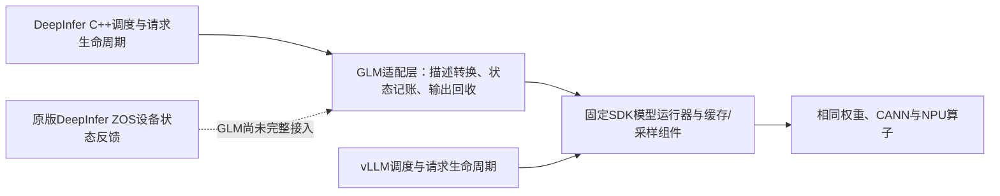

# 98/99实测后的路线决定：停止无边界调参，审查一项执行机制

日期：2026-11-12。目标仍是910C、8die、GLM-5.3-Flash、固定AISBench C4/C8；共同适用优化保持一致，DeepInfer实际不同的执行机制支持两档至少领先30%。本文件接续此前复盘，**不重新起算6小时决策、12小时单候选投入预算，不把目标改成“跑通即可”**。

## 1. 当前结论

适配已经形成可运行的原生引擎路径；这与证明DeepInfer的专有性能优势是两个里程碑。最新公平对比仍未达到目标，也还没有一个被证实足以填补差额的专有方案。继续默认“多跑几轮就会达到30%”缺乏依据。

| 正式负载 | DeepInfer98 | vLLM99 | 领先 | 距30%还需缩短原生整批时间 |
|---|---:|---:|---:|---:|
| C4，32条1024入/256出 | 281.38870 token/s | 223.31462 token/s | 26.01% | 0.89455秒，即3.07% |
| C8，32条1024入/256出 | 412.10826 token/s | 352.49706 token/s | 16.91% | 2.00142秒，即10.07% |

两侧同卡组、同镜像和资源限制、同共同配置，均完成64条正式请求；原生8个模型Worker exit0，双方已退出并释放本任务资源。56/64条完整文本相同，另外8条的通用质量影响未验收。每档仅一批，不代表稳定收益。

这次共同准备消除了所观察两个内核的服务期迟到编译，两侧均为0；每rank各准备18个模板，不增加模型forward或评测预热。**不能把这一共有修复称为独有算法，也不能用原生98除以旧参考95。** 旧C8的36.80%因此不能沿用为本轮结论。

[完整环境、启动参数、计时与限制](matched98-99-common-preparation-20261112.md) · [原生核验](../validation/shared-features-20261111/native98-common-preparation.json) · [参考核验](../validation/shared-features-20261111/reference99.json)

## 2. 为什么以前一直显得忙，却难以形成突破

1. **以30%为出发假设，未先证明收益空间。** 补兼容、共有优化和采集日志算作了同一类进展；局部修复没有对应到端到端还差多少秒。
2. **参考基线补齐太晚。** KDA、MTP图等共同能力逐步加入参考，原有优势被重新解释。此次必须双侧做同样的编译准备，结果已经证明单看原生改善会误判。
3. **把框架名字与执行机制混淆。** 当前是DeepInfer引擎、C++调度器、Worker，加上固定SDK模型运行器。大部分计算相同；不是原版DeepInfer全部模型、采样和设备调度能力已迁入GLM。
4. **把可能性排查当成持续交付。** 重复全模型加载、扩大数值对照、运行器修补占用了时间。性能阶段应只保留受改动影响的语义、状态和生命周期检查，不再重开CPU/NPU逐位精度搜索。

当前请求在客户端几乎连续供给：C4/C8平均在途分别3.994/7.945，客户端空槽折算仅0.044/0.138秒。这不支持把下一阶段花在压测客户端并发或HTTP排队参数上。

## 3. 当前架构真正不同在哪里

已有两批在途异步，98全72请求中590次先提交下一批、584次观察到当前设备工作未结束。它证明路径确有重叠，不等于重叠占比，也不是新的独有性证据。不能再以“实现异步”为任务名重复做一次。

最新实测参考容器的运行器源码已只读核验，SHA-256为`568c3049205b9caff5c656a7f5dd4c6e79fb358abe526f89fb9fb3f70a60a43c`，与本地审查副本相同。它已经有`DeviceMetadataExecutor`和provider注册，**“把元数据放到设备”这个泛称也不能直接宣称参考没有**。

## 4. 下一轮只审查这一项突破口

**稳定decode段中，MTP接受数与混合缓存状态的主机往返，是否可以由DeepInfer拥有的设备反馈路径替代。**

明确的源码事实：固定运行器在`_update_states_after_model_execute`中产生设备接受数并记录事件；`_prepare_inputs`第1495行等待该事件，在CPU重排接受数，再复制回设备；Mamba状态预处理还使用CPU计算位置。这形成了一条具体的依赖链，值得审查。它目前仍是候选瓶颈，**没有测出其未被其他工作覆盖的成本，不能先删同步或宣称已经有收益**。

最小候选范围：仅请求集合、物理缓存映射和图形状稳定的decode段，复用设备接受数、映射与长度修正；涉及新请求、结束/取消、prefill、缓存块切换、检查点或不支持的MTP回退时回到现有路径。数学计算、权重、采样规则和实际接受判定保持一致。不能将旧接受数填1、伪造概率，或直接把ZOS开关置1。

首先列清CPU消费者和依赖，核实参考现有设备元数据机制覆盖到哪里。如果只是参考已具备但本适配遗漏的能力，归类为共同能力补齐；如果只能实现一个两侧都适用的SDK补丁，也不包装成DeepInfer专有成果。只有原生调度与设备状态协议的实际差异成立，才进入专有候选验证。

[固定参考源码核验](../validation/shared-features-20261111/reference99-metadata-source-audit.json)

## 5. 明确不继续追的方向

| 方向 | 现有证据与本轮决定 |
|---|---|
| 只优化外层Python/C++包装 | 97的C8全窗口SDK调用外区间仅1.464秒，还是主机区间而非可兑现节省；不能据此覆盖当前2.001秒差额。停止作为主攻方向。 |
| 仅把已有decode重叠再加深 | 94的8步计分后诊断设备可见空闲中位数约4.74ms，包含插桩，不足以据此承诺整批收益。必须找到未被覆盖的具体依赖；不直接移植完整ZOS。 |
| 仅提高MTP接受率 | 98全72请求已接受14454/14890个草稿。假设工作不变且436个拒绝全部变接受，输出数只多约2.49%；这不是实测收益，也不足以支持本轮C8目标。 |
| 把checkpoint合批改称独有算法 | 固定vLLM已有同类能力，96的改动属于原生实现补齐；不再重复立项。 |
| 按DeepInfer README移植V4专用SWA/DSpark或950优化 | 模型、权重与硬件前提不同；当前GLM/910C适用性不能由名字推出。暂不进入实现。 |
| 修改MTP长度、context、并发和请求集寻找好看比例 | 会改变问题或扩大组合；本轮不做。共同开关也不能关掉以降低参考。 |

这里的历史区间只用于筛选，不能跨轮相减来预测98收益。**C8是当前约束更紧的一档；必须同时守住C4，不能拼接两个版本的最好分数。**

## 6. 有停止条件的执行表

此前总预算：从已记录的RP3c开始，6个有效工作小时内决定路线，单候选最多12个有效工作小时。以下均在剩余预算内，不重新承诺“两天必达30%”。

| 阶段 | 下一步与产物 | 最多投入 | 放行或否决条件 |
|---|---|---:|---|
| 已完成 | 98/99匹配结果、真实差额、源码审计及发布 | 已完成 | 两侧全量计时重算、退出和资源释放有证据 |
| RP3d-1 | 列明MTP接受数、CPU位置、混合缓存复制的消费者；形成原生与参考依赖图 | 下一轮先用1小时 | 必须存在参考未提供的可实现执行差异；否则否决专有路线，不用新名称继续 |
| RP3d-2 | 复用现有时间线；只有缺关键观测才追加一次有界、计分外的短观测 | 最多1次加载，仍受6小时总决策预算约束 | 分清等待中的设备有效计算、主机工作和真正可消除的空隙；收益空间需覆盖C8约2.001秒、C4约0.895秒，并考虑噪声。不能用累计等待时长当收益 |
| RP4c | 仅放行后实现一个可关闭的稳定decode候选 | 追加投入受12小时总上限约束 | 不同请求/块切换正常回退；MTP拒绝、结束、状态归属和退出通过必要检查；无实际机制改善则停止 |
| RP5 | 同候选开/关消融，与共同配置匹配的参考对照；发布固定源码、命令和原始结果 | 同一候选验收内 | 必须两档均过30%且归因成立；临界或顺序影响才做必要重复。未达标如实写差额，不扩大搜索矩阵 |

下一轮交付首先是一份**可实施或应否决的决定**，不能只有“正在测试”。若这条候选上限不足，交付最佳已验证结果、明确限制与需要用户选择的架构/目标范围；原Goal保持未完成，不无限自动尝试下一组参数。

主会话继续唯一调度，不新增子代理、新会话或Hermes推进cron。当前两轮作业已结束；下一项NPU作业尚未启动。现有工程/质量边界继续保留，未达计划的报告必须列明：承诺产物、实际产物、耗时、首个阻塞、错误假设、下一步会改变什么决定。
