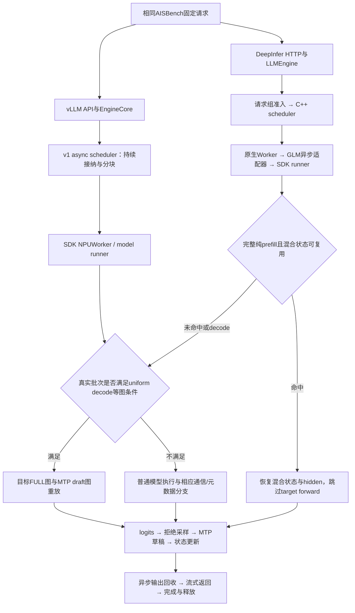

# DeepInfer与vLLM：实测性能、完整复现与流程/算子机制审计

日期：2026-11-13。固定实验：vLLM参考138、DeepInfer开启139、同源码状态复用关闭140。实测模型源码为`76bb59edf66caef19e81a13bf91b698aba09659b`。

**阅读结论：C8的混合状态复用有同源码干预证据；C4当前存在约6.53秒整批优势，但尚未被单项机制的因果实验完整解释。本次新增发现：同样开启FULL与MTP5，两边实际进入普通Python执行和draft图回放的数量不同，8个rank一致。这使“请求组织改变图覆盖和算子提交方式”成为可具体检验的主要解释，不能把它直接写成已证明贡献全部24.13%。**

本报告不把未运行的141/142计入成绩。最新候选`6b4e8e0`只做过源码/执行包准备；它没有新的模型性能结果。

## 1. 实验身份与比较变量

| 比较臂 | 引擎、调度与请求生命周期 | 模型计算 | 有意改变的内容 |
|---|---|---|---|
| 138参考 | vLLM API→EngineCore→v1 async scheduler→NPUWorker | 固定vLLM-Ascend GLM模型、CANN/torch-npu等现成实现 | 参考框架，普通4GiB缓存 |
| 139开启 | DeepInfer HTTP入口→LLMEngine→C++ scheduler→Worker→GLM适配器 | 固定SDK NPUWorker/model runner及相同GLM模型 | 原生请求组织、异步桥、前缀接纳、请求组准入、raw-logprob取行、混合状态复用；缓存3+1GiB |
| 140关闭 | 与139同一源码、请求组策略和3+1GiB配置 | 同上 | 入口包装仅旁路状态保存/恢复，直接执行原target forward |

138对139并非只改变一个布尔开关。它比较一组框架集成差异，因此只能先给端到端结果；139对140才是状态复用的单项干预。140没有关闭请求组准入或raw-logprob适配，不能用它量化这些机制各自贡献。

两个框架均启用的图、MTP、异步、普通prefix、DSA CP/SP、EP/AIV、共享专家重叠和prefill MC2等能力，不能作为DeepInfer独有贡献。相同配置并不保证实时批次形状、图覆盖或通信分支相同。

## 2. 硬件、依赖和资源条件

| 项目 | 固定条件 |
|---|---|
| 硬件/架构 | Ascend910C，aarch64，8die，4张物理卡 |
| 物理卡 | 1、3、4、5；三个计分臂同组串行 |
| die/rank映射 | rank0–7分别对应die2、3、6、7、8、9、10、11 |
| 并行 | TP8、EP8、DP1、PP1；不是8物理卡测试 |
| 模型 | GLM-5.3-Flash W8A8；激活/部分投影BF16，具体量化按checkpoint与SDK规则 |
| 镜像ID | `sha256:ce42d65b2403992ad2e2b06c61f4f048babb57e455cfe307b018345e36c5e98b` |
| 依赖 | CANN9.2、torch2.10、torch-npu2.10.0.post7、vLLM0.30.0+empty、vLLM-Ascend0.30.0rc2 / g8fde6d4e3 |
| 服务容器资源 | 32 CPU、512GiB主存、8GiB共享内存 |
| 客户端资源 | 独立AISBench容器，4 CPU、8GiB主存，host网络 |
| 测试工具版本 | 固定客户端venv元数据：Python3.12.13、ais_bench_benchmark3.1.0；本次只读回收 |
| 原生C++扩展 | `fe6e265ccd8b1c85f4de1b61602dbb6e0c4647153e156c54c0c59b466641da61` |
| 服务模型边界 | context2048、最多8请求、每步1792 token；MTP草稿5 |
| 缓存预算 | 每rank总4GiB；138普通池4GiB，139/140普通池3GiB+状态区1GiB |

镜像ID是现场本地镜像身份，不能冒充远程仓库manifest digest。固定模型config、权重索引、tokenizer及源码身份见复现清单；没有重新对全部权重分片逐一做完整文件哈希。本报告不分发权重或私有环境路径。

主要环境变量：`HCCL_BUFFSIZE=1280`、`HCCL_OP_EXPANSION_MODE=AIV`、`TASK_QUEUE_ENABLE=1`、`VLLM_USE_V2_MODEL_RUNNER=0`、`VLLM_USE_BREAKABLE_CUDAGRAPH=0`、`OMP_NUM_THREADS=2`。完整容器命令、rank命令和实际有效值见下方机器可读清单；日志、cache和挂载路径的身份性差异不视为算法差异。

## 3. 负载、工具和测量口径

每档32条固定合成请求，每条1024输入、256输出，整档32768输入和8192输出token；并发C4/C8分别为4/8。客户端`request_rate=0`、流式返回、`retry=1`、temperature0、top_p1、seed0、ignore_eos=True。每档原有两条预热；每臂还包括4条工程请求，故正式64条、合计72条，三臂总216条。

固定顺序是C4→C8，模型进程与缓存不在两档之间重置。**C8会重新使用C4已处理的数据与状态，它是温缓存场景。** 不可解释成冷启动、任意prompt分布或通用业务收益。

吞吐按AISBench原始请求时间戳重算：

```text
output_token_throughput = 全部输出token / (最后请求结束 − 首请求开始)
吞吐提升 = DeepInfer吞吐 / vLLM吞吐 − 1
```

同时核对官方汇总。TTFT、TPOT为请求中位数，不能相加重建整批时间。TTFT含排队/prefill，TPOT含模型执行、调度与异步反馈，均不是纯算子耗时。

数据文件SHA256为`66e5190762fc5cd92022ac5b57322151a4200af5b49f2c65057d8c023cc84f0d`；C4/C8配置SHA256分别为`2e53be80d3e2119834c7b609210c2e57eaeb27e7c1ef9fe7cb0cbb772e630412`、`acc27a0e935fb2ad565e3c2718bd6bef39c55dafad59e55e0a398abf63a9c0cd`。旧dataset manifest内的`prefix_caching:false`是数据准备元信息，不能当成服务端配置；三个服务的实际prefix caching均已开启。

## 4. 实测端到端结果

| 指标 | C4 | C8 |
|---|---:|---:|
| vLLM138，token/s | 243.76156 | 547.05506 |
| DeepInfer139开启，token/s | 302.58856 | 614.54459 |
| DeepInfer140关闭，token/s | 301.60478 | 532.09297 |
| 139相对138吞吐 | +24.13% | +12.34% |
| 139相对140吞吐 | +0.33% | +15.50% |
| 138整批秒数 | 33.60661 | 14.97473 |
| 139整批秒数 | 27.07307 | 13.33020 |
| 相对参考少用时间 | 6.53355秒 | 1.64453秒 |
| 138→139 TTFT中位数 | 1127.70→925.22毫秒 | 829.46→587.15毫秒 |
| 138→139 TPOT中位数 | 11.9261→9.6872毫秒 | 10.6330→10.5740毫秒 |

24.13%吞吐提升对应19.44%的整批时间减少；12.34%对应10.98%，不要混淆两个分母。C4请求生成段的中位TPOT更低，C8主要表现为TTFT更低、TPOT接近；这些是现象描述，不能代替原因。

三臂正式请求均32/32成功，0失败。完整文本一致性：139对138为C4 31/32、C8 23/32；140对138为29/32、24/32。这不是通用质量成绩，不能直接把文本差异定性为精度错误或默认无害。

## 5. 两条真实执行流程



DeepInfer拥有请求接纳、原生sequence、调度、缓存归属与输出生命周期；模型数学不是重新写了一套。适配器使用固定SDK的NPU模型计算、量化、KDA/DSA/MoE和MTP规则。

当前示例设置`DEEPINFER_ZERO_OVERHEAD_SCHEDULING=0`，原生Worker的GLM分支提前进入适配器。**本批不能宣称原有通用ZOS机制已经产生收益。** 原生“已接入”、异步“已提交”和设备计算/主机工作“物理重叠了多少毫秒”是不同证据。

## 6. 已有因果证据：混合状态复用如何减少计算

原生prefix接纳先按实际640-token对齐规则接入普通前缀缓存。状态复用另外保留完整prompt末尾所需的混合状态及hidden片段，供同一模型实例的重复prompt使用。

1. 为真实调度跨度构建记录，仅处理纯prefill、无推测decode且图模式NONE的批次。
2. 只有整批各请求均到prompt末尾、key存在且保存范围覆盖起点，才可复用。
3. 核对物理slot、缓存布局和全rank一致决策，等待保存事件完成。
4. 用固定SDK `vllm.v1.worker.mamba_utils.batch_memcpy`恢复状态及hidden，跳过原target `_model_forward`。
5. 仍执行正常logits、采样、MTP和请求进度更新；缓存不是已生成答案。

状态布局包含34组KDA/mamba层、注意力及indexer相关缓存，共67个target缓存模块；KDA同时有卷积和递推状态。每条完整保存涉及102个tensor区域，拆为64KiB字节段后批量复制。普通缓存和额外状态区合计仍受每rank4GiB约束。

实际角色计数为34个mamba、22个attention类缓存和11个tail类缓存；这是缓存模块布局，不是模型有67个decoder层。模型target decoder为45层，另有MTP模型计算。

139全程保存34条、复用21次，跳过11次target-prefill forward；每rank55次保存/恢复copy launch。正式C4纯prefill跳过768/31488 token（2.44%），C8跳过5120/12288（41.67%）。这个比例不包括全部decode计算，不能当成整模型FLOPs下降比例。

140实际保存、恢复、状态条目与copy计数均为0，直接执行原forward。139对140在C8少用2.06561秒、吞吐多15.50%；C4只少0.08831秒。该对照支持“此负载的温缓存C8有状态复用收益”，不支持“C4的24.13%由状态复用提供”。运行顺序与自然波动尚未独立估计。

## 7. 本次新增证据：相同图开关，实际执行路径不同

以下计数均逐rank扣除了启动捕获快照，8个rank一致；范围是整个72请求，包含工程与预热，**不是单独C4或C8，也不是设备kernel数量**。

| 观测项 | 138参考 | 139开启 | 140关闭 |
|---|---:|---:|---:|
| KDA进入Python `_forward`次数 | 2448 | 1054 | 1462 |
| 其中带`num_spec_decodes>0`元数据 | 2210 | 0 | 0 |
| 除以34层后的KDA遍历等价数 | 72 | 31 | 43 |
| 普通MTP模型forward调用 | 360 | 210 | 215 |
| 普通MTP调用/5的组等价数 | 72 | 42 | 43 |
| 实际draft图重放调用 | 602 | 629 | 628 |
| 超过decode图上限而选MC2 | 70 | 41 | 42 |

计数器双方字节相同，SHA256为`6e63ff738d4d9bfb6407df77b82dac3b1aa0edf14a044b9bec6141955c171174`。图重放不重新进入Python层，因此KDA Python计数下降不能解释为“这些KDA数学运算全部没做”。

原生计数能够严密对账：139共671步，纯prefill42步，其中11步复用，所以实际KDA Python遍历为42−11=31；42×5=210次普通draft forward；其余671−42=629步对应629次draft图重放。140则为43次纯prefill、0跳过、43×5=215次普通draft、628次图重放。**这给出了流程到模型调用的直接对应关系。**

参考的2210/34=65是“带推测decode元数据的Python遍历等价数”。它可能来自混批或其他失去FULL资格的推测decode；当前没有逐批descriptor，不能把65全部标成已确认的混批次数，更不能全算入C4。

## 8. 调度怎样影响图和算子路径

固定SDK的`NPUModelRunner._determine_batch_execution_and_padding`要求：各请求已经完成prefill、具有初始状态、本步每请求宽度等于uniform decode长度、总token数与请求数匹配，才形成uniform decode。MTP5的宽度为6；C4通常24行、C8通常48行，落在有效图尺寸24/48内。

持续批处理允许老请求decode与新请求prefill同一步出现。示例：若一批中既有每请求6行的decode，又有数百行prompt分块，则不满足uniform decode条件。目标图dispatcher和draft proposer都使用该批次属性，可能回到普通执行；大于48行的target还会进入相应MC2选择路径。

`NativeAdmissionCohort`在首个decode边界前接纳已排队工作；组冻结后暂缓新HTTP请求，直到该组完成。这样可以减少中途prefill打断decode，保持更多连续的uniform decode。代价是新到请求等待整组，不能默认对在线长短请求混合流量都更好。

**已确认：** 请求组代码真实启用，实际图/普通执行计数显著不同，原生计数可对账。

**仍需验证：** 参考65组推测KDA遍历各自的完整批次组成；请求组策略是否是C4六秒优势的主要因果来源，以及raw-logprob、其它适配开销和运行波动各占多少。当前没有一项同源码“只关请求组”的正式硬件对照，不能把这条机制链直接等同于24.13%的全部原因。

## 9. 算子层次：复用哪些计算，改变哪些工作

| 层次/模块 | 对应源码函数或算子接口 | 两边关系与可证明范围 |
|---|---|---|
| mHC与归一化 | `npu_hc_pre_v2`、`npu_hc_post`，RMSNorm、SP all-gather/reduce-scatter | 固定SDK模型共享；命中状态复用时本次target尾段不再执行其模型forward |
| KDA投影与卷积 | GLM `Glm5NextLinearAttention._forward`、`causal_conv1d` | 普通执行/图重放共享数学；spec与非spec混合时可有`index_select/index_copy_`分组及状态处理 |
| KDA核心 | `run_recurrent_kda`、`run_chunk_kda`，`gather_initial_states/scatter_states` | 沿用SDK AscendC及其包装；prefill chunk与递推decode路径按真实metadata选择 |
| DSA/indexer/attention | `Glm5NextMLAAttention`、KPool indexer与SDK MLA attention后端 | 共享SDK及缓存布局；本报告没有按单个SFA/indexer kernel给耗时收益 |
| FFN/MoE | gate/up→SiluAndMul→down；FusedMoE、EP与MC2/AIV选择 | 共享SDK；W8A8动态路径可调`npu_dynamic_quant/npu_quant_matmul/npu_grouped_matmul`，具体分支不能仅凭模型名假定 |
| 混合状态复制 | SDK `batch_memcpy` | 原生新增状态复用的copy开销；与省掉target forward一并由开关对照衡量 |
| MTP输出与logprob | `index_select`、log-softmax/gather；`NativeMTPLogprobGather` | 原生从保留raw logits直接取所需行，避免通用路径的整词表行重建；有真实输出契约检查，缺独立收益对照 |
| 图回放 | SDK `ACLGraphWrapper` | 图内仍计算同样算子；减少Python逐层调度和提交，并保持捕获时的执行组织，不代表单个矩阵乘法变快 |

KDA o_proj实际加载记录为BF16、`AscendUnquantizedLinearMethod`；不能说W8A8模型每个投影都是INT8。以上是对应源码与执行证据的层级说明，**不是算子级profiler耗时榜单**。

当前没有证据证明某个CANN数学kernel本身快24%。优势候选主要是少执行target-prefill、改变图资格/批次组织，以及减少输出重建工作。已测输出前小范围host回调合计39.78毫秒，不足以单独填补秒级差距；这不排除其它设备或等待范围。

这些现成实现分布在CANN、torch-npu、vLLM-Ascend自定义算子和其附带的Triton/AscendC包装中，不能全部称作CANN单独导出的标准接口。本次实测候选没有新写KDA/DSA/MoE数学kernel；适配改动主要位于状态、调用契约及调度边界。

## 10. 补丁、参数与可复现交付

实测139相对发布默认114的完整补丁为7文件、954增13删，SHA256 `304edbc80f901084528487f426b154965a9d6f6dd2d930e64945b3543af69342`。基线`c4ec8e000d04966574970802ae01db76e57a01b5`；已通过`git apply --check`，发布默认未替换。

补丁包括请求组准入、混合状态模块及HTTP/runtime接入、共有kernel签名准备和必要检查。raw-logprob适配、原生异步桥等已在基线中，不在这7文件增量里；不能拿该增量当成从上游空白仓库开始的全部适配。

参考使用相同共有kernel准备helper：`7360f6eeb52962fcbc88c3eb009bee2d87087c22618c1ce3f331d268feaefeb9`。它补齐卷积状态复制`index_stride=1`专用签名；不新增模型forward/预热，三臂受监测的迟编译为0。不能把双方共享的修正计为独有收益。

完整实际argv、环境、有效值和原始端点：

- [可读启动命令、AISBench命令及输入文件附录](reproduction-commands-20261113.md)
- [参考138复现清单](../validation/shared-features-20261111/reference138-reproduction.json)
- [开启139复现清单](../validation/shared-features-20261111/native139-reproduction.json)
- [关闭140复现清单](../validation/shared-features-20261111/native140-reproduction.json)
- [完整139补丁](../validation/shared-features-20261111/native139-complete-from-default114.patch)、[基线与文件哈希](../validation/shared-features-20261111/native139-complete-patch-manifest.json)
- [139实际入口](../validation/shared-features-20261111/native139-entry.py)、[140状态关闭包装](../validation/shared-features-20261111/native140-entry.py)
- [原始三臂统计与文本一致性](../validation/shared-features-20261111/native139-three-arm-result.json)
- [本次新增8rank执行路径对账](../validation/performance-attribution-20261113/execution-route-audit.json)
- [192条正式请求原始时间戳解码值](../validation/performance-attribution-20261113/request-timings-138-140.jsonl)
- [计数器启动/关闭输入](../validation/performance-attribution-20261113/counter-inputs-138-140.json)
- [标准库离线复算脚本](../validation/performance-attribution-20261113/recompute_evidence.py)

原始time_points在AISBench的SQLite/NumPy blob中。本次逐条只读解码并保留blob和数据库SHA256，未用JSONL里的数据库引用冒充时间戳；离线脚本无需模型或NPU，已复算六组结果及8rank计数。

公开清单中的`${TASK_ROOT}`、`${MODEL_DIR}`是脱敏挂载变量，需要复现者映射到自己的已验证环境；它们不是可直接访问的服务器路径。模型、tokenizer和固定编译扩展需另行准备，不能用x86_64客户端测试代表本次aarch64/NPU结果。

## 11. 尚未闭合的根因与下一项最小裁决

现有资料足以说明状态复用机制及其限定收益，也足以证明实际执行路径不同；仍不足以完成“C4全部主要收益的根因明确”这一要求。报告完成不等于该要求已完成。

具体实施已补成[仅C4的同源码单变量观测方案](c4-cohort-causal-experiment-20261113.md)，观测和时间/请求身份联合解析源码已完成，10项主机契约检查及192条历史时间戳兼容性核对通过；尚未取得池租约、尚未上机。

下一项仅回答一个问题：**在同一原生源码、关闭混合状态复用并保留raw-logprob等其它条件时，单独关闭请求组准入，是否恢复参考式的非uniform/普通执行，并消除相应C4优势？**

只比较cohort开启/关闭两个臂，保持相同4GiB总缓存与3+1GiB划分、输入、MTP、采样、图和通信设置。增加每档边界计数与有界batch descriptor记录，记录target/draft实际图模式、prefill/decode组成和算子入口，避免把整臂计数冒充C4。若需要设备时间，仅在非计分的机制窗口采样，不混入正式吞吐。

必须复用现有评测池协调入口，先取得完整同组窗口。不能仅等一次`npu-smi`空闲，也不能改卡后沿用138的分母。当前没有启动这些归因实验，不恢复cron或子代理。

尚缺项：单独cohort干预、参考逐阶段实际图路径、设备级关键路径与必要算子时间、自然波动及通用质量。以上任一缺失都不能用“框架更高效”“C++更快”填补。当前目标保持进行中。
