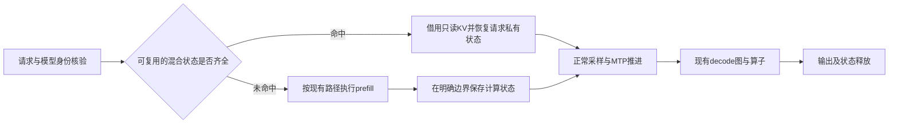

# DeepInfer 性能攻关复盘与下一轮计划

2026-11-13，北京时间。依据保留实现114、强参考117、候选124/125、诊断122/126，以及固定版本源码。本轮未启动模型、未修改模型实现，没有新的吞吐成绩。

**结论：当前已经有原生适配和限定负载的性能优势，但没有完成“同一候选在C4、C8均超过充分优化参考30%，且优势可归因”的目标。最近的主要问题是干预位置选得不准、把局部工作量减少当成性能前景，以及阶段预算反复重开。下一轮只保留一个开发方向：由DeepInfer管理可复用的完整混合模型计算状态，减少重复prefill。该方向尚未通过实现或硬件门槛；不能承诺一定达到30%。**

## 1. 当前成绩和剩余目标

| 固定正式负载 | 强参考117 | 保留DeepInfer114 | 单批优势 | 达到30%所需吞吐 |
|---|---:|---:|---:|---:|
| C4，32请求，1024输入/256输出 | 228.578 token/s | 306.942 token/s | +34.28% | 297.151 token/s |
| C8，32请求，1024输入/256输出 | 415.610 token/s | 501.220 token/s | +20.60% | 540.293 token/s |

C8的8192个输出token需要从16.34411秒降至15.16214秒以内，即至少净省1.18198秒；相对114还需增加7.80%的吞吐，或减少7.23%的整批时间。C4约有0.87937秒余量，不能以损失C4达标为代价。

适用范围是Ascend910C、aarch64、8die、GLM-5.3-Flash W8A8，以及既定顺序、预热和缓存条件。双方固定共有配方包括TP8/EP8、MTP5、目标decode图与draft图、异步、prefix、DSA CP/SP、共享专家重叠、prefill MC2等；继续沿用完整复现清单，不用历史弱参考制造收益。源码基线为 `c4ec8e000d04966574970802ae01db76e57a01b5`。

这些是已有单批结果，不是稳定性统计结论。115与117同配方的C8吞吐相差约11.52%，说明跨批变化不可忽视，尚不能估计可靠的噪声分布。114与117完整文本为C4 30/32、C8 29/32一致，差异的通用质量影响仍未验收。

## 2. 为什么继续原来的方式不容易出结果

### 2.1 适配完成度和新增技术收益被混为一谈

DeepInfer已经拥有请求、C++调度、Worker和生命周期，完整模型计算复用固定SDK实现。这是适配成果。双方又共享大量模型计算、算子和图执行能力，因此仅换框架外壳不会自然多出30%的收益。C4优势大于C8，与较小并发下框架开销占比更高的解释相容，但现有数据不能单独证明这一因果关系。

当前任务已经进入**新增框架机制的性能研发**，不能再把它报告成“还剩几个算子没有适配”。在保持强参考与相同负载的条件下，30%是需要证明的目标，不是必然能达到的结果。

### 2.2 改动实际命中，但没有改善关键路径

| 最近工作 | 实际结果 | 应吸取的教训 |
|---|---|---|
| 124：metadata图化 | 相对114，C4 −11.45%、C8 −9.20% | 减少Python准备或增加图重放，并不必然减少整批时间 |
| 125：后四步MTP缩行 | 相对114，C4 −2.46%、C8 +0.059% | 输入行数变少并不保证设备净成本下降，不能继续扫形状碰运气 |
| 126：图内任务取证 | 得到局部算子成本；完整导出失败，8worker非正常退出，资源已释放 | 取证有用，但不能算性能成果，也不应继续扩大profile工程 |

126选取的8个rank局部目标图约44.2–44.6毫秒；通信任务未与其他已记录计算重叠的区间约8.3–9.9毫秒。该时间不等于能消除的时间，跨rank执行步也未严格配对。目前没有证据支持“再删一个CPU等待”“换一条流”就能补足1.18秒。

### 2.3 每阶段有限时，总项目仍可无限延长

先限时分析、再限时试验、失败后重新开一个新阶段，这样依然可能没有总投入上限。以后恢复、编译、等待、失败和报告都计入同一轮累计预算；阶段结束不能自动领取新预算。负结果只关闭一个明确假设，不能被包装成吞吐突破。

### 2.4 验证需要覆盖会改变结论的风险

本阶段不继续CPU/NPU逐位对比、不做开关排列组合、不扩充通用执行器。保留必要的源码身份、真实机制命中、状态隔离、请求有效性和公平对照。对于新缓存机制，必须检查状态恢复是否正确；这与追求跨硬件逐位一致是不同的问题。

## 3. 优先突破方向：让框架少做一次重复计算

已有122诊断记录中，正式C8段仍执行14次含prefill的调用，合计12,288个prompt token。1024-token输入命中640-token混合前缀后，仍需计算剩余384 token。**这是已观测的重复工作，也是当前最具体的候选切入点；尚不知道消除它能净省多少正式计时。**

这是**待开发设计**，不是当前已存在的路径。DeepInfer负责状态的索引、所有权、恢复和调度；模型和算子继续使用固定实现。缓存的对象是计算状态，不能是生成答案或历史token响应。

需要覆盖四类契约：

1. **身份与位置**：实际token IDs、模型/权重/量化及位置一致；不按请求编号或benchmark档位命中，未命中走原路径。
2. **混合状态**：主注意力KV、压缩indexer、压缩尾部、KDA递推与卷积历史，以及MTP所需状态。只读页可共享，后续会写的状态必须按请求隔离，并遵守完成事件和引用计数。
3. **正常生成入口**：完整prefill端点若被复用，必须提供正常采样和draft所需的有效激活、位置与元数据；不能把计算长度改成1024后跳过这些依赖。
4. **内存与净成本**：快照、可写副本和所保留激活都要列入预算，从原4GiB缓存预算中明确核算，不能偷偷在池外额外clone。收益应扣除保存、恢复、复制和降低可用缓存容量带来的成本。

### 本轮源码审查的实际结论

- 114的 `CachedPrefixLease.acquire` 明确要求对齐、非终点前缀。
- 固定SDK `get_computed_blocks` 将命中上限设为输入长度减1，以便计算logits。该文件SHA-256与114运行时钉住的身份一致。
- 原生异步MTP的 `submitted` 拒绝零输入步；采样读取本次 `execute_model_state`，draft继续使用hidden states、positions与attention metadata。
- 固定SDK已有部分细粒度前缀、Mamba checkpoint和写时复制能力。必须优先审查复用范围；如果只是打开双方均有的能力，应双侧开启，不能声称独有创新。

**因此，“只改缓存长度”的方案现在就否决。完整端点快照的所有权、内存上限和恢复接口仍未闭合，当前不放行NPU测试。** 下一轮仅把上述单一机制推进到可评审的最小实现；如果必须重写模型语义、引入通用快照系统，或无法在预算内闭合，就结束该路线。

通信/计算交叠具有理论空间，但还缺可执行的跨批依赖设计；拆批又可能增加权重读取、通信次数和图缓冲成本。本轮不将它设为自动接替的第二实验分支。图参数、MTP行数和共同开关扫描保持关闭。

### 一个数据口径纠正

旧报告引用prefill主机区间合计6.900秒；本轮对 `native122-host-dependency-analysis.json` 的14条记录直接求和得到7.05442218秒。两者口径尚未统一。本计划只采用一致的14次调用、12,288 token作为工作量证据，不使用任一主机时长估算可取得的性能收益，也不为此重新采样。

## 4. 下一轮的唯一目标与累计预算

**下一轮交付目标：一项可开关、可回退、对照同一源码可归因的混合计算状态复用候选，并对固定C4/C8作采用或否决的明确决定。** 没有形成候选就交付有证据的否决，不再无限添加试验。

本次重新规划设置一次**累计8小时、最多3次模型加载**的上限。计时沿用本轮源码审查已记录的起点——北京时间11月13日05:25:06；本轮审查与规划已经计入，不能从下一次启动重新计时。最晚13:25:06形成路线裁决，不承诺该时刻必达30%。旧C/D阶段预算不恢复。

| ID | 累计截止（北京时间） | 必须交付 | 失败时的动作 |
|---|---|---|---|
| R0 | 本轮完成 | 核实基线、封闭旧分支、固定一个机制及总预算 | 不以规划冒充新性能结果 |
| R1 | 07:25:06（T+2小时） | 最小代码差异；状态/采样/异步/内存契约；固定参考是否已有等价能力；默认关闭且可回退 | 无法闭合则结束该路线，0次模型加载，不延长期限 |
| R2 | 10:25:06（T+5小时） | 最多1次候选加载：在原有工程请求中核验命中与状态，然后同一次加载跑完整正式C4→C8 | 错误或收益不足则否决；不追加形状、参数变体或诊断加载 |
| R3 | 13:25:06（T+8小时） | 只有候选有达标前景才用剩余2次加载：同源码关闭新机制的控制、固定强参考；核算归因、漂移和两档门槛并提交结果 | 若无法稳定解释结果或时间不足，明确未证实，不降级参考、不补开新阶段 |

阶段可以提前结束，不需要等满预算。一次失败加载也计数；所有编译、恢复、资源等待、取证和提交占用同一截止时间。若资源被占，截止时间内可完成独立代码与分析，但不能用等待为理由默默重置预算。

R1进入R2还要求：列出预计删除的真实工作、所有新增复制/同步/容量成本和具体证据。现有主机profile不能证明1.18秒净收益；若无法提出可检验且有合理成本依据的假设，不能仅因代码写完就加载模型。

R2/R3沿用已有完整AISBench负载、输入、预热、顺序与共享配置，不通过缩短计分、单边预热或改变缓存预算过线。端点复用只在其真实适用输入上生效；它在当前温缓存负载上的收益不能外推到冷启动或全新prompt。

同一候选必须两档均达到固定强参考的1.3倍。新控制中参考若更强，必须如实披露并判断原主张是否仍成立；参考更慢不能替代117成为有利分母。新增机制的贡献由同源码开/关对照判断，不能把全部跨框架差值都归到它名下。若接近门槛且漂移足以改变结论，在现有预算内无法消除不确定性，就记“尚未证实”。

正确性验证聚焦这次改变：正常prefill→decode、不同请求独立写状态、命中/未命中、EOS/输出长度和MTP记账；使用实际NPU参考与既有工程用例。新增输出差异需在预算内解释，不能仅以“浮点误差”豁免，也不扩展为无限精度定位。既有通用质量欠项仍单列，不自动验收。

## 5. 执行与汇报约定

- 仍由当前主会话执行；不新增子代理、cron或主会话。同一卡组的计分运行串行，独立源码检查和已有证据解析可并行。
- 一个实现候选，一个功能开关。没有多后端组合、自动搜索或失败后的第二路线。
- 每次阶段汇报只给：相对114净收益、相对117优势、机制实际删除的工作、合法性/失败、累计时间与加载数、下一明确动作。
- 总预算耗尽后不自动追加实现/试验或用新的阶段名清零；保留代码、证据和未完成目标，提出新的投入决定。此规则不修改或完成原生Goal。
- 截至本轮，最新已核实作业是126失败结束并释放；本轮没有连接服务器确认整机空闲，不能说卡全空。Goal active也不代表有NPU任务运行。

## 6. 证据入口

- [本轮核算、源码身份和决策记录](../validation/shared-features-20261111/strategy-replan-20261113.json)
- [114环境、实际参数及计时](../validation/shared-features-20261111/native114.json)
- [117环境、实际参数及计时](../validation/shared-features-20261111/reference117.json)
- [124负结果](../validation/shared-features-20261111/native124-decision.json)
- [125负结果](native125-result-20261113.md)
- [126图内成本、失败与阶段结束](native126-D2-decision-20261113.md)

**本轮完成的是路线裁决和预算约束。独有机制、净收益及完整30%目标均未新增验收结果。**
