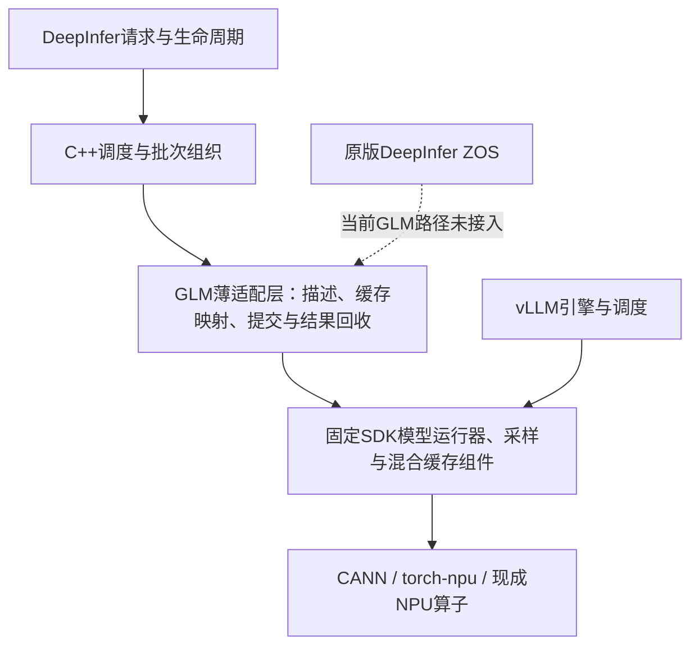

# DeepInfer / GLM-5.3-Flash / 910C：性能路线复盘与下一阶段计划

日期：2026-11-12。依据正式对照96/95、诊断97及固定版本源码。**本轮是复盘与计划修订，没有启动新的NPU测试、没有修改模型计算代码。** 原Goal、失败记录和原期限均保留；30%目标未完成。本文件为本次决策说明，执行状态以[当前状态](../STATUS.zh-CN.md)及本文件的阶段安排（现场作业身份不公开）为准。

## 1. 结论：先证明优势从哪里来，再投入实现

此前安排确有问题：把适配补齐、共有优化、性能诊断和DeepInfer特有机制都当作同一种进展；在没有算清收益空间时，默认继续改和测就能得到30%。这造成不少有价值的修复，却没有形成对目标的确定性推进。

**当前最有证据的直接问题是首批请求中的同步编译；真正值得考察的框架方向是调度到设备执行之间的依赖和批次组织。二者必须分开评价。** 编译准备属于共有工程能力；C++调度器、异步和prefix这些名字本身也不能证明独有优势。只有固定参考没有的实际执行方式、对应成本下降和端到端结果同时成立，才计为本任务要求的特性收益。

不能承诺一定存在30%的可挖空间。下一阶段承诺的是：**6个有效工作小时内做出路线去留判断，最多12个有效工作小时完成一个候选的结果或明确否决。** 这是投入上限和决策点，不是保证达标；它不重置原来已经逾期的计划。资源等待单列实际起止时间，不把等待算成技术进展。

## 2. 当前到底完成到了哪里

| 项目 | 实际证据 | 尚不能说明什么 |
|---|---|---|
| 原生执行 | DeepInfer引擎→C++调度器→Worker→GLM SDK计算；8die、TP8 | 不是所有原版DeepInfer优化都已接入 |
| 正式C4 | 96为230.64934，参考95为210.67674 token/s；领先9.48% | 没达到30% |
| 正式C8 | 96为412.46391，参考95为301.51731 token/s；领先36.80% | 每档仅一批，尚非稳定优势或专有机制归因 |
| 工程结果 | 64个正式请求全部成功，8个模型Worker exit0；56/64完整文本相同 | 8条分叉的任务质量影响未验收；不是通用质量通过 |
| 合批改动 | 15次多个partial片段同批，批次最大1792 token | 固定vLLM也有checkpoint后继续装入其他请求的逻辑，不能称其没有该算法 |
| 诊断97 | 72请求完成、8Worker exit0；rank0完整时间线 | manager因7个非主rank诊断文件缺失而失败，不能把整轮记成通过 |

96/95为同一物理卡组；97换过卡组且有插桩，**不能把97的吞吐除以95，也不能拼接不同版本各自最好的C4/C8。** 97结束及资源释放已有证据；这不证明当前整个服务器空闲。

实测源码为`8cd3bfc7ec4df7e8edc4b41c44e26d5208f35882`，扩展SHA-256为`fe6e265ccd8b1c85f4de1b61602dbb6e0c4647153e156c54c0c59b466641da61`。正式环境是910C/aarch64、固定vLLM-Ascend 0.30.0rc2镜像与W8A8权重；TP8/DP1/PP1/EP8，context2048、最多8请求、批次1792 token、每rank4GiB缓存、MTP5。每档32请求、1024输入/256输出、2个不计分预热；适用的共有图、异步、prefix、EP/overlap等保持匹配。完整环境、argv及证据见[96/95报告](performance-decision-20261112.md)。

## 3. 当前架构为什么没有自动带来大幅优势

底层大量工作相同，DeepInfer的实际不同主要在上层调度和接入方式。因此性能机会应从“少做了哪些工作、减少了哪些必须等待的依赖、改变了什么有效批次”来证明。仅把Python调度换成C++，无法预先推出总推理快30%。

当前并非完全串行：96的机制记录中，590次在上一批输出回收前提交下一批，其中586次观察到当前NPU仍pending。这说明已有重叠，**不代表重叠时间比例，也不允许把已经实现的异步再次当成待开发的新特性。** 原版ZOS仍被GLM适配层明确拒绝；若要接入，必须处理MTP接受长度、位置、KDA递推状态及请求退出边界，不能只改环境开关。

## 4. 最新证据怎样改变优先级

97的C4首批窗口约8.918秒，rank0有两个同步Triton编译调用：

| 内核 | 主机编译耗时 | 所在批次token片段 |
|---|---:|---|
| `_compute_slot_mapping_fused_groups_adaptive_kernel` | 2.270秒 | 384、128 |
| `_glm5_next_lightning_indexer_score_kernel` | 2.865秒 | 256、640、640 |

合计5.135秒，位于两个最慢的执行调用内部。已取得相应编译缓存文件和时间窗口，确认不是只根据日志警告推测编译。**具体哪个specialization键触发新编译、是否能安全复用或在启动时准备，仍需核定。** 不重新证明“这里发生过编译”。

同一窗口的输出回收约81ms、准备约13ms、提交约5ms。它们是rank0主机区间，包含嵌套，不能相加为设备成本，也不能外推整个作业；但已不支持“首批数秒主要耗在Python输出包装”这个判断。

还有一个必须纳入公平性的事实：参考95的C4也有约5.84秒的首token等待，首批约8.31秒结束。**参考是否同样受到首次编译影响未知，必须核查，不能只给DeepInfer预编译再沿用旧参考。** C4先跑、C8后跑，也可能受到不同缓存准备程度影响，现有证据不足以直接确定影响量。

96的C4耗时35.517秒，按参考95计算，30%目标要求≤29.911秒，需减少5.606秒。仅作为算术示例，即使把97测得的5.135秒全部从96扣掉、且参考完全不变，也只得到约27.98%优势。这是跨轮假设，**不是性能预测或新的测试结果**；它说明发现编译不能等同于完成30%目标。

## 5. 下一阶段只交付四件事

| 顺序 | 工作与产物 | 投入预算 | 去留条件 |
|---|---|---|---|
| A | 核定两个编译签名；做基于启动配置的有限形状准备或必要的特化修正；固定同样的双侧准备政策 | 0–2小时 | 不使用评测答案或按评测prompt预热；不扫shape笛卡尔积。两小时不能给出最小方案，则记录具体缺口，停止扩展 |
| B | 得到同卡组、相同准备政策的C4/C8对照；分列启动准备时间、首批和后续请求；修正后的性能预算表 | 2–4小时 | 原32请求全保留；共同能力同样可用。改变参考准备政策或卡组必须重建对应参考。时间线缺口只采必要区间 |
| C | 对一个DeepInfer实际差异机制做去留决定；优先检查当前SDK接入是否仍有可消除的调度→设备等待或低效批次边界 | 4–6小时 | 先指出固定vLLM的对应行为、当前未重叠成本及足够的收益上限。已有两批异步不重复开发；无足够空间就否决，不把ZOS名字当收益 |
| D | 仅当C成立，实现一个可关闭候选并完成归因、正式验证与发布 | 最多追加6小时；累计≤12小时 | 同源码做候选关闭/开启的消融，再与匹配参考比较；状态或质量门禁失败则不接受。没有机制命中或时间下降即停止该分支 |

**主候选最多一个。** A是准备政策/接入问题的处理，不包装成独有算法；C才决定是否值得投入真正的执行机制改造。若A已经让数字超过30%，仍需回答差异来自什么，不能省略归因。若C显示当前架构和固定负载没有足够空间，交付“最佳结果、上限、需要的架构改动和工作量”，而非自动开启下一轮参数搜索。

复核只解决实际影响结论的不确定性。第一次对照有明确大幅失败时不增加重复；靠近30%或C4/C8顺序影响判断时，才做必要的反序/重复对照。每次模型加载尽量完成工程检查、C4、C8和所需短诊断；不为每个小假设独立重启完整模型。候选开关能在同一进程安全切换才复用驻留，否则分别启动，不能留下状态污染。

## 6. 保留哪些检查，停止哪些扩展

- 保留：代码/依赖身份、完整请求数、真实输出长度、现有工程用例、受改动影响的状态/退出边界、错误和资源释放。模型数学计算保持现有参考语义。
- 对已有8条文本分叉保留清单；新改动若引入新的异常分叉，只针对受影响请求核查。自由生成逐字一致和CPU/NPU逐位相等都不新增为总验收门槛，未知质量也不冒充通过。
- 停止：无新证据地改写KDA/DSA/FFN、增加MTP参数组合、扫描全部CANN版本、扩大上下文和拓扑矩阵、建设通用运行器、为补齐7份诊断再跑整轮模型。
- 97诊断文件丢失的原因是非主Worker用`os._exit(0)`跳过`atexit`。下一次需要该追踪时，在真实drain/关闭边界保存，做小型退出路径验证即可；保留97原失败状态。
- 仍由本主会话推进；不启动子代理或新主会话，不恢复Hermes推进cron。设备作业按既有锁串行；离线分析、准备补丁和整理证据可在加载等待期间推进，不干扰计分。

## 7. 什么才算这次有成果

完成态必须同时具备：**一个固定候选、两个并发档的可比结果、真正的执行差异、该差异的因果证据、明确的工程与质量适用范围、可复现代码和命令。** C8单批过线、局部kernel变快、日志采集成功和报告发布分别记阶段成果，不冒充完整Goal达成。

在第6小时或第12小时的决策点，汇报只能是三种之一：①有足够机制证据并进入限定实现；②候选验证完成且说明达标/未达标；③路线被证据否决并列出原因。不能只写“继续优化”。如果资源或真实故障阻塞，则列实际等待时间、失败原因和可恢复条件，保持未完成。

## 证据

- [96正式核验](../validation/shared-features-20261111/native96-candidate.json)与[参考95核验](../validation/shared-features-20261111/reference95.json)。
- [两侧客户端请求耗时](../validation/shared-features-20261111/matched96-95-request-cost.json)。
- [97有限诊断与失败范围](../validation/shared-features-20261111/native97-diagnostic.json)、[首批时间线分析](../validation/shared-features-20261111/native97-first-wave-analysis.json)。
- [固定vLLM checkpoint能力审计](../validation/shared-features-20261111/reference95-prefill-capability-audit.json)。
- 编译缓存审计已正常完成，未再启动模型；脱敏摘要见[编译缓存审计](../validation/shared-features-20261111/native97-compile-cache-audit.json)。
