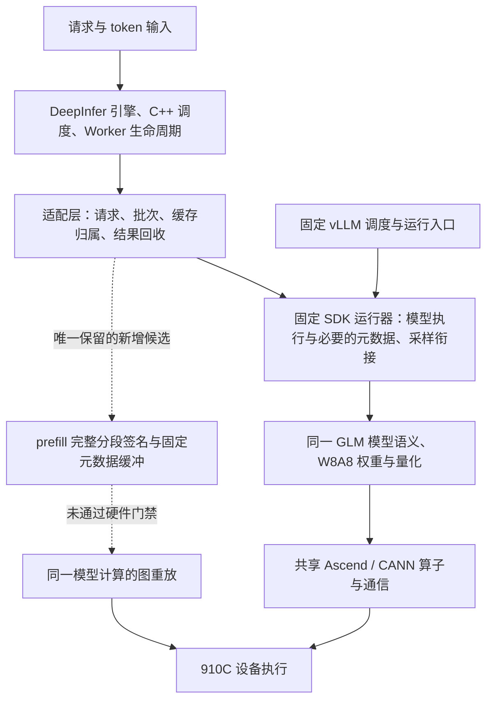

# DeepInfer 性能路线复盘与下一阶段执行决定

更新：2026-11-12，北京时间。本文是依据已采集结果作出的路线决定，不是新的性能通过报告。

## 1. 结论先说

**当前已经有原生 DeepInfer 驱动完整模型、执行固定 AISBench 负载的结果；但“双方共同优化对齐后，同一 DeepInfer 候选在 C4、C8 都领先至少 30%，且收益来自新增机制”的目标没有完成。**

推进慢的主要问题，是把共享能力接入、缺陷修复、机制探索和正式验收混在了一起。补齐 MTP、图执行、前缀缓存和通信配置，确实能消除落后，却不能自动产生 DeepInfer 独有优势。此前一些实验在可消除成本、覆盖负载和停止条件尚不充分时就加载了完整模型；又发生入口配置遗漏，浪费了验证机会。这部分属于实现与组织问题。

下一阶段收缩为：**补齐一组匹配基线 → 只保留一个有成本依据的 prefill 执行候选 → 一次有界工程验证 → 有机制收益才正式消融。** 不继续扩大算子、精度或参数组合。

## 2. 当前数据能说明什么

固定负载每档 32 请求，1024 输入 / 256 输出，C4 与 C8；两档顺序及缓存生命周期保持既有约定。下列数字只适用于各自声明的配置。

| 证据组 | C4 输出 token/s | C8 输出 token/s | 能下的结论 |
|---|---:|---:|---|
| 旧共同配置参考 104 | 220.76133 | 381.40255 | 已完成固定负载测试 |
| 同组 DeepInfer 102 | 240.75870 | 456.64960 | 本批相对参考 +9.06% / +19.73%，双档未达 30% |
| 新共同 MC2 配置参考 111 | 215.04058 | 374.02446 | 参考已完成；原生配对结果尚缺 |
| 原生 112 | 无 | 无 | 权重加载前失败，不能算模型或性能实验成功 |
| 修复后的原生 113 | 无 | 无 | 两次均在占卡前受阻，0 模型加载、0 AIS 结果 |

不能用 102 的原生成绩除以 111 的新参考成绩：共同执行配置已经改变。也不能把不同候选的最好 C4、C8 拼成一次验收。

新参考 111 对应的 30% 门槛为 **C4 279.55276、C8 486.23180 token/s**。每档输出 8192 token，等价于整批耗时分别不超过 **29.30395 秒、16.84793 秒**。还差多少时间，必须等匹配的原生 113 完成后计算。

旧配置下，102 距目标分别还差 5.481 秒、1.417 秒，C4 更紧。旧采样可用于提出假设，不能把旧配置的空隙直接当成新 MC2 配置的可获得收益。

111 从启动到释放约 15 分 54 秒，其中就绪前约 13 分 32 秒。因此完整模型加载很贵，正式负载本身较短。一次无必要的加载，其成本远高于本地读取已有证据。这个实测时长也不能保证原生或新图捕获耗时相同。

## 3. 为什么换成 DeepInfer 后，没有自然出现 30%

当前架构的大致分工如下：

DeepInfer 确实掌握目标引擎的请求与调度入口，但大量实际计算及运行器工作仍复用固定 SDK。两侧同样的矩阵乘、注意力、专家计算和通信，并不会因入口名称改变而消失。框架层能争取的空间主要是：减少无用工作、缩短关键路径上的主机提交、正确安排批次与依赖，而不是重新寻找更接近 CPU 的算术结果。

所以，新增候选必须回答“每批究竟少了哪笔时间”。只证明函数少调用、某个等待很长或某个局部算子更快，均不足以证明端到端能快 30%。

## 4. 本次复盘确定停止的方向

| 方向 | 停止或限制的理由 |
|---|---|
| CPU/NPU 逐位精度与低精度组合扩展 | 当前目标不是重新实现模型数学；保留必要质量和状态检查，不以位相等阻塞性能路线 |
| 把共享优化称为独有优势 | MTP、decode 图、prefix、MC2 等必须双方对齐；恢复共有能力只算基线修复 |
| 继续单独调 prefix 期待双档达标 | 已有开关对照显示 C8 改善而 C4 未改善，不能解释两个档位的剩余差额 |
| 大改接受数等待和 decode 同步 | 旧采样中等待主要与设备计算重叠，直接删除可见等待不等于节省同等总时间 |
| 不变条件下反复尝试占卡 | 113 已两次在认领前失败；需要连续设备窗口，不再以短暂空闲反复碰运气 |
| 新建恢复器、cron 或代理体系 | 不解除本阶段的性能门槛；保持本主会话及既有资源协议 |
| 单边额外预热、删首批、改输入输出长度 | 会改变比较口径，不用于凑出目标比例 |

旧 AllToAllV 路径的完整图候选已因 CPU 路由 split 依赖被否决。新 MC2 参考实测成立，改变了这一具体前提；它只允许重新审查一个候选，不等于完整 prefill 图已经受支持。

## 5. 唯一保留的突破口：prefill 的提交与重放

假设是：重复出现的 prefill 分段，在保持模型公式、量化、算子、缓存和请求状态不变的前提下，可以固定输入和元数据地址，用图重放代替大量主机逐算子提交，减少设备等待提交的时间。

它在本次固定参考中尚无已验证的等效执行路径；通用图机制本身不是 DeepInfer 的专利，也不声称其他框架不能移植。要计作目标要求的新增收益，必须证明参考没有通过已有适用选项走同一路径，并提供本候选开/关消融。

本轮已保存一个默认关闭的隔离草稿，源码 `a907c5b6644b076b13777e4a8cdda635b1c47b0e`。实际运行基线仍是修复入口后的 `c4ec8e000d04966574970802ae01db76e57a01b5`，二者不能混称“已测版本”。草稿未部署到设备，也未合入公开运行默认路径。

草稿目前覆盖：有序 CPU 描述参与签名、设备元数据内容不读回 CPU、固定元数据副本、每个请求一次重放、输出副本保护异步采样/MTP、最多 16 个签名、捕获失败后不重新执行同一有状态请求。未知元数据和跨流元数据生产器回退原执行路径。

已通过 **16 项元数据/多 rank 决策检查与 3 个 Python 文件语法检查**，没有导入模型、没有做 CPU 模型仿真或 NPU 执行。检查发现并补上“clone 改变 stride 必须拒绝”和“不能提前复制尚由另一条流生产的元数据”两个边界。这些是准备工作，不是性能突破。

**源码层新增关闭了以下缺口，但未由硬件证明：**

1. 从已结束的参考 111 只读提取 `ForwardContext` 源码，结合固定 Ascend 扩展逐字段审查，共 37 个字段都有明确处理。补上遗漏的 `slot_mapping`、padding、MoE 层计数和附加元数据；出现未审查字段时全体回退。
2. 每次候选准备核对参数、buffer、KV/state、合并卷积权重的地址与布局；只读元数据，不搬运模型。懒初始化尚未完成时走正常 eager 请求，不额外做未计分预热；已有图之后地址变化则报错，不能继续读旧地址。
3. 复用现有 8rank Gloo 控制组，交换捕获/命中/回退及图创建序号。局部不支持、命中图不一致或捕获/重放混合时，全体 eager；任一 rank 捕获失败，其他 rank 不重放，也不重做同一有状态请求。

这些决定逻辑已做元数据检查，**没有在客户端模拟模型或运行八 rank 模型**。真实 collective、图捕获、输出/状态与实际命中率仍未验证。控制交换和地址检查会新增开销，已在草稿中计数，必须计入净收益；不能宣称它们免费。

**目前不放行 NPU 的剩余前提是匹配原生 MC2 基线和成本判定。** 113 尚未启动模型，原卡组在本轮现场核验中仍被其他进程使用。之后即使满足基线与成本门槛，也只能进入一次有界工程验证，不能跳过状态、通信和输出验证直接计分。

捕获“记录工作而非立即执行”的 API 语义有官方依据，但不能替代当前模型、算子、流与状态组合的硬件验收。[CANN 捕获接口说明](https://www.hiascend.com/doc_center/source/zh/CANNCommunityEdition/910/API/runtimeapi/aclcppdevg_03_1782.html)

## 6. 下一阶段只执行这条顺序

| 步骤 | 具体产物 | 继续条件与停止条件 |
|---|---|---|
| RP7a：补齐匹配原生基线 | 使用 c4ec8e0，在参考 111 同卡组完成工程请求及 C4/C8；核对实际 MC2、HCCL、退出与原始时间戳 | 先有连续约 30 分钟设备窗口并按既有协议认领；参考 111 复用。无窗口即资源阻塞，不能把排队写成运行 |
| RP7b：决定候选去留 | 算出新基线达到目标所需净缩短时间，复核已落实的源码约束，明确可消除成本范围 | 没有足够空间，或需要扩大后端重写才能闭合，则否决本分支。未证实不写成“预计必达” |
| RP8：一次有界工程检查 | 同一加载内覆盖新请求、状态续接、槽位复用、同总 token 不同分段；记录 8rank capture/replay/fallback | 无错误且真实命中才继续。状态异常、通信失配或新开销吞掉收益即停止；最多一次有明确根因的修复，受原预算限制 |
| RP9：必要正式消融与验收 | 同组同共享配置的候选开/关，与固定参考比较；源码、参数、原始计时、输出边界完整入仓 | 同一候选两档均达到 ≥30%，质量边界成立，收益不能由波动解释，才算 Goal 完成 |

可独立的已有日志分析、代码准备和结果归档流水进行；同一组设备上的计分负载必须互斥，不能为了“并行”引入争用。不会新增子代理或恢复 Hermes 推进 cron。

## 7. 预算、责任与未完成事项

原路线预算起点仍是北京时间 **11 月 12 日 14:40:39**；路线决定检查点 **20:40**，单候选原累计预算最多 **12 小时**。本报告不重开计时，也不是新的两天或今晚达标承诺。

此前 20:00 原型门禁未完成，应记未达成：共同 MC2 配置补齐和入口覆盖失败消耗了时间，当时完整候选的必要源代码合同也尚未闭合。本轮已补上 37 字段、地址与 rank 决策约束，但不追认 20:00 门禁按时完成。入口覆盖属于我的修复遗漏；外部设备冲突单独记为资源阻塞，不能用它掩盖实现问题。

截至本轮，路线决定是：**保留这一个候选及已落实的源码约束，暂不放行 NPU；先恢复基线。如果剩余预算内不能闭合成本门禁或硬件工程失败，停止扩写原型并报告未证实。** 不能不断把“还有一个可能性”转换成下一批模型加载。

剩余工作量按验收产物计，是 **1 份匹配基线、1 次候选去留决定、至多 1 条候选的工程验证和必要消融、最终质量/波动/复现证据**；不是几十个算子逐一重做精度。候选可能被否决，30% 在当前约束下也可能无法达到。只有基线和机制证据支持后，才能给可信的完成时间。

## 8. 版本与证据入口

- [旧配置三路完整结果](prefix-budget-102-103-104-20261112.md)
- [新共同 MC2 参考 111：参数、环境与结果](shared-prefill-mc2-reference111-20261112.md)
- [112 失败、入口修复与验证边界](native112-entry-buffer-failure-20261112.md)
- [本轮草稿元数据检查](../validation/shared-features-20261111/prefill-signature-metadata-check.json)
- 执行顺序与停止条件见本文第 6–7 节；未部署的草稿见[补丁](../validation/shared-features-20261111/native-prefill-signature-draft.patch)。

已公开运行源码修复为 c4ec8e0，入口修复发布回执 a2217c8 已验证远端；该修复的 NPU 验收仍缺。后续发布的源码草稿仅为未应用补丁，不改变运行默认路径。图草稿默认关闭、隔离保存且未硬件放行。当前无本任务存活 NPU 作业，113 最后一次失败发生于认领之前，不能把 Goal=active 当成设备正在计算。
