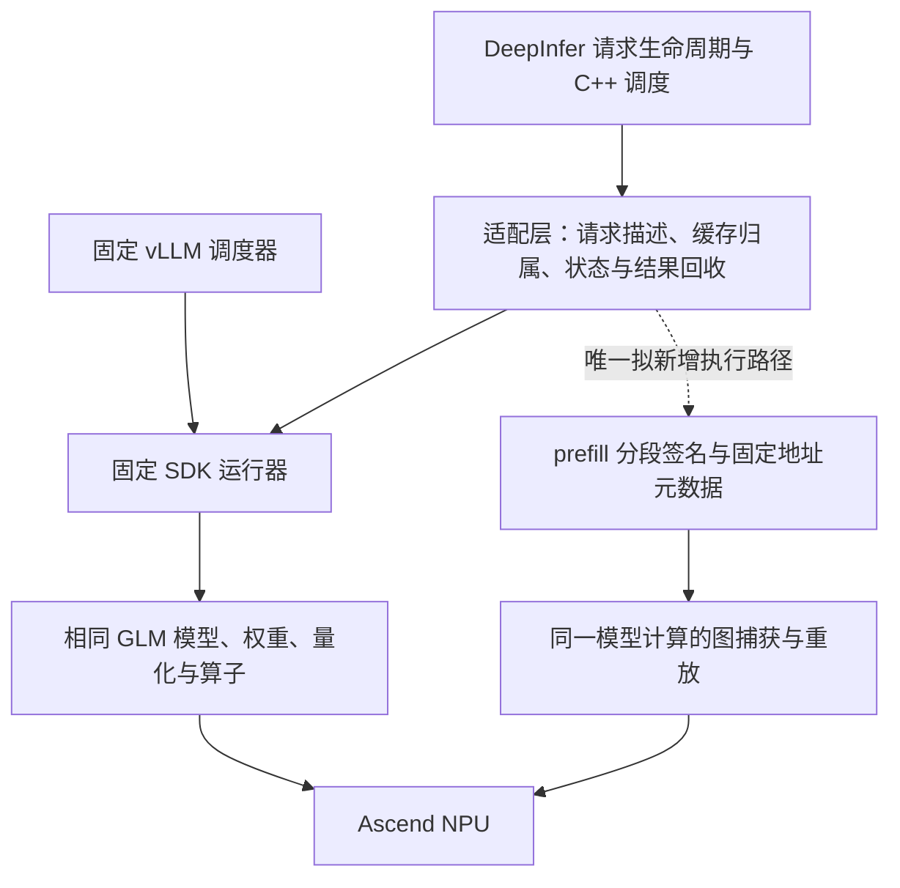

# DeepInfer：从参数试验转向一个有界的 prefill 执行候选

日期：2026-11-12。本文是 RP6 源码审查与下一阶段决定，不是新性能结果。保持原目标：在 Ascend 910C / aarch64 / 8 die，同一候选的 AISBench C4、C8 均领先固定 vLLM 0.30.0rc2 参考至少 30%，共有适用优化对齐，并有新增执行机制的消融证据。

## 1. 当前结论

**此前主要是在补齐共享计算后端的接入契约、修复额外开销，尚未形成足以支持双档 30% 的新执行路径。继续调 prefix、合批和图模式开关，没有足够依据。**

当前保留 `227d26b` 为唯一候选基线。下一项只做“按完整请求分段签名重放 prefill 图”的有界原型：复用相同模型与算子，由 DeepInfer 适配层保证元数据地址、状态更新和执行次数正确。不改模型公式，不增加低精度组合，不重开 CPU/NPU 逐位精度搜索。

本轮放行范围是**一个实现原型及其必要门禁**，不是直接放行正式 NPU 计分，更不是证明它可以达到 30%。完整 prefill 图对当前 KDA、SFA、MoE、通信组合的捕获支持仍未经过硬件验证。如果实现门禁不能在预算内闭合，停止这个分支，不转成图模式参数网格。

## 2. 已有结果与真正的差额

同卡组的 102/103/104 已全部结束并释放本任务资源；以下为各一批正式结果，尚无重复批次的波动范围。每档每侧 32 请求、1024 输入 / 256 输出，C4→C8，缓存跨档保留；两次预热不计分。

| 项目 | C4 | C8 |
|---|---:|---:|
| 固定参考 104 输出 token/s | 220.76133 | 381.40255 |
| DeepInfer 102，prefix 修复开启 | 240.75870 | 456.64960 |
| 当前相对参考 | +9.06% | +19.73% |
| 30% 对应输出 token/s | 286.98972 | 495.82331 |
| 当前整批仍需缩短 | 5.481 秒 | 1.417 秒 |
| 占当前整批时间 | 16.11% | 7.90% |

同源关闭修复的 103 为 245.94223 / 413.88963 token/s。开启后 C4 -2.11%、C8 +10.33%，不能各取最好档位拼成一个候选。修复让 C8 少重算 4480 个 prompt token、少 10 次 prefill（计数含两次预热），但 C4 没有相应计算量减少。该修复属于共有能力接入，不能算独有算法。

102 与参考完整文本相同 C4 为 23/32、C8 为 26/32。请求成功不等于通用质量通过；这些分叉的任务质量影响仍未验证。本计划不以降低质量或减少输出长度换吞吐。

[完整参数、环境和原始计时核验](prefix-budget-102-103-104-20261112.md)。不同卡组的旧 98/99 数字不混入本表。

## 3. 为什么此前没有累积出足够优势

1. **把接入完成与新增执行能力混在一起。** 缓存、MTP、异步、decode 图、EP、FlashComm 等参考也有；补齐这些只能先达到公平起点，不能自动产生 30% 优势。
2. **先运行后找理由。** 过去一些候选没有先写清可省多少端到端时间、成本是否在关键路径上，就进入完整模型运行；一次成绩变化不足以证明机制。
3. **忽略了运行器复用的边界。** 现在由 DeepInfer 管请求和调度，但大量模型执行、缓存、采样仍经过固定 SDK 运行器。相同权重和相同算子的大部分计算成本没有改变，不能仅凭换了框架入口预期大幅提速。
4. **局部改善没有同时覆盖两个档位。** prefix 对热缓存的 C8 有帮助，C4 仍需约 5.5 秒；当前 C4 才是更紧的约束。
5. **没有充分使用否决结果。** 此后明确关闭已被证据否定的方向，失败、未验证和已验证均单独保留，不再以新轮次编号重做同一件事。

必要的有限质量检查、资源归属和退出回收继续保留。取消的是不改变实现决策的重复检查，不是取消验收。

## 4. 架构上应改哪里

候选改变的是**同一段模型计算怎样提交到设备**：将重复的主机逐算子发射变成一次图重放。不是重写 KDA/FFN/DSA，也不是在 DeepInfer 下面启动 vLLM 服务接管请求。

“新增”只相对于本次固定参考实现及实际配置而言，不声称其他框架永远不能实现同类技术。通用 ACLGraphWrapper 已在参考里存在；真正需要新增的是 prefill 的完整状态与元数据契约，必须证明候选实际命中这一新增路径。

## 5. 本轮源码审查解决了什么

从已停止的正式参考 104 容器只读提取八个文件；没有启动模型或服务。SHA-256 与来源保存在证据 manifest。现有 runner/platform/GDN 源码此前已对已停止的正式参考 99 做过身份核验。

| 已核实的事实 | 对方案的直接约束 |
|---|---|
| GLM KDA 选择 AscendGDNHostMetadataBackend；其 builder 继承 UNIFORM_BATCH 声明 | 现有 decode 捕获不能自动证明 prefill 捕获成立；该枚举也不等于任意等长 prefill 已受支持 |
| KDA chunk 调用携带 CPU `cu_seqlens`、chunk indices；图执行中的这些常量不会随新 Python 对象自动变化 | 不能只用总 token 数作键。例如 `[640,384]` 与 `[512,512]` 都是 1024，但不能复用同一常量分段 |
| prefill 读取指定 recurrent state、执行卷积与 KDA，然后写回选中状态行 | 必须保证首次捕获/预热不污染真实请求，重放每步只提交一次状态更新 |
| GDN 现有固定地址 padding 主要在 `num_prefills == 0` 的分支；prefill state flags 等仍按批生成 | 需要专门固定 prefill 元数据 tensor 的存储并更新其内容，仅保留旧 Python 对象不够 |
| 当前 DSA-CP builder 已有部分持久 query/key-length 缓冲；SFA 的 slot、position、block-table 等仍各有生命周期 | 复用已有缓冲，但完整清单及先后顺序必须闭合，不能把“部分稳定”当“全部稳定” |
| 通用 ACLGraphWrapper 明确不负责持久输入缓冲和每次内容复制 | 包一层 wrapper 不能解决状态/元数据问题；只有输入地址检查也不覆盖 forward context 里的 tensor |
| 固定平台 PIECEWISE 分支关闭 npugraph_ex/static/super | 不把 PIECEWISE 当作可免费叠加的共同开关；本候选不靠关闭另一侧优化制造差距 |

源码关键位置：`glm_kda.py:get_attn_backend/_forward`，`gdn_attn_builder.py:_build_non_spec_chunked_prefill_metadata/build`，`glm5next/ops/kda.py:chunk_kda`，`ops/kda.py:run_chunk_kda`，`glm5next/ops/causal_conv1d.py`，`sfa_cp.py:AscendSFADSACPMetadataBuilder`，`acl_graph.py:ACLGraphWrapper`。这是文件与接口审查，不是所有底层 kernel 的图兼容性证明。

## 6. 工作量覆盖与收益判断

复用 101 的历史诊断，不再启动纯观测模型。它来自不同卡组且早于 prefix 修复，仅用于筛选方向。

| 101 元数据统计 | C4 | C8 |
|---|---:|---:|
| prefill 批次 | 27 | 20 |
| 所有请求 query 等长的批次 | 11 | 3 |
| 按请求顺序的 query/结束位置/是否有状态签名数 | 8 | 7 |
| 每种签名第一次之后的出现次数 | 19 | 13 |

这支持两项决定：**不把“只做等长 prefill”作为唯一交付路线；也不为所有理论形状预先编译。** 若进入实现，按最终实际 attention 元数据的完整签名建立有上限的重放缓存；原生输入顺序统计不能代替后端重排后的真实签名。

102 只留下总 token 直方图，不能由此推断完整分段签名或真实图命中率。101 中重复签名对应的主机时间也包含有效 NPU 计算，不能全算可省成本。

102 的两档含预热 prefill 次数分别为 40、15。即便乐观地将这些全部视为计分且全部命中，达到目标仍要求平均每次净省至少 **137.03ms / 94.49ms**。真实要求更高，因为预热不计分、首次捕获和元数据复制还会增加成本。此数是收益筛选门槛，不是预测。

101 的 5 个 prefill 插桩窗口中，可见设备非活动时间中位数约 239.87ms，足以保留这个假设；但插桩、不同卡组、仅 rank0、等待其他 rank 等因素都未排除，不能承诺这些空隙都能消掉。相比之下，接受数等待 138.04ms 中约 129.75ms 与设备工作重叠，不支持大改 decode 同步作为当前主攻方向。

## 7. 下一阶段只有一个候选

候选名称：**DeepInfer prefill 完整分段签名重放**。基线为 `227d26b`，新的修改使用隔离 worktree。保留现有 decode/MTP 图及共有配置，保留 eager 回退。最多一个实现候选，不增加第二个调度系统。

### RP7：实现门禁，至多 90 分钟

原预算不重开；最晚北京时间 20:00 给出“可进入一次硬件工程检查”或“否决”。提前完成就提前进入下一步。

- 在 `sdk_runtime.py` 的 Worker 初始化完成后安装独立 prefill 适配器；介入点是已有 `_model_forward` 边界，不接管 scheduler/cache manager。
- 显式列出图键中的 CPU 常量和每次必须复制的 tensor：有序 query 分段、请求数、prefill/初始状态分支、padding、TP/CP 布局等不能丢失。未知元数据字段或不支持的组合直接 eager，不猜测。
- 复用稳定权重和持久缓存基址；固定 token/position、block/slot/state 索引、初始状态 flag、SFA 元数据的地址。保持现有流依赖，禁止在上一次读取完成前覆盖元数据。
- 首次捕获必须使用独立占用的临时 cache/state 槽或等价的可证明隔离；不能靠“捕获大概不执行”推断安全，也不能快照整个权重或 KV 池。正式请求只执行一次有效更新。
- 不预枚举 benchmark 里的签名，不改变负载来提高命中；缓存最多 16 个完整签名，超过容量 eager，初次捕获成本如实计入相应请求，不增加单边未计分预热。
- 固定地址、引用归属、异步输出消费、MTP 衔接、MoE/通信捕获要求只要有一项需大改后端且无法在预算内闭合，即否决本原型。源码/API 准备通过不等于图可执行。

本阶段产物：一个可审查补丁、完整状态字段清单、真实开关与回退、元数据门禁检查。客户端检查仅为脚本/接口/状态记账，不跑模型仿真。

### RP8：一次有界硬件工程检查，过门禁才运行

复用现有资源锁、manager 和退出回收路径；先核实空闲及归属，再占同一可比较卡组。不能抢卡，也不能用新框架重写执行器。设备等待不触发重复模型加载。

一份加载中完成必要工程请求：新请求、前缀续接、槽位复用，以及总 token 数相同但分段不同的请求。核验 8 rank 实际 capture/replay、状态写入次数、无非法访问、无 stale metadata、MTP 正常、请求输出和资源释放。比较同一 NPU 计算后端的 eager 与候选；不以 CPU/NPU 逐位一致为门槛，也不接受因状态串用造成的“快”。

任何捕获失败、状态/输出异常或新增同步吞掉预期空间，保留失败证据后停止本分支；不退回全模型精度探索，不连续换图模式。一次必要的确定性实现修复可以在原预算内做，但不能把不同机制混进候选。

### RP9：只有工程与机制成立才正式计分

使用同组、同镜像、同源基线、同共有参数与固定 AISBench 负载，完成候选开/关和固定参考的必要对照。初次图构建、fallback、命中比例、内存和错误计入证据，不挑最好子批次。若设备组改变，重新建立该组参考，不能沿用 104 的比例。

只有同一候选 C4、C8 都超过 30%，机制实际命中，输出/质量边界满足，且收益大于合理解释的波动，才可声明目标完成。若只改善一档或仍不足，则报告实际取舍并否决“该项足以完成目标”；不以日志、计划或一次局部加速代替交付。

## 8. 时间、退出条件和交付

- 原路线预算起点仍为北京时间 **2026-11-12 14:40:39**；**20:40** 给路线去留结论，单候选累计 **12 小时**上限不变。外部阻塞单列，不能借新计划重置投入。
- 这不是新的“今晚必达 30%”承诺。当前证据不能支持具体达标日期。
- 本轮无新 NPU 作业、无新模型源码、无新增性能成绩；所有本任务已有作业均已完成释放，不由此断言整机空闲。
- 原 Goal 保持未完成；不新建主会话/子代理、不恢复 Hermes 推进 cron。
- 下一轮必须交补丁与门禁结论，或明确的技术否决；不能只报“已派发”“进程还在”“继续检查”。

## 9. 证据与复算

- [当前三路性能报告](prefix-budget-102-103-104-20261112.md)
- [本轮元数据覆盖与收益门槛](../validation/shared-features-20261111/prefill-graph-feasibility-screen.json)
- [正式参考 104 源码身份清单](../validation/shared-features-20261111/prefill-source104-manifest.json)
- [补充算子与 DSA-CP 源码身份清单](../validation/shared-features-20261111/prefill-source104-ops-manifest.json)
- [101 主机批次证据](../validation/shared-features-20261111/native101-host-dependency-analysis.json)
- [101 设备窗口证据](../validation/shared-features-20261111/native101-device-analysis.json)
- 覆盖统计的输入哈希、签名分组与限制保存在上述 JSON；计分条件沿用三路报告。该脚本只在开发工作区读取已保存的 JSON，未运行模型。

统计脚本首次执行因读取参考结果时使用了错误字段名退出，改为已存在的 `metrics` 后复算成功；未启动设备工作，未修改原始结果。
