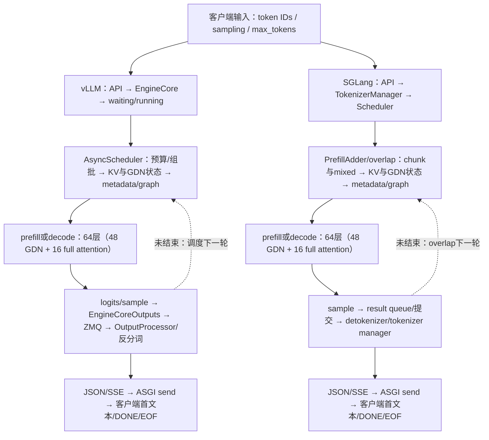

# 一个请求从输入到全部解码结束：vLLM Ascend / SGLang Ascend 分解对比

**这是GitHub直接可读的流程分解入口。** [新版中文详解HTML](request-flow/report.html) · [1344条正式请求CSV](request-flow/formal-requests.csv) · [结构化证据](request-flow/data.json)。HTML已重写为11章阅读报告；图和调度字段转换为中文，原始JSON不直接充当正文。

交互页可按输入长度、并发、重复轮次和请求序号比较两框架；也可选诊断RID，查看它实际经历的prefill/mixed/decode步、chunk与graph。下载目录后打开HTML，或从本地HTTP服务访问；GitHub源码页不执行HTML。

正式矩阵：aarch64、8×910B1分两组TP4、同实际Qwen27 W8A8 checkpoint、7长度×4并发×2框架×N3=168波/1344请求，输出1024。vLLM CANN9.2、SGLang CANN9.0且卡组固定；冻结组合比较，不作纯框架归因。

## 1. 请求完整流程与每轮循环

首文本之前包含接纳/排队、prompt处理、采样和输出路径；首文本之后到EOF也可能包含mixed prefill干扰、输出处理和网络，并非纯decode kernel时间。EOF后仍可能有零输出尾步。

## 2. 逐组件：实现、原理与实际耗时覆盖

|阶段|vLLM组件/流程|SGLang组件/流程|原理及时间证据|
|---|---|---|---|
|请求输入与API|OpenAIServingCompletion → AsyncLLM输入处理|OpenAIServingCompletion → TokenizerManager规范化|请求参数、ID、采样配置进入服务；文本输入才需要tokenizer，本矩阵直接传token IDs。 输入IDs可比；正式计时不含文本分词。API内部独占耗时未逐请求采集。|
|入队与接纳|EngineCore请求 → waiting/running队列 → Scheduler.schedule|TokenizerManager → Scheduler等待队列 → PrefillAdder|等待token预算、KV容量与GDN状态槽；并发请求不会自动同时进入模型。 客户端TTFT已测，单请求queue/prefill互斥分解未采全；不把整个TTFT叫prefill。|
|组批与分块|统一scheduled-token预算；AsyncScheduler维护下一轮状态|PrefillAdder、chunk与overlap batch/result队列|在已有decode和新prompt之间分配本轮工作；mixed表示同一批内两类query，不证明同时运行。 可按诊断RID看到每轮chunk、phase和graph；同名8192预算并非同义。|
|KV与递归状态|KV/cache分配与Ascend GDN state接口|Req/Token pool与GDN state pool；prefix-off不领取prefix收益|16层full attention使用历史KV；48层GDN使用conv/SSM状态。状态槽、长度、取消及prefix身份须一致。 当前状态维护的逐请求独占时间未分离；共享缓存正确性仍有门槛。|
|Host准备与图分派|Ascend model runner → BatchDescriptor → FULL/NONE|ModelRunner → NPUGraphRunner → ShapeKey及graph update|构造slot/长度/attention metadata，选择实际batch与padded graph bucket，处理H2D及必要同步。 诊断步表保留actual/padded/graph字段；缺失写未采，不能填0。|
|首次模型执行：prefill|execute_model → 64层target；mixed按query范围分派|forward/extend → 64层target；依实际FIA/GDN分支|处理完整prompt或一个chunk，建立KV/递归state；每层输出依赖上一层。首次执行还可能混入已在decode的请求。 下表有C16/out128的prefill与mixed原生子集；不是正式out1024每请求的prefill独占耗时。|
|每层计算与TP通信|ModelSlim量化/GEMM、Ascend GDN chunk/recurrent、FIA与TP|量化Linear/LayerCommunicator、NPU GDN融合、FIA与TP|Norm/投影 → GDN或full attention → 输出投影/TP → FFN/TP。48个GDN层和16个full-attention层的工作量不同。 可筛选500个profile窗口中的算子类别和通信；累计事件时间不能相加成一条请求墙钟。|
|Logits与首输出提交|sample_tokens → EngineCoreOutputs → output processor|model sample → process_batch_result → 输出提交|lm_head/logits → 采样 → 输出token IDs/停止条件。输出文本可能暂时为空，客户端TTFT以首个非空文本为界。 两栈所审查路径均有argmax机制；实际首个分歧ID/logits仍缺同次采集。|
|逐轮解码循环|scheduler → graph replay/execute → sample → 输出状态更新|overlap scheduler → graph replay → sample → result queue|每轮读取已有state/KV、为当前活跃请求计算下一token、采样并提交，再调度下一轮。可与host前后处理交错。 两栈四rank decode原生窗实测可比较；不同token位置/环境，不能直接作净收益比。|
|Worker到前端消息|EngineCoreProc → ZMQ首帧send+multipart尾帧 → AsyncMPClient|Scheduler输出 → detokenizer/tokenizer manager消息链|输出消息编码/IPC/接收/解码/入队；需要逐消息身份才能拆出每一段，不能用相邻时间强配。 当前只有同请求包络及部分send调用；纯IPC时延仍未独立闭合。|
|反分词与请求输出|OutputProcessor.process_outputs → detokenizer.update → RequestOutput|DetokenizerManager → TokenizerManager → streaming response|将真实输出IDs转文本，维护请求累计状态、finished和流式输出对象；可存在空文本或零输出尾步。 vLLM末次detokenizer为0.542473ms，process_outputs为1.841200ms；后者包含前者，不能相加。|
|序列化、SSE与ASGI|completion_stream_generator → Starlette/ASGI|_generate_completion_stream → Starlette/ASGI|输出对象 → JSON/SSE body → await send。生成器yield、ASGI返回、网络发送和客户端收到是不同边界。 后续serializer/ASGI CPU契约已有验证；真实同次HTTP/逐消息传输尚缺补采。|
|DONE、HTTP EOF与尾部|client DONE → EOF 0.269642ms（512/C1/out32插桩请求）|client DONE → EOF 0.110061ms；零输出尾提交可能在EOF后|客户端收到DONE后读到body EOF；这不要求TCP关闭。服务端仍可能有零token尾回放或状态清理。 正式1344条请求均有EOF端点；这些短诊断差值不移填到正式请求。|

### 单层内部如何展开

两栈的逻辑依赖都包括：输入Norm → QKV/门投影 →（GDN：conv、Q/K归一化、门与递归state更新；或full attention：读取历史KV并执行FIA）→ 输出投影/TP归约 → FFN（量化、矩阵乘、激活、回投影）/TP → residual → 下一层。融合边界、state布局、算子分派和host/graph调度不同。源码存在某分支不代表当前窗口命中；交互页逐条保留冻结源码/commit/行号和profile类别。

例如已对齐的512/C16 late两次forward，GDN normalize+gate+recurrent事件集合：vLLM 384次/5.145541ms，SGLang 96次/3.476812ms。128K/C5 first的GDN chunk各96次：268.946848/172.686590ms。它们是选定窗口的累计事件时间，不是单层独占墙钟，也不能移填到其它请求。

## 3. 每条正式请求：输入→首文本→EOF

对每个真实请求计算：TTFT=first_text−start；首文本后窗口=EOF−first_text；E2E=EOF−start；端点TPOT=(EOF−first_text)/(1024−1)。CSV和交互页给出全部1344条，不以波平均替代个体。每请求恒有TTFT+首文本后窗口=E2E。

下表先各波取请求P50，再对3波取中位。各列独立取中位，不保证中位数之间相加；单位秒，端点TPOT为毫秒。V/S为vLLM/SGLang。

|输入/并发|TTFT V/S|首文本后到EOF V/S|E2E V/S|端点TPOT V/S|
|---|---:|---:|---:|---:|
|512/C1|0.274009/0.336138|18.919468/20.382192|19.191596/20.713906|18.494104/19.923941|
|512/C5|0.618156/0.782369|21.759014/24.089049|22.389589/24.881602|21.269809/23.547457|
|512/C10|1.017409/0.868477|24.509503/26.796849|25.526330/27.659125|23.958458/26.194379|
|512/C16|1.317788/1.204034|24.993724/27.439634|26.306327/28.640324|24.431792/26.822712|
|2048/C1|0.285167/0.329630|18.866907/20.750683|19.147846/21.080313|18.442725/20.284148|
|2048/C5|1.237483/1.522755|21.959798/24.431485|23.194611/25.941941|21.466078/23.882194|
|2048/C10|1.499167/2.401957|25.425547/27.283353|26.931758/29.662671|24.853907/26.669944|
|2048/C16|2.222611/2.724555|26.523128/28.891784|28.761070/31.518319|25.926811/28.242213|
|8192/C1|0.829531/0.784251|18.928485/21.143349|19.758016/21.945973|18.502918/20.667985|
|8192/C5|3.252526/3.568463|23.254848/26.198597|26.507374/29.757269|22.732011/25.609577|
|8192/C10|5.302720/5.764998|28.888743/31.137121|34.188489/37.011036|28.239241/30.437069|
|8192/C16|7.722082/8.377600|31.982003/35.373057|39.704085/43.741747|31.262955/34.577768|
|32768/C1|3.465001/3.262394|19.079259/21.499043|22.544260/24.773264|18.650302/21.015682|
|32768/C5|11.953521/11.972986|29.099208/31.937987|41.053345/43.973028|28.444973/31.219929|
|32768/C10|20.561813/20.123846|42.201462/45.890203|62.760262/65.898118|41.252651/44.858458|
|32768/C16|30.871268/30.631106|54.977469/59.605175|85.879763/90.216012|53.741416/58.265078|
|65536/C1|7.383908/7.052261|19.198569/21.809669|26.582477/28.886795|18.766930/21.319325|
|65536/C5|23.038982/22.569910|39.646667/42.676990|62.685648/65.252028|38.755295/41.717487|
|65536/C10|41.645998/41.266046|63.991726/66.832033|105.637021/108.098079|62.553007/65.329456|
|65536/C16|64.341989/63.954121|89.980563/94.512058|154.374613/158.197094|87.957540/92.387153|
|131072/C1|16.829448/16.072147|19.612981/22.851107|36.441776/38.964788|19.172024/22.337348|
|131072/C5|51.729457/50.452346|61.915115/64.989722|113.616063/115.399178|60.523084/63.528565|
|131072/C10|94.491456/92.886111|112.901510/116.351806|207.408653/209.031275|110.363158/113.735881|
|131072/C16|145.879824/143.512139|170.756222/177.111578|316.614544/320.623717|166.917128/173.129597|
|256000/C1|42.459493/41.484307|21.112716/25.028911|63.556677/66.475778|20.638041/24.466189|
|256000/C5|130.105531/128.880866|121.228812/125.234189|251.294342/253.842970|118.503237/122.418562|
|256000/C10|239.898712/237.666234|241.568323/249.289033|481.497201/486.955268|236.137168/243.684294|
|256000/C16|371.133886/369.947091|370.701893/381.795732|741.753890/751.742823|362.367442/373.211859|

## 4. 设备内部拆分：同一原生时间域的decode窗口

以下是各rank真实512/C1/out32诊断中的一个decode窗口，vLLM replay2和SG step11，token位置并不相同。它们与上面的正式1024输出请求不是同次运行。计算/通信为区间集合的并集，表中剩余部分仅指这两类集合未覆盖，包含同步、其它任务或间隙；不是已证空闲或可回收收益。

|框架/rank|窗口ms|compute并集ms|collective包络并集ms|二者重叠ms|两集合未覆盖ms|transfer命名并集ms|Notify_Wait并集ms|
|---|---:|---:|---:|---:|---:|---:|---:|
|vllm/r0|17.982479|12.413782|3.337492|0.000000|2.231205|0.352974|1.865777|
|vllm/r1|17.999139|12.275924|3.482688|0.000000|2.240527|0.595151|1.733460|
|vllm/r2|17.827156|12.471710|2.905775|0.000000|2.449671|0.592231|1.156702|
|vllm/r3|17.993779|12.371878|3.420391|0.000000|2.201510|0.591053|1.682635|
|sglang/r0|25.208284|12.562954|3.420485|0.033601|9.258446|0.343885|1.921253|
|sglang/r1|25.225164|12.625006|3.383033|0.009341|9.226466|0.586352|1.593809|
|sglang/r2|24.865777|12.737193|3.403708|0.023460|8.748336|0.578287|1.626795|
|sglang/r3|25.141043|12.596752|3.606331|0.005980|8.943940|0.579750|1.840658|

SG每rank2686节点、260信号门、130collective；vLLM每rank3250节点、256信号门、128collective的内部支持依赖已形成。外层notify/完整关键路径仍未闭合。CAPTURE_WAIT记录末点不能当signal释放。HCCL含等待；低层别名不重复相加；四rank不能合成机器墙钟。

## 5. Prefill与mixed：实际查询到的rank0任务子集

这是512/C16/out128诊断的scope/flow/collective身份直接关联子集，缺完整phase fence与其它rank，不称全阶段耗时。vLLM有两个mixed步、SG有一个；不按行号强行一一对应。

|框架/step/phase|collective数|compute子集并集ms|collective包络并集ms|transfer命名并集ms|Notify_Wait并集ms|
|---|---:|---:|---:|---:|---:|
|sglang/5290/prefill|128|53.892948|337.526948|24.078185|310.659302|
|sglang/5291/mixed|128|445.679864|384.968208|328.794554|53.975112|
|vllm/106-5091673768383718/prefill|130|62.287063|253.534002|23.518312|228.188473|
|vllm/106-5091674115505011/mixed|130|66.944608|342.501961|23.572251|317.364538|
|vllm/106-5091674518770997/mixed|130|392.161298|340.840967|269.368023|69.121254|

## 6. 最后模型步、输出处理到EOF：逐边实测

下表是两条512/C1/out32插桩短请求。每行保留真实边界，非同义组件不强配，不把嵌套调用、不同钟域或包络相加。CPU函数耗时包含观察器开销。完整逐事件时间戳和限制在交互页及data.json。

|框架|起点→终点|时间ms|含义与限制|
|---|---|---:|---|
|vllm|last_EngineCoreOutputs_timestamp → last_output_processing_enter|0.752354|Includes producer/queue/IPC/decode/dispatch; exclusive IPC latency unobserved; float rounding about ns scale; historical common CPU namespace receipt, no simultaneous clock-error calibration|
|vllm|last_output_processing_enter → last_detokenizer_enter|0.384092|contains instrumentation overhead; not baseline score|
|vllm|last_detokenizer_enter → last_detokenizer_exit|0.542473|CPU function wall time; not exclusive tokenizer compute|
|vllm|last_detokenizer_exit → last_token_ready_enter|0.263121|logprobs/state/request object work + hooks; not isolated component cost|
|vllm|last_token_ready_enter → last_token_ready_exit|0.390672|includes hooks; not downstream SSE completion|
|vllm|last_output_processing_enter → last_output_processing_exit|1.841200|contains nested regions; do not sum with them|
|vllm|last_output_processing_exit → last_API_SSE_DONE_yield|1.453607|Includes generator scheduling and serialization; no per-message hash; not isolated queue wait|
|vllm|last_API_SSE_DONE_yield → API_iterator_exhausted|0.202051|Includes send-backpressure before next iterator resume; actual ASGI send awaited events absent|
|vllm|client_DONE → client_HTTP_body_EOF|0.269642|HTTP body EOF, not TCP close|
|vllm|last_EngineCoreOutputs_timestamp → client_HTTP_body_EOF|4.495894|Request envelope only; clock receipt predates capture; no isolated IPC/network latency|
|vllm|rank0_last_sampler_return → last_output_processing_enter|10.556046|Request-level envelope; not exact sampled-token/message association; sample return is not device completion; never sum ranks|
|vllm|rank1_last_sampler_return → last_output_processing_enter|10.219164|Request-level envelope; not exact sampled-token/message association; sample return is not device completion; never sum ranks|
|vllm|rank2_last_sampler_return → last_output_processing_enter|11.292620|Request-level envelope; not exact sampled-token/message association; sample return is not device completion; never sum ranks|
|vllm|rank3_last_sampler_return → last_output_processing_enter|10.877427|Request-level envelope; not exact sampled-token/message association; sample return is not device completion; never sum ranks|
|sglang|model_sample_step41 → worker_forward_exit_step41|0.275892|observed_same_process_order|
|sglang|worker_forward_exit_step41 → worker_forward_enter_step42|7.020426|observed_same_process_order|
|sglang|final_output_IPC_begin → final_output_IPC_end|0.139340|observed_same_process_order|
|sglang|final_output_IPC_end → positive_commit_after_hook|0.753534|observed_same_process_order|
|sglang|positive_commit_after_hook → zero_tail_commit_after_hook|17.154159|observed_same_process_order|
|sglang|ASGI_body_31 → ASGI_body_34|0.947895|旧ASGI包装器仅记录调用/创建coroutine；该差值不是await返回、socket发送或网络延迟。observed_same_process_order|
|sglang|client_DONE_frame → client_HTTP_body_EOF|0.110061|observed_same_process_order|
|sglang|final_output_IPC_end → detokenizer_batch_output_last_for_request|0.906385|request_scoped_timestamp_difference_supported_by_prior_same_container_clock_receipt_not_per_message_transit|
|sglang|ASGI_body_0 → client_first_frame|0.877065|旧ASGI包装器仅记录调用/创建coroutine；该差值不是await返回、socket发送或网络延迟。request_scoped_timestamp_difference_supported_by_prior_same_container_clock_receipt_not_per_message_transit|
|sglang|final_output_IPC_end → client_HTTP_body_EOF|5.132767|request_scoped_timestamp_difference_supported_by_prior_same_container_clock_receipt_not_per_message_transit|
|sglang|client_HTTP_body_EOF → zero_tail_commit_after_hook|12.774926|request_scoped_timestamp_difference_supported_by_prior_same_container_clock_receipt_not_per_message_transit|

## 7. 哪些部分仍然缺测

- 正式1344条请求的内部queue/prefill/metadata/IPC/ASGI独占耗时没有逐边采全；只展示真实端点，不将其按均值或百分比摊开。
- 首个实际token分歧/logits、同次逐消息真实HTTP链路，以及完整跨stream关键路径仍需补证。新CPU契约验证不充当NPU/真实服务性能。
- 本次新增的是可直接阅读、筛选的分解呈现，不是宣称所有未知已经解决。原冻结环境、质量门槛及未采用优化的状态保持。
- 新诊断步视图已按gen112更正SG mixed step5291两个RID的chunk位置映射；老交互地图作为历史快照未改字节，比较时用此入口。

## 8. 证据与复核

[结构化数据](request-flow/data.json)保存32张机制卡的冻结源码、commit/行号/SHA、正式请求、500个profile窗口类别、诊断步表、阶段区间及逐边输出链路。来源文件指纹见[source-manifest.json](request-flow/source-manifest.json)。本公开副本移除私有定位；原生完整trace不入Git。

没有运行新模型或NPU压测。新版HTML已在本地Chromium离线检查1440/768/390宽度，遍历672组请求配对和500个profile窗口；检查结果见[浏览器检查收据](request-flow/human-browser-qa.json)。数据校验器继续检查计数、请求分解恒等式、两端配对、diag阶段映射和页面嵌入数据一致性。这些是呈现与数据检查，不是新性能收益验收。

## 9. 逐组件的精确源码入口

以下是冻结源码机制定位；运行命中与耗时仍以相应实测窗口为准。

|阶段|vLLM / Ascend|SGLang|
|---|---|---|
|请求输入与API|[vllm/entrypoints/openai/completion/serving.py:109-144,220-324](https://github.com/vllm-project/vllm/blob/ced6857afa0ea7b2e3f0846a62e1394e90f15607/vllm/entrypoints/openai/completion/serving.py#L109)；OpenAIServingCompletion, OpenAIServingCompletion.create_completion, OpenAIServingCompletion._create_completion；commit ced6857afa0e [vllm/entrypoints/openai/completion/serving.py:220-324](https://github.com/vllm-project/vllm/blob/ced6857afa0ea7b2e3f0846a62e1394e90f15607/vllm/entrypoints/openai/completion/serving.py#L220)；OpenAIServingCompletion, OpenAIServingCompletion._create_completion, OpenAIServingCompletion.completion_stream_generator；commit ced6857afa0e|[python/sglang/srt/entrypoints/openai/serving_completions.py:71-145,147-173](https://github.com/sgl-project/sglang/blob/4e60d70ba406ef195a7d2090e55ad040ba584e1c/python/sglang/srt/entrypoints/openai/serving_completions.py#L71)；OpenAIServingCompletion, OpenAIServingCompletion._convert_to_internal_request, OpenAIServingCompletion._build_sampling_params；commit 4e60d70ba406 [python/sglang/srt/entrypoints/openai/serving_completions.py:147-173](https://github.com/sgl-project/sglang/blob/4e60d70ba406ef195a7d2090e55ad040ba584e1c/python/sglang/srt/entrypoints/openai/serving_completions.py#L147)；OpenAIServingCompletion, OpenAIServingCompletion._build_sampling_params；commit 4e60d70ba406|
|入队与接纳|[vllm/v1/core/sched/scheduler.py:561-584,650-680,1070-1090,1299-1305](https://github.com/vllm-project/vllm/blob/ced6857afa0ea7b2e3f0846a62e1394e90f15607/vllm/v1/core/sched/scheduler.py#L561)；Scheduler, Scheduler.schedule；commit ced6857afa0e [v1/metrics/stats.py:518-544](https://github.com/vllm-project/vllm/blob/ced6857afa0ea7b2e3f0846a62e1394e90f15607/v1/metrics/stats.py#L518)；IterationStats, IterationStats.update_from_events, IterationStats.update_from_finished_request；commit ced6857afa0e [v1/metrics/loggers.py:1138-1148](https://github.com/vllm-project/vllm/blob/ced6857afa0ea7b2e3f0846a62e1394e90f15607/v1/metrics/loggers.py#L1138)；PrometheusStatLogger, PrometheusStatLogger.record；commit ced6857afa0e|[python/sglang/srt/managers/scheduler.py:3902-3919,4113-4145](https://github.com/sgl-project/sglang/blob/4e60d70ba406ef195a7d2090e55ad040ba584e1c/python/sglang/srt/managers/scheduler.py#L3902)；Scheduler, Scheduler._get_new_batch_prefill_raw；commit 4e60d70ba406 sglang/python/sglang/srt/observability/req_time_stats.py:729-761；SchedulerReqTimeStats, SchedulerReqTimeStats.set_wait_queue_entry_time, SchedulerReqTimeStats.set_forward_entry_time；commit 4e60d70ba406 sglang/python/sglang/srt/observability/req_time_stats.py:651-668；SchedulerReqTimeStats, SchedulerReqTimeStats.__getstate__；commit 4e60d70ba406|
|组批与分块|[config/scheduler.py:49-64](https://github.com/vllm-project/vllm/blob/ced6857afa0ea7b2e3f0846a62e1394e90f15607/config/scheduler.py#L49)；SchedulerConfig；commit ced6857afa0e [v1/core/sched/scheduler.py:581-585](https://github.com/vllm-project/vllm/blob/ced6857afa0ea7b2e3f0846a62e1394e90f15607/v1/core/sched/scheduler.py#L581)；Scheduler, Scheduler.schedule；commit ced6857afa0e [v1/core/sched/scheduler.py:656-680](https://github.com/vllm-project/vllm/blob/ced6857afa0ea7b2e3f0846a62e1394e90f15607/v1/core/sched/scheduler.py#L656)；Scheduler, Scheduler.schedule；commit ced6857afa0e|[python/sglang/srt/managers/scheduler.py:4123-4145](https://github.com/sgl-project/sglang/blob/4e60d70ba406ef195a7d2090e55ad040ba584e1c/python/sglang/srt/managers/scheduler.py#L4123)；Scheduler, Scheduler._get_new_batch_prefill_raw；commit 4e60d70ba406 [python/sglang/srt/managers/schedule_batch.py:3101-3167](https://github.com/sgl-project/sglang/blob/4e60d70ba406ef195a7d2090e55ad040ba584e1c/python/sglang/srt/managers/schedule_batch.py#L3101)；ScheduleBatch, ScheduleBatch.mix_with_running；commit 4e60d70ba406 sglang/python/sglang/srt/managers/scheduler.py:1301-1325；Scheduler, Scheduler.init_chunked_prefill；commit 4e60d70ba406|
|KV与递归状态|[vllm_ascend/ops/gdn.py:275-286](https://github.com/vllm-project/vllm-ascend/blob/8fde6d4e335fe300e2b949aab0e31659cce0811d/vllm_ascend/ops/gdn.py#L275)；AscendGatedDeltaNetAttention, AscendGatedDeltaNetAttention.get_state_shape；commit 8fde6d4e335f [vllm_ascend/ops/gdn.py:250-268](https://github.com/vllm-project/vllm-ascend/blob/8fde6d4e335fe300e2b949aab0e31659cce0811d/vllm_ascend/ops/gdn.py#L250)；AscendGatedDeltaNetAttention, AscendGatedDeltaNetAttention._chunk_gated_delta_rule_fused；commit 8fde6d4e335f [vllm_ascend/attention/attention_v1.py:975-1099](https://github.com/vllm-project/vllm-ascend/blob/8fde6d4e335fe300e2b949aab0e31659cce0811d/vllm_ascend/attention/attention_v1.py#L975)；AscendAttentionBackendImpl, AscendAttentionBackendImpl.forward_fused_infer_attention, AscendAttentionBackendImpl._forward_fia_chunked_prefill_split；commit 8fde6d4e335f|[python/sglang/srt/mem_cache/memory_pool.py:642-651](https://github.com/sgl-project/sglang/blob/4e60d70ba406ef195a7d2090e55ad040ba584e1c/python/sglang/srt/mem_cache/memory_pool.py#L642)；MambaPool, MambaPool.__init__；commit 4e60d70ba406 [python/sglang/srt/hardware_backend/npu/attention/ascend_gdn_backend.py:298-369](https://github.com/sgl-project/sglang/blob/4e60d70ba406ef195a7d2090e55ad040ba584e1c/python/sglang/srt/hardware_backend/npu/attention/ascend_gdn_backend.py#L298)；AscendGDNAttnBackend, AscendGDNAttnBackend.forward_extend, AscendGDNAttnBackend.chunk_gdn；commit 4e60d70ba406 [python/sglang/srt/models/qwen3_5.py:1240-1328](https://github.com/sgl-project/sglang/blob/4e60d70ba406ef195a7d2090e55ad040ba584e1c/python/sglang/srt/models/qwen3_5.py#L1240)；Qwen3_5AttentionDecoderLayer, Qwen3_5AttentionDecoderLayer.__init__；commit 4e60d70ba406|
|Host准备与图分派|见相邻组件共享路径；该阶段的实际调用另需事件关联|[python/sglang/srt/model_executor/forward_batch_info.py:203-214](https://github.com/sgl-project/sglang/blob/4e60d70ba406ef195a7d2090e55ad040ba584e1c/python/sglang/srt/model_executor/forward_batch_info.py#L203)；ForwardMode, ForwardMode.is_prefill, ForwardMode.is_extend；commit 4e60d70ba406 [python/sglang/srt/hardware_backend/npu/attention/ascend_gdn_backend.py:50-105](https://github.com/sgl-project/sglang/blob/4e60d70ba406ef195a7d2090e55ad040ba584e1c/python/sglang/srt/hardware_backend/npu/attention/ascend_gdn_backend.py#L50)；AscendGDNAttnBackend, AscendGDNAttnBackend.prepare_gdn_inputs, AscendGDNAttnBackend.init_forward_metadata_out_graph；commit 4e60d70ba406 [python/sglang/srt/models/qwen3_5.py:955-1015](https://github.com/sgl-project/sglang/blob/4e60d70ba406ef195a7d2090e55ad040ba584e1c/python/sglang/srt/models/qwen3_5.py#L955)；Qwen3_5GatedDeltaNet, Qwen3_5GatedDeltaNet.forward；commit 4e60d70ba406|
|首次模型执行：prefill|[vllm_ascend/patch/worker/patch_qwen3_5.py:202-226](https://github.com/vllm-project/vllm-ascend/blob/8fde6d4e335fe300e2b949aab0e31659cce0811d/vllm_ascend/patch/worker/patch_qwen3_5.py#L202)；；commit 8fde6d4e335f [vllm_ascend/ops/gdn.py:250-286,454-530,554-633,706-738](https://github.com/vllm-project/vllm-ascend/blob/8fde6d4e335fe300e2b949aab0e31659cce0811d/vllm_ascend/ops/gdn.py#L250)；AscendGatedDeltaNetAttention, AscendGatedDeltaNetAttention._chunk_gated_delta_rule_fused, AscendGatedDeltaNetAttention._split_ba_for_tp；commit 8fde6d4e335f [vllm_ascend/ops/gdn.py:214-270,628-704](https://github.com/vllm-project/vllm-ascend/blob/8fde6d4e335fe300e2b949aab0e31659cce0811d/vllm_ascend/ops/gdn.py#L214)；AscendGatedDeltaNetAttention, AscendGatedDeltaNetAttention._chunk_gated_delta_rule_fused, AscendGatedDeltaNetAttention._split_ba_for_tp；commit 8fde6d4e335f|[python/sglang/srt/hardware_backend/npu/attention/ascend_gdn_backend.py:50-77,114-168,237-258,298-369](https://github.com/sgl-project/sglang/blob/4e60d70ba406ef195a7d2090e55ad040ba584e1c/python/sglang/srt/hardware_backend/npu/attention/ascend_gdn_backend.py#L50)；AscendGDNAttnBackend, AscendGDNAttnBackend.prepare_gdn_inputs, AscendGDNAttnBackend.forward_decode；commit 4e60d70ba406 [python/sglang/srt/hardware_backend/npu/attention/ascend_backend.py:373-376,441-445,1546-1577,1680-1769,3146-3168](https://github.com/sgl-project/sglang/blob/4e60d70ba406ef195a7d2090e55ad040ba584e1c/python/sglang/srt/hardware_backend/npu/attention/ascend_backend.py#L373)；AscendAttnBackend, AscendAttnBackend.__init__, AscendAttnBackend._can_use_tnd；commit 4e60d70ba406 [python/sglang/srt/hardware_backend/npu/attention/ascend_torch_native_backend.py:143-163,173-211](https://github.com/sgl-project/sglang/blob/4e60d70ba406ef195a7d2090e55ad040ba584e1c/python/sglang/srt/hardware_backend/npu/attention/ascend_torch_native_backend.py#L143)；AscendTorchNativeAttnBackend, AscendTorchNativeAttnBackend.run_sdpa_forward_extend；commit 4e60d70ba406|
|每层计算与TP通信|[vllm/model_executor/models/qwen3_5.py:217-290](https://github.com/vllm-project/vllm/blob/ced6857afa0ea7b2e3f0846a62e1394e90f15607/vllm/model_executor/models/qwen3_5.py#L217)；Qwen3_5Model, Qwen3_5Model.__init__, Qwen3_5Model.__init__.get_layer；commit ced6857afa0e [vllm_ascend/ops/gdn.py:534-551,706-724](https://github.com/vllm-project/vllm-ascend/blob/8fde6d4e335fe300e2b949aab0e31659cce0811d/vllm_ascend/ops/gdn.py#L534)；AscendGatedDeltaNetAttention, AscendGatedDeltaNetAttention._forward_core；commit 8fde6d4e335f [vllm/model_executor/models/qwen3_5.py:217-259](https://github.com/vllm-project/vllm/blob/ced6857afa0ea7b2e3f0846a62e1394e90f15607/vllm/model_executor/models/qwen3_5.py#L217)；Qwen3_5Model, Qwen3_5Model.__init__, Qwen3_5Model.__init__.get_layer；commit ced6857afa0e|[python/sglang/srt/models/qwen3_5.py:335-424,1137-1155](https://github.com/sgl-project/sglang/blob/4e60d70ba406ef195a7d2090e55ad040ba584e1c/python/sglang/srt/models/qwen3_5.py#L335)；Qwen3_5GatedDeltaNet, Qwen3_5GatedDeltaNet.__init__, Qwen3_5LinearDecoderLayer；commit 4e60d70ba406 [python/sglang/srt/layers/attention/linear/kernels/gdn_triton.py:20-26,137-168](https://github.com/sgl-project/sglang/blob/4e60d70ba406ef195a7d2090e55ad040ba584e1c/python/sglang/srt/layers/attention/linear/kernels/gdn_triton.py#L20)；TritonGDNKernel, TritonGDNKernel.decode；commit 4e60d70ba406 [python/sglang/srt/models/qwen3_5.py:1141-1155,1624-1640](https://github.com/sgl-project/sglang/blob/4e60d70ba406ef195a7d2090e55ad040ba584e1c/python/sglang/srt/models/qwen3_5.py#L1141)；Qwen3_5LinearDecoderLayer, Qwen3_5LinearDecoderLayer.__init__, Qwen3_5AttentionDecoderLayer；commit 4e60d70ba406|
|Logits与首输出提交|[vllm/entrypoints/openai/completion/serving.py:220-324](https://github.com/vllm-project/vllm/blob/ced6857afa0ea7b2e3f0846a62e1394e90f15607/vllm/entrypoints/openai/completion/serving.py#L220)；OpenAIServingCompletion, OpenAIServingCompletion._create_completion, OpenAIServingCompletion.completion_stream_generator；commit ced6857afa0e|[python/sglang/srt/entrypoints/openai/serving_completions.py:147-173](https://github.com/sgl-project/sglang/blob/4e60d70ba406ef195a7d2090e55ad040ba584e1c/python/sglang/srt/entrypoints/openai/serving_completions.py#L147)；OpenAIServingCompletion, OpenAIServingCompletion._build_sampling_params；commit 4e60d70ba406|
|逐轮解码循环|[vllm_ascend/ops/gdn.py:534-551,706-724](https://github.com/vllm-project/vllm-ascend/blob/8fde6d4e335fe300e2b949aab0e31659cce0811d/vllm_ascend/ops/gdn.py#L534)；AscendGatedDeltaNetAttention, AscendGatedDeltaNetAttention._forward_core；commit 8fde6d4e335f|[python/sglang/srt/managers/scheduler.py:4123-4145](https://github.com/sgl-project/sglang/blob/4e60d70ba406ef195a7d2090e55ad040ba584e1c/python/sglang/srt/managers/scheduler.py#L4123)；Scheduler, Scheduler._get_new_batch_prefill_raw；commit 4e60d70ba406 [python/sglang/srt/managers/schedule_batch.py:3101-3167](https://github.com/sgl-project/sglang/blob/4e60d70ba406ef195a7d2090e55ad040ba584e1c/python/sglang/srt/managers/schedule_batch.py#L3101)；ScheduleBatch, ScheduleBatch.mix_with_running；commit 4e60d70ba406 [python/sglang/srt/models/qwen3_5.py:955-1015](https://github.com/sgl-project/sglang/blob/4e60d70ba406ef195a7d2090e55ad040ba584e1c/python/sglang/srt/models/qwen3_5.py#L955)；Qwen3_5GatedDeltaNet, Qwen3_5GatedDeltaNet.forward；commit 4e60d70ba406|
|Worker到前端消息|[vllm/entrypoints/openai/completion/serving.py:220-324](https://github.com/vllm-project/vllm/blob/ced6857afa0ea7b2e3f0846a62e1394e90f15607/vllm/entrypoints/openai/completion/serving.py#L220)；OpenAIServingCompletion, OpenAIServingCompletion._create_completion, OpenAIServingCompletion.completion_stream_generator；commit ced6857afa0e|[python/sglang/srt/entrypoints/openai/serving_completions.py:147-173](https://github.com/sgl-project/sglang/blob/4e60d70ba406ef195a7d2090e55ad040ba584e1c/python/sglang/srt/entrypoints/openai/serving_completions.py#L147)；OpenAIServingCompletion, OpenAIServingCompletion._build_sampling_params；commit 4e60d70ba406|
|反分词与请求输出|[vllm/entrypoints/openai/completion/serving.py:220-324](https://github.com/vllm-project/vllm/blob/ced6857afa0ea7b2e3f0846a62e1394e90f15607/vllm/entrypoints/openai/completion/serving.py#L220)；OpenAIServingCompletion, OpenAIServingCompletion._create_completion, OpenAIServingCompletion.completion_stream_generator；commit ced6857afa0e|[python/sglang/srt/entrypoints/openai/serving_completions.py:147-173](https://github.com/sgl-project/sglang/blob/4e60d70ba406ef195a7d2090e55ad040ba584e1c/python/sglang/srt/entrypoints/openai/serving_completions.py#L147)；OpenAIServingCompletion, OpenAIServingCompletion._build_sampling_params；commit 4e60d70ba406|
|序列化、SSE与ASGI|[vllm/entrypoints/openai/completion/serving.py:109-144,220-324](https://github.com/vllm-project/vllm/blob/ced6857afa0ea7b2e3f0846a62e1394e90f15607/vllm/entrypoints/openai/completion/serving.py#L109)；OpenAIServingCompletion, OpenAIServingCompletion.create_completion, OpenAIServingCompletion._create_completion；commit ced6857afa0e [vllm/entrypoints/openai/completion/serving.py:220-324](https://github.com/vllm-project/vllm/blob/ced6857afa0ea7b2e3f0846a62e1394e90f15607/vllm/entrypoints/openai/completion/serving.py#L220)；OpenAIServingCompletion, OpenAIServingCompletion._create_completion, OpenAIServingCompletion.completion_stream_generator；commit ced6857afa0e|[python/sglang/srt/entrypoints/openai/serving_completions.py:71-145,147-173](https://github.com/sgl-project/sglang/blob/4e60d70ba406ef195a7d2090e55ad040ba584e1c/python/sglang/srt/entrypoints/openai/serving_completions.py#L71)；OpenAIServingCompletion, OpenAIServingCompletion._convert_to_internal_request, OpenAIServingCompletion._build_sampling_params；commit 4e60d70ba406 [python/sglang/srt/entrypoints/openai/serving_completions.py:147-173](https://github.com/sgl-project/sglang/blob/4e60d70ba406ef195a7d2090e55ad040ba584e1c/python/sglang/srt/entrypoints/openai/serving_completions.py#L147)；OpenAIServingCompletion, OpenAIServingCompletion._build_sampling_params；commit 4e60d70ba406|
|DONE、HTTP EOF与尾部|[vllm/entrypoints/openai/completion/serving.py:220-324](https://github.com/vllm-project/vllm/blob/ced6857afa0ea7b2e3f0846a62e1394e90f15607/vllm/entrypoints/openai/completion/serving.py#L220)；OpenAIServingCompletion, OpenAIServingCompletion._create_completion, OpenAIServingCompletion.completion_stream_generator；commit ced6857afa0e|[python/sglang/srt/entrypoints/openai/serving_completions.py:147-173](https://github.com/sgl-project/sglang/blob/4e60d70ba406ef195a7d2090e55ad040ba584e1c/python/sglang/srt/entrypoints/openai/serving_completions.py#L147)；OpenAIServingCompletion, OpenAIServingCompletion._build_sampling_params；commit 4e60d70ba406 [python/sglang/srt/managers/scheduler.py:1948-2017](https://github.com/sgl-project/sglang/blob/4e60d70ba406ef195a7d2090e55ad040ba584e1c/python/sglang/srt/managers/scheduler.py#L1948)；Scheduler, Scheduler.event_loop_overlap, Scheduler.event_loop_overlap.pop_and_process；commit 4e60d70ba406 [python/sglang/srt/managers/schedule_batch.py:1882-1929,2691-2733,3101-3167,3509-3559,3694-3749](https://github.com/sgl-project/sglang/blob/4e60d70ba406ef195a7d2090e55ad040ba584e1c/python/sglang/srt/managers/schedule_batch.py#L1882)；Req, Req._cap_finished_len_at_max_new_tokens, Req.update_finish_state；commit 4e60d70ba406|
