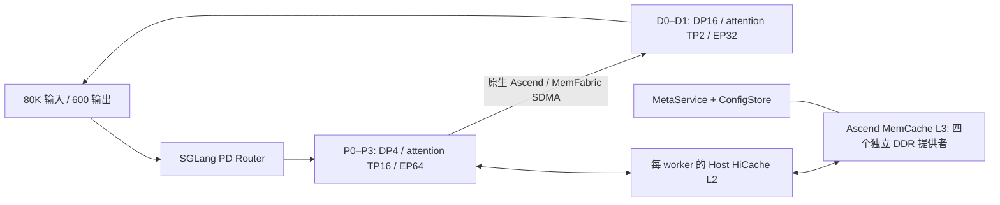

# Ascend MemCache：GLM-5.3 W8A8 / SGLang PD 部署

本页记录 GLM-5.3 W8A8 在 Ascend 910C 上接入 Ascend MemCache 的部署方法。目标负载为 **80,000 输入 token、600 输出 token**。现场地址、SSH 凭据和权重访问地址不入库；命令中的角色地址由部署者填写。

**验证状态（2026-10-14）**：原 2P2D 已完成 80K/600 冷请求和清除 L1/L2 后的 L3 回放验证。用户指定的4P2D完成四个DDR提供者与64个P进程的SDK预热，D权重和KV池分配完成，但首次DeepEP通信因HCCL动态内存不足退出；D显存比例0.80的下一版尚未启动。随后现场管理通道在SSH握手前断开，**无法确认当前服务可用，也未完成新拓扑80K/600验收**。原2P2D数字是已测历史结果，不代表4P2D性能。详见 [验证快照](deployment/ascend_memcache/validation-20261014.json)。

## 1. 拓扑与 SGLang 参数

4P2D 指 **四台物理 Prefill 主机加两台物理 Decode 主机**，每台 16 个 NPU die；P、D 是两个独立的分布式模型进程组。

| 角色 | 物理节点 | EP | DP | 每 DP 副本的 attention TP | SGLang `--tp-size` | 每台节点 rank |
| --- | --- | --- | --- | --- | --- | --- |
| P | P0、P1、P2、P3 | 64 | 4 | 16 | 64 | 0、1、2、3 |
| D | D0、D1 | 32 | 16 | 2 | 32 | 0、1 |

启用 `--enable-dp-attention` 后，attention TP = 全局 `tp-size / dp-size`。因此 P 使用 `--tp-size 64 --dp-size 4 --ep-size 64`，D 使用 `--tp-size 32 --dp-size 16 --ep-size 32`。不要将 P 的 `--tp-size` 直接设为16、D直接设为2，再配 EP64/EP32。



**两个数据面分别配置**：P→D 的 KV 搬运使用原生 `ascend` 后端 / MemFabric SDMA；P 的 HiCache L3 使用 `ascend_memcache` / `device_sdma`。安装 MemCache 不会自动把 PD 传输改成另一种连接器。

## 2. 固定依赖与离线安装

本次工程环境为 Linux **aarch64**、Ascend 910C、CANN9.0.0、驱动25.5.2、Python3.11、SGLang `0.5.17.dev386+gc5bd3d7dc`。镜像原 tag 为 `sglang-tianjin:arm64-cann9.0.0-a3-v0.5.16`；tag中的版本不能代替镜像内实际版本。

固定使用 **memfabric_hybrid1.1.5 + memcache_hybrid1.1.5**。在有网络的工作机下载匹配 aarch64/cp311 的 wheel，传入离线现场，再在独立派生容器中安装：

```bash
python3 -m pip install --no-index --no-deps --no-cache-dir \
  /packages/memfabric_hybrid-1.1.5-cp311-cp311-manylinux_2_26_aarch64.manylinux_2_28_aarch64.whl \
  /packages/memcache_hybrid-1.1.5-cp311-cp311-manylinux_2_26_aarch64.manylinux_2_28_aarch64.whl
python3 -m pip show sglang memfabric-hybrid memcache-hybrid
```

| wheel | SHA256 |
| --- | --- |
| memfabric1.1.5 | `8e8aacd97e776462d11d8513f072209d41d3a638d898057a806b4dc662df957d` |
| memcache1.1.5 | `95914b6df5040aa7871e677d4368925592f04acd313cf9ee6ec32f26f5d8ed12` |

1.2.1 的匹配组合在本镜像的独立 SDK 生命周期探针中出现 native heap crash，因此本次未采用；这不是对所有环境或后续版本的结论。

原镜像、原启动文件和原容器保留。每台运行容器映射本机16个 `/dev/davinci*`、`davinci_manager`、`hisi_hdc`，只读映射 Ascend driver/firmware/dcmi，使用 host network / IPC、足够 shm、memlock，以及只读 `/model`。模型权重约764GB，**先复制到每台本地 NVMe，完整 SHA256 校验后再启动**。NFS/SSH传输只用于分发，不作为运行时权重目录。

## 3. SGLang 的 MemCache 适配

附带 [部署工具与补丁](deployment/ascend_memcache/) 基于 [SGLang PR26043](https://github.com/sgl-project/sglang/pull/26043)，固定源 head 为 `08246a9e20fef1d75b4ee6c3d9646c415f215a54`。本工具针对上述镜像内源代码做精确锚点替换，不升级整个 SGLang。

```bash
# 容器内执行；实际工具位置自行设置。
KIT=/workspace/glm5-3-sglang/deployment/ascend_memcache
bash "$KIT/fix_sonames.sh"
python3 "$KIT/patches/mc-apply-patch.py" \
  --sglang-root /sgl-workspace/sglang/python/sglang
# 再执行一次应报告所有修改已存在，不能继续重复添加。
python3 "$KIT/patches/mc-apply-patch.py" \
  --sglang-root /sgl-workspace/sglang/python/sglang
```

本适配的关键点：

- 注册 `ascend_memcache` 后端、零拷贝读取路径和 NPU layout 选择。
- GLM DSA + Ascend MemCache 选择 **HiRadixCache + 已有 NPU MLA Host Pool**；本环境的 UnifiedRadixCache/HostPoolGroup 路径未作为工作点。
- 使用 `kernel_ascend`、`page_first_kv_split`，同时存取 **K/V/index** 三个组件。缺少 index 必须判为 MISS，不能把不完整缓存当 HIT。
- 在本环境中，跨进程 `batch_put_from` 写入不可被另一参与者查询；使用 **copying `put` 写回退**，读取仍使用零拷贝。不能宣称零拷贝写已验证。
- SDK 显式、幂等 `close()`；独立探针及服务退出需要检查真实进程退出码。

`fix_sonames.sh` 在派生容器内补 wheel 库的 SONAME 链接，处理 bare `dlopen("libhcom.so")` 等解析；不修改主机驱动。锚点或原文件不同会报错，应先核对镜像版本，不能跳过安装失败继续启动。

## 4. MetaService 与四个 DDR 提供者

建议放在独立服务容器里，先起服务再加载 P 模型。示例端口分开使用：Meta25300、ConfigStore25301、Meta metrics25302；PD 的 MemFabric store24946另行启动。

Meta配置文件：

```json
{
  "meta_service_url": "tcp://P0_IP:25300",
  "config_store_url": "tcp://P0_IP:25301",
  "metrics_url": "http://P0_IP:25302",
  "ha_enable": false,
  "log_level": "info",
  "log_path": "/workspace/logs/meta",
  "log_rotation_file_size": 20,
  "log_rotation_file_count": 10,
  "evict_threshold_high": 90,
  "evict_threshold_low": 80
}
```

```bash
# P0 的独立服务容器中：
python3 "$KIT/start_meta_service.py" /workspace/metaservice.json
```

P0/P1/P2/P3 各启动一个独立 DDR 提供者，配置必须一致，ready文件各自独立：

```bash
python3 "$KIT/pool_provider.py" \
  --meta "tcp://${P_HEAD}:25300" \
  --config-store "tcp://${P_HEAD}:25301" \
  --world-size 128 --dram 16GB --max-dram 64GB \
  --device 0 --ready-file /workspace/provider.ready.json
```

`world_size=128` 是进程参与者的上限，覆盖64个 P 模型进程加4个提供者，不能写成物理节点数6。每个提供者 `dram_size=16GB`；**模型 SDK 客户端 `dram_size=0GB`**。`max_dram_size=64GB` 是每进程 VA stride 上限，不是每进程实际保留64GB物理内存。四台提供者合计64GB配置容量。

提供者先于 P 的 Host HiCache 分配。原先在大型 Host L2 分配完成后让每个模型进程再申请16GB DDR，曾出现 `HalMemCreate` 失败；本工作点把物理 DDR 从模型客户端移到独立提供者。正常停止通过 SIGTERM/SIGINT 调用 `close()`，等待 `POOL_CLOSE_RESULT` 和退出码，不把强制 kill 当 clean close。

## 5. 公共环境

填写 `P_HEAD`、`D_HEAD`、当前 `NODE_IP`、网络接口和节点 rank；它们是现场值。以下在模型容器内执行：

```bash
export P_HEAD D_HEAD NODE_IP COMM_IFACE
: "${P_HEAD:?set P0 address}" "${D_HEAD:?set D0 address}" "${NODE_IP:?set this host address}" "${COMM_IFACE:?set communication interface}"
source /usr/local/Ascend/ascend-toolkit/set_env.sh
source /usr/local/Ascend/nnal/atb/set_env.sh
unset http_proxy https_proxy HTTP_PROXY HTTPS_PROXY ASCEND_LAUNCH_BLOCKING
export NO_PROXY='*' no_proxy='*' HF_HUB_OFFLINE=1 TRANSFORMERS_OFFLINE=1
export HCCL_SOCKET_IFNAME="$COMM_IFACE" GLOO_SOCKET_IFNAME="$COMM_IFACE"
export HCCL_OP_EXPANSION_MODE=AIV HCCL_BUFFSIZE=1000 TASK_QUEUE_ENABLE=2
export STREAMS_PER_DEVICE=32 SGLANG_SET_CPU_AFFINITY=1
export SGLANG_NPU_USE_MULTI_STREAM=1 SGLANG_ENABLE_OVERLAP_PLAN_STREAM=1
export DEEP_NORMAL_MODE_USE_INT8_QUANT=1 DEEPEP_NORMAL_LONG_SEQ_ROUND=72
export DEEPEP_NORMAL_LONG_SEQ_PER_ROUND_TOKENS=1024
export DEEPEP_NORMAL_COMBINE_ENABLE_LONG_SEQ=1
export ASCEND_MF_STORE_URL="tcp://${D_HEAD}:24946"
export ASCEND_MF_TRANSFER_PROTOCOL=sdma
export SGLANG_DISAGGREGATION_BOOTSTRAP_TIMEOUT=600
export PYTORCH_NPU_ALLOC_CONF=expandable_segments:True
```

在 D0 的独立服务进程中启动SDK内置store：

```bash
export ASCEND_MF_STORE_URL="tcp://${D_HEAD}:24946"
python3 -m memfabric_hybrid.launch_ascend_mf_store
```

SGLang原生 Ascend engine 使用上述 `ASCEND_MF_STORE_URL`。首次启动前检查监听端口归属，避免复用别的任务的服务。

## 6. P 启动：EP64 / DP4 / attention TP16

```bash
export SGLANG_ENABLE_UNIFIED_RADIX_TREE=0
export SGLANG_ASCEND_MEMCACHE_ENABLE_WARMUP=1
export SGLANG_ASCEND_MEMCACHE_COPY_WRITE=1
export SGLANG_HICACHE_MEMCACHE_CONFIG_PATH=/workspace/memcache-local.json
printf '{}\n' > "$SGLANG_HICACHE_MEMCACHE_CONFIG_PATH"

# 必须在四台一致；含权重身份、KV schema、page geometry和并行布局。
export MC_TAG="glm53w8a8-${WEIGHT_MANIFEST_SHA16}-kvs3-pg128-tp64dp4ep64-ctx98304"
MC_EXTRA=$(python3 - <<'PY'
import json,os
print(json.dumps({
    'meta_service_url': f"tcp://{os.environ['P_HEAD']}:25300",
    'config_store_url': f"tcp://{os.environ['P_HEAD']}:25301",
    'protocol':'device_sdma','dram_size':'0GB','max_dram_size':'64GB',
    'world_size':128,'hbm_size':'0','max_hbm_size':'0',
    'log_level':'info','extra_backend_tag':os.environ['MC_TAG']
}))
PY
)
python3 -m sglang.launch_server \
  --model-path /model --trust-remote-code --device npu --attention-backend ascend \
  --dtype bfloat16 --quantization modelslim \
  --tp-size 64 --dp-size 4 --ep-size 64 \
  --enable-dp-attention --enable-dp-lm-head \
  --nnodes 4 --node-rank "$P_RANK" --dist-init-addr "${P_HEAD}:29834" --dist-timeout 3600 \
  --host "$NODE_IP" --port 31400 --served-model-name glm-5.3-pd \
  --disaggregation-mode prefill --disaggregation-bootstrap-port 31934 \
  --disaggregation-transfer-backend ascend \
  --enable-hierarchical-cache --hicache-io-backend kernel_ascend \
  --hicache-storage-backend ascend_memcache --hicache-mem-layout page_first_kv_split \
  --hicache-size 32 --hicache-write-policy write_through \
  --hicache-storage-prefetch-policy wait_complete \
  --hicache-storage-backend-extra-config "$MC_EXTRA" \
  --context-length 98304 --mem-fraction-static 0.75 \
  --chunked-prefill-size 16384 --max-prefill-tokens 98304 --max-running-requests 4 \
  --enable-metrics --moe-a2a-backend deepep --deepep-mode normal \
  --disable-cuda-graph --disable-shared-experts-fusion \
  --reasoning-parser glm45 --watchdog-timeout 3600
```

`P_RANK` 为0/1/2/3，P0是组 leader。`--hicache-size32` 按每worker计算，整机预算还要加 index Host Pool、模型进程、通信缓存和独立 DDR；不得当成整机只用32GB。

## 7. D 启动：EP32 / DP16 / attention TP2

D不启用 HiCache L3。P负责前缀缓存，D保留原生PD接收路径；本次先使用 eager、无MTP，不同时改变推测解码与传输策略。

```bash
export SGLANG_DEEPEP_NUM_MAX_DISPATCH_TOKENS_PER_RANK=32
python3 -m sglang.launch_server \
  --model-path /model --trust-remote-code --device npu --attention-backend ascend \
  --dtype bfloat16 --quantization modelslim \
  --tp-size 32 --dp-size 16 --ep-size 32 \
  --enable-dp-attention --enable-dp-lm-head \
  --nnodes 2 --node-rank "$D_RANK" --dist-init-addr "${D_HEAD}:29836" --dist-timeout 3600 \
  --host "$NODE_IP" --port 31401 --served-model-name glm-5.3-pd \
  --disaggregation-mode decode --disaggregation-transfer-backend ascend \
  --context-length 98304 --mem-fraction-static "${D_MEM_FRACTION:-0.80}" \
  --max-running-requests 16 \
  --moe-a2a-backend deepep --deepep-mode normal \
  --disable-cuda-graph --disable-shared-experts-fusion \
  --reasoning-parser glm45 --watchdog-timeout 3600
```

`D_RANK` 为0/1；D0是leader。0.80是本次拓扑的显存预算起点（0.90首启时虽有204288token的KV池，但DeepEP NotifyDispatch随后申请约2GB HCCL内存失败，需为动态通信留余量），实际启动后检查每DP的KV容量能覆盖80,000输入加600输出；不能只依据 HTTP `/health` 判为可用。DP16也不代表已完成16并发长请求的容量验收。

## 8. Router 与启动顺序

```bash
python3 -m sglang_router.launch_router \
  --pd-disaggregation --policy round_robin \
  --prefill "http://${P_HEAD}:31400" 31934 \
  --decode "http://${D_HEAD}:31401" \
  --host "$D_HEAD" --port 31480 \
  --request-timeout-secs 7200 \
  --health-check-timeout-secs 10 --health-check-interval-secs 15 \
  --health-failure-threshold 3 --health-success-threshold 1
```

依次完成：权重与镜像核验 → 独立服务容器 → PD MemFabric store → MemCache MetaService → 四个DDR提供者 → 四个P rank、两个D rank → 所有rank readiness和L3 warmup → Router → 小请求 →80K/600 → L3回放。每个rank用本次启动独立日志和退出码，不能接受旧日志里的ready标记。

## 9. 80K/600 与真实 L3 回放验证

原生 `/generate` 测试固定 `input_ids` 长度80,000、`max_new_tokens=600`、`ignore_eos=true`，使用相同请求文件；在合成输入内埋一条唯一nonce，并检查输出。输出600包括原生 completion 中的 reasoning token；不等于最终可见正文一定600token。

先冷请求，等待 `sglang:backuped_tokens_total` 对应已完成写入；然后 **POST P leader `/flush_cache` 清L1/L2，保留Meta和DDR提供者**，发送相同文件。要求同时成立：HTTP200、SSE完整结束、实际输入80000/输出600、nonce存在、请求SHA相同、L3完成读取计数增加、P日志显示前缀命中。仅看到前缀命中不足以区分L1/L2/L3。

P leader的HTTP metrics只覆盖本机DP；其他物理P的DP counters需读取其本次运行的 Prometheus mmap目录并导出。可在每个P peer的服务容器中运行附带的只读导出器：

```bash
python3 "$KIT/peer_metrics.py" \
  --log /workspace/logs/p-current.engine.log --host "$NODE_IP" --port 31490
```

64个TP进程的计数不可直接相加当作逻辑token数；需按参与当前请求的TP归一化。跨机墙钟可能有偏差，TTFT与总时间由同一客户端 `time.monotonic` 测量。

已完成的**原2P2D**一次固定合成请求：冷TTFT34.923s、总318.578s；L3回放TTFT3.862s、总285.910s；命中79,872token、新prefill128token。600输出完成，nonce正确，L3读写计数与日志互相印证。**这只证明该负载流程与L3回放可用，不构成多轮吞吐或4P2D收益结论。**

新4P2D首启观察：P的64个模型进程分别完成MemCache SDK warmup；D每进程权重约35.63GB，KV池204288token/约20.91GB，比例0.90。首次 `aclnnNotifyDispatch` 的HCCL动态分配失败，报请求2098200576字节；随后SGLang清理进程产生137/3退出码，容器 `OOMKilled=false`。这不能读作完整服务启动成功。

下一版保留EP/DP/attention TP，只将D的KV静态显存预算降到0.80，为通信分配留余量；**该配置尚未启动、容量与请求未验证**。管理通道恢复后，先核对全部进程、保持Meta直到所有DDR提供者正常close，再完整重启新cohort；通过实际拓扑/容量检查后才执行80K/600和L3回放。需保存每个DP的容量、逐请求结果、缓存日志与L3计数，才能补充本节的通过结果。

## 10. R0129/R0130 的迁移边界

历史vLLM实验对PD地址描述符施加range cap；已测的64KiB对256KiB有较低搬运延迟，在原80K/60K输出、cc16负载中也观察到TTFT与吞吐改善。当前SGLang使用MemFabricSDMA，原连接器、超时变量和性能数字不能直接迁移。

本次4P2D初始cap=0，保留原描述符；观察真实搬运bytes、段数、构造耗时、SDK调用耗时与返回值。若传输占比值得优化，再做单独的64KiB对照，固定请求、缓存状态、拓扑、SDK和解码策略。64KiB是候选值，不是当前SGLang已验证的最优值。原多线程分片K=4曾在真实vLLM实验中严重退化并失败，本次不引入。

## 11. 停止与回滚

先停止接受新请求并确认 `/get_load` 中 `num_reqs`、`num_waiting_reqs` 都为0；停止模型 → DDR提供者正常close → Meta/PD store/router → 确认全部NPU无遗留计算进程与端口无冲突。服务容器与模型容器分开，关闭P时不会无意关闭整个L3池。

保留原镜像和原2P2D的完整启动配置。失败后恢复**整个匹配的原cohort**，重启Meta、DDR、P、D和Router并做真实生成验证；PID1为sleep的容器仅 `docker start` 不会自动恢复推理服务。修改 TP/DP/EP、权重或KV schema时必须更换缓存namespace，避免复用不兼容的L3对象。

本部署工单的现场操作已由用户单独授权；它不自动恢复其他研究任务的设备操作，也不把旧性能结果写成新研究结论。

## 来源

- [SGLang Ascend GLM-5.2 部署教程](https://github.com/sgl-project/sglang/blob/main/docs/docs/hardware-platforms/ascend-npus/model-deployment/tutorials/glm_5_2.mdx)：架构与Ascend PD部署参考；不能把GLM-5.2的结果当作本模型验收。
- [Ascend MemCache](https://gitcode.com/Ascend/memcache)：SDK与分布式KV存储引擎。
- [SGLang MemCache接入PR26043](https://github.com/sgl-project/sglang/pull/26043)：本次固定源版本的基础，尚不代表所有SGLang版本均可直接安装使用。
