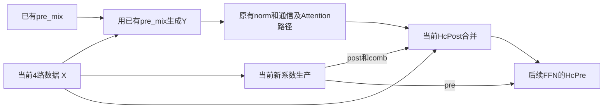

# F01 · 注意力前 mHC 复合边界

[返回进展总览](README.md)

最近有意义的更新：2026-11-03（Asia/Shanghai）

## 当前状态

|项目|状态|
|---|---|
|优化类型|已有融合边界的拆分/调度（本轮仅 EARLY-Y）|
|历史分析|v180 条件式候选族（CONDITIONAL）；原记录保留|
|本轮复核|EARLY-Y 源码逻辑已澄清；可实现性与收益待验证|
|新增实现|未实施|
|新实现正确性|未实施，未验收新实现|
|优化后同条件性能|未测量，未声称提速|
|独立复核|已请求 GPT-6.1 / xhigh；临时侧聊禁止启动子代理，实际尚未启动、未收到结果|

## 算子与原有流程

绑定源码中的 npu_hc_pre_v3 / aclnnHcPre；profile 语义名 HcPre。新接口尚不存在。

已有 HcPre 一次调用返回 Y、post、comb、pre。归档 A3 源码先做投影/统计并同步；第二阶段对每个数据块依次计算新 pre、生成并写出 Y、计算 post/comb。下游归一化等任务按整体 HcPre 完成后推进。

## 候选改动及其意义

本轮只审查 HC93-EARLY-Y：在进入算子前已有 pre_mix 时，将 Y 的生成/交付与当前新系数生产分离，让使用 Y 的原有路径有机会提前推进。

解除对当前新系数生产的不必要等待；不删除原有系数计算，也不以 CPU 调度时间作为成立依据。

## 成立条件与证据边界

只适用于有外部 pre_mix 的已核对源码分支。保留 Y 的 BF16 舍入、全部当前新系数、原残差及消费者；post/comb 要在当前 HcPost 使用前就绪，pre 要在后续 FFN HcPre 使用前就绪。数据依赖允许分离，不证明当前硬件、二进制和新任务安排可有效并行。

## 本轮逻辑说明

这次讨论的是 F01 族内的 **EARLY-Y** 子方案。F01 族还登记了其他复合/列优先级等变体，本轮没有据此关闭整个候选族。

### 输入和结果

|对象|含义|消费者|
|---|---|---|
|X|当前 token 的4路原始数据|Y 生成、新系数生产、当前 HcPost 的 residual|
|已有 pre_mix|进入当前 HcPre 前已有的混合配比|当前 Y；首层由模型初始化，后续由前面的 mHC 阶段传递|
|Y|4路按已有配比相乘相加后的1路数据|当前输入归一化与后续 Attention 路径|
|新 post、comb|当前输入算出的合并配比|当前 Attention 结果与原 residual 的 HcPost 合并|
|新 pre|当前输入算出的下一阶段混合配比|后续 FFN 的 HcPre；不是有外部 pre_mix 分支中当前 Y 的必需输入|

`ProcessY` 的源码动作是：将 X 扩展到 FP32，按指定配比逐项相乘，沿4路求和，再按原方式转回输出类型。它用的是进入算子前的配比时，不需要当前系数投影、统计、Sigmoid 或 Sinkhorn 的结果。

源码关键选择为：

```cpp
ProcessY(...,
    tilingData->hasPreMix != 0 ? preMixLocal : mixes01ReduceLocal,
    ...);
```

没有外部 pre_mix 时会改用新 pre，不能直接套用本轮的独立性结论。

### 当前实现与候选安排

当前归档源码的控制顺序：

```text
投影和统计 → 阶段间同步 → 新pre → 生成并写出Y → post/comb → HcPre完成
                                                               ↓
                                               原有norm/通信/Attention路径
                                                               ↓
                                                        当前HcPost
```

这里是每个处理块的主要顺序；多个硬件单元仍有原有分工和流水，不能理解为整卡所有工作完全串行。Y 已经写入输出位置不等于下游获得了可单独使用的就绪通知。

候选按计算依赖可画成：



这只是允许研究的依赖图。它没有指定一个已可运行的并行实现；还要定义新算子/接口、事件交接、输入存活、数值等价及真实调度资源。两条队列不保证两项任务可同时驻留，当前混合算子中的空闲计算部件也不自动对另一任务可用。

### 已有 profile 能说明什么

旧166的已绑定目标图中，有2560组 Attention HcPre→RmsNorm 对。HcPre 中位35.401µs，随后间隔中位0.980µs，RmsNorm 中位3.960µs；已登记的这类边都在同一流。数据来自旧166，不能当作171新运行耗时。

171的归档有 FULL 图回放及 aclmdlRIExecuteAsync 对应记录。这支持“该记录中有事先安排的图任务”，不证明每个当前 native HcPre 与旧源码逐指令一致，也不提供166计时到171的迁移依据。

这些证据没有给出内部 Y 的最早可用时间，没有证明整段请求关键路径或可节省35µs。HcPre 结束至 HcPost 开始的 Attention 路径跨度也不是免费的可隐藏时间。

### 本轮纠正

1. 不能把 EARLY-Y 称为新增计算融合；它是已有融合边界的拆分/交付和调度重组候选。
2. 当前 Y 在 post/comb 前就生成并写出；不能说“全部新配比算完后才生成 Y”。
3. 有外部 pre_mix 时，当前 Y 不依赖本次新配比；并非所有 HcPre 分支都独立。
4. 不能由源码独立性、两条队列或卡上部分单元空闲，直接判定并行可运行/可加速。
5. CPU 可异步提交，但修改 CPU 提交时机本身不能解除设备图中的整算子完成依赖。已有证据不证明 CPU 在整个请求中从不构成瓶颈。
6. “Y＋归一化融合”与 F02 接口机会重叠，是另一项可组合但需单独验证的变体；本轮不把它用来证明 EARLY-Y 本身属于融合。

### 本轮结论

**已支持：归档有外部 pre_mix 的源码分支中，Y 不依赖本次新系数。未建立：当前二进制的改动资格、新接口可实现性、实际资源重叠、运行正确性和性能收益。**

记录源码性质不等于接受性能方案；整个 F01 仍为 CONDITIONAL。


## 可能要做的事

以下是待办计划；没有执行证据时不能改为“已完成”。

- [ ] **F01-01 · 完成请求中的独立复核**：在允许启动代理的主对话中，按用户要求使用 GPT-6.1、xhigh，只读检查本页依赖、源码顺序、profile 能力和分类；本侧聊不代为启动。 接受/停止条件：实际收到可追溯产物后才更新独立复核状态；审查通过仍不代表实现/性能通过。
- [ ] **F01-02 · 从已有171 profile 固定当前同批次基线**：只查选定同一 case 中 HcPre→norm→Attention路径→HcPost 及图/队列依赖。当前本地可复核的细时序为旧166，171归档可确认FULL回放；不得把166的微秒数迁移到171。 接受/停止条件：先复用已有数据；不为源码已回答的问题重新采集。记录当前171同一调用边界，不能仅由间隔推断端到端关键路径。
- [ ] **F01-03 · 若值得实施，再冻结顺序/并行对照**：未来分别比较A原版、B拆分顺序执行、C拆分尝试重叠。相同输入/权重/精度与执行方式，核对Y、所有新系数和最终HcPost；计时一直到所需结果合并完成。属于未来计划，本次未执行。 接受/停止条件：C稳定优于A才有收益证据；C仅优于B说明重叠可能抵消部分拆分成本；无收益只记录该实现/条件下未观察到改善，不宣称所有拆分均不可行。

## 证据入口

- [历史候选总表](../CANDIDATES.md)：本页初始名称、思路和关键条件的来源；不是本轮新执行证据。
- [v180 结构化记录](../records/latest/records.json)：按本候选 ID 查询条件、消费者、引用和已存在融合。
- [当前候选图](../records/latest/candidates/F01.json)：语义 footprint / 条件图，不证明整块可融合成一个 kernel。
- [F01本次可重现归档复核摘要](evidence/F01-review-20261103.json)：只读源码快照与已解析profile的检查；不是native运行测试或独立代理审查。
- [源调用与消费者](../records/history/continuation/profile-first-20261031/HC-attention-fork-source-contract-v93.json)：Y→norm/Attention；post/comb→当前Post；pre→后续FFNPre。
- [A3底层Part1/Part2源码](../records/history/continuation/HC-operator-source-v58/vllm-workspace/vllm-ascend/csrc/moe/hc_pre/op_kernel/hc_pre_m_k_split_core.h)：源码全阶段同步、hasPreMix选择、每块pre/Y/post/comb顺序；不等于171加载二进制身份已证。
- [数值与分支合同](../records/history/continuation/profile-first-20261031/HC-operator-numerical-and-dependency-contract-v59.json)：ProcessY、BF16边界、新系数消费者、源实现及执行身份限制。
- [EARLY-Y与其他变体](../records/history/continuation/profile-first-20261031/HC-attention-fork-variants-v93.json)：本轮只取HC93-EARLY-Y，不混入其他变体的收益。
- [旧166的时序聚合（gzip）](../records/history/continuation/profile-first-20261031/HC-operator-profile-and-edges-v58.json.gz)：2560已绑定目标图对及中位数；不是171基线，不给内部Y就绪时刻。
- [171图回放对应记录](../records/history/continuation/shared-profile-analysis-v166/graph-replay-containment-focus.json)：2026-11-02的FULL回放与API范围；不迁移旧机器时序。
- [Task/Loop/Run恢复入口](tasks/f01-early-y/README.md)：本轮记录状态和可恢复的下一步；未来实验仍未执行。

## 进展与纠正记录

### 2026-11-03 · 20261103-REGISTER-42

类型：TRACKING_CREATED_NOT_NEW_ANALYSIS；依据：用户要求每个候选的逻辑与后续工作可在GitHub观察和回溯；来源为既有CANDIDATES/v180记录。

为42个既有候选建立稳定页面和状态维度；41条沿用历史条件分析，不声称本轮重新验证；42页建档不记为42项优化完成。

### 2026-11-03 · 20261103-F01-DEPENDENCY-REVIEW

类型：SOURCE_REVIEW_AND_BOUNDED_PROFILE_REUSE；依据：本侧聊主执行者只读核对归档模型/A3源码、旧166数据库选定TASK及对应聚合、171图回放记录；可重现摘要见evidence/F01-review-20261103.json。

有外部pre_mix时Y不依赖当前新系数；当前源码先投影/同步，在第二阶段每块先写Y再处理post/comb。EARLY-Y是交付边界重组候选；未建立native改动可行性或收益。

### 2026-11-03 · 20261103-F01-CORRECTIONS

类型：EXPLANATION_AND_CLASSIFICATION_CORRECTION；依据：用户追问融合定义与真实代码后，回到源依赖和profile能力边界。

纠正把EARLY-Y当新增融合、把Y描述为等全部系数完成才生成、把F02的Y+norm混入当前方案的讲解。两队列/部分硬件空闲不保证并发；旧166约1µs间隔不证明全局CPU从不瓶颈，35µs不是可省时间。F02只记录边界澄清，不记为本轮完成其分析。

### 2026-11-03 · 20261103-F01-INDEPENDENT-REVIEW-REQUEST

类型：REQUEST_RECORDED_NOT_EXECUTED；依据：用户要求subagent使用GPT-6.1/xhigh；当前临时侧聊禁止创建或联系子代理。

独立审查登记为已请求但未启动，无模型产物；后续只有实际取得审查结果才可更新。不得将本次主执行者复核伪装成独立代理复核。
