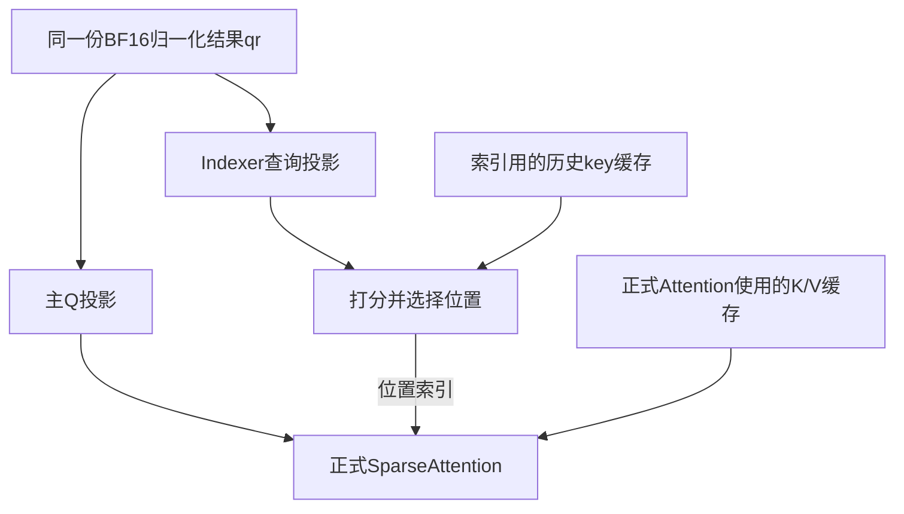

# F05 · Q norm → 动态量化 → Q 投影，多算子链

[返回进展总览](README.md)

最近有意义的更新：2026-11-03（Asia/Shanghai）

## 当前状态

|项目|状态|
|---|---|
|优化类型|归一化＋动态量化融合（本轮QR-NORM-QUANT）|
|历史分析|v180 条件式候选族（CONDITIONAL）；原记录保留|
|本轮复核|Q链与多消费者已澄清；融合数值/接口/收益待验证|
|新增实现|未实施|
|新实现正确性|未实施，未验收新实现|
|优化后同条件性能|未测量，未声称提速|
|独立复核|未启动；没有独立审查结果|

## 算子与原有流程

模型 q_norm（RMSNorm；历史profile名RmsNorm）→普通行DynamicQuant（W8方法调用npu_dynamic_quant）→Wq_b量化投影（npu_quant_matmul；历史QuantBatchMatmulV3）。Indexer投影在适用分支也消费同一qr。

Q_A投影后做RMSNorm得到舍入后的BF16 qr，普通动态量化将其变成INT8和FLOAT行scale，再供Q_B矩阵投影。适用Indexer分支仍需要qr；其投影后每head量化属于另一操作。

## 候选改动及其意义

本轮仅将q_norm与普通行DynamicQuant接入一个融合实现，输出合法的INT8+行scale，同时保留仍被消费者使用的BF16 qr及其他有效输出。Q_B投影保持原逻辑，不把整条链默认视为一个已可运行kernel。

在内部使用已经按原精度舍入的qr继续做原动态量化，减少选定中间读取和单独量化的交接；若BF16另有读者，原qr发布仍要保留。归一化/量化本身的算术及Q_B乘法不删除。

## 成立条件与证据边界

保留原BF16归一化舍入、整行RMS/amax、scale/量化舍入及zero/NaN/Inf等原规则。保留Indexer与其他BF16/rstd读者。普通1280宽FLOAT行scale量化不能换成Indexer128宽FP16-scale head量化；库接口存在也不证明精度兼容。

## 本轮只看哪一段

F05是Attention内部Q路径的候选族。本轮先看 **RMSNorm→普通DynamicQuant**，不把Q_A投影收尾、跨消费者量化复用、完整GEMM融合和Indexer head量化混成一个已证方案。

### 原来的三个操作

|操作|算法或作用|结果|
|---|---|---|
|q_norm / RMSNorm|对Q_A的输出按完整行平方均值等原规则归一化|舍入后的BF16 qr|
|普通DynamicQuant|按当前完整行数值生成量化比例，按原比例/舍入规则把qr量化成整数|INT8数据和FLOAT行scale|
|Q_B投影|对量化输入和权重做原矩阵乘法，并按原scale等规则输出|Attention后续需要的Q数据|

量化比例说明整数对应原数值的尺度。模型原流程本来就有这次INT8量化，融合不是新增量化或额外降低精度。

源码CV路径的关键关系为：

```python
qr = attn.q_norm(q_a)
q_b_quant, q_b_scale = wq_b.quantize(qr)
# 后面仍由Q_B的matmul消费量化输入
```

W8方法普通Tensor输入时调用npu_dynamic_quant，再调用npu_quant_matmul；PreparedLinearInput可以在该方法边界复用预量化结果。但整层Linear、TP、bias、布局/输出约束不能仅由这个方法存在就判定可接入。

### 怎么融合

```text
原来：归一化 → 发布BF16 qr → DynamicQuant重新读取 → INT8+scale → Q_B
候选：[归一化 → 原BF16舍入 → 继续按原规则量化] → INT8+scale → Q_B
```

候选仍要完成整行归一化统计和量化的整行amax/scale，不能每块独立生成不同的行scale。也不能用未经BF16舍入的归一化FP32临时值直接量化。

### qr还有谁要用

适用Indexer分支中，`indexer.project_query(qr)`也消费同一qr，模型辅助接口还返回qr。所以本轮默认保留仍需的BF16输出，不把中间写出全删掉。

```text
融合NormQuant
   ├→ INT8+行scale → Q_B
   └→ BF16 qr → 仍需要它的Indexer或其他原消费者
```

以后若要让Q_B与Indexer投影共用预量化输入，要另查同一量化器、行映射、参数和代际；不能因都是INT8就直接共享。

### 一个已知的库替代边界

已钉的公开AddRmsNormDynamicQuant源码keys1/2在FLOAT归一化临时值上量化，缺少当前需求的BF16归一化输出roundtrip。它不是本case已证的直接替代。其他key或安装CANN9.2对象的实际能力没有因此被排除，完整native归约和量化规则仍待验证。

普通qr量化按1280维整行产生FLOAT scale；Indexer投影后的query每head128维并有FP16 scale舍入，是另一量化器，后者归后续F09等问题。

### 可省什么，不能先承诺什么

M=3、QR宽1280、BF16时，qr为7680B（7.5KiB）。若其他BF16读者仍需要qr写出，融合最多研究少一个选定7680B读取及独立交接；不能同时声称qr写入消失。没有其他BF16读者的更强域，才有15360B一写一读的条件接口量。逻辑接口量不是已测HBM或收益。

本轮没有删除Q_B矩阵计算；将量化输入继续送入GEMM是另一实现边界，需要兼容tiling、全行scale和有限存储，不能由相邻源码调用推断必然融合。

### 本轮结论

**原Norm→普通DQ→Q_B源链和qr其他消费者有依据；NormQuant是待验证融合候选。** 新接口、native数值等价、运行正确性和同条件收益尚未建立；F05全族保持CONDITIONAL。

## 问题：BF16结果送到的索引分支做什么

它为稀疏Attention挑选要读取的长上下文缓存位置。Indexer从qr生成自己的查询，与索引key缓存打分，选择位置并发布编号，SparseFlashMla使用这些索引读取对应长上下文/压缩缓存。



因此，这份qr不只给主Q路径的DynamicQuant使用。当前Indexer接口还接收它；优化主Q量化不能直接删掉这个消费者。以后若改变Indexer输入、证明同一量化器/数值/行域/代际兼容，可以另研究共用INT8输入，但不是现有接口自动支持。

这段选择主要对应长上下文/压缩缓存；滑动窗口的缓存与索引路径仍按原逻辑保留。Indexer本身也有打分/TopK成本；并非每层都重新选择，有些层复用源层已发布的索引。本次是职责和解释补充，不提高实现或性能成熟度。

## 问题：为什么叫分支，是否先选缓存再算Attention

用户对先后关系的理解正确：所讨论路径先得到位置索引，再将主Q、位置索引和对应K/V等输入交给正式Attention。`_select_sparse_indices`调用在`_forward_attention`之前，后者同时接收q和compressed_indices。

“分支”描述的是同一qr有主Q投影、Indexer查询投影两个消费者，不表示Indexer和正式Attention互不依赖，也不证明这两个投影在当前实现中并行。两路在正式Attention处汇合；前一版图没有明确画出汇合，已修正。

Indexer先用索引查询和索引key缓存打分/选位置，正式Attention随后使用主Q和对应K/V等输入；这两个缓存角色/用途不能因“都读缓存”就当成同一计算。保留BF16的直接原因仍是当前Indexer查询投影消费qr，而非要求保留一份只供后面读取KV的BF16拷贝。

## 问题：每条分支能否单独做一个算子

可以把两条分支分别视作候选区域/对外接口，但这不是已有单kernel实现的证明：

```text
共享归一化结果qr
   ├→ 区域A：主Q准备 ─────────┐
   └→ 区域B：索引查询/选择 ────┤
                              ↓
               主Attention使用两路结果及KV等输入
```

当前主Q投影和Indexer查询投影已经是不同算子调用；一条分支里还可能有矩阵乘法、位置旋转、量化、缓存打分/TopK等多个操作。新的工作不是仅为两条分支起两个名字，而是检查各自哪些相邻操作能在合法实现中融合。

一个接口内部可以先包含几个kernel。要声称整支路只有一个融合kernel，仍需数值边界、完整行统计、tile容量、缓存/状态和运行时实现证据。把几个Python调用包起来不等于已经融合。

上图选择共享一次归一化。此前把不重复归一化作为必须条件过于严格：也可以把归一化分别融合进两个分支，允许重算并计入成本。两路共用一次量化仍是另一条件候选，需要相同数值、量化器、行域和代际，并保留仍需的BF16输出。

两个算子也不保证同时执行；资源与调度允许才可重叠，正式Attention仍必须等所需主Q、索引与缓存等输入。若选择主Q/Indexer内部的RoPE、量化、TopK接合，要与F07、F09、F12等既有候选共同计价，不新增重复收益。

本次只记录用户提出的分区视角；没有选择整支路单kernel实现，没有新增运行或性能结论。

## 澄清：归一化也放进索引查询、选位置分支

用户提出的是**分支内部融合**。下面是候选边界，整段单kernel尚未证明：

```text
归一化前的q_a
   ├→ 候选A：[归一化 → 主Q准备] ─────────────→ 主Q
   └→ 候选B：[归一化 → 索引查询 → 打分/选位置] → 位置索引

主Q + 位置索引 + K/V等原输入 → 正式Attention
```

若两边都包含归一化，同一归一化会算两次。这是合法的候选取舍：多做计算和输入读取，换取可能减少的qr写读及中间交接。此前把归一化必须只算一次当硬条件，已纠正。共享一次仍是另一备选，两者收益不能相加。

索引分支还需要hidden_states派生的weights、位置、索引缓存及scale、元数据等，并须保留原索引输出/复用协议；不是只有q_a这一个输入。若qr仍有其他活跃读者或返回接口，也不能直接删掉原BF16输出。两路重算都必须保留原归一化参数、输入代际和BF16舍入，再遵守各自量化规则。

归一化和查询准备可作为融合候选；把打分和选位置也全部合成一个高效kernel，仍待验证。后半段要比较历史缓存中的候选位置并挑TopK，其数据规模和执行方式可能与前半段不同；需要检查能接合到哪里，不能只按源码相邻定案。一个接口也可能含多个kernel，两个分支算子不保证同时执行。

若仅索引算子做一次归一化并输出qr供主Q使用，默认会新增主Q等待它完成的依赖；提前发布qr需另有同步协议。本次先比较共享一次与两路重算，不把额外早发布方案当已有能力。

**用户的分支内融合思路是合理候选；“归一化必须只算一次”的限制不成立。完整索引分支单kernel及实际收益尚未实现或验证。** 不新增候选族，不提升实现、正确性或性能状态。


## 可能要做的事

清单保留已完成复核和未执行计划；没有执行证据时不能勾选。复核完成不表示实现或性能通过。

- [x] **F05-01 · 固定源链、量化器和已知其他消费者**：已核对q_norm→普通DQ→Q_B、Indexer消费qr及W8预量化方法边界，复用v61/v63数值合同。 接受/停止条件：不把同shape或相同INT8类型当量化器等价；不把已知qr读者删除。 [记录1](evidence/F05-norm-quant-review-20261103.json)
- [ ] **F05-02 · 选择保留原数值的NormQuant实现和接入接口**：围绕原BF16舍入后的整行qr、amax/scale/round策略及活跃输出定义新融合接口；优先复用既有Q_B预量化方法，但核对完整wrapper/并行/偏置/输出条件。 接受/停止条件：已钉公开NormQuant keys1/2缺原BF16 roundtrip，不能直接替换；也不从该反例推断所有实现都不可行。
- [ ] **F05-03 · 约束通过后比较完整消费范围**：未来在同shape/输入/权重下核对BF16 qr、INT8、scale、Q_B及适用Indexer输出，计入保留的qr写读、统计、启动和暂存。小M/大M分别筛查成本。 接受/停止条件：正确性与稳定完整范围收益均通过才接受；不能将消失的独立任务时长全部当可省。
- [ ] **F05-04 · 其他F05变体单独选择和计价**：Q_A→RMS、Q_B/IndexQ共用一次量化，以及再接GEMM都保留为其他条件变体；本轮未实施或全部复核。 接受/停止条件：同一qr/quant接口只能计算一次收益，公共量化还需同值、同规则和同代际证明。
- [ ] **F05-05 · 比较共享归一化与分支内归一化的融合边界**：根据用户澄清，比较共享一次与两路各自归一化；索引侧包含查询准备及可接合的缓存打分/选位置。复用既有fork/join与数值合同，仅补新实现边界证据。 接受/停止条件：允许重算并计入成本；不为凑单kernel改变原数值/状态，整段Indexer单kernel与收益待验证；与既有重叠候选只计一次。

## 证据入口

- [历史候选总表](../CANDIDATES.md)：本页初始名称、思路和关键条件的来源；不是本轮新执行证据。
- [v180 结构化记录](../records/latest/records.json)：按本候选 ID 查询条件、消费者、引用和已存在融合。
- [当前候选图](../records/latest/candidates/F05.json)：语义 footprint / 条件图，不证明整块可融合成一个 kernel。
- [本次NormQuant复核摘要](evidence/F05-norm-quant-review-20261103.json)：只读源链、方法接口和数值限制；没有新native执行。
- [Attention Q链与qr分叉](../records/history/original-run/whole-scope-20261030/frozen-source-snapshot/vllm-ascend/vllm_ascend/attention/dsa_v41.py)：归档源码与对应有界合同；不当作当前二进制或新融合收益证据。
- [Indexer对qr的消费](../records/history/original-run/whole-scope-20261030/frozen-source-snapshot/vllm-ascend/vllm_ascend/models/deepseek_v41/indexer.py)：归档源码与对应有界合同；不当作当前二进制或新融合收益证据。
- [W8量化方法与数值合同](../records/history/continuation/profile-first-20261031/projection-operator-numerical-contract-v61.json)：归档源码与对应有界合同；不当作当前二进制或新融合收益证据。
- [F05各子方案及非叠加条件](../records/history/continuation/profile-first-20261031/router-vector-fusion-variants-v63.json)：归档源码与对应有界合同；不当作当前二进制或新融合收益证据。
- [公开库实现的BF16舍入差异](../records/history/continuation/profile-first-20261031/norm-quant-operator-source-contract-v94.json)：归档源码与对应有界合同；不当作当前二进制或新融合收益证据。
- [Indexer职责与主Attention交接](evidence/F05-indexer-role-20261103.json)：固定源码qr→索引查询→选择→Attention输入的职责说明；无新实现或收益。
- [Indexer与Attention的分叉及汇合](evidence/F05-indexer-attention-join-20261103.json)：纠正说明图，确认先选索引再正式Attention；不推断实际并行或新收益。

## 进展与纠正记录

### 2026-11-03 · 20261103-REGISTER-42

类型：TRACKING_CREATED_NOT_NEW_ANALYSIS；依据：用户要求每个候选的逻辑与后续工作可在GitHub观察和回溯；来源为既有CANDIDATES/v180记录。

为42个既有候选建立稳定页面和状态维度；41条沿用历史条件分析，不声称本轮重新验证；42页建档不记为42项优化完成。

### 2026-11-03 · 20261103-F05-NORM-QUANT-REVIEW

类型：SOURCE_CHAIN_AND_NUMERICAL_REVIEW；依据：核对固定Attention/Indexer源码，复用v61量化方法、v63变体及v94公开库数值合同。

本轮仅选择RMSNorm→普通DynamicQuant融合；保留BF16 qr及Indexer读者、整行统计和原舍入。Q_B仍存在，库NormQuant接口和其他量化器不能直接视为等价；无新实现/运行/收益。

### 2026-11-03 · 20261103-F05-INDEXER-ROLE-QUESTION

类型：QUESTION_ROLE_CLARIFICATION_NOT_MATURITY_PROMOTION；依据：用户追问BF16归一化输出的索引分支用途；定点核对Indexer选择输出与SparseFlashMla的cmp_sparse_indices接入。

明确索引分支选择长上下文缓存位置，为Attention发布索引编号；窗口路径仍保留。当前Indexer消费qr，不能随主Q量化删除；此说明不记新实现或收益。

### 2026-11-03 · 20261103-F05-DATAFLOW-JOIN-CORRECTION

类型：EXPLANATION_GRAPH_CORRECTION_NOT_RUNTIME_PROMOTION；依据：用户指出先访问缓存选择再正式Attention的先后关系；定点核对源调用及npu_sparse_flash_mla的q/KV/索引输入。

补齐qr分叉后在正式Attention汇合的图；分支是两个消费者，不表示执行独立/已并行。Indexer选择在正式Attention前，BF16需求来自Indexer查询投影。没有新增实现、运行或性能结论。

### 2026-11-03 · 20261103-F05-BRANCH-REGION-QUESTION

类型：USER_PROPOSED_PARTITION_NOT_IMPLEMENTATION；依据：用户提出每个分支单独做一个算子；复用已核对qr双消费者和Attention汇合证据。

记录两条分支作为候选融合区域/接口，保留共同归一化；一个接口不保证单kernel，两个算子不保证并行。当前投影调用本已分开，新增机会在兼容操作的内部接合；不升级可实现性或收益。

### 2026-11-03 · 20261103-F05-NORM-DUPLICATION-CORRECTION

类型：USER_CLARIFICATION_AND_DESIGN_RESTRICTION_CORRECTION；依据：用户澄清归一化加索引查询、选位置也在融合边界内；复用已有数值合同、Indexer输入及Attention汇合证据，无新native运行。

纠正此前归一化不可重复的过强限制；记录共享一次与两路重算两种备选，允许以重算换减少中间交接。完整Indexer单kernel、qr可删除和实际收益仍待证明，不提升实现/正确性/性能状态。
