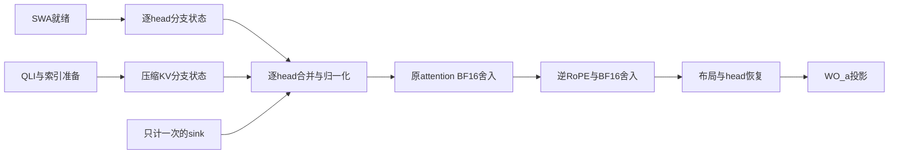

本轮分析attention能否与输出投影重组，范围只涉及算子状态、舍入、head/行域和必要工作。使用已有profile、冻结源码和离线模型，没有运行设备或修改目标实现。

已对齐3200组SMLA→逆RoPE→发送布局→all-to-all→WO_a→WO_b→reduce-scatter，共23680条既有TASK，并关联640组QLI/prepare。当前attention输出是[3,64,512] BF16；all-to-all后的WO_a输入是[24,1,4096]，权重[1,4096,1024]。因此一个投影group包含8个512维head、输出1024维。两侧元素总量相同不等于行/head所有权相同；前移投影或attention都需要重新核对权重、query、通信与就绪。2560组root和640组阶段未知的边界保持不变。

拆分SWA和压缩attention时，不能直接把两个已投影并混合head的分支向量按一个比例相加。各head的softmax质量不同，即使保留了每个head的LSE/质量，混合后的向量也可能丢失恢复信息。一个已分别归一化的两head反例中，两种情况的分支投影和都为[1,1]，head质量也相同，正确合并结果却分别为5/4和3/4。另一个未归一化分子反例保留了完全相同的逐head m/l，分支投影和仍相同，最终结果却为3/4和7/8。可保留每个head的m/l/分子，待质量确定后再混合head；也可另证输出空间与head缩放的特殊可交换结构。等待所有质量已知后再投影、相同head缩放等特殊情形没有被排除。

在实数线性状态编码、head状态可独立变化的域，若8个投影块各rank512，为支持任意head缩放需要保留4096个线性自由度，不能只保留一个1024维混合状态。实际checkpoint的块rank、head状态可达性和相关性尚未知，因此没有把这个条件命题写成当前固定模型的普适存储下界。当前API还设置return_softmax_lse=False，返回的FLOAT张量为空；新的split/merge必须显式增加状态合同，不能用已有BF16输出冒充未舍入的分支状态。

下面是保留原输出精度的一种候选依赖图；它尚未实现，分支合并也需原生精度复核：

把WO_a前移到PV之前，在固定query位置、精确实数下可以分配线性变换，但原生精度并不自动等价。BF16 RNE模型中，3个零logit key的value为1、1、2.015625，另加一个零logit、零value的sink。attention未舍入值为257/256，先舍入再乘BF16权重3得到3；先投影value再做加权，保留FP32或新增BF16中间舍入都会得到3.015625。该反例放在不旋转的448维范围即可成立，没有运行原生kernel，也未声称这些就是模型实际输入。

逆RoPE另有位置限制：前移后的矩阵为R_inv(query_position)·W_head。普通按key位置缓存的一个固定投影值不能自动服务未来不同query位置；key RoPE的位置也不能代替query逆RoPE的位置。只前移448个非旋转维度是另一个条件算法，仍保留64维tail、逆RoPE和投影，且不能绕过原attention BF16舍入。

工作量也要重算。以一个8-head投影group、D=512、R=1024和每query参考N个key为例，提前投影会把后续PV累积宽度从512增至1024，还增加U_new个key的投影构建工作。只比较常规稠密PV+OA，前移参考算术量更低需要U_new<M·(1−N/1024)；N≥1024时，这个模型即使缓存理想预热也无严格算术优势。只前移非旋转部分，PV加tail的宽度为1088，即原来的17/8。105组参考模型保留了可摊薄与不能摊薄的情况；它们不是实际有效key计数，也没有通过精度与所有权门槛。

一种按head保存投影后V的表示还会显著增加缓存。保持原K供未改写QK使用时，一个8-head owner、一个consumer的BF16投影bank新增量是原共享512维K平面的16倍，总量17倍；FLOAT投影bank则总量33倍。source20的KV被20层读取，但这些层的OA矩阵不因此相同；在20组不同投影的参考域，总量分别为321倍、641倍。若沿当前64-head query owner保存所有group，还需额外扩展。24组存储模型分别列出BF16/FLOAT、owner和consumer数量；这只是所选表示的逻辑值预算，压缩、低rank、按需保留或重算仍是其他域。FLOAT PV的混合类型支持与吞吐也未获得证明，不能沿用BF16峰值。

另一个拆分候选是先完成逐head QK与统计，再做PV。它可以使后续计算提前知道质量，但需要保存完整分数/概率及原tile状态序列，或付出QK重算。M个query、H个head、每query N个key时，完整FP32分数值预算为4MHN字节，BF16概率为2MHN字节，另一次QK参考算术为2MHDN OPS；这些是不同保留/重算方案，不能相加当额外HBM下界。当前tile队列不等于已有全N持久缓冲。全局归一化后直接舍入BF16 P也不自动等于当前在线exp/缩放/PV序列，仍需重放原序列或证明新精度；知道质量后，最终attention BF16和OA顺序门槛仍在。

因此当前可登记的结论是：保留原舍入的输出epilogue、增加逐head状态的split/merge、统计先行PV，以及提前投影V是不同候选。它们必须分别支付新状态、保留/重算、缓存/构建、位置/权重、通信和精度合同，不能合并记作免费消除attention输出或KV读写。v83已有输出布局信用和v61已有OA前移all-to-all分析继续复用，没有重复计算成新收益。

本轮新增F08↔F14、F12↔F14、F14↔F19三条条件合同，并扩展既有attention/output联合组。中央累计131条关系、25组联合合同、464对待汇入或复核。分支仍359条、24个语义模块；2073个regime/285598次执行条件分析，9个regime/1352次待关键字段，849条PMU/16阶段图/3136归属歧义未变。全模块最低MFU、完整融合覆盖和整体理论上限仍未完成，Goal保持ACTIVE。
