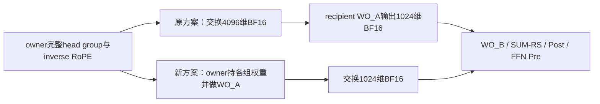

本轮补齐F03与F12/F13/F14/F15四项条件组合，并深化已有F03/F16：当前稀疏注意力、输出恢复/投影、reduce-scatter、attention Post→FFN Pre的联合重组。整体目标仍未完成。

960处窗口同时匹配当前attention Pre系数/premix的HC TASK/API、attention Post TASK/API，再连接FFN Pre和未来FFN Post，关联12200个原生任务及2880条既有通信控制记录。包含192处QLI、40处head zero/copy和24处candidate copy。它是attention Post→FFN Pre范围，区别于前两轮FFN Post→下一attention Pre；实际参数、地址、跨rank token/head映射与正式phase未证明。

明确修正行域口径：M是owner行，Q是当前有效query行，T是裁剪后的cache行，G=P*M是完整carrier/输出投影行。G可为6672而T为6668，最后一个query owner又可只有830行。当前WO_A、WO_B、稳定输出TensorMove与RS保留G行。早期T裁剪接口模型是另一个参考图，不能当成当前G缓冲的绝对内容；完整全局物化修正为2H(G−T)=40960B逻辑值/对应rank用例。共同G缓冲在两方案中都计价时，相对共享读收益不变。没有在这些窗口发现4行RS zero/cat，不把G−T行认定为死数据。

一个具体重组方案是把WO_A放到head AllToAll前：owner在完成原per-head attention合并及inverse RoPE后，使用每个接收组对应的4096×1024 BF16权重，把各完整head group投成1024维再发送。

在保留同一M/G行域的参考图中，每peer逻辑值载荷是原来的1/4，WO_A直接稠密算术量在P*M=G时不变。但当前rank只有一组消费者权重ABI，新图需提供全部8组或其它合法权重访问方式；若显式复制独立BF16矩阵，每rank、每复制层多出58720256B即56MiB权重内容。它不是已证明的新增分配量；共享/流式权重、多个小M-row批次、kernel模式、缓存、队列和通信进展须重新计价。1/4不是物理wire或时延比。Q<M的tail还须产生原zero-head经过WO_A后的结果，保留bias/nonfinite/舍入语义，不能直接删行或盲填零。

256个选定API逻辑接口组合把私有WO_B copy参考4GH B与整个WO_B/stable/RS参考8GH B做集合计数，前者已经在后者里，不能相加。RS输出→Post的4MH B接口及Post→Pre的一份8MH B输入端口另需新handoff；原4H Post写回与未来FFN Post读取仍保留。head zero/copy/pack可由一个新producer处理有效行和zero tail，但inplace inverse RoPE的更新写是值端口，不是新增数组分配。所有数字均不是原生kernel访问遍数、HBM或时延收益。

不能把Post无条件挪入每个TP partial后再SUM：在构造的两项BF16/FLOAT参考中，原SUM_BF16后Post为0.224609375，各partial先Post_BF16再SUM为0.2255859375。它不代表实际CANN规约策略或冻结参数，但足以否定无条件线性搬移。必须保留WO_A完整4096K/BF16、WO_B/BF16、native SUM/RS与Post/下一Pre的边界或给出新的数值合法域。

TopK和attention状态也需分别保留：静态candidate membership的准备不等于重用当前query scores、head masses或跨新Post值的TopK结果；headwise softmax/sink/occurrences和online BF16次序不能在head混合后随意恢复。LSEFalse的空输出不提供统计状态。可以研究更细行/块流水，而每一块仍需满足其全部贡献、当前coeff/premix、原始残差、state/metadata/last-reader与有限进展合同。

条件关系204→208，待核对391→387，联合组保持26。F03已有30个有范围的伙伴，4个待核对，整个候选仍open。原9类/1352次COMPUTE操作数、849个PMU缺口、16个phase未绑定图、3136项归属歧义及G14拷贝/同步范围保持。整模块关闭0，全模块物理理论上限、最低利用率和实际收益未建立。没有新增服务器或设备运行。
