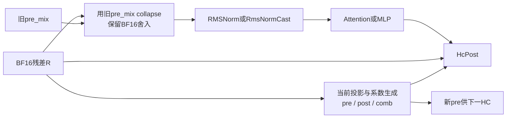

本轮围绕 HC 算子的融合、拆分、重组与理论上限，覆盖16个捕获形状/角色/上下文组合，HcPre、HcPost各8,944次执行，M为2、3、800、816、834。代码仅定点读取8份HC算子wrapper、kernel及tiling文件，未研究框架生命周期，未运行模型或新增设备测试。

最值得进一步验证的方案是把“旧pre_mix驱动的collapse＋归一化”与“当前系数投影＋Sinkhorn”拆开。所有捕获HcPre都提供external pre_mix；原始源码确认当前Y使用它，而新pre是下一HC的输入。因此当前Y不必在数据依赖上等待本次投影及系数生成，但当前post/comb仍必须在本次HcPost前就绪，新pre也必须保留。拆分需要明确的算子边界与同步，并计算新增launch和Vector/访存资源竞争。

| M=3、root绑定图层阶段 | 中位设备耗时 |
|---|---:|
| Attention HcPre / Norm / HcPost | 35.401 / 3.960 / 7.460 μs |
| FFN HcPre / NormCast / HcPost | 34.940 / 3.160 / 7.420 μs |

80个图、3,200层均有精确记录ID：两类Pre→Norm、层内Post→Pre、Merge→Post各3,200条；跨层Post→Pre有3,120条。其中400条跨层区间还包含其它Compute起点，涉及Engram/辅助状态及通信，不能统一跨层折叠。其余区间未记录中间Compute起点也不证明空闲、别名或融合合法。64个root图中，HC设备任务时段之和占图device control span的比例中位7.0204%，只是曝光份额，不能当成端到端收益上限。

HcPre已经融合了系数投影、平方和/RMS、pre/post/comb生成、Sinkhorn和collapse。内部仍先把BF16输入转为FP32，经GM工作区交给Cube，并存取split-K部分结果，collapse再读一次BF16输入。投影AB显式启用HF32；官方API说明该模式在Mmad前把FLOAT32输入舍入到HF32，因而不能拿BF16峰值替代其计算能力。[华为HF32接口说明](https://www.hiascend.com/document/detail/en/CANNCommunityEdition/910/API/ascendcopapi/docs/en/api/SIMD-API/C-API/cube_compute/asc_enable_hf32.md)

平方和路径还有可分析的内部重组空间：原始源码执行16×16 Gram块，再取对角线。在24 AIC的源码条件重构中，M=3请求的投影工作量为15.72864M次操作，Gram为10.48576M次操作；对应必要dense投影为2.94912M，普通逐元素平方归约为0.12288M。请求矩阵尺寸并非完整硬件发射证明，改成向量归约也不自动保持原Cube归约精度。两者的资源成本和数值合同要分别评估。

HcPost先将BF16输入扩成FP32，计算x×post，再按残差通道i的原顺序分别乘comb并累加，最后RINT回BF16。h=4时，每token每hidden元素为20次乘法、16次加法。合并上游Add必须保留Down的BF16舍入、Merge的BF16舍入，再进入HC的FP32计算。Post输出还会作为后续Post的残差，并可能供Engram、辅助状态或尾部使用，不能因为与Pre融合就宣称整份残差存储消失。

| 逻辑值读写模型 | M=3 | M=800 |
|---|---:|---:|
| HcPre最小描述符值字节量 | 2,120,124B | 43,015,788B |
| 对应冷HBM参考访存下界 | 1.3251μs | 26.8849μs |
| HcPost最小描述符值字节量 | 276,720B | 73,792,000B |
| 对应冷HBM参考访存下界 | 0.1730μs | 46.1200μs |

上述数字使用此前注明的每die 1.6TB/s参考，假设这些值实际经过HBM；真实缓存层级、内部重复访问、填充、同步和计算依赖尚未计全，不能拿它们与实测耗时相除报加速或MFU。完整计算下界仍须分别使用HF32、A2 Gram、Vector及特殊函数的能力，并计入20次Sinkhorn迭代中的39轮依赖归一化。当前没有足够证据把这些能力填成可靠的本机数值。

共记录7个方案/决策：延迟collapse与系数分支拆分、Pre＋Norm、Post＋下一collapse/Norm、消除FP32 cast工作区、Gram只求必要对角线、Merge＋Post，以及拒绝无条件代数折叠。Pre→Norm条件成立时，M=3可减少61,440B的BF16中间写读；cast工作区接口为491,520B逻辑写读。这些都不是已测得的HBM节省或时间收益。前两个方案共用的61,440B只能计一次，Merge＋Post也不能再叠加singleton Add和Down＋Add的同一项收益。

改变每次处理行数还需检查原始HC源码中列归约缓冲的epsilon对齐：当前读取的源码具有stride8而部分Adds长度按rows×4计算的条件，已保存独立索引反例；未证明当前捕获的loaded binary及row tiling触发，未诊断现有模型故障或修改代码。

本轮条件分析已入台账；全范围仍未完成。下一步转向SparseFlashMla、Indexer及投影链的工作量、访存、融合边界和计算上限，继续补齐其它算子与未覆盖条件。
