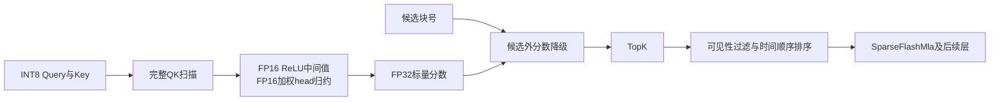

本轮完成 attention/Indexer 的51个捕获组合分析：SparseFlashMla 21组、QLI 18组、query quant与prepare各6组。与32份原始执行索引逐条核对，执行次数分别为4,367、832、832、832，共6,863次；模型和服务器运行状态未改动。

最值得优先研究的是候选位图与提前取Key。当前QLI的候选过滤发生在完整QK和head归约之后，不能把2048候选块理解为已提前减少矩阵乘法。每个候选生产层把结果共享给4个消费层，但消费层仍会排序2048个块号并计算membership。

| root绑定、M=3图中的QLI模式 | 次数 | 中位设备耗时 |
|---|---:|---:|
| C2普通扫描 | 192 | 94.232μs |
| C1候选生产 | 64 | 212.364μs |
| C1候选消费 | 256 | 497.125μs |

各模式的prepare约12.7–12.91μs。模式间的差值没有隔离成单项成本，不能直接报候选过滤收益；16个阶段未绑定图也没有混作同负载基准。64个root图中QLI设备任务时段曝光占比中位3.9285%，不是端到端可实现收益。

当前case的max-model-len为34,816，候选块大小8，逻辑块域最多4,352个，因此membership位图为544B/query，原2048个INT32块号为8,192B/query。原始候选列表可继续供需要它的消费者使用，同时发布位图以减少消费层重复排序与查找。已验证有效块号/-1域的membership等价；仍须保持每行、每次forward的完整写入、清零、代际和就绪关系。位图本身不减少QK。

提前按候选取Key可以减少QK，但必须保留候选外的补位语义：当前候选外位置被降为NEG_HUGE，候选不足TopK时仍可输出真实位置。有限FP16权重乘积与key scale条件下，可以证明原分数远小于NEG_HUGE的FP32间隔，从而生成同一常量分数，再沿用原sort/merge保留补位和tie规则。直接丢弃候选外位置或改成-1不等价；非有限中间值需要回退或另立数值合同。

代码定点读取还明确了三个精度边界。Query量化先把scale舍入到FP16，再用这个scale量化；独立BF16反例的量化结果为95与96，证明不能任意改成用未舍入FP32 scale。QLI先将INT32 QK经ReLU和1/1024转换到FP16，再做FP16权重乘积和head归约，不能当作一次FP32数学求和。SMLA的在线Softmax指数tile会先舍入BF16再参与PV，改变tile或归约顺序需要核对精度。

SMLA本身已经融合SWA、压缩KV、在线Softmax/sink和PV，内部仍有FP32 score、BF16指数、PV及更新工作区。它在root图中的中位耗时为：SWA 37.9105μs、C2 44.6505μs、C1 44.681μs。共3,200条精确SMLA→inverse RoPE→Transpose图链已绑定。

理论模型按实际有效键数和缓存向量并集建模，不按整个KV池容量计流量。令nq为每query实际参与的原始窗口及压缩位置数，U为所有query请求的独立缓存向量数，则SMLA两次GEMM的普通算法工作量为4HDΣnq，理想值读写为4THD＋2DU＋4H，再加索引、metadata和内部队列；H=64、D=512。QLI当前INT8 QK工作为2×32×128×ΣLq，候选消费模式仍是完整Lq。

| 明确假设：M=3且每行有效 | 普通算法工作量 | 参考计算下界 |
|---|---:|---:|
| SMLA 128个SWA位置＋512个压缩位置 | 251.658M BF16操作 | 0.6693μs |
| QLI扫描32,768个Key | 805.306M INT8操作 | 1.0709μs |

参考沿用已注明的每die 376 BF16/FP16 TFLOPS、752 INT8 TOPS、1.6TB/s，仅用于声明条件下的模型。[硬件参考来源](https://arxiv.org/html/2506.12708v1#S3.SS3.SSS1) 上表不是捕获输入值的断言，也没有计全Vector、TopK、在线归约、tile填充、缓存层级和依赖，不能据此报几十倍加速或MFU。

共记录13个方案/决策：候选位图、提前取Key并保补位、QLI融合prepare、源代码已明确别名的self-copy特化、head归约重组、Query RoPE＋量化、weight epilogue、Key量化＋cache写入、SMLA内部队列、SWA提前执行、SMLA＋inverse RoPE＋布局、跨卡Key分区，以及跨迭代增量复用的条件与反例。SMLA的LSE关闭时输出为0元素；没有把profile空shape额外计为4B标量。

跨层融合仍须发布后续层读取的indices/candidate bank。跨卡分析不能仅凭每卡拥有全部32个index heads就声称8倍重复工作：若Query行已分片，改成Key分片可能保持每卡计算量并增加交换。跨迭代也不能只因旧Key不变就复用旧分数；新Query可以让TopK排序反转。

M09、M10已分别建立10和9个算子语义分支族，旧记录保留为历史证据。整体仍未完成：实际逐query长度、缓存并集、候选值、内部阶段成本及Vector/TopK能力仍有参数缺口，Q/KV与输出投影等其它算子也尚未全部完成定量分析。
