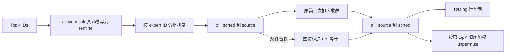

本轮核对 Router TopK→MC2 内部路由分组与逆映射。结论是：保留第一次排序结果后，第二次用于求逆的排序不是这段语义必需的工作。尚未实现替换，也未据此给出提速。

第一次排序返回排列σ，现有第二次排序以-σ[j]为唯一key、j为payload，故其有效输出恰好满足π[σ[j]]=j。直接按该等式构造逆映射保留原σ，因此不需要改变第一次expert同分排序。已检查T≤8的全部46234个排列及当前T=6/9/18的局部消费者窗口模型；这是数学模型验证，没有原生Scatter速度或加载内核精度证明。大的816/834行gather分支已有按索引写逆映射，未重复领取“去第二次排序”收益。

full-load的每个有效分区都读取完整expert-ID向量并做两次高层Sort。3行/TopK6有18个分区，3行/TopK3有9个，2行/TopK3有6个。三种组合3512次既有调用，对应条件源码参考120240次高层Sort；仅去逆排序后的参考为60120次。这不是原生指令统计、实测耗时，也不是所有等价算法的必要工作下界。固定显式GM逆映射表示仍须发布4T字节，容量未知，仅保留相应符号界。

局部方案也可区分消费者：core0保留完整逆映射供全局unpermute，其他core只构造自己assignment区间会读的位置。共享一份全局映射则需新读取和就绪关系，还要证明原各core的分组排列一致。当前源码计数/cumsum只由最后一个有效core写出，并没有按全部core重复写出；该部分未计为重复收益。

| M=3、TopK=6的条件计算图 | 高层Sort调用参考 | 内部行量化参考 |
|---|---:|---:|
| 当前源码分区 | 36 | 18 |
| 仅直接构造逆映射 | 18 | 18 |
| 仅按token对齐分区 | 6 | 3 |
| 两者结合 | 3 | 3 |

这是同一基线的替代图；两项独立节省不能相加。按token对齐也改变并行度，若再共享量化或全局映射，必须按同一组选定分区重新计算。

需要特别保留active mask边界：MC2先把inactive token的expert ID在GM中改写为额外sentinel，再同步、排序和计数。例子[0,1]在第一行inactive后变为[384,1]，逆映射从[0,1]变为[1,0]，计数也不同。不能直接用mask之前的TopK输出生成可复用映射，或悄悄提前这个可观察改写。Router TopK按每行score选expert，MC2按所有assignment的有效expert ID分组，它们的key与数据域不同。

若进一步以histogram/prefix替换第一次分组排序，必须保留tie/capacity语义。声明的逐行expert模型在receiver容量为1时，两个同expert token的顺序互换，会改变留下哪个token。无容量裁剪且所有处理对行排列等变时可另行建立等价域；当前原生精度、alias和实际容量尚未据此关闭。直接保留第一次σ的局部逆映射方案没有这项重排。

跨层/跨迭代复用也分输出：当前mode2的cumsum取决于有效ID直方图，但逆映射还依赖assignment顺序。[0,1]与[1,0]计数相同，逆映射不同。已知false的padding尾部可给直方图增加(P-N)·k个sentinel；这条公式不删除原有map、记录、mask副作用或通信。映射相同也不说明hidden、量化值或expert输出相同。验证相等与发布新epoch仍须计价。

共享映射的值模型还保留了新GM读取。在T=6、6个分区时，所列逻辑值访问可少96B；但声明的每次copy触及32B块、无跨copy缓存合并且base offset为0的敏感性模型，块覆盖从224B变为256B。它不是实际DMA或HBM流量，说明不能仅按值字节确定收益。官方[DataCopyPad文档](https://www.hiascend.com/doc_center/source/en/CANNCommunityEdition/850/API/ascendcopapi/atlasascendc_api_07_0265.html)支持非对齐逻辑长度，blockLen单位为Byte；当前文档是API语义参考，未作为9.2原生实现或物理带宽证明。

原生层联接3200组router/TopK/MC2边界，复用9600条旧TASK；2560组有阶段归属、640组仍未知。TopK的三路输出描述全部保留，内部Sort没有被虚构成新增可计时TASK。已有REL73-07及三组联合合同得到细化，中央计数仍122条/25组、473对待汇入或复核；分支台账358条、24个语义模块。9个regime/1352次执行的关键字段缺口、849条PMU缺失、16张阶段未知图、3136条模块归属歧义未改变。整体目标及全模块最低MFU仍未完成。
