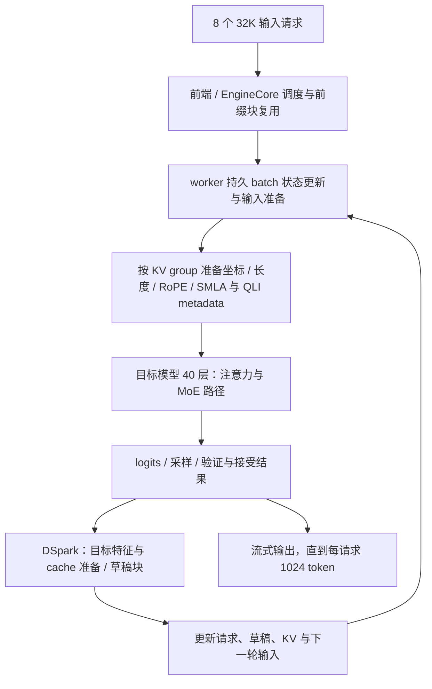

# 模型推理过程分析和潜在优化机会

> **阶段性研究报告：整体优化机会覆盖尚未完成。** 此前的整体完成判断已更正；未闭合范围见[完整性更正](../continuation-20261030/COMPLETENESS-CORRECTION-20261030.md)。

**DeepSeek V4.1 Flash W8A8 · 169 / Ascend 910C · vLLM-Ascend**  
研究场景：32K 输入、1K 输出、并发 8、约 90% 前缀缓存命中。  
研究日期：2026-10-30。本文整合已有有效测量与新目标下的追加研究；历史“发布完成”不作为本次验收依据。

## 1. 主要结论

本场景应同时优化**完整迭代中的 worker 准备边界**与**设备内的 MoE、Indexer 和投影**。只分析一个 40 层主模型片段，会遗漏与该片段时长接近的迭代间隔。

新分析在同一次官方采集中识别出稳定重复的主模型相容序列：后续窗口每 rank 12 次，每次主流有 1318 个唯一任务，其中 40 个为主模型 MoE 形状相容调用。主流段跨度中位为 **37.441 ms**，相邻段间隔中位为 **35.740 ms**。同次 rank 0 / 8 worker trace 中，`prepare input` 在这些间隔内的覆盖中位分别为 **34.006 / 31.485 ms**。这些事实使 A3 metadata 批量准备成为本报告新增的优先候选。它们不证明整段间隔可以删除。

设备侧，初始混合窗口的 MoE 复合任务占本 rank 已导出跨度的中位约 **39.17%**；后续小行数窗口约 **18.86%**。历史选定 40 层主流片段内约 **35.88%**，三者分母不同。MoE 值得优先研究，但目前不能把复合任务中的计算、通信、工作不均和内部等待完全拆开。

后续具体算子中，约 **496.5 µs** 的指定 QLI 形状组、约 **52.1 µs** 的单组输出投影接口，以及约 **42.0 µs** 的小 M Q_b 相容投影，分别对应选择状态特化、二维接口和 head 分片前移的设计空间。mHC、KV 准备、共享专家和 Engram 也有具体机会，优先级应随前述瓶颈变化重新评估。

本报告的交付是有证据的优化研究与实施路线。**尚未实现或验证任何端到端提速方案。** 本机参考吞吐不是理论上限；本文也不将其他硬件论文的倍率用作 910C 的收益预测。

## 2. 场景与可复现边界

| 项目 | 本研究实际条件 |
|---|---|
| 机器与资源 | 172.16.10.169；项目标识 910C/A3；16 个逻辑芯片。设备显示 Ascend910、每芯片 65536 MB HBM |
| 模型 | 私有 checkpoint `DeepSeek-V4.1-Flash-1017-w8a8`；不以公开 V4 的规格替代本 checkpoint |
| 并行 | TP8 × DP2；总计 8 个并发请求，两 DP 各完成 4 个 |
| 输入/输出 | 每请求 32768 / 1024 token；忽略 EOS，固定生成长度 |
| 缓存 | 命中 235904 / 查询 262144，即 89.990%；block size 128；0 抢占 |
| 已有优化 | DSpark 5、异步调度/batch queue、DSA-CP、FlashComm、fused MC2、graph 路径等冻结配置；动态分支逐项以运行证据核对 |
| vLLM / Ascend | `0.30.0+empty` / `0.30.0rc2`；源码 commit 分别为 `ced6857afa0ea7b2e3f0846a62e1394e90f15607` / `8fde6d4e335fe300e2b949aab0e31659cce0811d` |
| Torch / CANN | torch `2.10.0+cpu`、torch_npu `2.10.0.post7`、CANN 9.2.0；镜像 ID `ce42d65…` |

实际容器、挂载、serve.sh 和版本证据见[环境快照](../ENVIRONMENT-SNAPSHOT-20261030.json)。所有运行只使用本人 169 服务或分析容器；未操作 172，未停止他人任务。

“90% 前缀命中”不是节省 90% 总时延。它减少部分输入计算，但后续每轮解码/验证仍需访问长上下文的相应缓存、构造 metadata、执行主/草稿模型及通信。缓存查询差值也不能直接当作实际 prefill 行数。

## 3. 一次请求如何经过系统

这张图表达逻辑依赖；实际有 batch queue、多流和主机准备重叠，不能按箭头把所有时长相加。DSpark 的具体 draft/verify 时序和每次实际接受长度仍以各次运行元数据为准。

主模型层内，mHC 对多路残差状态做 pre/post 处理；注意力路径包含低秩 query 投影、归一化/RoPE、SWA 及压缩 cache 更新，部分层还有 compressor 和 QLI 索引选择；稀疏注意力消费索引及分页 KV。CP 分支的 head 交换将“本地 token、全部 head”恢复为“全部 token、本地 head”，随后执行两级输出投影及相应归约。MoE 路由选专家，复合 MC2 完成分发、专家计算、激活/量化和汇合。共享专家及 Engram 是需要分别核对的分支，不能假定所有层具有相同结构。

源码、数据流和 32 个主编号及派生候选见[融合与重组目录](FUSION-INVENTORY.md)；本轮新增 F33 见第 8 节及[追加分析](../continuation-20261030/CONTINUATION-ANALYSIS.md)。

## 4. 采集方法与计量口径

### 4.1 三层数据

| 层级 | 已实际执行的方法 | 可以支持的分析 |
|---|---|---|
| 请求/框架 | 冻结输入、逐请求流式时刻、原生 `/metrics` 前后差；EngineCore 外部栈与 procfs；追加 worker procfs | 请求完成量、命中、抢占、草稿计数、客户端 TTFT/近似 TPOT、主线程 CPU 消耗与等待栈 |
| 算子/时间线 | 本镜像原生 TorchNPUProfilerWrapper，CPU+NPU、Level1/PipeUtilization，两个短窗；安装版官方 `analyse` 导出 | 同次 kernel 区间、完整输入形状组、model/stream/task、worker CPU scope、通信及控制轨道 |
| NPU 负载 | 驱动自带 npu-smi，逐帧同机单调时钟；历史 PMU/流水字段按原含义保留 | 粗粒度 AICore 显示值、HBM 容量、进程归属，以及受限的流水活动线索 |

官方方法见 [vLLM-Ascend profiling guide](https://docs.vllm.ai/projects/ascend/en/main/developer_guide/performance_and_debug/service_profiling_guide.html)；实际能力以冻结版本为准。原常驻服务未启用 profiler 路由，因此此前用同镜像、同脚本的独立诊断容器完成采集，再恢复原服务。追加离线分析没有重新采集 NPU 数据。

32 份导出（两窗 × 16 rank）均成功。新分析重新读取全部 CSV，其 SHA256 与原摘要全部一致；另外读取同次 rank 0 / 8 后续 worker trace。原始数据主要保留在 169 本任务目录，本机不假定有全量副本。

### 4.2 参考吞吐与采集扰动

| 运行与口径 | 完整客户端窗口 | 聚合输出 token/s | 用途 |
|---|---:|---:|---|
| 同次官方诊断的无 profiler 参考 | 16.004567 s | 511.854 | 目标场景参考 |
| 官方 profiler 轮 | 18.377898 s | 445.753 | 算子/框架诊断；不是无扰动性能 |
| 新 worker 外部采样尝试轮 | 15.404247 s | 531.801 | 请求与 procfs 有效，Python 栈采样失败；不是优化后结果 |

历史 AISBench 519.84 输出 token/s 使用另一窗口定义，不能与本表直接算回退或收益。上述轮次的 DP 分配、接受长度和采集负担并非逐事件一致，尚未构成某个优化的同条件 before/after。

无 profiler 参考的客户端首次非空文本平均 924.713 ms，近似 TPOT 平均 14.369 ms。近似 TPOT 按 `(结束−首次非空文本)/(1024−1)` 计算，包含协议尾部；DSpark 的流式 chunk 可含多个 token，chunk 间隔不是逐 token ITL。

## 5. 完整迭代：新增框架侧发现

### 5.1 从主模型片段走向相邻执行间隔

分析不固定历史 model/stream ID：按每个 `(Model ID, Stream ID)` 的重复首 task key 分段，并校验整个任务 ID、类型、输入/输出形状序列。每 rank 的相容主流段有 1318 个唯一 task ID、40 个主模型 MoE 接口；初始窗 5 段、后续窗 12 段，窗内完整签名一致。实际 model ID 为 49；主流随 DP 为 87 或 89。

| 每 rank 先取中位，再取 16 rank 中位 | 初始窗 | 后续窗 |
|---|---:|---:|
| 主模型相容主流段跨度 | 37.761 ms | 37.441 ms |
| 相邻段间隔 | 混合期不汇总为解码间隔 | 35.740 ms |

后续共有 176 个间隔（16 rank × 11）。rank 0 的间隔跨度与全部 kernel 记录区间并集的中位分别为 36.081 / 7.349 ms，rank 8 为 35.341 / 11.187 ms。间隔内有草稿相容计算、metadata kernel、通信及控制记录；未覆盖部分不能直接叫设备空闲。

### 5.2 同次 worker 的输入准备

| 同一官方后续采集 | rank 0 | rank 8 |
|---|---:|---:|
| `prepare input` 完整范围时长中位 | 45.927 ms | 44.878 ms |
| 在相邻主模型段间隔内的覆盖中位 | 34.006 ms | 31.485 ms |
| 每范围后代 cpu_op scope 数中位 | 6956 | 6956 |
| 根范围未被直接子 scope 覆盖的时长中位 | 16.590 ms | 15.403 ms |

完整准备范围部分重叠前一段设备执行。一个代表范围包含 976 次 slice、1063 次 as_strided、383 次 copy、245 次 where 和 540 次 empty_tensor scope。它们包含嵌套操作，不能当成同数量独立 kernel，更不能把 inclusive 时间相加。未被子 scope 覆盖的时间也包含 Python/native 工作、等待和采集开销。

已有 EngineCore 栈更多落在 `step_with_batch_queue → future.result → worker 回复队列`，主线程约一个核。它说明 EngineCore 在等待下游回复；**本次 worker 证据进一步提示，下游准备边界必须单独调查**。仅减少 EngineCore 自旋或把等待搬到另一线程，不保证 token/s 改善。

### 5.3 无 Torch profiler 的有限交叉检查

追加采样轮完成相同 token/缓存契约，采用独立 cache_salt，使本轮 seed 与对应测量共享缓存命名空间，避免旧请求变成 100% 命中；未 reset/restart 服务。请求业务窗口内 15.256 s 的 procfs 样本显示，EP0 / EP8 worker 主线程约 **0.968 / 0.966 核**，进程聚合约 1.917 / 1.880 核。主线程接近单核 CPU 饱和，但这不能单独归因到 metadata，仍可能包含轮询等工作。

worker py-spy 50 Hz 出现持续采样落后并超时，两个采样子进程退出 -15，未产生有效 speedscope；降低至 1 Hz 的独立尝试又在预热期间因非本人容器的 NPU PID 出现而被归属检查终止，未进入测量。两次失败均如实保留。原服务最终健康且空闲；未操作外部进程。本文不使用不存在的 worker 栈支持结论。

## 6. 算子和 NPU 负载：哪些热点已经看见

### 6.1 初始混合期与后续小行数分别看

以下按每 rank 全部已导出 kernel 的最早开始至最晚结束为分母，类型先取区间并集，再取 16 rank 中位。

| 导出类型 | 初始窗占比中位 | 后续窗占比中位 |
|---|---:|---:|
| MoE `DispatchFFNCombine` | 39.17% | 18.86% |
| 量化矩阵乘 `QuantBatchMatmulV3` | 3.93% | 5.30% |
| `MatMulV2` | 3.97% | 4.18% |
| `HcPre` | 3.51% | 4.06% |
| QLI Indexer | 3.47% | 3.31% |
| `SparseFlashMla` | 4.36% | 2.73% |

窗口跨度中位为 1514.292 / 896.905 ms，不是整个 1K 输出请求。初始窗每 rank 有 160 条 MoE 首维大于 3 的记录；后续所见 MoE、SMLA、量化矩阵乘首维均不大于 3。结合客户端后窗位于首次文本之后，支持区分混合期与小行数路径，但没有逐请求 phase 绑定，不能把每条 shape 自动标为 prefill 或 decode。

初始窗指定 `[816,5120]`、24 本地专家组的 640 条 MC2 记录中位 **2812.874 µs**、p95 **8801.524 µs**。相同物理输入形状仍可有不同专家行分布、mask、容量和等待，长尾不能直接归因于通信。

### 6.2 把后续热点落到完整接口

| 完整形状相容组（简写） | 条数 | 中位 / p95 µs | 研究意义 |
|---|---:|---:|---|
| Q_b `[3,1280]`，NZ 权重对应输出 32768 | 8112 | 42.019 / 46.319 | small-M 与权重复用/分片 |
| 输出投影 `[24,1,4096]×[1,4096,1024]` | 7680 | 52.139 / 55.919 | 单组 batched 接口与二维接口 |
| Engram 相容投影 `[3,6144]×[25600,6144]ᵀ` | 384 | 277.644 / 289.760 | 大权重投影与布局 |
| 指定 QLI `[3,32,128]`，含 `[3,1,2048]` 候选输入 | 768 | 496.500 / 501.990 | 选择状态长度/归并 |
| Indexer 索引整理 kernel（未导出 shape） | 1536 | 12.820 / — | 尾部融合次于指定 QLI 主体 |
| Engram UVA gather 指定形状 | 384 | 11.840 / — | 已见设备片段较短；完整 host/UVA 代价未知 |

池化调用并非独立重复实验；形状相容不等于权重和函数身份已全部绑定。另两个完整 QLI 形状组中位约 92 / 210 µs，因此不能只凭 query 首维混成一个“Indexer 耗时”。

历史同一内部图第 2 轮的 40 主层、单主流跨度中位 37.122 ms；该范围 MoE 35.88%、HcPre 7.66%、QLI 6.65%、TransposeBatchMatMul 5.66%、SMLA 4.88%。这些值辅助层内排序，不替代上表的全窗口分母。第 0 层以及 28/24/32/36 层是已有逐层筛查中的比较入口；尚不证明某层的通信或硬件利用率根因。

### 6.3 NPU 负载与通信的解释边界

参考轮 AICore 显示值中位 68%（128 个芯片帧），采集轮 67%（144 个芯片帧）；实际帧距约 2 s。HBM 显示占用约 61–61.5 GB，是容量。不能从这些值推断还有 32% 或 33% 的可兑现速度空间，也不能计算实际 HBM 带宽。

显式 COMMUNICATION 标签的卡内并集中位为初始 188.926 ms、后续 76.150 ms；计算标签（含 MIX）为 1093.493 / 489.082 ms。按该标签分类得到的交集为 0，但 MC2 的 MIX 内包含通信，AICPU controller/hcom 还可能描述同一过程的不同层。因此不能据此认定没有物理重叠，或把所有通信时长当作暴露开销。完整依赖关键路径和链路流量仍未测清。

## 7. 竞争机制假设

| 已见症状 | 保留的机制假设 | 仍可能的解释 / 能区分它们的证据 |
|---|---|---|
| worker 主线程接近 1 核；prepare 范围覆盖大部分相邻间隔 | 大量小张量准备/dispatcher 与 Python 构造限制提交 | 等待、轮询及 profiler 开销也在范围内；需低开销阶段计时、调用路径与删减准备工作的同条件比较 |
| 大行数 MC2 长尾；部分 rank/层差异 | 真实专家负载或内部组级交接不均 | 通信等待、tile 效率、共享资源和采集扰动也可能造成；需同调用专家计数、capacity 和阶段 ready 时间 |
| QLI 指定组约 0.5 ms，输出 K 较小 | 选择/归并状态大于实际所需 | 有效 key 长度、candidate 模式与数值/tie 语义未绑定；先读实际 metadata，再比较精确 K 特化 |
| 小 M 投影时间远高于名义 MAC 参考 | 权重搬运、布局、接口或 tile 粒度主导 | 尚无真实 HBM/L2 字节；需相同输入/权重与图路径的接口/分片对照 |
| Engram gather 片段较短、大投影较长 | 已见设备段优先优化投影 | host lookup、UVA fault/同步可能不在所选片段；需完整 producer/consumer 时间与页/预取证据 |

这些假设之间可以同时成立。因果判断需要单机制试验；一个方案跑得更快，也未必证明其声称的根因。

## 8. 优先优化机会及可执行验证路线

### A. F33：把 A3 多组 slot/metadata 准备变成批量生产

**证据与边界。** worker 的新时间线为第一优先级提供支持。冻结 `dsa_v41.py` 的非 A5 packed-cache 分支按组执行 mask、clamp、除法/余数、where 和多次 copy；runner 逐 KV group 构造 metadata。源码已经有批次共享和组内共享，本候选研究这些共享之后仍存在的小任务与对象边界。

**重组。** 以 KV group 为外层维度，一次批量生成 page/offset/flat 坐标及兼容的长度字段，写入固定地址输出。保持不同 group 的物理块、ratio 和 storage block size；仅共享真实相同的批次数据。可选择独立设备算子，或在能力允许时捕获准备子图。

**正确性。** 保持负 slot 的 `-1` sentinel、压缩完成判据、actual-request/token padding、C2 位置奇偶及 skip-update、SWA/LongKV 所有权。buffer 不能在前一 replay 消费完之前覆盖；compressor 状态更新不能随纯坐标运算任意移动。A5 已有 backend 不证明 A3 已可调用。

**判断成功。** 降低未被前一设备段隐藏的准备时间，同时改善最终 TPOT/吞吐；记录主线程 CPU、dispatcher/launch 数、metadata device 时间和等待。CPU 利用率下降或 scope 数减少本身不足以验收。实现难度中等，适合先做此边界的定向工程验证。

### B. F21：MoE 内部组级 ready、激活与第二次 GMM 的交接

**证据。** MC2 是初始窗主要热点，历史主层内也占显著比例。源码已有 dispatch 与 GMM1 的部分交叠；其外层 dispatch→GMM→activation→GMM→combine 已融合，重新包装不是新收益。

**重构。** 将大同步边界拆为已就绪专家组/块的交接，研究下批 dispatch 与前批激活、GMM2/combine 的重排。消费者 reduction 决定可切分维度；不是任意矩阵维度都能提前发布。

**约束和代价。** 独立 buffer/分区、cross-core flag、量化 scale、workspace 活期及 collective 次序必须一致。GMM1/GMM2 共享 Cube，dispatch/激活使用 AIV/搬运，不能假设各阶段同时满速。先保存同次逐专家有效行数与真实 capacity，再决定先解决工作不均还是阶段等待。收益机制置信度中等、实现难度高。

### C. QLI：把 token 保留长度与 2048 tile 解耦

**证据。** 指定后续组约 496.5 µs。源码每 tile 排序、归并并保留较长列表，最终只写 sparseCount。先核实真实 sparseCount、有效 key 长度和 candidate 模式。

**特化。** 在最终 K=512 且语义允许的路径，只缩短 token 累加状态，保留 2048 tile 和 candidate block 的独立合同。满 tile 的条件账中，两路归并输入可由 4096 对减到 2560 对，回拷由 2048 对减到 512 对；tile sort 本身仍执行。

**约束。** 保持排序、tie、sentinel、有限负惩罚、候选不足补齐、跨层候选复用与异步工作区。不能直接删除候选外位置，也不能无条件换成近似/无序 TopK。开发难度中等；对 K、长度和 mode 做受控特化比先替换整套算法更收敛。

### D. 输出投影：单组接口与两级投影边界

**接口候选。** 当前 `[24,1,4096]×[1,4096,1024]` 单组投影使用 transpose-batchmatmul。可将相同布局表达为二维矩阵乘，研究不同后端选择。已有合成 BF16 eager 对照中，原接口事件中位 66.0 µs、二维接口 48.8 µs，但序列有漂移，事件含提交间隙；最大绝对输出差 0.000244140625，非逐位相同。它支持保留候选，尚不支持替换真实图或宣称整机提速。

**进一步重组。** 在保持中间 BF16 舍入和逐组权重对应时，可研究第一投影输出直接交第二投影消费，或按可归约通道分块接入 reduce-scatter。预乘两组权重会改变浮点计算及舍入，不能当作等价融合。先做真实权重、graph 路径和下游精度验收；单接口替换成本较低，跨投影/通信流水成本较高。

### E. Q_b：把 head 分片前移以增加权重复用

CP 当前使用 ReplicatedLinear Q_b，再做 attention/head 交换。条件 TP8、每 rank 3 个有效 token 时：

| 每 rank 条件工作账 | 当前布局 | 前移 head 分片布局 |
|---|---:|---:|
| 矩阵 | `[3,1280]×[1280,32768]` | `[24,1280]×[1280,4096]` |
| INT8 MAC | 125829120 | 125829120 |
| INT8 权重本体 | 40 MiB | 5 MiB |
| 输出元素 | 98304 | 98304 |

计算量相同，输入行数变大、每 rank 权重更小，有机会改变小 M 数据复用，并移动后续 head 交换边界。**新增 query gather、索引与 cache 可见性代价必须同时记账。** 保持 per-token scale、NZ/通道权重、metadata、RoPE、mask、padding 及输出 head 排列；不能只改线性层就删除 collective。跨模块代价高，适合在完整 attention 子图中验证。

### F. mHC、KV 准备、共享专家与 Engram

- **mHC：**已有 HcPre/HcPost，前处理在历史主层片段约 7.66%。研究内部归约/向量阶段、输入扫描复用以及跨 pre/post 的状态；保持 FP32 系数、Sinkhorn 迭代和中间精度。低 MAC 活动不证明整个 kernel 低效。
- **KV/RoPE/cache：**研究 norm、RoPE、量化与 cache 写的生产边界，或 inverse RoPE 与 head pack 一次写出。必须保留分页、cache plane stride、因果位置、in-place alias 和跨流发布事件；物理连续不等于语义上可合并。
- **共享专家：**研究 routed 与 shared 分支的并行或量化输入复用，但需证明量化域、scale、token 排列相同，以及 fused MC2 配置允许。两支争用 Cube/AIV/HBM，单独时长不能全部相互隐藏。
- **Engram：**已见设备片段内，大投影优先于短 UVA gather。研究投影权重复用、连续化以及确定性地址的提前准备；仍需完整 host/UVA 路径。不同 Engram 层权重不一定相同，不能跨层任意合批。

## 9. 融合、拆分和重组应如何选择

| 边界 | 推荐研究方式 | 关键限制 |
|---|---|---|
| 多 KV group 的小坐标准备 | 横向批量合并，固定输出地址 | 各组所有权与物理映射独立；保留已有共享 |
| MC2 内部大同步 | 拆为组/块 ready，再组织流水 | 先证明数据独立、buffer 和事件；AIC/AIV 资源竞争 |
| QLI 的选择状态 | 按真实 K 特化状态与归并 | 排序、tie、回退、candidate 和无效值 |
| inverse RoPE→head pack | 合并读写与布局转换 | 原位别名、旋转维度、精度、padding |
| attention→输出投影→归约 | 按可提前完成的行/通道交付 | collective 是否提供块 ready；不能跳过 reduction |
| 共享专家与 routed 专家 | 独立分支并行，或经证明的量化复用 | 选路兼容性与资源争用 |

融合节省的是实际消失的中间读写、启动或同步；拆分的价值是更早发布可消费数据。若拆分损害 GEMM 粒度、增加通信和缓冲，总时间可能更长。以消费者依赖及同条件总时延判断，不能以“融合数量”或可视化区间相交验收。

## 10. 理想时间与收益评估

对固定语义、数据域和资源，分别建计算、存储、通信、启动和依赖账。允许重叠的资源取相应约束，存在串行依赖的部分沿路径组合，避免所有项简单相加或一律取最大。

例如 Q_b 条件逻辑 125829120 INT8 MAC，在既有名义 353.8944 TMAC/s 参考下约 0.356 µs；Engram 逻辑 471859200 BF16 MAC 的名义参考约 2.667 µs。这些仅覆盖逻辑矩阵计算，不包含 tile 填充、scale、数据访问、启动和等待。

若一次 Q_b 必须从某存储层读取全部 INT8 权重，其权重服务参考为 `41943040/B` 秒；Engram 相容 BF16 权重本体为 314572800 B。这里 B 是同边界下可达带宽，**真实必读字节与驻留尚未测得**。不能拿 42/0.356 或 278/2.667 直接当可提速倍数。

同理，MC2 不能仅用物理输入 M 推算各本地专家的真实工作。容量裁剪、mask 和跨 rank 路由会改变有效行数；没有同次计数，就保留变量。当前不具备证明严格数值全机 TPS 上界的必要工作量、硬容量和完整依赖证据。用户要寻找优化机会，不需要用一个伪精确上界替代这些研究。

## 11. 文献调研与对本场景的提炼

资料库由[原一手资料库](REFERENCES.md)与[本轮补充](../continuation-20261030/LITERATURE-SUPPLEMENT.md)组成，按机制而非论文倍率使用。检索截止 2026-10-30，覆盖以下体系；版本、阅读范围和不适用处在条目中注明。

| 机制域 | 代表主源 | 本机映射与复析 |
|---|---|---|
| 模型结构 | V4 官方材料、mHC、Engram、DeepInfer V4.1 | 区分公开模型与本 checkpoint；已有复合核只研究剩余边界 |
| KV/服务组织 | PagedAttention、RadixAttention、ORCA、Sarathi-Serve、DistServe | 前缀复用/连续调度已存在；关注命中后的实际工作与混合期干扰 |
| 动态计划/图 | FlashInfer、Ascend graph 文档、ACL graph 更新 RFC | F33：plan 与 run、固定地址、明确 task/event 身份；保留当前共享 |
| 算子流水/通信 | NanoFlow、Comet、FLUX、DeepEP、PTO MegaMoE、Tutel | 按消费者独立维度切分；把已存在 MC2 流水和资源竞争一起记账 |
| 专家计算 | MegaBlocks、DeepGEMM、Ascend MC2 源码 | 真实行分布、padding、grouped GEMM 与权重复用；不假设本机有固定容量浪费 |
| 注意力/选择 | FlashAttention/3、FlashMLA、RadiK、RTop-K、MrgSort | 当前已是 sparse/复合核；QLI 精确 K 特化优先，近似/无序替代需独立精度合同 |
| 投机解码 | Leviathan/Chen 原论文、EAGLE、DSpark 实现 | 以最终输出 token 归一化 draft+verify+准备成本，接受率不是加速倍率 |
| 量化/小 M | SmoothQuant、vLLM-Ascend 动态量化设计 | 不改变冻结 W8A8 语义；核对 per-token/per-channel、布局和 scale 复用 |
| 性能模型与采集 | Roofline、I/O complexity、官方 profiler 与 npu-smi | 分资源和关键路径分析，限定代理字段，保留扰动与未知 |

本轮具体变化有三点：

1. [FlashInfer 的 plan/run 和固定 workspace](https://arxiv.org/html/2501.01005v1)与新增 worker 时间线共同支持 F33，但源码已有批内共享，因此新增空间是 A3 的具体批量生产边界。
2. [Comet 的共享张量依赖分解](https://arxiv.org/html/2502.19811v1)和 [FLUX 的整体时间评估](https://arxiv.org/html/2406.06858v1)要求先证明可交付维度和粒度。它们支持更精确的 F21/F15，不支持把已有 MC2 再“融合一次”的收益。
3. 投机解码原论文要求保留采样/校正语义并计入草稿成本。新增轮 accepted/draft=6445/8790 是 token 计数比，不能当作每轮接受长度、整请求加速或纯模型利用率。

资料库是截至检索日按上述机制整理的相关主源集合，不声称对所有历史发表物作了数学意义的穷尽。论文的 GPU、训练、950、FP8/FP4 或其他模型路径与本机 910C/W8A8 的边界逐条保留。

## 12. 文献之后再次看数据：保留与降级

| 方向 | 复析结论 |
|---|---|
| worker 输入准备 | 从一般框架疑点提升为有同次范围支持的优先调查项；新 F33 具体到 A3 多组 metadata |
| MoE | 继续优先研究初始大行数及内部交接；先区分真实工作量与等待，不以低 MAC 代理断因果 |
| Indexer | 指定 QLI 组远大于尾部整理，先查内部 K/归并；candidate 外删除或近似 TopK 降为条件方案 |
| 输出投影 | 保留低成本二维接口；合成 eager 差异不足以证明真实 graph 收益 |
| Q_b | 保留前移 head 分片；计算不变、潜在权重服务减少，但新增 query/index/cache 代价未计清 |
| attention 主体 | 已有融合且选定片段中 Indexer 更长；不预设重写 attention 是第一优先级 |
| Engram | 在已见设备段内先查大投影；完整 host lookup/预取成本仍待绑定 |
| 额外异步/前缀缓存 | 基线已启用，不重复列为新增功能；只研究剩余回复、准备与 ready 边界 |

## 13. 下一阶段实验合同

研究报告不要求把所有候选同时实现。建议按以下顺序选择单机制 Loop，每轮使用同一冻结负载及明确保护条件：

1. **F33 定向诊断与原型：**低开销记录实际 metadata group/操作身份、输入准备与提交时刻；保持现有 sharing，对比批量坐标生产。保护 prefill/decode、空请求、padding、C2、DSpark 接受/拒绝后的状态。
2. **单组输出投影真实 graph 对照：**固定真实输入/权重、静态地址、预热和交替顺序，核对误差与下游输出，再测客户端窗口。先隔离接口，不同时改通信。
3. **QLI K 特化：**保存实际 K、长度和 mode；对 tie/sentinel/回退逐项验证，再测同签名 kernel 和完整迭代。
4. **MoE 组级诊断：**只保存选定同调用的每 rank 专家计数、capacity 与阶段 ready；避免共享 count 缓冲被后层覆盖。无法绑定 replay 时拒绝该样本，不扩大无目标合成 dump。
5. **Q_b/通信重组：**在上述低成本机会评估后，建立完整 attention 子图的语义与资源对照；包含 query gather、index/cache 所有权和输出归约。

每轮至少保存原命令、源码/镜像、输入摘要、cache 计数、成功/错误、原始指标、重复离散度及回滚方式。只有正确性通过、同条件差异超过噪声、最终业务指标改善时，才称为已验证优化。

## 14. 已知限制与研究产物

逐请求 prefill/decode/replay 绑定、同次逐专家有效计数与容量、真实 HBM/L2 字节、完整暴露通信关键路径、Engram 完整 host/UVA 成本，以及若干输出头/采样和 packed 分支仍有缺口。这些限制决定候选的置信度和下一试验，不被隐藏成确定收益。

本研究保留以下可复查产物：

- 场景/环境：[实际环境快照](../ENVIRONMENT-SNAPSHOT-20261030.json)、[总目录](../RESEARCH-INDEX.md)、[结构化目录](../RESEARCH-CATALOG.json)。
- 官方测量：[请求/负载摘要](official-capture.json)、[32 份算子汇总](official-operators.json)、[完整形状组](official-operator-shapes.json)。
- 历史层内与草稿：[证据摘要](evidence-summary.json)、[EngineCore CPU](framework-cpu.json)、[融合目录](FUSION-INVENTORY.md)。
- 新增完整迭代：[重复序列](../continuation-20261030/graph-executions.json)、[176 个间隔](../continuation-20261030/iteration-gaps.json)、[worker 范围与冻结源码](../continuation-20261030/prepare-input-analysis.json)、[紧凑汇总](../continuation-20261030/continuation-evidence.json)。
- 新 worker 轮：[匿名请求/procfs/失败采样证据](../continuation-20261030/worker-validation.json)、[追加分析](../continuation-20261030/CONTINUATION-ANALYSIS.md)。
- 资料：[原资料库](REFERENCES.md)、[新增主源与机制提炼](../continuation-20261030/LITERATURE-SUPPLEMENT.md)。
- 交付检查：[六步要求审计](../continuation-20261030/REQUIREMENTS-AUDIT.md)、[五项复核结果](../continuation-20261030/verification-results.json)、[最终服务与源码状态](../continuation-20261030/FINAL-SESSION-STATE.json)。

公开摘要及脚本不包含私有权重、prompt 或生成文本。独立重采仍需相同权重、冻结输入、镜像和 169 环境。复算脚本验证算术、结构与口径，不替代原始硬件采集或候选优化的正确性/性能实验。
