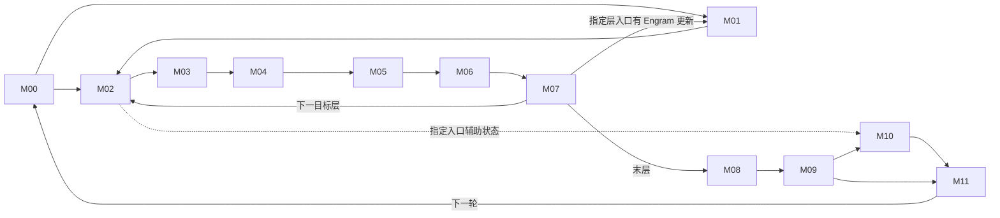

# 171 · DeepSeek‑V4.1‑Flash 融合优化研究工作台

## 2026-11-10 整inactive-DP与实际就绪：限定判断，继续全链路

介绍：沿engine本地无工作→target40＋draft3→peer专家与最后输出，先评估整轮、合成sender和host联合交付。到了哪里：171 hostname核对恢复，20运行树文件16旧hash匹配/4新取＋5依赖；原C8的43个idle F21入口全部早于active。独立新profile全16 CPU/native每轮40＋3关联完成，26个共同Gloo ordinal形成208对；实际Ascend target/draft共用INT32[2,DP]数据包，8个CPU pair并非单个16rank reduce。源范围/身份计数不证明全链路完成。

结果：原C8固定active到达/EP服务/资源的独立idle prefix/tail停止；252ms整轮的32ms非DFC补集不能直接算收益。新录制C8 Gloo backend-only全免P90仅5.586240ms/0.388793%，rho=.5、每阶段新增.1ms为1.393120ms/.096959%，停止同独立TTFT1%预算。DP1独有末尾约715ms等待在所有首token后，且跨同步profiler stop/export；不得将Free/Gloo总量归为生产收益。

待确认：全局无真实工作＋BatchFrame整轮快路、单侧真实EP service-only/资源重写。前者仅两DP代表marker与frontend-ready夹住的有利启动上界21.561858ms（P90 1.500668%、整批.123345%；half/h.1为10.580929ms），还免费抹掉下一真实准备，不是预计净收益。缺实际全16工作标志/TP一致、inbox与在途future/lease、协议代次/成本和六普通负载；后者缺eager M416接收计数与改sender行序/M的逐原语逐位证明。与已有metadata-host范围不相加。Engram全false mask直接returnhidden不具通用IEEE位等价，非新NPU失败。

已确认可实现：本轮无新增原语准入。NPU0、模型0、请求0、新profile0、远端写入0，未操作另一个已完成profile控制器。Goal ACTIVE、每替换原语逐位一致、全链路未扫全；下一条loop-021沿prefix/cache/provider/finished/error退役，先核冻结guard再追最后读者；冷启动warmup/启动MM缺口仍保留。

[完整介绍、到了哪里、结果及证据](evidence/整inactive-DP与Gloo就绪交付判断.md)。

## 2026-11-10 实际worker家族与有效配置更正

介绍：沿真实V1 profile/capture/dummy与消费者，见[本轮判断](evidence/worker-capture-review.md)。到了哪里：22份局部源范围、15旧identity匹配；3632参与窗分为3136真实Q>0、488有metadata但Q0、8个None-metadata dummy，SP/head/三层sender全部核对。结果：仅翻DSpark flag、按M3共图、仅翻shared flag均已停止；真实metadata图模板/dispatcher/代次与显式资源重写仍待确认，无新native准入。

**更正此前“shared已重叠”**：固定enable_fused_mc2=1会强制multistream_overlap_shared_expert=False，源码SHA与旧启动排除回执一致；可选helper不是已生效重叠，旧candidate样本0、无speedup。整段价格与已有原语资格保留，不能因此宣称共驻已支持。

下一条loop-020：整inactive-DP target40+draft，追真实跨卡expert服务、原mask和死输出再定价。原C8只一波idle，连真实peer整三body parent免费也仅P90 .647747%/整批.051980%，停止同小预算，不剪六普通/target40。新授权framework profile已独立完成，先绑定Gloo与target/draft就绪；不混入旧227波价格。Goal ACTIVE，每替换原语逐位一致。

## 2026-11-10 三层body限定进展；全链路仍进行中

介绍：沿真实三层DSpark HC→CP/SWA→TP恢复→EP16/top3/shared→下层与head输入，见[本轮完整判断](evidence/dspark-three-body-review.md)。到了哪里：原C8全部3696窗与11088 F21计数；227活跃波保留3632参与窗（3624自身active），原observer epoch为DP各自历史标签，错误断言与更正保留。结果：全parent免费有利P90 1.424587%/整批3.569201%；rho.5、h.1ms每波条件净.678778%/1.662497%，不是预计/实测，不与host/context/score相加。每替换原语逐位一致；本轮无新native准入。

待确认：同原语body graph/提交+shared/routed资源安排；具体切口、persistent metadata、wrapper同步与DFC末读已下钻。已停止：零sender跳EP、空expert新增GMM收益、三层同值合并及同小TTFT预算配方。已确认可实现：本轮没有新增候选准入。

下一条：loop-019真实V1 worker _dummy_run/profile_run/capture_model及继承caller，派生target/draft warmup、dummy、metadata/cache代次和collective顺序，之后继续prefix/provider/error剩余路径。当前171认证失败，本轮只用固定源码/旧profile，无当前运行身份核验、NPU或远端写入。

## 2026-11-10 当前：输入/context整段价格，继续三层draft body

**介绍**：从实际loader/runner/selector走到三cache与query embedding。**到了哪里**：15运行源；原C8 SQL3696窗（3624 active、453 TP8组），不是地址或覆盖率证明。draft MM预embedding被loader关闭，own embedding保留；padded aux全QSL arange与accepted/rejected/sample selector分开。**结果**：完整aux选行→main→metadata/context→embedding→第一draft HcPre全免，有利P90 1.549643%/整批1.460072%；rho.5/h.1ms每波条件净.741306%/.607932%，非预计/实测/准入。大host/context待确认，与metadata-host不叠加；main单独全免.304272%/.177883%停止同独立C8小预算。不存在的重复、跨模型共值、通用changed-M原配方均停止；旧反例native回执和7当前源pin核对，旧派生flow-index失配保留。

loop-017 PIVOTED仅限源码/价格判断，loop-018继续真正三层draft的noncausal SWA/CP、HC和128/top3/EP16、提交/graph合法性与megakernel范围。物理三cache末读、原M/tile逐位、联合新成本及完整host-parent六普通时间仍是具体缺口。Goal ACTIVE，全链路未扫全，每替换原语逐位一致；本轮NPU0、推理0、新profile0、远端写入0。

[介绍、到了哪里、结果与下一条交付](evidence/embedding-context-review.md)。

## 2026-11-10 当前：末层物理cache与原行映射，继续输入/embedding

**介绍**：保留body38完整aux39，body39沿writer/page/未来读者到topK/TP-SP返回。**到了哪里**：16运行源pin；slot3/group11、padded stride、非模128环；页按已处理提交prefix退役。3328单请求末行=CP7/旧local415，不能压成一行后取topK前缀。**结果**：尾128 writer且原prefix发布不变、新topK前缀且原restore不变两配方已停止；全原cache+显式旧行/原数值几何联合query/O/FFN仍待确认。56原C8窗口保留六cache原语旧时长的有利组件P90包络2.163059%；rho.5/h.5ms每wave条件净.947468%，非预计/实测/逐位准入，也不剪改变cache producer的大范围。混合波的全部验证行仍有读者。

loop-016 **PIVOTED仅限源码/价格判断**，loop-017继续文本输入/embedding与DSpark context producer；实际多请求QSL/device长度、SMLA/HC/GEMM/EP原几何、逐位实现/净成本/六普通缺口保留。Goal ACTIVE，全链路未扫全，每替换原语逐位一致。本轮NPU0、推理0、新profile0、远端写入0，服务不变。

[介绍、到了哪里、结果及下一条交付](evidence/final-cache-review.md)。

<!-- FINAL-PRODUCER-20261110-START -->
## 当前前沿：aux完整接线更正，继续body39（loop-016）

**Goal ACTIVE；全链路未扫全；每个替换原语逐位一致。更正并撤回：此前aux36/37/38与两个body可删的判断漏了NPU runner先加1，两层3.8115%/1.77169%情景不得再用于候选收益。**

- **介绍**：重新沿GPU setup virtual selector、NPU override、setter到model采集点追完整接线，保留原错误记录和失效说明。
- **到了哪里**：冻结ID37/38/39，上游无eagle/dflash覆盖，NPU选择38/39/40，setter排序去重不换ID，model再判断layer_idx+1；真实aux入口为37/38/39。body38全行输出mean供aux39，只有body39在最后采集之后。这是源码/冻结配置推导，不冒充live对象dump；缺Docker INFO日志未被当成分支证据。
- **结果**：原两body裁剪已停止/撤回，原Run不可变记录由新Run及superseding knowledge明确声明旧解释失效。当前body39候选仍待确认；56个real eager窗口下inclusive最有利DP全免包络P90 2.32864%，h=.5ms/wave、rho.5情景净1.03026%，rho.25仅.44810%，负收益保留。非实测或原语准入。metadata72窗末读结论不变，producer_done/alias/native/graph/error仍待确认。
- **下一处**：body39 SWA128物理writer/page/slot/未来读者、selected-query到topK36原CP-local映射；保留KV20/topK36与body38完整aux39。38 HCPost→完整aux-mean物化只能另研、须算全aux行，不能认领38整层计算删除。新NPU0、推理0、新profile0、远端写入0。

[更正与当前判断](evidence/metadata-tail-and-final-producer.md) · [完整接线](evidence/aux-config-call-chain.json) · [当前body39价格](evidence/final-producer-entry.json) · [撤回档案](evidence/withdrawn-two-layer-price.json)

<!-- FINAL-PRODUCER-20261110-END -->

<!-- METADATA-HOST-20261110-START -->
## 上一段：metadata与host联合交付（loop-015已PIVOTED）

**Goal ACTIVE；loop-014 PIVOTED（限定结论），loop-015 PIVOTED（限定结论）；全链路未扫全。每个替换原语逐位一致。**

- **介绍**：从target DP协调、global/local metadata，经实际DSpark query到producer/consumer，先核早知字段与整段净值。
- **到了哪里**：13源SHA；DP为8组[r,r+8]CPU Gloo pair。实际DSpark override返回B×Q（冻结Q5），不能复用target24桶；GPU reject后的length/slot仍晚知。CP同代batch可共享，但global/local域及每资源physical state分开。V1每次host submit、FULL用external event、finally release，不能借V2全task finish证明V1末读。
- **结果**：旧CP/CPU-plan renderer精确重放，21项profile输入hash核对；已有方案不重复认领，旧文本验收不满足逐位门槛。同代BatchFrame+group组装/发布**待确认，值得深入**。原样shape-only返回缓存/mini graph已停止；device-only小预算不剪较大host方案。
- **净模型**：保留两个parent builder、每组return、first producer。旧B4诊断组件毛预算1.689–2.490ms；f=.5/rho=.5/h=.25ms时条件净.79357ms/迭代，C8整批.969%、P90.266%；rho1时1.83714ms、2.243%/.616%。这是有利情景而非matched实测。无暴露的负收益保留。原C8串行敏感性到整批1%需净.81898ms/wave，P90需2.98371ms；首输出一次另列，不多认异步下一波。
- **下一处**：BatchFrame observer/alias/closure和V1 release到实际末读，再决定具体grouped实现；DP packet保留empty/dummy/K0/input-fits/error序列及Gloo净成本缺口。其后回末层attention/FFN row-demand和剩余输入/embedding/Engram。新NPU0、推理0、新profile0、远端写入0，无部署变化。

[完整判断](evidence/metadata-host-review.md) · [具体联合协议](evidence/metadata-batch-frame-protocol.md) · [有成本净模型与请求门槛](evidence/metadata-host-net-price.json) · [源码与缺口前沿](evidence/metadata-host-frontier.json)

<!-- METADATA-HOST-20261110-END -->

<!-- INPUT-STAGING-20261110-START -->
## 上一段：输入原保护与条件 dead-backup（loop-014已PIVOTED）

**Goal ACTIVE；loop-014 PIVOTED（限定结论）；每个替换原语逐位一致。**

- **介绍**：继续沿物理 CPU 源追 H2D 末读，判断提前输出真正需要的代次边界。
- **到了哪里**：21份源码身份核对。继承的 synchronize_input_prep 在 target 准备前等待、结束后记录，覆盖 block table、zeroer 和 target CPU 源；已知晚到持久源为 proposer backup INT32[4]（每卡16B），CP qsl/suffix 为本次新结果。device metadata 另有 stage/join/reuse。
- **结果**：无 discard greedy 下每行至少一个有效ID，backup臂条件无活读；可仅消去 fallback fill/H2D，作为提前输出协议深入，仍属**待确认**。原 C8 回复 rank0/8 的2641/2677条日志不含 discard 数/all_greedy 标志，受限分支的实际资格未证。原7–15ms仅重叠组件预算，未扣新协议成本，不能全额授予此分支。原样 early-copy 补丁继续**已停止**；扩展复用栅栏或 live-source snapshot/ring 亦待确认，需支付 lost host overlap / event / backpressure；不能预设全部输入双份。
- **下一段**：共享 metadata / host submission 的较大交付联合定价，保留本段全caller/委托末读、实际资格和native逐位缺口即可继续。随后回末层attention/FFN producer。不重复自动快照实验。
- **环境**：新NPU0、推理请求0、新profile0、远端写入0，无部署变更。AST遍历顺序reader错误保留，修正后仅review通过，未认领实现或性能准入。

[完整判断](evidence/input-staging-review.md) · [行段与所有权前沿](evidence/staging-execution-frontier.json) · [协议修订](evidence/early-output-generation-protocol.md)

<!-- INPUT-STAGING-20261110-END -->

<!-- SAMPLER-PINNED-20261110-START -->
## 上一轮前沿：实际reply等待与pinned输入代次

**Goal ACTIVE；loop-014 EVALUATING；全链路未扫完。每个替换原语逐位一致。**

- **介绍**：沿实际sampler/processor/RNG/verify→输出线程→下一输入staging，判断等待能否与DSpark重叠。
- **到了哪里**：28源SHA，13类条件族；原C8只读SQL72窗口。真正回复来自rank0/8的9个输出等待，63非回复窗口不当客户端收益。spec只实例化MinTokens；custom拒绝，block与普通首拒规则不同，RNG形状/offset/代次不能合并改写。
- **结果**：保留sampling ready、原CPU返回、copy/event代价，short TTFT条件3.395%、P90约0.5373%，没有吞吐/response-end实测结论。更大提前输出+输入staging所有权路线**待确认**。native证明pending pinned H2D不会快照：shared INT32[24]/INT64[16]全部24/16元素变新值，独立代次control字节0差；这仅是底层所有权参数补证。缺代次协议的原样early-copy补丁**已停止，不能应用**。
- **下一处**：枚举CpuGpuBuffer、block-table及metadata可写pinned源和最后H2D读者，设计lease/不可变frame并扣ring/event/回压成本；然后继续metadata/host及末层attention/FFN大producer。不重测自动快照，不重开低值greedy或当前inactive random小方案。

新NPU隔离进程1、服务推理请求0、新profile采集0，health前后200。a1在NPU启动前setup筛选错误保留；修正后a2匹配当前16 worker环境。服务/全局环境未改。

[介绍/到了哪里/结果](evidence/sampler-output-review.md) · [代次协议](evidence/early-output-generation-protocol.md) · [前沿与价格](evidence/sampler-output-frontier.json) · [native原件](evidence/native-pinned-h2d-a2/evidence.json)
<!-- SAMPLER-PINNED-20261110-END -->

<!-- TERMINAL-READERS-20261109-START -->
## 前次前沿：终端读者与跨迭代交付，完整搜索继续

**Goal ACTIVE；loop-014 EVALUATING；每个替换原语逐位一致。全链路未扫完。**

- **介绍**：最终HC→全部真实读者→target head/接受拒绝→异步输出与下一输入，按完整交付定价。
- **到了哪里**：18源SHA匹配；13,520文件仅是三个bank/getter标识的引用扫描。DSpark不消费MTP bank getter值；prompt完整行、req-ID快照/bonus-draft scatter、Worker输出线程、CPU stop和common退役接口已读。
- **结果**：bank源码容量320MiB/卡（16卡共5GiB），保留full AG/full-M数学形状的具体补丁已形成，未部署、native/graph待确认。Post→head输入全免C8 P90最高0.96564%、六普通情景0.64242%；target head+验证连GEMM全免最高个体响应0.58204%、六普通0.52940%，停止相同独立1%延迟小预算。原compact FFN原语位差已停止，即使normalized相同也不放行。更大末层producer与reject-count/下轮host plan保留。
- **下一处**：sampler processors/RNG、random block verifier/fallback；再联合定价下轮host-device大交付及末层attention/FFN producer。connector provider内部仍条件待扫。

[介绍/到了哪里/结果](evidence/terminal-execution-review.md) · [结构化前沿](evidence/terminal-execution-frontier.json) · [价格](evidence/terminal-cost-replay.json) · [未部署补丁](evidence/terminal-dspark-dead-bank.patch) · [原native引用资格](evidence/terminal-native-archive-qualification.json)
<!-- TERMINAL-READERS-20261109-END -->

<!-- DSPARK-EXECUTION-20261109-START -->
## 前次独立前沿：DSpark整段score判断，终端与异步迭代继续

**Goal ACTIVE；每个替换原语逐位一致；loop-013 PIVOTED，loop-014开始terminal全部读者和下一迭代。全链路未完成。**

- **介绍**　从aux/main→三context cache→3decoder→base与五次Markov反馈→target接受拒绝边界，先形成完整parent再匹配历史。
- **到了哪里**　21源SHA匹配，补实际Ascend config patch证明draft128 experts/top3/3层。W2复制/disable_tp，五轮没有五个原AG可删；原BF16 W2→BF16 Add→ArgMax舍入保留。112 accepted periods的8组typed成本一致；独立clean同shape/count不同时间，已分开。历史C8绑定231 waves/3632 rank-score记录。
- **结果**　整个score含六GEMM/收集/选择/发布全部免费，C8 makespan最高条件信用0.9529%、个体响应0.9602%；六普通B1匹配情景最高0.8027%。结束同原schedule独立追1%score的小变体，不补同预算cache命中trace；小context writer也止于自己的预算。aux/main、三decoder/EP与大提交仍保留具体逐位/净价/代次缺口，不能被上述低值误剪。
- **下一处已开始**　target实际因use_eagle(dspark)=true分配MTP HC bank；先full HC/pre_mix gather和copy，再collapse。runner getter返回值只在mtp替换输入，DSpark用aux；完整实际读者仍待审。源码容量320MiB/rank（16rank约5GiB）是待确认的读者/容量切口，**未确认可删**；继续wide/narrow/collapse位值与成本、prompt/logprob、reject kernel、async/scheduler/下一输入。
- **工作范围**　新NPU测量0、推理请求0、远端写入0；本地证据`d2c26f7`。

[介绍/到了哪里/结果及三类处置](evidence/dspark-execution-review.md) · [成本与整段价格](evidence/dspark-execution-frontier.json) · [21源身份](evidence/dspark-execution-identity.json) · [native限定复用](evidence/dspark-native-evidence-reuse.json) · [cohort资格纠正](evidence/dspark-cost-cohort-qualification.json) · [无损typed窗口](evidence/dspark-score-windows-archive.json) · [terminal实际入口](evidence/terminal-entry-frontier.json)
<!-- DSPARK-EXECUTION-20261109-END -->

<!-- ENGRAM-EXECUTION-20261109-START -->
## 上一前沿快照：Engram交付已推进，DSpark五候选入口继续

**全链路仍进行中；每个替换原语逐位一致。loop-012为PIVOTED，当前loop-013保持活动。**

- **介绍**　从层1/14四路残差反推BF16 Wkv、rotated gate、UVA/TP-SP、hash/history及退役，按整段交付形成范围后匹配历史。
- **到了哪里**　19份源码SHA匹配当前运行；64首tokenbody/128两层边界/4736 gate任务，10组Wkv成本calls/min/median/max一致。实际6144→25600 BF16 Wkv；共享DP已有本地lookup，A3不走A5 unrotated gate。gate接HcPre后残差仍有HcPost末读。
- **结果**　body+copy全免C8原调度条件TTFT最高1.1154%；独立Wkv/gate/tuple-cut分别0.6156%/0.4897%/0.7107%，停止同预算小方案和未改变失败变体。owner交付、提前Wkv、内容cache与HC联合范围保留具体净价/逐位/代次缺口，未宣称Engram穷尽。
- **新容量机会**　INT8表保留checkpoint E8M0 scale，两个物理共享表可少18,432,548,400B（17.16665GiB）host。现成MXFP8 decoder在编码255生成0x7fc00000，加载FP32为0x7f800001，直接复用停止；修正CPU256编码/65536乘积0位差。NPU原语、加载/映射/退役及真实UVA延迟待确认，不把CPU证据写成已部署或速度收益。
- **下一处已开始**　DSpark实际3draft blocks、aux零基36/37/38；base logits一次，随后5次Markov/embed/bias/选词有串行反馈。继续MarkovHead/LogitsProcessor、context producer及target accept/reject/history末读，再定大词表交付的净价；不继承旧模块完成。
- **本轮工作**　NPU测量0、服务推理请求0、远端写入0；本地证据`576d5e4`。

[介绍/到了哪里/结果及三类处置](evidence/engram-execution-review.md) · [匹配成本/条件价格](evidence/engram-execution-frontier.json) · [冻结身份](evidence/engram-execution-identity.json) · [CPU位门槛](evidence/engram-scale-representation-cpu.json) · [128 typed窗口无损包](evidence/engram-execution-windows-archive.json) · [DSpark入口与未扫项](evidence/dspark-entry-frontier.json)
<!-- ENGRAM-EXECUTION-20261109-END -->

<!-- SMLA-SERVICE-GATE-20261109-START -->
## 上一前沿快照：SMLA联合交付与服务实际激活门槛

**全链路仍进行中；每个替换原语逐位一致。当前转Engram内容producer→两层残差→迭代退役。**

- **介绍**　沿实际SMLA自带6key实现追KV/QK/softmax/PV/partial和输出，按整段交付形成直读或跨层panel与首partial的联合parent后再匹配历史。
- **到了哪里**　2560窗口/1840调用/720无query，30组typed成本一致；C1/128行页与C2/64行页的8个原C++ helper CPU地址case明确快pair/大步长回退不同顺序，不是NPU位差证明。自带库/包与通用336key实现区别已核。
- **结果**　K256/512等参考速率的direct+首partial最高条件信用1.219%/2.031%，panel后续复用+首partial为1.048%/1.689%；均非预计收益。保留有效K、稀疏速率、逐位、bank生命周期和level3资格缺口。首partial独立0.406%不再拆小预算，但仍在联合parent内。
- **服务shared资格补证**　库调查发现服务custom也覆盖激活且对象不同；a2仅保留其独立进程事实。a3绑定服务同custom优先路径/库SHA，实际打开自带激活对象，M416八项字节0、actual BlockNum8/4/8/4+DownMix4。仅此case原语准入；a3时长受进程专用打开观察，不与旧a2/生产比较，DFC共驻仍待确认。
- **下一处**　Engram在`model.py:1565–1591`的lookup等待/SP分片/Wkv-gate入口已读；继续实际rotation、TP/UVA/head交付、gate数学、hash/history和迭代退役。SMLA、MoE和其余历史模块均未被宣布所有优化穷尽。

[SMLA内部范围/估价/具体缺口](evidence/smla-execution-review.md) · [服务M416实际实现门槛](evidence/shared-4cube-service-gate-summary.json) · [a2资格补充](evidence/data/native-shared-4cube-a2-qualification.json) · [当前前沿](evidence/source-frontier.json)

本轮SMLA新增NPU0，服务shared资格定点NPU1；模型服务请求0，health前后200。所有远端新增在自有`/data/tiankuan/wio`映射子目录；未改服务/源码/权重/全局环境。v168仍为带observer诊断cohort，不能相减重建生产基线。
<!-- SMLA-SERVICE-GATE-20261109-END -->

<!-- MOE-READERS-RESOURCE-20261109-START -->
## 当前断点：shared4/8原语门槛与DFC返回，继续SMLA内部

**全链路仍进行中；每个替换原语逐位一致。**

- **介绍**　从真实DFC20AIC/40AIV形成完整shared4AIC/8AIV候选，继续做决定性原语门槛；返回段沿SP finalize、两Combine、Unpermute、shared合并和HcPost追实际消费者。
- **到了哪里**　M416真实layer0共享权重、正确加载BF16 scale下，ND/NZ默认与ND限4/8八项比较0字节差异且finite。实际Block Num8/4/8/4，Down另Mix4。ND4/8隔离流水中位558.24µs，未测DFC共驻。a1误用F32 scale已invalid，原件保留；a2仅本case原语准入。
- **结果**　完整shared仍待真实共驻/争用、其它M/40层逐位和图/格式设置，whole-shared原条件2.248%不是预计收益。返回producer保留原FP16/BF16舍入和TopK顺序，结束屏障后offsetD仍有读者；前缀裁剪/deferred返回融合待确认。原样空expert credit变体复用已有EP16逐位通过但native价值失败，已停止，不重测。DQ-only全免条件0.2864%，停止独立1%小路线；merge+Post全免1.3537%仅筛选预算。
- **下一处**　已从真实Python调用进入`sparse_flash_mla_torch_adpt.h:173 aclnnSparseFlashMla`，接续安装CANN的物理选中SWA/C1/C2 cache到QK/softmax/PV及归约。MoE所有优化、其它历史模块、Engram/DSpark/迭代交付尚未独立穷尽。

[原语门槛与原件](evidence/shared-fourcube-primitive-gate.md) · [返回读者/舍入/缺口](evidence/moe-return-consumers.md) · [实际未闭合前沿](evidence/source-frontier.json) · [旧空credit native复用](evidence/empty-expert-native-reuse.json)

v168时序仍为带observer诊断cohort，observer模型信用0，不能减去它重建生产基线。新NPU两次（有效1、scale签名不匹配1），无模型服务请求，health均前后200；远端新增仅自有`/data/tiankuan/wio`子目录，无服务/源码/权重/全局配置修改。
<!-- MOE-READERS-RESOURCE-20261109-END -->

<!-- ATTENTION-TRANSPORT-OUTPUT-20261109-START -->
## 当前独立前沿：逐位合同与Attention交付

**每个替换原语必须逐位一致（用户明确要求）。全链路仍未扫完。**

- **介绍**　从真实宽输入读者和SMLA输出，分别反推Q/cache-ready与OA/OB/RS/HC/FFN norm交付；形成方案后才匹配历史。
- **到了哪里**　隔离TP8真实Wkv两shape对照完成，宽收集8rank一致、输出finite；stock AIV AGMM有526/1005个位差，直接替换已停止。原Wkv切M的302个位差方案也停止。不再为这些配方补测性能。
- **结果**　输出段2560原窗口中1840有query、400 query空但仍投影、320整侧无投影；14组OA/OB成本匹配，实际均BF16。孤立逆RoPE+pack全免的C8条件TTFT信用最高0.723%，停止独立1%路线。query owner先OA可将65536降为16384B/query，额外2240MiB/rank；同cohort最快通信代理下新增50/100µs/层的最高条件信用1.938%/1.391%，保留大行完整40权重逐位/成本门槛，非预计收益。下一处为FFN双输出到真实MoE消费者；其余前沿未自动闭合。

[通信/数值深入](evidence/attention-transport-review.md) · [输出至FFN判断](evidence/attention-output-review.md) · [native汇总](evidence/AGMM-native-summary.json) · [便携定价](evidence/attention-output-portable.json) · [验证](evidence/attention-output-validation.json) · [显式未闭合前沿](evidence/source-frontier.json)

远端仅在自有 `/data/tiankuan/wio` RW映射新建诊断目录，进程级缓存/日志/auto通信端口隔离，未改服务、全局环境或挂载；服务推理请求0，health前后200。前三次启动错误原件保留，a4完成，不把启动错误当原语失败。
<!-- ATTENTION-TRANSPORT-OUTPUT-20261109-END -->

<!-- EXECUTION-SEARCH-CORRECTION-20261109-START -->
**全链路融合搜索尚未完成。** 2026-11-09用户纠正：GitHub只是已跑工作的参考；剪枝用于减少无效工作，有价值候选必须继续深入判断。撤回上一轮将12模块已有记录/具名缺口当作全Goal完成依据的结论。已知局部事实保留；Goal恢复进行中。

- **介绍**　从真实代码独立建立生产者/全部读者和合法分支，按最终交付由大到小选择融合范围。
- **到了哪里**　独立搜索与高值深入判断进行中；路径覆盖、变换范围和候选成熟度分开记录，旧台账不充当搜索穷尽证明。
- **结果**　已转入SMLA输出至FFN与MoE前沿。最新诊断/逐位合同/停止子方案见上方；本段旧D-A1初建记录不作当前任务断点。
<!-- EXECUTION-SEARCH-CORRECTION-20261109-END -->

**适用任务**　固定部署下的算子融合、数学化简、计算与通信重组、megakernel 设计及验证。更新日期 2026-11-09。接手顺序为环境核对、路径定位、价值初筛、证据与任务选择。

## 1. 冻结环境

目标资产 171，910C，16 个逻辑设备，CANN 9.2.0，DP2 / TP8 / EP16 / PP1。模型为 DeepSeek‑V4.1‑Flash‑1017 W8A8（DSpark、Engram），使用冻结 vLLM‑Ascend。MoE 当前分支为自有 DispatchFFNCombine。冻结镜像 ID 为 `sha256:ce42d65b2403992ad2e2b06c61f4f048babb57e455cfe307b018345e36c5e98b`，容器为 `wio-vllm-v41-repro171-20261102`，模型服务名为 `dsv41`。主负载为并发 8、输入 32,768、输出 1,024 token；六个普通请求分别评价。

同一 Codex 项目中，本机 `ENVIRONMENT.md` 保存 SSH、服务端点和离线证据定位方法，`HANDOFF.md` 保存详细研究断点。2026-11-09 已授权171复用已有密码认证；本机统一入口按资产编号核对主机并从钥匙串读取凭据。远端本轮只在 `/data/tiankuan/wio` 范围内操作，未重启或修改其它环境。换机器时恢复获授权的 SSH 配置、冻结源码和原始 profile；公开仓库能恢复研究决策与索引。当前服务健康须在实际连接时核对。[冻结配置与哈希](../scope.json) · [成本和负载基线](../baselines/) · [证据索引](../evidence-index.json)

## 2. 融合的目标、搜索尺度与性能单位

1. **沿执行路径分段。** 从模型输入走到输出及下一轮迭代，标出分支、汇合与跨层依赖。12 个模块用于分工和覆盖核对，候选区域可跨模块。
2. **按数据交付由大到小选区。** 从一段计算的最终输出反推，先将服务于该输出的生产者和消费者作为整体评估。逐一确认段外还需要哪些中间结果或状态、何时需要。能够在区域内按时交付就保留大范围；必须独立交付时，才沿该处切分。
3. **评估数学与执行融合。** 在满足输出、精度和状态语义的前提下，检查公式能否化简、公共项能否复用、归约能否合并；再判断中间写读、通信或提交能否减少，必要工作能否重叠。对较大区域，同时评估用 megakernel 在一次设备启动内调度多个阶段的可行性。
4. **用已有性能数据初筛。** 按匹配的 shape、dtype 和负载，把可省工作和新增开销折算为 µs/次，优先复用已有 profile、实测速率及同基线结论。整段的乐观净收益仍低，则结束同一预算内的子方案；收益可观，再深入源码核算，只补会改变去留的关键参数。分别记录算子局部净省与按命中次数、关键路径折算的请求收益。[单位成本与样本口径](../baselines/unit-costs.md)

## 3. 十二模块执行图

图示为逻辑交付。M02–M07 表示目标层重复体；M01 只在指定层触发。M10 依赖来自指定目标层入口的辅助状态和相应 seed。虚线表示该入口的旁路读者。S00–S11 是源码复核记录编号，与模块编号分别管理。

| 模块 | 计算边界 | 代码复核记录 |
|---|---|---|
| [M00 输入、词嵌入与元数据](../modules/M00.md) | 请求/缓存状态 → token、位置、slot | [S00](evidence/S00.md) · [S01](evidence/S01.md) · [S02](evidence/S02.md) · [S03](evidence/S03.md) · [S05](evidence/S05.md) |
| [M01 Engram](../modules/M01.md) | 指定层哈希查表 → WKV → 门控残差 | [S04](evidence/S04.md) |
| [M02 Attention 前 mHC/RMS](../modules/M02.md) | 残差及 premix → Attention 输入 | [S06](evidence/S06.md) |
| [M03 Attention 主体](../modules/M03.md) | Q/KV、cache、QLI → SMLA | [S07](evidence/S07.md) |
| [M04 Attention 输出](../modules/M04.md) | OA/OB、TP 交付 → Post | [S07](evidence/S07.md) |
| [M05 FFN 前 mHC/RMS](../modules/M05.md) | 残差 → router 与共享专家输入 | [S06](evidence/S06.md) · [S08](evidence/S08.md) |
| [M06 MoE](../modules/M06.md) | 路由 → dispatch → 专家 → return/combine；共享专家支路汇合 | [S08](evidence/S08.md) |
| [M07 FFN 输出与跨层状态](../modules/M07.md) | HcPost → 下一层，保留 Engram/aux 读者 | [S06](evidence/S06.md) · [S08](evidence/S08.md) |
| [M08 目标读出](../modules/M08.md) | 末层归约 → norm → 词表分数 | [S09](evidence/S09.md) |
| [M09 采样与验证](../modules/M09.md) | 分数、草稿 → token、接受数、seed | [S09](evidence/S09.md) · [S11](evidence/S11.md) |
| [M10 DSpark 草稿](../modules/M10.md) | aux → 三层 context/草稿 → 五步选词 | [S10](evidence/S10.md) |
| [M11 迭代交付](../modules/M11.md) | 输出、回收及 slot 状态 → 下一轮 M00 | [S11](evidence/S11.md) |

## 4. 优化地图与研究阶段

2026-11-10 新采集：[171 框架 CPU/CANN/设备 profile](evidence/framework-profile-171.md)。冻结 C8 请求完整执行，worker覆盖前12迭代。DP1的Gloo等待与设备Free重叠中位约710ms，框架协调/组间进度为优先排查线索；具体可省量待确认。原服务已恢复。

优化点按当前决定分为三组。点编号查看代码和证据，megakernel 标在方案类型里。[逐项说明](opportunities.md) · [早期 42 族](evidence/priority-42.md)

<!-- THREE-MEGA-PERFORMANCE-20261109-START -->
2026-11-09补价：[三个megakernel的净性能、敏感性与停止门槛](evidence/three-megakernel-performance.md)。三项仍为待确认；表中的数字是条件情景，新增设备实测0。K03的局部周期百分比不直接换成整请求收益，K01/K02不重复记owner/direct预算。
<!-- THREE-MEGA-PERFORMANCE-20261109-END -->

<!-- WORKBENCH-CONTINUATION-20261109-START -->
2026-11-09续扫：[计划、物理读序与整段停止条件](evidence/workbench-continuation.md)。从未闭合的目标→草稿DP交付开始，新增核对C04/C06/C09/C11/C12；其余模块引用原S00–S11覆盖。新增设备实测0。C04a与C12a是原机制内停止的子范围，不增加独立收益预算。

- **介绍**　核对实际消费者后确定可删工作，再用匹配原profile定价。
- **到了哪里**　全链路独立搜索未完成。该轮仅补局部合同；12模块有记录/缺口具名不构成搜索完成证明，高值候选仍须深入。
- **结果**　目标计数直接复用被反例否定；固定GEMM边界全免仍不足1%。SMLA补物理packed顺序合同，QLI补c/ρ/h门槛。旧实验的暂停记录单独保留。
<!-- WORKBENCH-CONTINUATION-20261109-END -->

<!-- C2-DEEP-NATIVE-20261109-START -->
2026-11-09深入：[C2实际链、请求信用与Wkv换M反例](evidence/C2-deep-screen-and-Wkv-numerics.md)。全链路搜索继续；192个C2窗口不作全图覆盖率。

- **介绍**　绑定三源336个FP32 native调用，按原EP/请求顺序剪枝，再对更大的row-owner方案做决定性的native数值补证。
- **到了哪里**　C8单独两FP32投影冲首token1%的路线停止；大producer待确认。原样ND换M“逐位不变”出现反例，不能按旧条件估价直接领实现。
- **结果**　两FP32全免的条件TTFT信用最高0.636%，cache-only该项为0。真实Wkv的3328→8×416有302/1703936个位差，maxabs2.44e-4；整次诊断后续NZ分支ERROR，1组ND比较完成，模型请求/性能benchmark为0。下一处是同M producer收集/窄发布重价及原精度合同，不能继承local-M计算节省。
<!-- C2-DEEP-NATIVE-20261109-END -->

### 待确认

实现条件或调优价值还有关键问题。优先看 C08、C09 和 K03。

| 介绍（模块、优化点与类型） | 到了哪里 | 结果 |
|---|---|---|
| [M03 Attention 主体](../modules/M03.md) · [📄 C08](opportunities.md#c08) producer/通信重排 | 待确认；已测local-M与stock AGMM直接替换已因位差停止 | 同M真实root/P2P和保留原归约的流水待协议/净价；不继承旧30.27ms或7/8计算信用。 |
| [M03 Attention 主体](../modules/M03.md) · [📄 C09](opportunities.md#c09) SMLA 分页 KV 直读（[历史 F07](opportunities.md#history46-f07)） · 读写融合 | 待确认；本次已核对具名合同/门槛 | 原KV pair有物理偏移重排、尾部fallback和负索引停止；新直读须匹配packed plane或过数值验收。原17.78ms仍为条件情景，实际K/整核速度待证。 |
| [M06 MoE](../modules/M06.md) · [📄 K03](opportunities.md#k03) DFC 尾部承接共享 GateUp · megakernel  | 待确认。条件净性能已复算；需τ/吞吐/覆盖 | τ20µs/h5µs、40层时：Up吞吐ρ1省0.600ms/周期（中位1.080%）；ρ0.9仅0.486ms（0.876%）。同一局部周期情景，不是整请求实测。 |
| [M00 输入与元数据](../modules/M00.md) · [📄 C01](opportunities.md#c01) 增量发布 block 表 · 提交合并 | 待核对可省的主机提交时间 | 部件预算：C8 旧整批 23.66 ms（0.127%），仅计上传数据。 |
| [M00 输入与元数据](../modules/M00.md) · [📄 C04](opportunities.md#c04) 目标与草稿共享 DP 计数 · 调度与同步 | 待确认；本次已核对具名合同/门槛 | 目标24行桶不能决定草稿5/20行；直接复用子项C04a停止。扩展packet须含B/K/角色/epoch及一致fallback；协调净关键省仍未知。 |
| [M01 Engram](../modules/M01.md) · [📄 C06](opportunities.md#c06) Engram 完整结果复用 · 计算消除与复用 | 待确认；本次已核对具名合同/门槛 | 71.1%–96.3%是需消除的可缓存耗时比例，不是row-hit率。部分miss可保留整次WKV；缺完整键命中和残余调用成本。 |
| [M02 Attention 前 mHC](../modules/M02.md) · [📄 C07](opportunities.md#c07) mHC 系数与残差复用 · 计算消除与复用 | 待确认可省归约与舍入边界 | 预算：HcPre 占同周期约 5.10%；周期降 1% 需净删 HcPre 耗时的 19.6%。 |
| [M03 Attention 主体](../modules/M03.md) · [📄 C11](opportunities.md#c11) QLI 按 key 压实评分 · 计算消除与复用 | 待确认；本次已核对具名合同/门槛 | 223完全关键波情景需每四次净省0.833667ms。等速零开销需评分主体占旧段≥84.024%；极有利全段评分时新增成本≤0.158514ms。缺c/ρ/h。 |
| [M04 Attention 输出](../modules/M04.md) · [📄 C10](opportunities.md#c10) OA前移/窄交换 | 待确认；大行完整权重逐位门槛与直接send成本 | 65536→16384B/query；总bank2560MiB、额外2240MiB/rank。h50/h100µs的最高条件信用1.938%/1.391%，非实测/预计收益。旧M3 stock+pack保持停止。 |
| [M06 MoE](../modules/M06.md) · [📄 C05](opportunities.md#c05) 裁掉无最终贡献的行 · 计算消除与复用 | 待核对假路由命中次数及末层读者 | 上界：末层 FFN 与读出合计 22.992 ms（长 prefill）；idle 波若有 100 次，旧整批达 1% 需净省 1.859 ms/次。 |
| [M06 MoE](../modules/M06.md) · [📄 C12](opportunities.md#c12) Norm、Router、TopK 联合生产 · 读写融合 | 待确认；本次已核对具名合同/门槛 | 固定GEMM的子项C12a停止：非GEMM全免目标最高0.8963%周期，连草稿最高0.9637%。大方案若改变GEMM主体，须另证净差。 |
| [M06 MoE](../modules/M06.md) · [📄 C13](opportunities.md#c13) 共享专家与路由专家联合排程 · 调度与同步 | 待核对计算与通信可重叠的窗口 | 情景：F21 独占资源且保留路由时可省 0.594 ms/周期，达到 1% 后新增成本余量中位仅 0.0427 ms。 |
| [M10 DSpark](../modules/M10.md) · [📄 C14](opportunities.md#c14) 三层 context KV 共同发布 · 读写融合 | 待核算额外权重、重排与同步 | 预算：原 context 前缀 1.050 ms（同周期 1.897%）；周期降 1% 需净省该段约 52.7%。 |
| [M11 下轮状态](../modules/M11.md) · [📄 C02](opportunities.md#c02) 合并生成 ID、位置及接受数 · 计算消除与复用 | 待核对必须保留的 CPU 镜像和索引 | 设备端上界：已定价部件全免为 61.73 ms（旧整批 0.332%）。 |
| [M11 下轮状态](../modules/M11.md) · [📄 C15](opportunities.md#c15) 客户端输出提前就绪 · 调度与同步 | 待核对普通请求的输出与页回收时点 | 上界：C8 即使去掉全部可释放等待也仅省 12.807 ms；普通 code-single 整响应达 1% 需净省 4.666 ms。 |
| [M11 下轮状态](../modules/M11.md) · [📄 F03](opportunities.md#history46-f03) 13 项 slot 批写扩形状 · 提交合并 | 13 项扩形状待判断 | 26项0.961ms/步时，13项需0.880ms/步才两轮整段均≥1% |
| M00、M11 · [📄 K07](opportunities.md#k07) 跨组slot与共同输入publisher · megakernel | 共同输入发布待判断，B4 批写实测见 C03 | 历史B4整批3.39%/2.22%；共同输入已定价设备全免61.73ms |
| M02、M03 · [📄 K01](opportunities.md#k01) Post/HcPre/RMS到本地KV-ready的前端 · megakernel  | 待确认。条件净性能已复算；总方案与融合增量分账 | owner毛包络分为计算22.412ms、通信38.132ms；各50%暴露再扣额外5ms省25.272ms（旧TTFT尺度1.694%）。megakernel独立边际待定。 |
| M03、M04 · [📄 K02](opportunities.md#k02) SMLA direct/partial到inverse RoPE与可选OA send producer · megakernel  | 待确认。条件净性能已复算；需direct速度与OA净增量 | K256等速direct基准17.777ms；OA净增关键惩罚≤2.859ms才守住旧TTFT尺度1%。仅PV读速75%时余量0.883ms；两侧75%时基准仅13.827ms。 |
| M06、M08 · [📄 K10](opportunities.md#k10) 末层需求驱动selected query/FFN/readout producer · megakernel | 待确认末层输出读者 | FFN+readout有利上界22.992ms；需净兑现64.89%；不是预计值 |
| M09、M10 · [📄 K05](opportunities.md#k05) aux owner到main norm与三套context KV · megakernel | 待确认权重搬运和发布成本 | 原prefix1.050ms；到同周期1%需净删52.71%；尚无新实现预计值 |
| M10 · [📄 K04](opportunities.md#k04) DSpark三层或whole-draft常驻 · megakernel | 待确认设备通信协议 | 三层仅gap免费后仍需删native24.32%；whole draft需11.62%；都是同周期门槛 |
| 全模型 · [📄 K09](opportunities.md#k09) 40层或跨迭代无限常驻 · megakernel | 待确认设备控制协议 | 当前未具备可接入实现或可报告性能值，不排在局部方案前 |
| [M04 Attention 输出](../modules/M04.md) · [📄 F08](opportunities.md#history46-f08) OA→OB 同核分块交付 · 读写融合 | 备选原型 | 长 prefill 的 TTFT 估省 15.34–17.94 ms（1.03%–1.20%），整批约 0.08%–0.10%。假设两种资源均达参考速率的 90%，短阶段可重叠 50%。 |

### 已确认可实现

已有代码或验证证据支持在指定条件下实现。收益注明估算或实测。

| 介绍（模块、优化点与类型） | 到了哪里 | 结果 |
|---|---|---|
| [M00 输入与元数据](../modules/M00.md) · [📄 F01](opportunities.md#history46-f01) slot 坐标与扁平索引双输出 · 提交合并 | 服务实测·限定基线 | 各自CP基线：15.034s→14.217s，整批-5.43% |
| [M03 Attention 主体](../modules/M03.md) · [📄 F05](opportunities.md#history46-f05) QLI 四层共享成员转换 · 计算消除与复用 | 服务实测·限定基线 | 单改整批-1.50%/-1.48%；slot基线上-1.27%/-1.56%，样本重叠 |
| [M06 MoE](../modules/M06.md) · [📄 K00](opportunities.md#k00) 既有 DispatchFFNCombine · megakernel | 冻结基线已在用 | 基线事实；无第二份融合收益 |
| [M11 下轮状态](../modules/M11.md) · [📄 C03](opportunities.md#c03) 26 项 slot 批写（[历史 F02](opportunities.md#history46-f02)） · 提交合并 | 服务实测 · B4 | 历史服务实测：B4 两组整批耗时分别下降 3.39% 和 2.22%。 |

### 已停止

当前版本和负载下结束排查。每项保留停止原因，条件改变可重开。

查看停止原因与已有结果

| 介绍（模块、优化点与类型） | 到了哪里 | 结果 |
|---|---|---|
| M03 · [📄 C08/C2单独两FP32投影](evidence/C2-deep-screen-and-Wkv-numerics.md) · 计算共享 | 已停止；限C8首token1%独立路线及原其它工作固定 | 全部免费条件TTFT信用最高0.636%；不排除联合owner或普通请求。 |
| M00、M10、M11 · [📄 C04a](opportunities.md#c04a) 直接复用目标padded计数 · 计划复用 | 已停止；字段不足 | B1/B4目标同24行，草稿分别5/20行；扩展packet仍见C04。 |
| M05、M06 · [📄 C12a](opportunities.md#c12a) 固定router GEMM的全部边界融合 · 读写融合 | 已停止；整段乐观筛查不过线 | 112同窗：目标全免最高0.8963%周期，连草稿最高0.9637%；更小子方案一并停止。 |
| M01 · [📄 K06](opportunities.md#k06) Engram固定位置plane融合 · megakernel | 原局部方案已停止 | 所列gate+lookup全免最高约0.743%同周期，局部停止 |
| M09、M10 · [📄 K08](opportunities.md#k08) 五Markov与局部head融合 · megakernel | 原局部方案已停止 | 五步55任务即全免最高0.8504%周期；保持dot的target/draft联合旧整批179.925ms<185.908ms |
| M00 · [📄 U01](opportunities.md#history46-u01) 视觉条件入口 · 条件分支 | 范围外 | 当前收益0；图像负载未知 |
| M00、M01 · [📄 R01](opportunities.md#history46-r01) 词嵌入/Engram 输入交付 · 计算消除与复用 | 不立项 | embedding具名设备+launch整批0.482%，普通≤0.667%；协议常见组分别≤0.083%/0.085% |
| M00、M02 · [📄 R04](opportunities.md#history46-r04) 首层虚拟四路与草稿 padding · 计算消除与复用 | 不立项 | C8整批15.88ms(0.085%)，普通≤0.081% |
| M00、M10 · [📄 R22](opportunities.md#history46-r22) 输入bank与DSpark主投影转置 · 读写融合 | 不立项 | 合计有利TTFT0.623ms、整批8.05ms(0.043%) |
| M00、M11 · [📄 H01](opportunities.md#history46-h01) CP 局部长度与 CPU 计划公共项 · 提交合并 | 历史基线复用，不单独立项 | CP单改整批6.10%/4.89%；CPU复用10.36%/9.56% |
| M00、M11 · [📄 R02](opportunities.md#history46-r02) 元数据 tiling 多输出 · 提交合并 | 不立项 | 全部具名API免费：整批0.141%，普通≤0.161% |
| M01 · [📄 R03](opportunities.md#history46-r03) Engram 局部 gate/lookup 与尾部 · 计算消除与复用 | 不立项 | gate+lookup全免≤0.743%本地周期；尾部TTFT1.30–2.05ms |
| M01 · [📄 U02](opportunities.md#history46-u02) Engram 自然跨层/跨步缓存 · 计算消除与复用 | 暂不立项 | 原本地周期1%需消除约75.4%可缓存部分（常量免费假设） |
| M02、M03 · [📄 R05](opportunities.md#history46-r05) 独立提前本地 Q 与空侧提早 · 通信与计算重排 | 不立项 | TTFT最有利9.011ms<14.919ms；空侧对EP16到达0 |
| M02、M05 · [📄 U03](opportunities.md#history46-u03) Gram 对角化、范数归约与精度约束 · 计算消除与复用 | 暂不立项 | M3例Gram 5242880 MAC vs 61440平方；mix投影7864320 MAC仍保留；无通过精度的性能值 |
| M02、M05 · [📄 U04](opportunities.md#history46-u04) Sinkhorn 真正定点提前停止 · 计算消除与复用 | 暂不立项 | 两处需兑现中位差额77.6%；单侧最有利TTFT≤9.96ms |
| M02、M05、M07 · [📄 F04](opportunities.md#history46-f04) 两处 Post→mHC premix/RMS 共读残差 · 读写融合 | 暂不立项 | 同速字节模型9.12–18.23ms；宽写+25%时14.59ms；原生直连中位10.53/14.02ms |
| M02、M07 · [📄 R09](opportunities.md#history46-r09) 宽残差工作区交付 · 读写融合 | 不立项 | 双输出TTFT0.36–3.93ms；只存宽平面净省字节0 |
| M03 · [📄 F06](opportunities.md#history46-f06) QLI 四消费层内截短列表归并 · 计算消除与复用 | 暂不立项 | 七非生产层TTFT过线需约20%核时净减；修正版联合整批需消费层净减60.6%–63.5% |
| M03 · [📄 R06](opportunities.md#history46-r06) Attention 输入多投影/旋转/量化/cache 融合组 · 读写融合 | 不立项 | 直接搬运整批7.33–9.27ms；半向量工作+间隙全省0.68%–0.70% |
| M03 · [📄 R07](opportunities.md#history46-r07) C2 与索引输出接口联合 · 读写融合 | 不立项 | TTFT0.353ms、整批0.461ms；索引准备全免TTFT6.56–6.70ms |
| M03 · [📄 U05](opportunities.md#history46-u05) 同代 KV 面板驻留 · 读写融合 | 不独立立项 | 连续copy参考TTFT4.02–5.77ms；有效稀疏速率<约465GB/s可能改变优先级 |
| M04 · [📄 R08](opportunities.md#history46-r08) Attention 直接写发送布局/接收逆旋转 · 通信与计算重排 | 不立项 | 发送整批0.49%–0.51%；接收端新增免费也仅TTFT4.84–5.33ms |
| M05、M06 · [📄 R10](opportunities.md#history46-r10) Norm 同时产三种输入 · 读写融合 | 不立项 | TTFT慢2.01至快3.09ms；给路由首段50%附加净省仍8.40ms |
| M06 · [📄 F09](opportunities.md#history46-f09) 固定路由专家跨核激活交付 · 读写融合 | 暂不立项 | 单核最多3次读含前侧11.13ms(0.75%)；全部逻辑传输免费敏感性29.35ms(1.97%) |
| M06 · [📄 H02](opportunities.md#history46-h02) 前缀换 DP、冷热专家与权重放置 · 部署布局 | 范围外 | C8额外命中上界0 token；专家布局收益不纳入融合 |
| M06 · [📄 R11](opportunities.md#history46-r11) Router/TopK/ID/dispatch 入口 · 读写融合 | 不立项 | TTFT1.65–1.85ms、整批0.27%–0.36% |
| M06 · [📄 R12](opportunities.md#history46-r12) 路由专家单核激活承接 · 读写融合 | 不立项 | TTFT11.13ms(0.75%)，普通整段≤0.148% |
| M06 · [📄 R13](opportunities.md#history46-r13) 共享专家两处交接联合 · 读写融合 | 不立项 | 有利TTFT8.83ms(0.59%)、整批62.10ms(0.33%) |
| M06 · [📄 U06](opportunities.md#history46-u06) 其它合法 MoE 后端/selector · 条件分支 | 范围外 | 该固定profile无匹配后端预算，Nbranch及净开销未知 |
| M06 · [📄 U07](opportunities.md#history46-u07) 固定布局的专家返回有序直写 · 通信与计算重排 | 暂不立项 | 不把专家等待或冷热放置当成可删；新增净省量未证实 |
| M06、M07 · [📄 R14](opportunities.md#history46-r14) 共享 Down+加和+HcPost+直接 premix · 读写融合 | 服务反例·限定变体 · 不立项 | 三项有利TTFT7.30ms(0.49%)；M3服务慢0.31%/0.19% |
| M08 · [📄 R16](opportunities.md#history46-r16) 末层 Post 到词表 MM 整段 · 读写融合 | 不立项 | 整段全部免费TTFT14.41ms(0.966%)、整批78.69ms(0.423%) |
| M08、M09 · [📄 R17](opportunities.md#history46-r17) 目标词表选词与分片摘要 · 通信与计算重排 | 不立项 | 一次摘要交换整批27.48–47.78ms；完整logits额外ID半扫描4.23ms |
| M08、M09 · [📄 U09](opportunities.md#history46-u09) 有限 prompt 评分共同扫描/TP摘要 · 计算消除与复用 | 范围外 | 本地0.79–2.20ms；含跨卡2.42–4.82ms；固定请求无命中 |
| M08、M10 · [📄 R15](opportunities.md#history46-r15) 三检查点打包归集与草稿取行拼接 · 通信与计算重排 | 不立项 | 整批8.02–31.27ms；极有利全额最多0.39% |
| M09 · [📄 R20](opportunities.md#history46-r20) top-k/top-p 双阈值融合 · 计算消除与复用 | 不立项 | B4每次18.72us；随机外推整批0.046%/0.134%，普通<0.06% |
| M09 · [📄 R21](opportunities.md#history46-r21) 有限 token logprobs 与私有mask · 计算消除与复用 | 不立项 | 整批7.99–15.98ms；最有利附带mask24.53ms(0.132%) |
| M09、M10、M11 · [📄 R19](opportunities.md#history46-r19) 验证+草稿ID+下一轮状态联合 · 提交合并 | 不立项 | 设备+等待模型63.86ms(0.344%)；满批主机全给足约0.992% |
| M09、M10、M11 · [📄 U10](opportunities.md#history46-u10) 随机/概率草稿/换批/动态长度的状态交付 · 调度与同步 | 暂不立项 | 当前无该分支端点估值；不外推greedy/caller大间隙 |
| M09、M11 · [📄 R18](opportunities.md#history46-r18) 目标验证直接生成 seed/count · 提交合并 | 不立项 | 即使计数回传免费整批10.14ms；普通≤0.065% |
| M10 · [📄 R23](opportunities.md#history46-r23) 三层context RMS/RoPE/cache与提交 · 提交合并 | 不立项 | 半设备预算27.94–30.82ms；含主机整批0.21%–0.24% |
| M10 · [📄 R24](opportunities.md#history46-r24) 五步 Markov 校正到 ID 及W1/W2复用 · 计算消除与复用 | 不立项 | 具名任务含末轮全免整批67.65ms(0.364%)；普通≤0.170%；W1/W2免费0.213% |
| M10 · [📄 R25](opportunities.md#history46-r25) DSpark 可选共享 TopK hook · 条件分支 | 不立项 | 发生次数0，可省工作0 |
| 全模型 · [📄 U08](opportunities.md#history46-u08) 全层/跨层 megakernel 额外空间 · megakernel | 不独立立项 | 局部已归F04/F07/F08/F09；没有额外通用加速百分比 |

## 5. 已完成、待确认与任务分配

- **算子开发**：优先 C09 / 历史 F07，选一个真实长提示 shape，比对 SMLA 的分页 KV 直读与原有显存暂存路径。第一份交付是相同输入下的数值对照、真实有效 K 及完整 kernel 的 µs。
- **框架与通信联合**：C08已测切M及stock AIV AGMM直接替换停止；只保留原逐位数值接口的所有权/通信重排。K01共享预算。C10大行OA前移先核完整权重数值、布局增量和KV容量，不能重复旧失败小行变体。
- **待补证**：优先确认 K03。先查同 shape 下 DFC 最后 GMM2 到 Vector 收尾之间 Cube 真正可用的时间、并发 Up 吞吐、净新增成本及层覆盖。既有模型假设额外开销为每 FFN 5 µs 时，过参考线所需尾部时长中位约 18.89 µs；这个时长尚待确认。K02 与 C09 的 KV 交付部分重叠。理论估价和源码核对均未新增设备实测。
- **排查队列**：首批是大 prefill 的 OA→OB（历史 F08）、C11 QLI 压实、C07 mHC、B1 slot 扩形状（历史 F03）。下一批优先 C05 假路由、C06 Engram 完整键复用、C12 路由主体。按引导词选一项，结束时更新本节。

**当前范围**　已登记的离线局部判断、历史基线与理论切分可复用；独立全链路搜索尚未完成。高值OA/OB/HC与SMLA/DFC等范围仍有具体门槛。地图、候选深度与搜索前沿分别维护。[团队工作单](team-work.md) · [当前证据](evidence/attention-output-review.md)

## 6. 性能定价与适用范围

| 成本项 | 已有参照 | 使用边界与来源 |
|---|---|---|
| BF16 GEMM | M416、K5120、N1280，DP0、prefill；8 rank 合计 320 条，单次中位 34.78 µs、P95 37.42 µs；按中位数约 80.3 TMAC/s | 一次乘加计一个 MAC。优先匹配完整 shape、dtype、布局与阶段。模型含 385,100 条设备记录、1,698 组条件。[单位成本说明](../baselines/unit-costs.md) · [逐 shape 记录](../baselines/profile-units.json) |
| TP8 AllGather | 每 rank 输入/输出 646,400 / 5,171,200 B；两组并发时 DP0/DP1 分别 58.47/59.95 µs，对应 88.449/86.255 GB/s | BF16，原表标 BFP16。吞吐以完整逻辑张量计，含启动和同步；换消息大小、拓扑、并发或改为 EP16 应重新匹配。[回放与字节口径](../baselines/collective-calibration.json) · [模型内通信](../baselines/communication.json) |
| 内存搬运 | 五个匹配 TensorMove 的逻辑输出速率约 1,109–1,210 GB/s | 用于相同条件的敏感性估算；稀疏、冷热缓存、UVA 需要各自样本。逐项标明是单向输出字节还是读写总字节。[搬运依据](../baselines/ffn-entry.json) |
| 启动、重叠与请求侧 | 已绑定的图内设备区间、node API 区间、TP8 最慢 rank、六普通请求和长提示 C8 | 局部时间与请求时间分别计算。并行卡时间不累加；原整网 1% 是参考，不是局部算子唯一准入条件。[成本目录](../baselines/atlas.json) · [共享测量](../baselines/shared-measurements.json) · [请求负载](../baselines/workloads.md) |

估算顺序：匹配原始耗时；缺样本时以可删 MAC / 有效 MAC 速率，或可删字节 / 匹配的有效带宽估计；扣除替代计算、重排、同步、争用。对可重叠工作按同 rank、同请求窗口取关键路径差。每项报告局部 µs、命中次数、TTFT 或整批 ms、估计条件。持续 HBM/L2/UVA 带宽与部分新 shape 的算力仍有缺口。[待校准项](../baselines/calibration-plan.json)

## 7. 研究成果来源与共同维护

| 来源 | 可复用成果 |
|---|---|
| 171 W8A8 框架排查 | [暂停记录](../STATUS-2026-11-08.md)、[分析日志](../analysis-log.jsonl)、[证据索引](../evidence-index.json) |
| 算子优先级及方案制定 | [历史42族登记](evidence/priority-42.md)、[后续优先级及组合基线](https://github.com/wio1997/Inference-Foundry/blob/c0cce2c6eb39eb1935d244d30deb9d5b6754dc54/operator-optimization/deepseek-v4.1-ascend/PRIORITY-PLAN.md)。CP＋Slot＋CPUplan 已有组合对照，后续比较须标记相同基线。 |
| F01 独立验证 | [mHC 双流原型与图回放](evidence/independent-hc.md)。当前重复计算版本已有局部反例，系数专算变体仍待实现。 |
| 全模型 Goal、megakernel 与团队复核 | 本页第 3 节逐阶段源码复核、第 4 节去重机制、第 5 节团队队列与专题切分。 |

**编号规则**　引用必须带来源，例如“优先级42/F01”是 mHC，“历史46/F01”是 slot 双输出。C09、历史46/F07、K02 的共同 KV 读写只有一份收益。台账行数不可跨来源相加。

### 阶段说明与上传流程

每个优化点、每次有进展，都更新同一张 📄，写三行。

- **介绍**　属于哪个模块，准备怎么改，想省掉什么。
- **到了哪里**　从「待确认、已确认可实现、已停止」中选一项，写明依据。估算、原型和实测进展写在结果里。
- **结果**　有数字就写负载、指标和数值，标明估算或实测。暂时算不出就写缺什么；决定停止就写原因。

### 每次怎样上传

在[逐项说明](opportunities.md)对应编号下按日期追加这三行，把代码、PR 或性能证据链接附在结果下。同次将该行移到对应进度组，保留模块、类型及原证据链接，更新结果，提交到研究分支或发 PR。下一位从这条记录接手。
