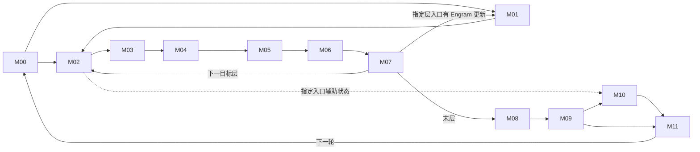

# 171 · DeepSeek‑V4.1‑Flash 融合优化研究工作台

**适用任务**　固定部署下的算子融合、数学化简、计算与通信重组、megakernel 设计及验证。更新日期 2026-11-09。接手顺序为环境核对、路径定位、价值初筛、证据与任务选择。

## 1. 冻结环境

目标资产 171，910C，16 个逻辑设备，CANN 9.2.0，DP2 / TP8 / EP16 / PP1。模型为 DeepSeek‑V4.1‑Flash‑1017 W8A8（DSpark、Engram），使用冻结 vLLM‑Ascend。MoE 当前分支为自有 DispatchFFNCombine。冻结镜像 ID 为 `sha256:ce42d65b2403992ad2e2b06c61f4f048babb57e455cfe307b018345e36c5e98b`，容器为 `wio-vllm-v41-repro171-20261102`，模型服务名为 `dsv41`。主负载为并发 8、输入 32,768、输出 1,024 token；六个普通请求分别评价。

同一 Codex 项目中，本机 `ENVIRONMENT.md` 保存 SSH、服务端点和离线证据定位方法，`HANDOFF.md` 保存详细研究断点。连接只用本机已授权的 key。换机器时恢复获授权的 SSH 配置、冻结源码和原始 profile；公开仓库能恢复研究决策与索引。当前服务健康须在实际连接时核对。[冻结配置与哈希](../scope.json) · [成本和负载基线](../baselines/) · [证据索引](../evidence-index.json)

## 2. 融合的目标、搜索尺度与性能单位

1. **沿执行路径分段。** 从模型输入走到输出及下一轮迭代，标出分支、汇合与跨层依赖。12 个模块用于分工和覆盖核对，候选区域可跨模块。
2. **按数据交付由大到小选区。** 从一段计算的最终输出反推，先将服务于该输出的生产者和消费者作为整体评估。逐一确认段外还需要哪些中间结果或状态、何时需要。能够在区域内按时交付就保留大范围；必须独立交付时，才沿该处切分。
3. **评估数学与执行融合。** 在满足输出、精度和状态语义的前提下，检查公式能否化简、公共项能否复用、归约能否合并；再判断中间写读、通信或提交能否减少，必要工作能否重叠。对较大区域，同时评估用 megakernel 在一次设备启动内调度多个阶段的可行性。
4. **用已有性能数据初筛。** 按匹配的 shape、dtype 和负载，把可省工作和新增开销折算为 µs/次，优先复用已有 profile、实测速率及同基线结论。整段的乐观净收益仍低，则结束同一预算内的子方案；收益可观，再深入源码核算，只补会改变去留的关键参数。分别记录算子局部净省与按命中次数、关键路径折算的请求收益。[单位成本与样本口径](../baselines/unit-costs.md)

## 3. 十二模块执行图

图示为逻辑交付。M02–M07 表示目标层重复体；M01 只在指定层触发。M10 依赖来自指定目标层入口的辅助状态和相应 seed。虚线表示该入口的旁路读者。S00–S11 是源码复核记录编号，与模块编号分别管理。

| 模块 | 计算边界 | 代码复核记录 |
|---|---|---|
| [M00 输入、词嵌入与元数据](../modules/M00.md) | 请求/缓存状态 → token、位置、slot | [S00](evidence/S00.md) · [S01](evidence/S01.md) · [S02](evidence/S02.md) · [S03](evidence/S03.md) · [S05](evidence/S05.md) |
| [M01 Engram](../modules/M01.md) | 指定层哈希查表 → WKV → 门控残差 | [S04](evidence/S04.md) |
| [M02 Attention 前 mHC/RMS](../modules/M02.md) | 残差及 premix → Attention 输入 | [S06](evidence/S06.md) |
| [M03 Attention 主体](../modules/M03.md) | Q/KV、cache、QLI → SMLA | [S07](evidence/S07.md) |
| [M04 Attention 输出](../modules/M04.md) | OA/OB、TP 交付 → Post | [S07](evidence/S07.md) |
| [M05 FFN 前 mHC/RMS](../modules/M05.md) | 残差 → router 与共享专家输入 | [S06](evidence/S06.md) · [S08](evidence/S08.md) |
| [M06 MoE](../modules/M06.md) | 路由 → dispatch → 专家 → return/combine；共享专家支路汇合 | [S08](evidence/S08.md) |
| [M07 FFN 输出与跨层状态](../modules/M07.md) | HcPost → 下一层，保留 Engram/aux 读者 | [S06](evidence/S06.md) · [S08](evidence/S08.md) |
| [M08 目标读出](../modules/M08.md) | 末层归约 → norm → 词表分数 | [S09](evidence/S09.md) |
| [M09 采样与验证](../modules/M09.md) | 分数、草稿 → token、接受数、seed | [S09](evidence/S09.md) · [S11](evidence/S11.md) |
| [M10 DSpark 草稿](../modules/M10.md) | aux → 三层 context/草稿 → 五步选词 | [S10](evidence/S10.md) |
| [M11 迭代交付](../modules/M11.md) | 输出、回收及 slot 状态 → 下一轮 M00 | [S11](evidence/S11.md) |

## 4. 优化地图与研究阶段

**按主责模块定位，按优化点阅读。** 主责模块是该项的维护入口，协作模块标明跨段依赖。同一机会跨模块时只建一行。以下列出当前 15 个机制，以及需独立区分状态的历史成果、备选原型和专题实现。专题切口可以实现同一机制，历史编号保留原始实验口径。

**当前 15 个机制**中，12 个处于初步判断，C08、C09 已有条件估算并待领原型，C03 的 B4 分支已有服务实测。

**进度口径**　**判断中**：已定位工作，证据尚不足以估净收益。**条件估算**：已有带假设的数值，尚待匹配形状验证。**局部确认 / 服务确认**：同基线实测，须注明范围和正负结果。**已有实现**说明代码存在；**已交付**另需版本、接入条件、验收和维护人。行动列标明应补证、做原型、停止还是复用。

| 主责模块 | 优化点 | 优化逻辑 | 当前进度与依据 | 下一步 | 协作／归属 |
|---|---|---|---|---|---|
| [M00 输入与元数据](../modules/M00.md) | **C01** 增量发布 block 表 | 提交｜跳过未变化的行及其拷贝 | 判断中｜仅有搬运预算 | 按实际调用点核对剩余可删的提交时间 | M11 |
| [M00 输入与元数据](../modules/M00.md) | **C04** 目标与草稿共享 DP 计数 | 等待｜省去可预测的第二次主机协调 | 判断中｜有过线门槛 | 核对各 DP 是否能一致决策及回退 | M10/M11 |
| [M00 输入与元数据](../modules/M00.md) | **历史46/F01** slot 坐标与扁平索引双输出 | 计算｜一次索引计算写两份结果 | 服务确认｜同轮 CP 基线整批降 5.43% | 已有实现，按该基线复用 | M11 |
| [M01 Engram](../modules/M01.md) | **C06** Engram 完整结果复用（K06（局部变体已停）） | 计算｜相同完整键命中后复用查表和投影 | 判断中｜有命中率门槛 | 按层、权重版本及完整键回放 | — |
| [M02 Attention 前 mHC](../modules/M02.md) | **C07** mHC 系数与残差复用（历史46/F04 · 独立 HC） | 计算／读写｜减少重复归约、工作区和残差读写 | 判断中｜已知 HcPre 占时 | 定位可删主体并复核舍入；具体反例见独立 HC 记录 | M05/M07 |
| [M03 Attention 主体](../modules/M03.md) | **C08** 本地 KV 投影后窄 AllGather（K01） | 通信／计算｜减少宽通信及重复投影 | 条件估算｜按毛收益兑现 50% 估省 30.27 ms；待原型 | 验证单层 BF16、行序、cache 和净通信时间 | M02 |
| [M03 Attention 主体](../modules/M03.md) | **C09** SMLA 分页 KV 直读（历史46/F07 · K02） | 读写｜消除显存暂存写回与重读 | 条件估算｜K256 等速时，含首段 PV 的 TTFT 估省 17.78 ms；待原型 | 比较完整 kernel 的精度与耗时 | — |
| [M03 Attention 主体](../modules/M03.md) | **C11** QLI 按 key 压实评分（历史46/F05（已验证的另一方案）） | 计算｜只给有效 key 打分 | 判断中｜有 MAC 估算，净耗时未知 | 扣除 gather、压实和次序恢复 | — |
| [M03 Attention 主体](../modules/M03.md) | **历史46/F05** QLI 四层共享成员转换 | 计算｜一次生成成员表示供四层共读 | 服务确认｜单改整批降 1.48%–1.50% | 已有实现；叠加批写的增量未确立 | — |
| [M04 Attention 输出](../modules/M04.md) | **C10** OA 前移并直接生成发送布局（K02（输出端）） | 通信｜先压缩 head 数据再交换 | 判断中｜旧实现未命中目标形状 | 查实际可覆盖形状及权重额外容量 | M03 |
| [M04 Attention 输出](../modules/M04.md) | **历史46/F08** OA→OB 同核分块交付 | 读写｜避免中间投影完整落显存 | 条件估算｜大 prefill；M24 已排除 | 先查片上容量、权重搬运与重叠 | — |
| [M05 FFN 前归一化](../modules/M05.md) | 协作模块 | 归一化与路由输入共同归两处主责记录 | 随 C07、C12 记录 | 核对交付合同 | C07、C12 |
| [M06 MoE](../modules/M06.md) | **C05** 裁掉无最终贡献的行（K10（末层）） | 计算｜减少空闲 DP 假路由及已退役行计算 | 判断中｜末层已有上界 | 数真实 idle 波次；保留远端专家和 raw 读者 | M08/M10 |
| [M06 MoE](../modules/M06.md) | **C12** Norm、Router、TopK 联合生产 | 读写｜减少门控投影周围的中间张量 | 判断中｜阶段占时已知 | 分开核算必要 GEMM 和可删交付 | M05 |
| [M06 MoE](../modules/M06.md) | **C13** 共享专家与路由专家联合排程（K03） | 等待｜用可用资源重叠计算与返回 | 判断中；具体 K03 有条件模型 | 核对资源窗口；原 fork 不重测 | M07/M10 |
| [M06 MoE](../modules/M06.md) | **K00** 既有 DispatchFFNCombine | 执行组织｜一次 launch 含分发、专家和返回 | 已有实现｜冻结基线 | 作为参照，不重复计收益 | — |
| [M06 MoE](../modules/M06.md) | **K03** DFC 尾部承接共享 GateUp | 等待｜利用 Vector 收尾时的 Cube 空档 | 条件估算｜尾部时长未实测 | 先量可用尾部与新增争用 | C13 的实现分支 |
| [M07 FFN 输出与跨层状态](../modules/M07.md) | 协作模块 | 跨层残差与专家结果的下游读者 | 随 C07、C13 记录 | 核对交付合同 | C07、C13 |
| [M08 目标读出](../modules/M08.md) | 协作模块 | 末层 raw 快照与有效输出行 | 随 C05 记录 | 核对交付合同 | C05 |
| [M09 采样与验证](../modules/M09.md) | 协作模块 | context 的输入及 token 提前交付 | 随 C14、C15 记录 | 核对交付合同 | C14、C15 |
| [M10 DSpark](../modules/M10.md) | **C14** 三层 context KV 共同发布（K05） | 读写｜复用 aux 输入及前缀交付 | 判断中｜有原前缀预算 | 扣除权重移动、行重排和同步 | M09 |
| [M11 下轮状态](../modules/M11.md) | **C02** 合并生成 ID、位置及接受数 | 计算｜多个状态输出共用一次请求映射 | 判断中｜仅有设备端预算 | 找出必须保留的 CPU 镜像和索引读者 | M00 |
| [M11 下轮状态](../modules/M11.md) | **C03** 26 项 slot 批写（历史46/F02 · K07（B4）） | 提交｜合并同一轮的 26 项 slot 写入 | 服务确认｜冻结 B4 两组基线整批耗时分别降 2.22% 和 3.39% | 复用；小批量见历史46/F03 | M00 |
| [M11 下轮状态](../modules/M11.md) | **C15** 客户端输出提前就绪 | 等待｜分开 token 可见与 cache 安全回收 | 判断中｜固定 C8 上界低；普通请求待证 | 核对普通请求端点、页生命周期及取消路径 | M09 |
| [M11 下轮状态](../modules/M11.md) | **历史46/F03** 13 项 slot 批写扩形状 | 提交｜将已验证 B4 方案扩至普通小批量 | 判断中｜仅 26 项分支已有服务正例 | 查 13 项分支的 caller 净时间 | C03 的扩形状 |

**示例**　当前 C03 是已验证的 26 项批写，历史46/F03 是尚待验证的小批量扩展；当前 C11 是尚待判断的压实评分，历史46/F05 是已经实测的成员共享。相邻工作分别立项，证据独立。

专题实现：全部 11 个切口（按模块查看）

| 模块范围 | 来源编号与优化点 | 优化依据 | 已有证据 | 当前处置 |
|---|---|---|---|---|
| M00、M11 | K07 跨组slot与共同输入publisher | 重复索引/slot任务、提交与共同plan交付 | B4 批写已实现并有服务实测，更大范围的输入发布仍在判断 | 复用 |
| M01 | K06 Engram固定位置plane融合 | 中间plane/局部lookup/gate交付 | 设计与条件估算 | 停止原范围 |
| M02、M03 | K01 Post/HcPre/RMS到本地KV-ready的前端 | 局部转发和少spill/调用；owner重排另消重复投影与宽AG | 设计与条件估算 | 与C08联合评估 |
| M03、M04 | K02 SMLA direct/partial到inverse RoPE与可选OA send producer | KV gather/partial交接；更大分支输出payload65536→16384B/query | 设计与条件估算 | 与C09联合评估 |
| M06 | K00 当前DFC megakernel | 基线已融合routing quant/EP/GMM1/act quant/GMM2/return/unpermute | 既有实现 | 复用 |
| M06 | K03 DFC内部Cube尾部承接shared GateUp | 隐藏原串行shared Up关键时间；必要MAC与EP保留 | 设计与条件估算 | 优先补尾部时长证据 |
| M06、M08 | K10 末层需求驱动selected query/FFN/readout producer | 无读者的非logit行query/output、FFN/readout；不删远端服务 | 设计与条件估算 | 待读者核对 |
| M09、M10 | K05 aux owner到main norm与三套context KV | 宽aux交付、重复重组与全局KV投影；主norm和不同WKV保留 | 设计与条件估算 | 待证 |
| M09、M10 | K08 五Markov与局部head融合 | 局部add/argmax/copy/调用；必要dot保留 | 设计与条件估算 | 停止原范围 |
| M10 | K04 DSpark三层或whole-draft常驻 | 重复调用/交接/初始化；必要TP/EP、cache及GEMM保留 | 设计与条件估算 | 待协议 |
| 全模型 | K09 40层或跨迭代无限常驻 | 潜在跨阶段提交/驻留，尚无可信净收益值 | 概念设计，尚无可报告的净收益 | 待协议 |

历史归档：全部 46 个原始判断（按模块查看）

| 模块范围 | 来源编号与优化点 | 优化依据 | 已有证据 | 当前处置 |
|---|---|---|---|---|
| M00 | U01 视觉条件入口 | 冻结文本请求无视觉输入。 | 初筛处置·见原预算及条件 | 范围外 |
| M00、M01 | R01 词嵌入/Engram 输入交付 | 按原范围停止。图外bank有其它读者则扣回；不同层权重不能缓存成同一WKV | 初筛处置·见原预算及条件 | 不立项 |
| M00、M02 | R04 首层虚拟四路与草稿 padding | 按原范围停止。HcPre/HcPost都要适配原BF16行，不省后续残差输出 | 初筛处置·见原预算及条件 | 不立项 |
| M00、M10 | R22 输入bank与DSpark主投影转置 | 按原范围停止。RMS仍归约全5120并读gamma；图copy命中未知用有利代理 | 初筛处置·见原预算及条件 | 不立项 |
| M00、M11 | F01 slot 坐标与 flat 索引双输出 | 双输出已有实现，沿用同轮基线。 | 服务实测·限定基线 | 已有实测 |
| M00、M11 | F02 26 项 slot writer 批量调用 | 26项批写已有实现。 | 服务实测·限定基线 | 已有实测 |
| M00、M11 | F03 小批量 13/26 项 slot 批写 | 属于F02的小批量扩形状，13项分支尚无足够净省证据。 | 初筛处置·见原预算及条件 | 不独立立项 |
| M00、M11 | H01 CP 局部长度与 CPU 计划公共项 | 已有调度与CPU计划基线。 | 初筛处置·见原预算及条件 | 不独立立项 |
| M00、M11 | R02 元数据 tiling 多输出 | 按原范围停止。原就绪信号早于读者，不计整段异步等待 | 初筛处置·见原预算及条件 | 不立项 |
| M01 | R03 Engram 局部 gate/lookup 与尾部 | 按原范围停止。这是两种不同范围/分母；不能相加；联合尾部已在F04预算 | 初筛处置·见原预算及条件 | 不立项 |
| M01 | U02 Engram 自然跨层/跨步缓存 | 按C06，完整内容命中且收益覆盖协调及容量才重开。 | 初筛处置·见原预算及条件 | 暂不立项 |
| M02、M03 | R05 独立提前本地 Q 与空侧提早 | 按原范围停止。不把排程移动当作删掉计算 | 初筛处置·见原预算及条件 | 不立项 |
| M02、M05 | U03 Gram 对角化、范数归约与精度约束 | 有位差先例；尚缺满足精度的具体替代实现。 | 初筛处置·见原预算及条件 | 暂不立项 |
| M02、M05 | U04 Sinkhorn 真正定点提前停止 | 提前退出需满足真实定点及判定成本，尚无过线的实现证据。 | 初筛处置·见原预算及条件 | 暂不立项 |
| M02、M05、M07 | F04 两处 Post→mHC premix/RMS 共读残差 | 若新增扩宽写入，残差共读接近或低于历史请求门槛；跨层服务收益不稳定。 | 初筛处置·见原预算及条件 | 暂不立项 |
| M02、M07 | R09 宽残差工作区交付 | 按原范围停止。后读Y/FFNPost各多读宽面抵消；不支持免费UB→L1假设 | 初筛处置·见原预算及条件 | 不立项 |
| M03 | F05 四 QLI 消费层共享一次候选成员转换 | 四层共享单改有效，已有批写基线下的增量尚不稳定。 | 服务实测·限定基线 | 已有实测 |
| M03 | F06 QLI 四消费层内截短列表归并 | 归并占旧核时的比例未证实；不能按整个QLI核时计收益。 | 初筛处置·见原预算及条件 | 暂不立项 |
| M03 | F07 SMLA KV 直读与首段 PV 直写 | 沿C09，从真实分页KV写回和QK/PV重读入手，先做局部对照。 | 初筛处置·见原预算及条件 | 优先原型 |
| M03 | R06 Attention 输入多投影/旋转/量化/cache 融合组 | 其中Qb/index-Q共享动态量化：八站点第二次量化合计22.58µs/图，未扣共享开销；不单开项目。 | 初筛处置·见原预算及条件 | 不立项 |
| M03 | R07 C2 与索引输出接口联合 | 按原范围停止。持久索引有后读者；第二流水组可并行须另证 | 初筛处置·见原预算及条件 | 不立项 |
| M03 | U05 同代 KV 面板驻留 | C09的一种替代实现，共用KV交付预算。 | 初筛处置·见原预算及条件 | 不独立立项 |
| M04 | F08 大行 OA→OB 同核分块流水 | 大prefill有已绑定形状和可删除的投影交接，但依赖搬运/计算重叠；M24排除。 | 初筛处置·见原预算及条件 | 备选原型 |
| M04 | R08 Attention 直接写发送布局/接收逆旋转 | 按原范围停止。两者替代；448/64与正零及接收路径保留 | 初筛处置·见原预算及条件 | 不立项 |
| M05、M06 | R10 Norm 同时产三种输入 | 按原范围停止。router宽输入是规定舍入；六份dispatch行不是本地稠密输入 | 初筛处置·见原预算及条件 | 不立项 |
| M06 | F09 固定路由专家跨核激活交付 | 多核仍需同一激活；没有可兑现的新广播或驻留成本依据。 | 初筛处置·见原预算及条件 | 暂不立项 |
| M06 | H02 前缀换 DP、冷热专家与权重放置 | 部署放置调整。 | 初筛处置·见原预算及条件 | 范围外 |
| M06 | R11 Router/TopK/ID/dispatch 入口 | 按原范围停止。MM与选中权重保留；归档未传固定表；主机晚提交另记 | 初筛处置·见原预算及条件 | 不立项 |
| M06 | R12 路由专家单核激活承接 | 按原范围停止。其余核仍读GM，不能删整行写回；跨核门槛另归F09 | 初筛处置·见原预算及条件 | 不立项 |
| M06 | R13 共享专家两处交接联合 | 按原范围停止。保留激活顺序和点积；W8A8已有DequantSwigluQuant，无独立clamp/cat可再省 | 初筛处置·见原预算及条件 | 不立项 |
| M06 | U06 其它合法 MoE 后端/selector | 备选后端没有冻结负载命中证据。 | 初筛处置·见原预算及条件 | 范围外 |
| M06 | U07 固定布局的专家返回有序直写 | 必要的远端服务与有序归并仍保留，可删的净关键时间未证实。 | 初筛处置·见原预算及条件 | 暂不立项 |
| M06、M07 | R14 共享 Down+加和+HcPost+直接 premix | 按原范围停止。先BF16加法舍入；premix读与F04重叠，不相加 | 服务反例·限定变体 | 不立项 |
| M08 | R16 末层 Post 到词表 MM 整段 | 按原范围停止。同段子融合一起排除；仅裁行不算融合，24槽最长分片不变不省通信 | 初筛处置·见原预算及条件 | 不立项 |
| M08、M09 | R17 目标词表选词与分片摘要 | 按原范围停止。完整raw/logprob读者不能删；tie/NaN/私有处理保持 | 初筛处置·见原预算及条件 | 不立项 |
| M08、M09 | U09 有限 prompt 评分共同扫描/TP摘要 | 原负载未命中有限提示评分。 | 初筛处置·见原预算及条件 | 范围外 |
| M08、M10 | R15 三检查点打包归集与草稿取行拼接 | 按原范围停止。所有发送字节与原均值源时点保留 | 初筛处置·见原预算及条件 | 不立项 |
| M09 | R20 top-k/top-p 双阈值融合 | 按原范围停止。top-p依赖原概率累积；RNG及raw分数不能用argmax等价替代 | 初筛处置·见原预算及条件 | 不立项 |
| M09 | R21 有限 token logprobs 与私有mask | 按原范围停止。prompt长行另U09；K=-1或raw读者继续完整发布 | 初筛处置·见原预算及条件 | 不立项 |
| M09、M10、M11 | R19 验证+草稿ID+下一轮状态联合 | 按原范围停止。时间轴去重；不同主机线程空档和换批不能照抄 | 初筛处置·见原预算及条件 | 不立项 |
| M09、M10、M11 | U10 随机/概率草稿/换批/动态长度的状态交付 | 不同选择和换批条件混合，缺匹配负载的独立收益。 | 初筛处置·见原预算及条件 | 暂不立项 |
| M09、M11 | R18 目标验证直接生成 seed/count | 按原范围停止。seed原位置、完整输出ID及host镜像保留 | 初筛处置·见原预算及条件 | 不立项 |
| M10 | R23 三层context RMS/RoPE/cache与提交 | 按原范围停止。三层WKV及各自norm不共用；计数等待与submit依赖保留 | 初筛处置·见原预算及条件 | 不立项 |
| M10 | R24 五步 Markov 校正到 ID 及W1/W2复用 | 按原范围停止。五步串行自回归、BF16舍入和原词表映射保留 | 初筛处置·见原预算及条件 | 不立项 |
| M10 | R25 DSpark 可选共享 TopK hook | 按原范围停止。hasattr为假；其它MTP模型的功能不能算到DSpark | 初筛处置·见原预算及条件 | 不立项 |
| 全模型 | U08 全层/跨层 megakernel 额外空间 | 需指明已有局部候选以外可新增消除的工作。 | 初筛处置·见原预算及条件 | 不独立立项 |

证据与基线：[当前机制](mechanisms.csv) · [历史处置](history-46.csv) · [专题模型](megakernel.csv) · [独立 HC 验证](evidence/independent-hc.md) · [另一个分支的早期 42 族与原始状态](evidence/priority-42.md)。新增或更新一个点时，同步填写主责模块、优化逻辑、证据阶段、下一步与出处；局部耗时、请求耗时、实现交付分别更新。

## 5. 已完成、待确认与任务分配

- **算子开发**：优先 C09 / 历史 F07，选一个真实长提示 shape，比对 SMLA 的分页 KV 直读与原有显存暂存路径。第一份交付是相同输入下的数值对照、真实有效 K 及完整 kernel 的 µs。
- **框架与通信联合**：C08，先验证单个普通 SWA 层换本地行数后的 BF16、行序与 cache，再比较窄 AllGather 的净交付时间。专题 K01 和它共享工作预算。
- **Megakernel 专题**：优先确认 K03。先查同 shape 下 DFC 最后 GMM2 到 Vector 收尾之间 Cube 真正可用的时间，以及新增争用。既有模型假设额外开销为每 FFN 5 µs 时，过参考线所需尾部时长中位约 18.89 µs；这个时长尚待确认。K02 与 C09 的 KV 交付部分重叠。理论估价和源码核对均未新增设备实测。
- **排查队列**：首批是大 prefill 的 OA→OB（历史 F08）、C11 QLI 压实、C07 mHC、B1 slot 扩形状（历史 F03）。下一批优先 C05 假路由、C06 Engram 完整键复用、C12 路由主体。按引导词选一项，结束时更新本节。

**已完成的范围**　冻结模型实际路径的离线首筛与条件记录、已有实现的历史基线复核，以及 megakernel 理论切分。当前 C08、C09、K03 仍分别处于原型待领或条件补证阶段。团队清单列出 2 个原型、4 个首批排查、8 个后备确认；专题 K03 与 C13 复用同一 MoE 模块责任链。[团队工作单](team-work.md) · [megakernel 设计依据](evidence/megakernel.md) · [逐窗口模型](evidence/megakernel-window-model.json)

## 6. 性能定价与适用范围

| 成本项 | 已有参照 | 使用边界与来源 |
|---|---|---|
| BF16 GEMM | M416、K5120、N1280，DP0、prefill；8 rank 合计 320 条，单次中位 34.78 µs、P95 37.42 µs；按中位数约 80.3 TMAC/s | 一次乘加计一个 MAC。优先匹配完整 shape、dtype、布局与阶段。模型含 385,100 条设备记录、1,698 组条件。[单位成本说明](../baselines/unit-costs.md) · [逐 shape 记录](../baselines/profile-units.json) |
| TP8 AllGather | 每 rank 输入/输出 646,400 / 5,171,200 B；两组并发时 DP0/DP1 分别 58.47/59.95 µs，对应 88.449/86.255 GB/s | BF16，原表标 BFP16。吞吐以完整逻辑张量计，含启动和同步；换消息大小、拓扑、并发或改为 EP16 应重新匹配。[回放与字节口径](../baselines/collective-calibration.json) · [模型内通信](../baselines/communication.json) |
| 内存搬运 | 五个匹配 TensorMove 的逻辑输出速率约 1,109–1,210 GB/s | 用于相同条件的敏感性估算；稀疏、冷热缓存、UVA 需要各自样本。逐项标明是单向输出字节还是读写总字节。[搬运依据](../baselines/ffn-entry.json) |
| 启动、重叠与请求侧 | 已绑定的图内设备区间、node API 区间、TP8 最慢 rank、六普通请求和长提示 C8 | 局部时间与请求时间分别计算。并行卡时间不累加；原整网 1% 是参考，不是局部算子唯一准入条件。[成本目录](../baselines/atlas.json) · [共享测量](../baselines/shared-measurements.json) · [请求负载](../baselines/workloads.md) |

估算顺序：匹配原始耗时；缺样本时以可删 MAC / 有效 MAC 速率，或可删字节 / 匹配的有效带宽估计；扣除替代计算、重排、同步、争用。对可重叠工作按同 rank、同请求窗口取关键路径差。每项报告局部 µs、命中次数、TTFT 或整批 ms、估计条件。持续 HBM/L2/UVA 带宽与部分新 shape 的算力仍有缺口。[待校准项](../baselines/calibration-plan.json)

## 7. 研究成果来源与共同维护

| 来源 | 可复用成果 |
|---|---|
| 171 W8A8 框架排查 | [暂停记录](../STATUS-2026-11-08.md)、[分析日志](../analysis-log.jsonl)、[证据索引](../evidence-index.json) |
| 算子优先级及方案制定 | [历史42族登记](evidence/priority-42.md)、[后续优先级及组合基线](https://github.com/wio1997/Inference-Foundry/blob/c0cce2c6eb39eb1935d244d30deb9d5b6754dc54/operator-optimization/deepseek-v4.1-ascend/PRIORITY-PLAN.md)。CP＋Slot＋CPUplan 已有组合对照，后续比较须标记相同基线。 |
| F01 独立验证 | [mHC 双流原型与图回放](evidence/independent-hc.md)。当前重复计算版本已有局部反例，系数专算变体仍待实现。 |
| 全模型 Goal、megakernel 与团队复核 | 本页第 3 节逐阶段源码复核、第 4 节去重机制、第 5 节团队队列与专题切分。 |

**编号规则**　引用必须带来源，例如“优先级42/F01”是 mHC，“历史46/F01”是 slot 双输出。C09、历史46/F07、K02 的共同 KV 读写只有一份收益。台账行数不可跨来源相加。

**协作流程**　新对话先读本页并定位当前任务的模块、机制及现有证据，再按任务要求选择初筛、理论估价、开发或验证。认领时在团队工作单写负责人和目标分支。贡献者可在研究分支编辑，或从工作分支/派生仓库提 PR；在同一变更中更新对应台账、证据和本页断点。审阅重点为复现条件、单位、基线、重复归因和状态依据。公开仓库只提交可公开的研究结果；SSH key、个人登录配置及原始凭据留在本机。

新增或更新记录使用：日期｜来源／机制 ID｜主模块及消费者｜优化类型｜适用配置与负载｜已有证据阶段｜收益与分母｜当前行动｜负责人｜下一处／停止条件｜证据或提交。局部确认、服务确认和已交付均须给出对应结果链接。

**新对话指令**　读取本页，先核对环境，定位【任务或模块】的证据阶段、已完成工作与下一步。从已有源码及性能资料开始，依据第 2 节的研究原则自主开展指定任务。结束时提交可审阅的增量、更新状态和接手位置。
