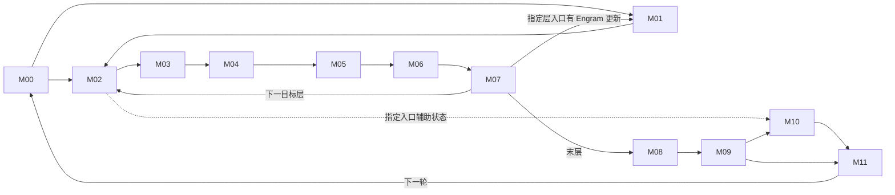

# 171 · DeepSeek‑V4.1‑Flash 融合优化研究工作台

## 当前断点 · 2026-11-10 全模型注册与继承绑定：49源码约束，107输入控制位仍待扫

介绍：从真实注册、C3/别名、冻结配置与逐层职责建立执行入口，再与旧范围相交。到了哪里：40当前源码、config43d3/serve c297未变；16方法解析与Python C3对照、40target角色/3draft与私有128专家TopK3标量控制；156原静态分支/循环/上下文位逐项记录。结果：49受限源码/角色/排除绑定，107仍未闭合，不是107算子或已完成路径。DSpark继承/别名与实际_propose已补，rawMTPbank存在但固定DSpark数值路径不消费；同预算旧terminal小方案不重开。新框架/原语准入0，全链路未扫全，每替换原语逐位一致。

待确认、值得深入：较大共同CP frame的CPU/scalar/canonical QSL/设备长度交付；冻结V1 executor不capture producer，A3 builder不启用metadata_in_graph，producer输入地址与model graph地址分开审查。不能据此跳过native位、全部读者/事件或输入租约，增加共享读者可延长末读；旧device-only2.098217%不是整parent上界。107处还须继续callsite/人口/消费者，不把源码行交集当搜索完成。

配置补充：原HF类体展平控制保留vision_n_layers32，而draft arch-info的is_mm_prefix_lm=False；两者不是同一字段。纯文本/DSpark不能推出vision-router bias不存在，实际HF/text/gate与token谓词仍待绑定。已确认可实现：仅上轮受限CPU原型1保留，本轮新增融合0。已停止：静态18入口当全覆盖、flag1当CANN MegaMoe、raw bank不存在、凭text-only删除vision-bias与同预算独立terminal copy小方案；更大parent保留。

[完整判断](evidence/全模型派发继承与合法分支覆盖判断.md) · [注册/C3/40角色](evidence/whole-forward-dispatch.json) · [156位与旧范围交集](evidence/whole-forward-coverage-delta.json) · [配置形态对照](evidence/whole-forward-config-shape-controls.json) · [源行段](evidence/whole-forward-binding-source-excerpts.json)。

下一条待扫：loop047 Run run-20261110T124045Z：继续实际V1 worker metadata/input的107剩余位，核输入Tensor来源、selected builder/资源组、canonical QSL与每个first owner→全部base/native/model graph消费者和CPU/producer/consumer退役及覆写；区分V2/A5和固定/动态条件。40源派发Run114154Z已PASS/NA；新Run仍PLANNED，配置两形态标量补充不当真实对象或原生位。只读源码/旧数据，无Torch/NPU/模型/新profile/服务动作。

## 当前断点 · 2026-11-10 共同设备投影命中后死工作：保留原首owner，转全模型分支覆盖

介绍：设备权威长度经CP投影→原base缓存→C2/native与最终消费者。到了哪里：17当前源/11限定body/18行段、39个common读取点，原base符号哨兵960例与miss反例；16旧trace共4576次目标调用/4400命中段。结果：已有batch命中后的25段新长度值无消费者，原首投影/持久复制保留，独立补丁固定保留各QSL但未证明每份必要；精确补丁可审查但未安装。缩入时钟余量后平均45.234547ms/11周期Free，转移.5/新增.1ms每周期条件净2.098217%独立诊断窗。无原生/框架新准入，全链路未扫全，每替换原语逐位一致。

待确认，值得开发：已有local batch hit的死投影删除；源码边界闭合，仍缺私有clone真实Torch/NPU/原生packet和地址/空尾与capture逐位、无探针成本、全请求与六普通人口/转移。已确认可实现：上轮受限CPU原型1保留，本轮新增框架替换0。已停止：删首投影、CPU上界替设备值、无owner判别删全部QSL、writer-only异步化、跨代cache与空query跳QLI的具体配方；按owner有条件删非首QSL/pin/H2D及CPUscalar/setup的大parent保留，此投影价不当整段上界。

请求另列：同镜像配平C8轻量参考15.967999s，真实metadata frame229/231；人口.5/转移.5/h.1ms的条件整批省1.336721%，人口1则2.817479%，默认未知比例0，非实测，不迁移原不同prompt C8/TTFT/普通。CPU微基准、不同窗口及并发时间线收益不相加。

[完整判断](evidence/共同设备长度投影的死工作与真实消费者判断.md) · [原源码消费者](evidence/common-device-source-review.json) · [精确待审补丁](evidence/common-device-hit-elision.diff) · [局部与请求条件价](evidence/common-device-price.json) · [下一段静态入口](evidence/whole-forward-entry.json)。

下一条待扫：loop047 Run run-20261110T114154Z：沿当前模型/DSpark/Engram/attention的18个静态入口递归解析callee与合法guard，绑定冻结flag后再与同SHA旧审阅范围相交，分别记录源码已读/分支人口/消费者/原生证据；挑最大未扫交付。入口Run114347Z已PASS：16当前源、295语法callsite/156分支位，均不当唯一算子或执行覆盖。只读源码/配置/旧数据，无Torch/NPU/模型/新profile/服务动作。

## 当前断点 · 2026-11-10 共同frame分层key与26caller：CPU原语受限通过，继续device读者

介绍：共同frame按rawCPU/postCPU/device/每资源交付分层，追真实caller、变异和图地址。到了哪里：12当前源/11限定body/29行段；16worker旧CPUparent日志确认每frame目标26+draft1；原CPU AST标量1728例，实际TorchCPU1728例/44928字节比较，guard变体3模式/78比较。结果：封闭不可变租约内CPU复用原型已确认可实现，服务框架替换准入0；v1 inference Tensor版本读取失败原件保留，模式guard通过但不证明不可变。CPU v1六组26call配对净省2.226–2.445ms/frame，非请求收益；真实caller/保留首body的新条件价1.964%/3.275%诊断窗。全链路未扫全，每替换原语逐位一致。

已确认可实现：仅封闭CPU输入租约下的隔离原语原型，含optional-out旁路和inference-aware key；未安装到服务。待确认：框架实际集成/全部保护负载、较大公共device投影的所有读者/地址/原生位与关键路径净价。已停止：全局helper cache漏out写、CPU双mirror合并、shape/版本号当不可变证明、遗漏TP/causal/dtype/actualTokens，以及假定V41draft继承Legacy缓存或有26次重复。旧大frame异步writer-only配方仍停，不剪原主流完整方案。

[分层key、caller与CPU原语](evidence/共同frame分层键与真实caller及CPU原语判断.md) · [CPU模式资格补充](evidence/共同frame_CPU模式资格补充.md) · [真实caller与付成本价](evidence/common-frame-caller-price.json) · [实际CPU字节/局部成本](evidence/common-frame-torch-cpu.json) · [inference反例与guard](evidence/common-frame-cpu-modes.json)。

下一条待扫：loop046 Run run-20261110T105846Z：一次原主流CP suffix/clamp/where→base首batchcache与全部common字段/原生closure读者→稳定QSL和capture/event firstowner。保留各builder QSL复制与物理输出，查是否能只删重复device长度投影；只读源码/已有profile，不新增NPU/模型/服务动作。CPU模式门槛Run110329Z已PASS，不能以guard省略输入租约。

## 当前断点 · 2026-11-10 DFC原路由与末读闭合：转有函数归因的共同metadata大交付

介绍：DFC原mask/排序/inverse/count发布→远端搬运→GMM与Unpermute末读，再转同代共同metadata/frame。到了哪里：11当前DFC源/10限定body，454完整EP16路由组/7264ranklayer调用、80原生inverse witness、21792纯字节映射；5当前metadata源/4入口body与新16rank函数自身账、144付首producer/新增成本情景。结果：原R与dummy/zero-group flags保留，删gmA写不等于释放activation arena；历史5路由免费输入1.543–6.922us低于旧小预算，原样输入-only维持停止。新metadata仅helper共享的条件净1.995%诊断窗，CP自身25%也共享为3.622%，全base保留；非请求预测。新准入0，全链路未扫全，每替换原语逐位一致。

待确认：改变GMM读法/提前publication/largeM/shared资源的原生位、phase/资源/末读与净价；metadata共同字段的实际caller兼容性、不可变CPU快照、device权威长度及每资源发布、图事件和原语位。已确认可实现：本轮0。已停止：历史固定GMM/flags的M3输入-only，sorted position/topK代原行、删dummy inverse/zero-group flags的具体配方；跨代shape-only或跨物理组整metadata复用仍停。保留不同GMM/大parent，未把旧排序参考改成用户门槛。

[DFC路由与末读](evidence/DFC原路由行映射与GMM末读判断.md) · [共同metadata函数自身与净价](evidence/共同metadata函数自身归因与保留首生产者的净价.md) · [454路由/5原生旧实验](evidence/dfc-row-map-delivery.json) · [144条件价](evidence/common-frame-measured-price.json)。

下一条待扫：loop045 Run run-20261110T100641Z：同代frame最小字段key→CP/global/localbase实际caller与闭包→CPUhelper返回值mutation→每资源固定deviceQSL/slot/table/C2/nativeattrs发布；复用原acquire-before-mainwrite及CPU/producer/consumer双退役，价实际保留工作和新增成本。只读源码/已有诊断，不做NPU/框架进口/新profile/服务动作。

## 当前断点 · 2026-11-10 Engram全局owner付成本剪枝与DFC输入行共享：继续真实路由读者

介绍：全局Engram rows→WKV/gate/HC付成本判断，再沿较大DFC的BF16输入/量化/路由/跨EP搬运追到首GMM。到了哪里：Engram9源、56几何/4字节oracle、108C8/216短窗价、544比例与六普通代理；DFC9源18限定行段、原host DoTiling CPU12形状、1032匹配父段。结果：Engram仅明确小预算子情景停止，大parent待确认；DFC单核已共享但跨核仍重复，localM3有18次量化/3输入行，prefill416仅多20次，不能统一取6倍。targetDFC占自身两窗15.979%/17.537%，删整段10%另付h5条件净1.343%/1.496%窗口，量化内部占比未知。新准入0，全链路未扫全，每替换原语逐位一致。

待确认：更大Engram lookup/globalowner/WKV/gate/HC的原生位/资源/传输/末读与请求曝光；DFC稳定行映射、mask/dummy/zero-work完整分支、peer/gather或GMM A loader、原量化位与内部phase和新增成本。已确认可实现：本轮0。已停止：Engram已明确低于旧排序预算的独立子情景、N512/1024单AIC八panel同驻、flag-only分片及错误8倍MAC/B读取信用；DFC全形状unique-once/每路由独立重算的错误信用、把整个DFC当量化phase。只停止这些范围，不剪更大parent。

[Engram全局owner与付成本价](evidence/Engram全局行Nowner几何与付成本请求判断.md) · [DFC输入行与首GMM判断](evidence/DFC输入行量化共享与首GMM交付判断.md) · [原host回放](evidence/dfc-input-host-cpu.json) · [DFC完整父段价](evidence/dfc-input-delivery-price.json)。

下一条待扫：loop044 Run run-20261110T094003Z：原expandedRowIdx sort/active mask/dummy/count生产→unique sender row map→远端gather→receiver连续gmA与GMM首读；保留原flags/容量/K/Fixpipe/舍入，追bank末读，付新map/gather/并行度成本。先用旧profile，不做NPU/框架进口/新profile/服务动作。

## 当前断点 · 2026-11-10 HC双parent跨层与FULL图：转Engram全局行和WKV大交付

介绍：HC系数尾部到跨层/Engram/aux/final读者及FULL事件，再转全局Engram rows→WKV→gate→HC。到了哪里：15当前源/11限定body，两入口AST seed，6有限正常DAG/2004顺序对及3反例；144双parent价、16 PMU压力价；另9当前Engram源/6入口body、2权重header，payload0，每rank24条WKV+37gate完整链/54价格。结果：纠正实际首层None解释，target和DSpark首层均有premix；ownPost前整作业join支配后续读者。双parent无争用条件2.672%/2.740%窗口，PMU代理可降至.1%–.4%或负，不能当实测新争用。Engram大段全免1.169%/1.176%窗口，半省h5仅.572%/.575%；旧独立小预算不重开。新准入0，全链路未扫全，每替换原语逐位一致。

待确认：HC native位、独立流/FULL捕获/allocator-workspace/真实争用；Engram全局owner/WKV/gate/HC联合原生几何、原语位与付成本净价。已确认可实现：本轮0。已停止：实际首层当None、借无关ExternalEvent作coeffdone、缺producer fence或跳过/异常不join的具体配方；旧WKV-only/gate-only/inactive-passthrough与原样overlap/staged-prefix停止保留。

[HC双支路读者与FULL图](evidence/HC双支路系数跨层读者与FULL图判断.md) · [双parent/PMU价](evidence/hc-both-delivery-price.json) · [9源Engram入口](evidence/engram-joint-entry-review.json) · [完整WKV/gate价](evidence/engram-joint-entry-price.json)。

下一条待扫：loop043 Run run-20261110T084215Z：现存全局complete-K Engram bank→保留原M3 padding/K/Fixpipe的WKV Nowner几何→新row-restore AllToAll→rotated gate和持久HC残差；比较direct-SP-owner的冲突，先用完整原C8/普通/prefill价大parent。只读源码/旧数据，不做NPU/框架进口/服务动作。

## 当前断点 · 2026-11-10 O投影资源剪枝与HC premix提前交付：继续真实系数和跨层读者

介绍：OA/OB→SP→HC/FFN大交付，再沿实际HCPost/HCPreV3/RMS走到MLP和FFNPost。到了哪里：37O投影源/23限定body、20HC源/17限定body，两rank各516条源一致链，144 parent价、108资源价、144 fork/join价；原profile六条1800MHz记录。结果：当前M24单owner81.636us下界高于全部旧OA+OB，停止该schedule及擦掉OA舍入的预合成；多owner/大prefill待确认。premix存在时collapse不依赖本次新系数，提前交付e5/h5、无争用条件净1.340%/1.368%窗口，40us MLP争用会翻负；原BF16残差、collapse与RMS舍入/FP32扩宽均保留。新原语准入0，全链路未扫全，每替换原语逐位一致。

待确认：多owner OA/OB的活跃key、原语位、聚合服务与净价；premix提前交付的原系数尾部/跨层代次/独立事件/FULL图/实际MLP争用；大prefill和普通请求曝光。已确认可实现：本轮0。已停止：擦掉OA舍入的普遍预合成、当前M24单owner全部OA/OB、原kernel间gap-only小范围；舍入前FP32直接喂router、删除后续FFNPost残差、无premix原样提前或跳过活跃coeff。只停止具体变换，不剪大parent。

[O投影原生资源与大段价](evidence/O投影原生资源与SP残差FFN交付判断.md) · [HC原生与提前交付](evidence/HC原生舍入与premix提前交付判断.md) · [144 fork/join情景](evidence/hc-early-delivery-price.json)。

下一条待扫：loop042 Run run-20261110T080543Z：HCPre stage2 post/comb/Sinkhorn/newpre到下一decoder、Engram与final读者及实际多流FULL图split/join；保留原coeff完整工作、原舍入/归约，查能改变去留的事件/资源/争用边界。仅只读源码/旧profile，不进口框架、不做NPU/服务/采样。

## 当前断点 · 2026-11-10 共同frame双端退役与packet净价：继续O投影大交付

介绍：同代CP共同frame沿metadata producer/consumer走到下一代覆写，并补head8 query packet成本。到了哪里：15当前source identities、11限定body行段，Python回调提交时点与device/CPU存储寿命分开；20场景1033顺序模型、两rank各12帧/144成本情景；另7当前OA/OB→SP→mHC/FFN入口源已核。结果：release-only/devicewait-only pinned复用缺边，明确acquire须早于runner持久输入覆写，CPU快照与producer/consumer完成分别保护。三目标packet旧参考616–620us/迭代，不按层重复；替换与共存成本不同。大frame/head候选保留待确认，转O投影大段；新原语准入0，全链路未扫全，每替换原语逐位一致。

待确认：common frame的native事件代次/alias/逐原语位与净价，head全局packet/压缩mask/graph资格；较大OA/OB→SP→mHC/FFN原生几何与净价。已确认可实现：本轮0。已停止：release-only输入复用、devicewait-only pinned源复用，以及挪走commonwriter但保留eager依赖读者的原样方案；不停止完整owner/fence或更大parent。

[真实覆写/双端退役与成本](evidence/共同frame的真实覆写与双端退役判断.md) · [顺序模型](evidence/metadata-frame-order-cpu.json) · [packet价格](evidence/global-query-packet-price.json) · [下一段入口](evidence/o-projection-native-entry-review.json)。

下一条待扫：loop041 Run run-20261110T070506Z：实际OA TransposeBatchMatMul、所选OB BF16的TorchNPU/CANN tile/fixpipe/舍入→SP collective→mHC/FFN双读者；保留大prefill原M/全部权重集与rounded残差，按匹配旧数据价整段。7源入口/局部调用链不当native准入；不重测已停M3 OA/小逆RoPE打包。只读源码/已有数据，无新NPU/框架进口/profile/服务动作。

## 当前断点 · 2026-11-10 head布局分支与共同metadata：继续真实寿命和消费者

介绍：贯穿Qb→全局query SMLA→inverseRoPE→TP O投影，并转向同代CP共同metadata交付。到了哪里：17当前head/native源、原标量25packet fixture与有限坐标；两个代表rank各480目标样本拆456CSA/24纯SWA；另9当前metadata源追到真实helper、base共享和SMLA/QLI闭包。结果：CSA的KV逻辑访问扩大8倍、Cube M padding2倍，纯SWA不同；原条件净价须付新增成本。共同plan仍有大范围价值，但31ms提交前边界非全可删或精确函数；首段源码/72条件价格已记。新原语准入0，全链路未扫全，每替换原语逐位一致。

待确认：贯穿head布局的native位/metadata/NZowner/资源/请求净价；共同frame的alias/双完成栅栏/实际归因与净成本。已确认可实现：本轮0。已停止：cache-only packet借作globalquery、跨物理组整对象或shape-only跨代缓存、CPU上界替device长度；不剪完整动态协议或更大parent。

[head分支与净价](evidence/head布局贯穿SMLA的分支与净价判断.md) · [共同metadata实际生产/价格](evidence/同代CP共同metadata的实际生产与价格判断.md)。

下一条待扫：loop040 Run run-20261110T063608Z：共同QSL/CPUlength/device length/positions的全部observer与mutation、闭包attrs，canonical frame在主流覆写前的producer_done+consumer_done栅栏；emptyquery/emptyDP/error/abort/FULL事件集合与顺序。保留每资源slot/ring与原native attrs，沿实际读者补证后继续下一交付。仅只读源码/旧数据，不重采、不操作服务。

## 当前断点 · 2026-11-10：Engram lookup整段低值，转原生双缓存epilogue

**配平数据补充**：旧loop036原件冻结后获知：配平复采已完成并恢复原服务。新集合为前4条prompt镜像，不能直接沿用旧8条请求比例；32worker窗口中steady lookup union中位约0.03034%/0.03029%。四个native算子族全部站点的松包络约5.009%/5.083%窗口，含其它target/draft，下一步需绑定实际indexK/longKV调用，不能作为候选收益。 [分负载补充](evidence/engram-storage-balanced-supplement.json)。

**Goal ACTIVE；loop036限定source/原生旧价PIVOTED，loop037 RUNNING。全链路未扫全，每个替换原语逐位一致。**

介绍：Engram checkpoint code/E8M0scale→成对加载→共享UVA注册owner/pointer bank→lookup/dequant与退役。到了哪里：12当前source/header pins、11非空ranges；3236Python字面caller搜索；2当前I8/E8M0header且payload读0；7248原native lookup/906TP8group与固定C8端点匹配。结果：weight回调成对写、scale回调no-op；910C flags为MAPPED|PINNED，normalclose有同步/注销失败保留owner，但热graph/reload与半初始化事务仍未证明。仅改dtype/开MXFP8/热复用旧ptr非法。先价整个lookup：全免且替代0，TTFT条件最多1.761056ms/.118045%，整批最多8.599814ms/.046259%；同旧1%固定延迟预算的compactscale/groupbroadcast/lookup-only开发停止，不再补小NPU实验。共享host请求payload差18,432,548,400B单列，非实际释放RAM或NPUKV容量；较大input-owner/WKV/iteration仍待确认。本轮新原语准入0，全链路未扫全，每个替换原语逐位一致。

[整段判断](evidence/Engram成对UVA寿命与整段lookup价值判断.md) · [源审阅](evidence/engram-storage-source-review.json) · [当前前沿](evidence/engram-storage-frontier.json) · [完整旧价与906组记录](evidence/engram-storage-price.json) · [原件/摘录范围](evidence/engram-storage-public-source-manifest.json)。未做新原语NPU验收，不再为已低值lookup小范围补证。

loop037 Run run-20261110T035955Z：indexK/longKV的RMS→inplacepartialRoPE→DynamicQuant→code/halfscale scatter实际原生交付。6当前source匹配；已读indexer.update_keys、AscendRMSNorm.forward_oot无residual与bias_loaded分支、DeviceOperator旋转/散写和ops导入。继续OOT注册/实际选中callee、TorchNPU/CANN/自定义kernel tile/舍入、slot/cache代次与末读。归入已有input-ready/query/SWA较大parent，条件全免2.1327%/half-h20us1.0449%不是小epilogue收益；先整段净价，不干扰配平profile控制器。 [新入口](evidence/cache-epilogue-entry.json)，Run仍PLANNED。此源码扫描无新NPU/模型/请求/profile/显式远端写入/服务动作，独立配平控制器未操作。

## 当前断点 · 2026-11-10：SMLA原序L1与尾块已判，转Engram注册交付

**Goal ACTIVE；loop035限定source/CPU/条件价格PIVOTED，loop036 RUNNING。全链路未扫全，每个替换原语逐位一致。**

介绍：selected IDs/可见长度→原V0物理pair/半区压紧→三槽GM panel→QK/PV真实L1交付。到了哪里：11实际source/限定ranges，333原V0 CPUfixture/46184行地址；12旧nativeQLI×PA情景与1239552活跃NZ坐标；54旧价复现、108联合与20指令成本情景。结果：910C ND2NZ srcDValue为uint16元素，物理行距128会溢出，保留64位base并按原顺序拆分；朴素逻辑序104例不符，7例活跃洞回退。发现两块L1保留末128行、第三块work的较大联合方向，需跨QK(i)/PV(i-1)任务及新flags。K512/.75参考/h5us/12B factor1、全尾合资格时最有利请求条件1.6663%，非P90/实测，负值保留；高指令数可转负。原生ND2NZ padding/LoadData/MMAD逐位、真实K/页代次/分组、预取与净价仍待确认。停止逻辑序直替、A5宽stride套910C、原7块全驻K512与旧stockGM prepack的具体配方。本轮新增原语0，全链路未扫全，每个替换原语逐位一致。

[整段判断](evidence/SMLA原序直达L1与尾块复用判断.md) · [源审阅](evidence/smla-direct-l1-source-review.json) · [待确认/已停止前沿](evidence/smla-direct-l1-frontier.json) · [全部价格](evidence/smla-direct-l1-price.json) · [原件与公开范围](evidence/smla-direct-l1-public-source-manifest.json)。CPU证明不作NPU原语逐位准入。

loop036 Run run-20261110T032750Z：Engram紧凑scale checkpoint→host/sharedUVA注册owner→device pointer bank→lookup/dequant→末读/close/reload。3当前source SHA匹配；已读storage/scale类型分配、I8与MXFP8加载分支和lookup入口。继续SharedUvaBuffer注册/失败回滚/各rank close、成对code/scale bank寿命和图稳定地址；保留原INT8×FP32→BF16与255 NaN位合同。只为会改变18.4325GB容量/大交付净价去留的参数补证；不干扰进行中的配平profile控制器。 [新入口](evidence/engram-storage-entry.json)，Run仍PLANNED，不当成已完成。此源码扫描无新NPU/模型/请求/profile/显式远端写入/服务动作；本机另一个已授权配平profile控制器未操作。

## 当前断点 · 2026-11-10：SMLA分核包已判，继续selected-KV到L1

**Goal ACTIVE；loop034限定source/CPU控制/条件价格PIVOTED，loop035 RUNNING。全链路未扫全，每替换原语逐位一致。**

介绍：沿长度/掩码/平台/确定性→AICPU分核包→arch22 FA/FD与QK/PV实际读者，判selected-KV大交付。到了哪里：21实际源pin/18限定ranges；原标量323–1631的7个本机CPUfixture；1840原C8 native/2560窗/30typed组，6旧值精确复现、54付plan/协调成本情景。结果：packet已按batch ratio共享，900词已定义/124尾词未写；默认整行，q3 level3可生成6FA/3FD/48vec。更正旧“未传FLASH_DECODE”原因：入口会传，但host/key选择FD0；未继续消费的是BATCH_CONSISTENCY算术。停止flag-only安全跨S2和重复38层metadata信用；不是服务故障/NPU精度结论。12B计划/.75稀疏参考/h5us，K256条件最有利请求.727%–.875%，K512为1.101%–1.395%；后者继续深入。13负请求信用保留，均非实测/P90。新增原语准入0，全链路未扫全，每替换原语逐位一致。

loop035 Run run-20261110T023853Z：原序selected-KV64位地址+transfer计划→Cube QK/PV精确L1布局。已读Vector pair/large-stride fallback、Cube panel ND2NZ和DataCopyPA片段；继续vendor Nd2NzParams字段/stride/padding、PV布局/LoadData/flags、原ring与源/page/index代次，先找匹配旧搬运数据，再只补影响去留的门槛。保留原metadata/逻辑TopK及所有MMA/softmax/FP16-BF16边界。

[判断](evidence/SMLA分核包与原顺序交付判断.md) · [具体缺口](evidence/smla-schedule-frontier.json) · [下一入口](evidence/smla-direct-kv-entry.json)。

包文件只读复核先遇一次SSH认证错误，随后主机核对与同一读重试成功；custom op-api/SMLA.o旧SHA和6 compiled keys一致。[包复核](evidence/smla-package-recheck.json)。仅当前磁盘包，不是逐调用key/设备loaded状态。新增NPU/模型/请求/新profile/显式远端写入/服务变化0；没有新增原语准入。

## 当前断点 · 2026-11-10：workspace寿命已判，进入SMLA分核包

**Goal ACTIVE；loop033限定源/寿命/容量PIVOTED，loop034 RUNNING。全链路未扫全，每替换原语逐位一致。**

介绍：从实际GetWorkspaceSize→Byte empty→rawptr/OpCommand→ACLNN/设备末读，判断容量、共享和大融合。到了哪里：安装TorchNPU声明commit绑定24参考源，15文件限定ranges；9安装header逐SHA一致，16worker初始expandable_segments:True；原rank0 DB无分配/释放或PYTORCH_API表。结果：原NPU empty走同流CachingAllocator；scope析构不等于设备完成/物理释放，queued闭包没有workspace Tensor lease；capture用private pool且replay不逐节点重跑empty。停止逐层容量累加、captured每步malloc收益与scope末读计法。分桶DFC/QLI缩容量支持更大融合仍待确认，缺全sender界/实际ACLNN-inner scratch/全流末读/物理峰值/逐位与净价。大DFC旧共同尾段全免条件P9020.09%–22.69%，阶段占25%/半省/h5us为2.458%–2.783%，容量本身不兑换成该收益。新增已确认原语0；全链路未扫全，每替换原语逐位一致。

loop034：SMLA metadata AICPU的1024×INT32分核包→arch22 FA/FD字段和workspace末读；8实际source SHA匹配，已读adapter35–89、AICPU Compute/Prepare25–110与packet布局，BalanceSchedule/GenMetadata、actual core attrs/合法determinism/空KV/ori_sparse及读者仍待扫。36/72只是源码packet容量常量，不代表实际launch核数；不按小metadata成本剪掉selectedKV/QK/PV大parent。

**范围更正**：三处审阅尾行标签超过EOF，已按实际文件长度更正；不存在行不计覆盖。[审阅v2](evidence/native-workspace-source-review-v2.json)与[原记录更正](evidence/native-workspace-source-review-correction.json)保留原Run证据。

[本轮判断](evidence/原生workspace寿命与融合容量判断.md) · [具体缺口](evidence/native-workspace-frontier.json) · [下一入口](evidence/smla-metadata-delivery-entry.json)。本轮NPU/模型/请求/新profile/显式远端写入/服务变更0。官方24参考源按immutable URL/SHA/ranges可恢复，本次公开不重复其源码body；实际SMLA8源snapshot另存。

## 2026-11-10 DFC原生交付与24/48资源更正；继续workspace实际分配

**介绍**：沿receiver行→GMM1 FP16→SwiGLU INT8/scale→GMM2 FP16→combine追真实交付、别名和同步，再价整段。

**到了哪里**：31实际source pin、所列ranges；16旧DB逐SHA及2,560原eager任务时间/globalId精确匹配，全部 `MIX_AIC / blockNum24 / mixBlockNum48`。8 typed成本和24专家计数逐窗绑定。旧“DFC固定20/40留4/8空核”解释撤回：40是内部routing tiler参数，wholeDFC从平台取资源。独立shared4/8的原语字节/发核事实保留，不能推共驻。

**结果**：已停止——依赖固定空闲4/8、当前arch2201直接L0C→UB/换TSCM名就删GM、仅compact4608/把既有别名当四bank节省的配方。C1/C2已同640MiB、A/activation已同320MiB；2171计数窗有潜在WAR见证，960MiB公式不是已释放显存，不乘层/卡。原FP16、2304维max、clamp/Exp/Div/RINT和scale末读都保留。

**待确认**：大DFC共同尾段全免条件P9020.090%–22.690%；若相关曝光阶段占25%、半省/h5us，为2.458%–2.783%。半省/h20us要同1%排序参照，阶段需占10.70%–12.09%。这些是固定原调度情景，非实测/预计；计数不等于阶段时间。第二V2C等待可研究移到真实group21消费者前，但需实际DMA/旗标/位一致与曝光。显式24→20让核若多花20%×Cube敏感阶段，并非免费空核；全局负收益已保留。六普通/完整decode与实际阶段时间仍缺。已确认可实现本轮新增0。

**下一处**：loop032有限PIVOTED，loop033 RUNNING；6实际source pin，已读 `GetWorkspaceSize→at::empty Byte→rawptr capture→OpCommand.SetCustomHandler/Run` 入口。继续queue/allocator/stream/capture/现有memory记录和末读；不凭tensor作用域断言use-after-free，也不凭声明容量断言物理释放。无新NPU、模型、请求、profile、显式远端写入或服务改动。全链路未扫全，每替换原语逐位一致。

[介绍、到了哪里、结果](evidence/DFC原生交付与24核资源更正.md) · [资源更正证据](evidence/dfc-resource-correction.json) · [净价前沿](evidence/dfc-gemm-tile-frontier.json) · [实际分配入口](evidence/native-workspace-entry.json)

## 2026-11-10 latent双缓存整段净价；继续DFC专家GMM内部

**介绍**：从四KV源输入追到FP32投影/pool/ring、BF16 latent、index-K量化双发布和同latent原地long-RoPE/发布，先按整段再判小配方。

**到了哪里**：256首token源窗，224发布，其中40窗query0仍更新cache；133个typed子集条件匹配。另112个完整decode诊断周期、448源窗、38条件；它们是candidate周期样本，非全C8请求/六普通。实际C2为token-aligned清零后pool、原独立RMS；pool读旧ring必须早于尾写，wk末读前不能在另一流原地RoPE。native RMS/quant/scatter内部未读，未用pin冒充覆盖。

**结果**：已停止——同独立1%预算的尾段（span全免条件P90 .2802%）、保留原GEMM的其它计算/间隙（.4856%）、仅挪早生产段理想重叠（.7990%）。完整root含cast/zero/span全免1.1518%，half/h20us .5545%；扩大到含保留query/SWA的输入ready联合parent为2.1327%、half/h20us1.0449%，仅待确认，须补真正ready/资源/位一致/通信净成本，不与旧C2/host/QLI/SMLA相加。graph样本root span全免周期最大.9972%，非请求收益。本轮“已确认可实现”新增0，无新NPU/请求/profile/远端写入/服务改动。

**下一处**：loop031有限PIVOTED，loop032 RUNNING；实际DFC GMM1接收端M/轮转core/两组C2V发布入口已读，10源hash匹配。继续GMM2→BlockMmad异步fixpipe/FP16→SwiGLU INT8+scale→combine真实消费者，先整段价。GMM1 logicalN与expertC strideK解释尚未核，不能直接认作可删padding；独立4/8原语不证明与20/40 DFC共驻。每替换原语逐位一致，全链路未扫全。

[介绍、到了哪里、结果](evidence/latent双缓存整段与保留GEMM净价判断.md) · [净价前沿](evidence/index-key-publication-frontier.json) · [下一处入口](evidence/dfc-gemm-tile-entry.json)

## 2026-11-10 QLI原生末读者、容量与有成本门槛；继续latent双交付

**介绍**：沿整段QLI继续host分核→Cube/Vec→token/candidate最终输出及PA物理读者，判断少算/少搬与资源再分配。每替换原语逐位一致。

**到了哪里**：18 native源核对，arch22主body、原Sort32/MrgSort接口、host parser/tiler主路径和非FD metadata分配已读列明ranges。16当前worker映射custom opapi，QLI JSON/.o f1dd0d93…相符、4key；磁盘/映射/initial env不冒充每调用device binary/tiling或loaded内存证明。

**结果**：已停止——910C所选metadata源不生成S2/LD归并payload，删除该数据信用0。待确认——末尾仍Reset/init/prefetch/SyncAll的空epilogue；声明workspace与显式region差额；保留原half链、candidate2048/pin/filler/tie次序的top512 accumulator及shared membership/大QLI。C24且host核数=kernel block数时，源声明99.0234375MiB、显式G32区域4.6875MiB；这不是实际resident可释放显存，不乘八，LibApi L/隐藏scratch/实际alias与高水位待核。

有成本筛查：若accumulator占原kernel时间25%、阶段时间删75%，e1/h0、5、20us每index source时条件P90为1.017481%/1.006756%/.974581%。h20us要过1%需f≥25.6246%(e1)或51.2491%(e.5)。阶段比例/曝光/新成本会改变去留；PMU比率不当阶段耗时，表非预计/因果/实测收益。旧byte-mask局部机制保留，旧batched-slot C8稳健门槛未过；不认领新服务收益。

下一条已经从实际caller读到：KV源2/8/14/20同latent→indexwk/RMS/RoPE/quant/key-scale两scatter，再原地longRoPE/第三scatter。跨流必须保护indexwk对preRoPE latent的末读；query的half-scale-first quant与key先quant后scalehalf也不能混用。loop031继续真实行量/C2完整位与整个多输出交付价格，再追native consumers。**Goal ACTIVE，全链路未扫全，无新primitive/性能基线准入。**

[QLI原生/资源与净价判断](evidence/QLI分核末读者与容量及净价判断.md) · [native覆盖/待确认](evidence/indexer-native-contract-frontier.json) · [下一条入口，未价全段](evidence/index-key-producer-entry.json) · [地图](evidence/source-frontier.json)。本轮只读，模型/NPU/请求/新profile/远端写入/服务变更0；未操作其它controller。

## 2026-11-10 启动交付已判，热Indexer整段继续native

**介绍**：从完整启动交付追四helper、workspace及MM容量，再按实际消费者定热Indexer融合范围。每个替换原语逐位一致。

**到了哪里**：四helper/early guard、workspace capture锁定及MM profile/KV预算已读；16rank旧启动wrapper .329–.378s（不相加）。纯文本启动仍profile8192 encoder tokens/8images。142直接safetensors头部匹配266视觉tensor、485268480 BF16元素，checkpoint925.576MiB；构造dtype约925.605MiB。张量payload读取0，非live allocator上界。热路径368组/50独立成本条件吻合，实际每卡rows≤1024，长度已融合。Python V3→native V2 adapter及arch22 half舍入、算后membership/filler、crosscore flags追至所列局部ranges；源pin不当加载库或全分支完成。

**结果**：已停止——冷开销删除和locked热增长对暖请求直接信用0；同1%独立预算下量化+chronological排序即使全免费，条件P90仅.594571%，额外大行sum在这些调用本就不存在。待确认、值得深入——QLI整段有利P9089.693940ms/6.012243%；删50%且每source付5us为44.686970ms/2.995397%，均非预计/实测收益。不能用这份小段价格剪掉大QLI，也不能相加其它候选。视觉参数单bank不足2240MiB/卡，联合容量仍需allocator/headroom/KV policy/逐位与请求价。

**逐位限制**：原FP16 query scale、weights×scale half、QK DEQF16+ReLU half、FP32 head sum/key scale次序保留；候选外真实位置可作不足top512填充，无条件压掉/改-1停止。chronological bank已在八index sources共享，每消费者重算不获免费信用。下一条继续host tiler/SplitCore、candidate pin/tie/merge、LD末输出、PA物理gather和当前priority/loaded库-key；随后核有成本净价。原ordinary/跨迭代cache与其它全链路缺口保留，**Goal ACTIVE、全链路未扫全**。

[启动/容量判断](evidence/启动预热与容量交付判断.md) · [热Indexer整段深入](evidence/热Indexer整段交付与逐位边界判断.md) · [覆盖地图](evidence/source-frontier.json)。本轮只读：模型/NPU/请求/新profile/远端写入/服务变更0，未操作其它controller。header-index失败及analyzer字段错误原样留证，无新原语/性能基线准入。

## 2026-11-10 实际mode更正与公共前缀原语：复用原Encoding，保留冷miss

**介绍**：沿输入renderer→native encode_batch→完整Encoding→每请求IDs的实际消费者查重复计算。每替换原语逐位一致，先价整段，再深入稳定前缀共享。

**到了哪里**：C8八任务在2.473533ms提交，单worker native466.209239ms/父方法487.110933ms，最后input492.603961ms。显式tokenizer-mode=deepseek_v41已沿两registry追完限定分派：tokenizer为V41 factory+cached HF，renderer却是DeepseekV4Renderer→BaseRenderer。**撤回“实际服务已有HfRenderer副本池、只调线程数即可安全并行”的解释**；HfRenderer不在这条路径，flag-only配方停止，显式独立backend/调度仍待确认。实际无pool CachedDSV41TokenizersBackend+原scalar方法重放8份IDs同hash；from_pretrained bootstrap/实际加载对象及wire尚未准入。Generic/pool回放只属反事实能力。初稿报告及旧JSON解释由actual-tokenizer-dispatch-frontier更正，原件保留。

**结果**：
- **已确认可实现（给定prefix的受限CPU原语）**：固定pipeline的117067字符/29385 IDs安全数字cut，不跨AddedToken；1256cases/269698 IDs含24fallback、Unicode/special/cap/error/list ownership，差异0。实际公共前缀117286字符；预选prefix是点证，不是在线发现/LRU实现。
- 进一步从首次原完整Encoding的字符token_to_chars和已有IDs提取prefix，8份完全相同，增量插入中位.182108ms/max.261111ms，避免另encode prefix。char117067≠UTF8byte117187，错误bytecut控制拒绝。局部9对old8 781.565971→保留首个完整miss+7hits166.072773ms；这是孤立CPU原语观测，不是实测请求收益。第一组另一cohort的759.538/79.447/额外build129.943ms原件单列，跨Run标不具可比性，不与旧profile466ms相加/替换。
- **待确认、值得开发：在线prefix cache**。缺一般prefix发现/插入、byte-LRU/epoch/实际backend指纹失效、完整bootstrap/wire、真实CPU关键暴露和六ordinary。每请求独立list，原text/arrival/cache_salt、validation与EngineCore/Engram/H2D消费者保留，无模型/H2D删除信用。
- **有成本粗价**：旧FIFO/其它父work/gap不变，冷miss保留第一job全部native，只给7hits删50%，每job付.5ms并首次插入.182108ms，最后input条件提前199.150528ms、firstinput延迟.682108ms。固定下游lag/未知request配对的P90情景−.682108～144.505989ms，非因果界/预计或实测收益；不能把input提前改名为batch收益，不叠加旧seed/metadata/parallel预算。
- **已停止**：依赖不存在pool的flag-only并行、裸共享可变backend、任意prefix拼接和错误bytecut。保留显式pool与在线cache的不同净成本/代次问题。

**下一段**：loop029已pin7源/5旧match，读到kernel_warmup wrapper，四个rejection_sampler/penalties/rms/indexer helper body仍未读；之后workspace/encoder_budget真实producer、消费者与cleanup。loop027只做mode前置守卫，不能记这些helper已扫。无新startup/model/profile/服务改动；全链路未扫全，不用函数/证据数量作完整性证明。

失败原件保留：AutoTokenizer尝试含模型/NPU包进口，未观测其设备初始化，不把“无显式计算请求”当进口无设备初始化证明；成功native点无Torch，成功scalar replay无torch_npu。未请求模型/device计算，owned cache路径核实不存在，无远端文件写入。配置/21进程initial-exec flags与native trace支持FASTOKENS关闭，但不当加载中Python对象证明。

[实际分派/原语/净价与缺口](evidence/实际tokenizer分派与prefix原语判断.md) · [受限边界证明](evidence/shared-prefix-tokenizer-proof.md) · [下一启动入口](evidence/startup-warmup-entry.json)

## 2026-11-10 文本/SSE整段与ByteLevel长prompt预热点证

**介绍**：沿真实FastIncrementalDetokenizer/stop/logprobs→RequestOutput/collector→completion SSE→Starlette UTF8/Uvicorn HTTP交付，先价整段，再深入首步长prompt重复decode。每替换原语逐位一致。

**到了哪里**：437834完整Python事件唯一ID及父边包含校验通过，父子区间并集去重；8个约10ms的native大首步合计84.266439ms。installed tokenizers0.22.2/ByteLevel JSON/binary已pin。候选保留原构造的完整ID转换，只在list prompt IDs最后有效token以ASCII结束且tokenizer不可变时选择空seed；其它边界回退。129280词表ID、两skip标志、多步UTF8/special/error等共1302780次逐步字节/None/异常比较无差异；576个原vLLM wrapper场景/2976次update也无差异。未完成UTF8盲删seed有反例，未放宽guard。None/prompt_embeds入口尚未准入，接入前必须绕过原型guard。

**结果**：
- **已确认可实现（限定CPU原语/原wrapper fixture）**：8份同输入CPU重建都命中，9对交错配对中位合计101.113973→4.124833ms，包含原构造和新增guard/空stream，非服务TTFT/NPU实测。原构造4.392ms不认领为已删。
- **待确认**：实际renderer IDs/kwargs/backend/不可变资格、完整SSE wire回归与真实关键暴露/新成本、六ordinary。旧profile native8全免是宽松固定schedule敏感性：最高84.266439ms/P90约5.86%/整批.482%；rho.5、每seed .1ms条件净41.33322ms，非预计收益，不能拿CPU点96.989ms替换旧cohort预算。
- **已停止**：JSON-only同C8独立1%预算，全免首tokenP90信用仅.255192ms，整批约.0851%；不剪whole output/seed/ordinary。整输出609.977ms并集有大量保留/重叠工作，不当实测可省。
- **下一段**：实际输入renderer→async tokenize/executor→HF native。已pin8源并读局部入口：真实调用tokenizer(prompt, kwargs)，有max_input_tokens+1截断、token IDs/embeds分支；8后台encode_batch共466.209ms尚不是event-loop阻塞或收益。之后四warmup helper内部/startup MM仍未扫完。

Goal ACTIVE。loop023/024 PIVOTED；第三Run原语对拍通过，前两host/container路径ERROR/INVALID保留，Task禁止含invalid Run的Loop标ACCEPTED。CPU词表加载3次，模型权重/NPU/服务请求/新profile/远端写入/服务改动0；未操作其它controller。源码范围/哈希/fixture计数均不当全链路穷尽证明。

[整段与价格](evidence/文本到SSE交付与长prompt预热判断.md) · [CPU定点/边界/净价缺口](evidence/ByteLevel长prompt预热定点判断.md) · [下一输入入口](evidence/input-renderer-entry.json)

## 2026-11-10 请求代次、stop与终止轮：保守host界与整段价格

介绍：从真实internal ID/归一化stop参数到abort双队列、旧future、worker tombstone与异常消费者，反推no-next-demand整段交付。到了哪里：18运行树源14旧hash匹配/4新取；原方法控制fixture验证external abort可作用多internal代、EOS/显式stop/min-token集合不同、GPU valid数不等于可见cap裁剪数，async空CPU valid列表也不等于无输出。默认随机后缀/opt-out是source条件，不当live值或唯一性证明。

结果：scheduler已有保守终止界，会抑制即使全拒绝也必然达到max_tokens的额外target；不给重复40层信用。同一post-schedule数学界可随immutable frame提供终止保守子集，不需新accepted-count D2H；实际资格频率还缺。原C8七终止波把所有GPU-facing尾部全免也仅32.152328ms/整批0.172948%、TTFT0，rho.5/每波.25ms只14.326164ms，停止同独立1%小预算。该边界是target采样/verification最后native→draft最后score，不能作为更大host/queued/EOF父区间上界。

待确认：no-next-demand DSpark/provider/output/queued-input联合，保留context/prefix cache活写者、真实peer专家服务、全DP/TP决定、zero placeholders/valid counts、原算术几何与前轮lease。调用_skip_drafting本身仍跑dummy body，不是整段删除。普通六负载用exact9144 client SHA eba6确认caps126/13/300/20/126/13、ignoreEOS True；18端点各arm保留，四名称跨arm输出hash不同，不作位一致/性能前后对。短code-single末交付松弛约60ms不等于本地native时长或净省，缺实际资格、native/CPU parent和新增fence/协议成本；不套C8低预算剪掉普通。

已确认可实现：本轮无新原语准入；控制fixture/review PASS不是NPU逐位或模型通过。Goal ACTIVE、每替换原语逐位一致、全链路未扫全；下一条loop-023追hot frontend detokenizer/stop-string、logprobs、RequestOutput到SSE字节与buffer/error消费者，之后startup/warmup/MM。NPU0、模型0、服务请求0、新profile0、远端写入0，未改服务/环境。

[本轮介绍、到了哪里、结果和证据](evidence/请求代次与终止轮交付判断.md)。

## 2026-11-10 Prefix-cache/退役：实际guard排除空GPU配方

介绍：沿request hash→多组prefix命中/touch→分配/发布→worker cache消费者→finished/abort/reset/复用，先核整段已有共享与真实工作。到了哪里：27运行树源19旧hash匹配/8新取；不变serve.sh/default和完成profile启动记录确认prefix caching开启。普通KV/EC transfer、generic权重预取与sparse KV offload未启用，Engram CPU表仍活跃。全16既有trace SHA/size不变；该capture没有专属cache/prepare-input标签，不能据此定CPU父区间为0。

结果：实际V1＋DSpark不初始化通用KV block zeroer；无Mamba、128对齐cached specs、circular32私有/noncacheable，使当前partial-hit CoW copy也不触发。删这两类现有GPU工作的local/request信用0（固定host），停止同配方；CPU ID收集/drain仍待大host范围定价。仅翻cascade/trailing-drop或通用changed-M hidden复用不能继承逐位一致；不剪新的layout/owner/shared-read机制。

待确认：typed physical-cache＋immutable BatchFrame退役，以及保留原row算术的跨请求selected-KV读取共享，分别与既有metadata-host、SMLA/QLI/物理cache范围重叠，不相加。缺整个engine CPU父区间、实际选中物理行交集/现有L2共享、owner代次/最后读者及净成本。原free_blocks fixture证明refcnt0仍可prefix命中且不可写；当前无KV consumer，defer_block_free=False，新早交付不能继承不存在的通用fence。

已确认可实现：本轮无新增原语准入。review/fixture PASS不是NPU或模型通过。NPU0、模型0、请求0、新profile0、远端写入0；Goal ACTIVE、每替换原语逐位一致、全链路未扫全。下一条loop-022沿normalized internal request ID/stop参数→abort旧future、同ID新代及异常消费者；4个warmup helper内部/startup MM缺口仍保留。

[本轮介绍、到了哪里、结果与证据](evidence/Prefix-cache与退役交付判断.md)。

## 2026-11-10 整inactive-DP与实际就绪：限定判断，继续全链路

介绍：沿engine本地无工作→target40＋draft3→peer专家与最后输出，先评估整轮、合成sender和host联合交付。到了哪里：171 hostname核对恢复，20运行树文件16旧hash匹配/4新取＋5依赖；原C8的43个idle F21入口全部早于active。独立新profile全16 CPU/native每轮40＋3关联完成，26个共同Gloo ordinal形成208对；实际Ascend target/draft共用INT32[2,DP]数据包，8个CPU pair并非单个16rank reduce。源范围/身份计数不证明全链路完成。

结果：原C8固定active到达/EP服务/资源的独立idle prefix/tail停止；252ms整轮的32ms非DFC补集不能直接算收益。新录制C8 Gloo backend-only全免P90仅5.586240ms/0.388793%，rho=.5、每阶段新增.1ms为1.393120ms/.096959%，停止同独立TTFT1%预算。DP1独有末尾约715ms等待在所有首token后，且跨同步profiler stop/export；不得将Free/Gloo总量归为生产收益。

待确认：全局无真实工作＋BatchFrame整轮快路、单侧真实EP service-only/资源重写。前者仅两DP代表marker与frontend-ready夹住的有利启动上界21.561858ms（P90 1.500668%、整批.123345%；half/h.1为10.580929ms），还免费抹掉下一真实准备，不是预计净收益。缺实际全16工作标志/TP一致、inbox与在途future/lease、协议代次/成本和六普通负载；后者缺eager M416接收计数与改sender行序/M的逐原语逐位证明。与已有metadata-host范围不相加。Engram全false mask直接returnhidden不具通用IEEE位等价，非新NPU失败。

已确认可实现：本轮无新增原语准入。NPU0、模型0、请求0、新profile0、远端写入0，未操作另一个已完成profile控制器。Goal ACTIVE、每替换原语逐位一致、全链路未扫全；下一条loop-021沿prefix/cache/provider/finished/error退役，先核冻结guard再追最后读者；冷启动warmup/启动MM缺口仍保留。

[完整介绍、到了哪里、结果及证据](evidence/整inactive-DP与Gloo就绪交付判断.md)。

## 2026-11-10 实际worker家族与有效配置更正

介绍：沿真实V1 profile/capture/dummy与消费者，见[本轮判断](evidence/worker-capture-review.md)。到了哪里：22份局部源范围、15旧identity匹配；3632参与窗分为3136真实Q>0、488有metadata但Q0、8个None-metadata dummy，SP/head/三层sender全部核对。结果：仅翻DSpark flag、按M3共图、仅翻shared flag均已停止；真实metadata图模板/dispatcher/代次与显式资源重写仍待确认，无新native准入。

**更正此前“shared已重叠”**：固定enable_fused_mc2=1会强制multistream_overlap_shared_expert=False，源码SHA与旧启动排除回执一致；可选helper不是已生效重叠，旧candidate样本0、无speedup。整段价格与已有原语资格保留，不能因此宣称共驻已支持。

下一条loop-020：整inactive-DP target40+draft，追真实跨卡expert服务、原mask和死输出再定价。原C8只一波idle，连真实peer整三body parent免费也仅P90 .647747%/整批.051980%，停止同小预算，不剪六普通/target40。新授权framework profile已独立完成，先绑定Gloo与target/draft就绪；不混入旧227波价格。Goal ACTIVE，每替换原语逐位一致。

## 2026-11-10 三层body限定进展；全链路仍进行中

介绍：沿真实三层DSpark HC→CP/SWA→TP恢复→EP16/top3/shared→下层与head输入，见[本轮完整判断](evidence/dspark-three-body-review.md)。到了哪里：原C8全部3696窗与11088 F21计数；227活跃波保留3632参与窗（3624自身active），原observer epoch为DP各自历史标签，错误断言与更正保留。结果：全parent免费有利P90 1.424587%/整批3.569201%；rho.5、h.1ms每波条件净.678778%/1.662497%，不是预计/实测，不与host/context/score相加。每替换原语逐位一致；本轮无新native准入。

待确认：同原语body graph/提交+shared/routed资源安排；具体切口、persistent metadata、wrapper同步与DFC末读已下钻。已停止：零sender跳EP、空expert新增GMM收益、三层同值合并及同小TTFT预算配方。已确认可实现：本轮没有新增候选准入。

下一条：loop-019真实V1 worker _dummy_run/profile_run/capture_model及继承caller，派生target/draft warmup、dummy、metadata/cache代次和collective顺序，之后继续prefix/provider/error剩余路径。当前171认证失败，本轮只用固定源码/旧profile，无当前运行身份核验、NPU或远端写入。

## 2026-11-10 当前：输入/context整段价格，继续三层draft body

**介绍**：从实际loader/runner/selector走到三cache与query embedding。**到了哪里**：15运行源；原C8 SQL3696窗（3624 active、453 TP8组），不是地址或覆盖率证明。draft MM预embedding被loader关闭，own embedding保留；padded aux全QSL arange与accepted/rejected/sample selector分开。**结果**：完整aux选行→main→metadata/context→embedding→第一draft HcPre全免，有利P90 1.549643%/整批1.460072%；rho.5/h.1ms每波条件净.741306%/.607932%，非预计/实测/准入。大host/context待确认，与metadata-host不叠加；main单独全免.304272%/.177883%停止同独立C8小预算。不存在的重复、跨模型共值、通用changed-M原配方均停止；旧反例native回执和7当前源pin核对，旧派生flow-index失配保留。

loop-017 PIVOTED仅限源码/价格判断，loop-018继续真正三层draft的noncausal SWA/CP、HC和128/top3/EP16、提交/graph合法性与megakernel范围。物理三cache末读、原M/tile逐位、联合新成本及完整host-parent六普通时间仍是具体缺口。Goal ACTIVE，全链路未扫全，每替换原语逐位一致；本轮NPU0、推理0、新profile0、远端写入0。

[介绍、到了哪里、结果与下一条交付](evidence/embedding-context-review.md)。

## 2026-11-10 当前：末层物理cache与原行映射，继续输入/embedding

**介绍**：保留body38完整aux39，body39沿writer/page/未来读者到topK/TP-SP返回。**到了哪里**：16运行源pin；slot3/group11、padded stride、非模128环；页按已处理提交prefix退役。3328单请求末行=CP7/旧local415，不能压成一行后取topK前缀。**结果**：尾128 writer且原prefix发布不变、新topK前缀且原restore不变两配方已停止；全原cache+显式旧行/原数值几何联合query/O/FFN仍待确认。56原C8窗口保留六cache原语旧时长的有利组件P90包络2.163059%；rho.5/h.5ms每wave条件净.947468%，非预计/实测/逐位准入，也不剪改变cache producer的大范围。混合波的全部验证行仍有读者。

loop-016 **PIVOTED仅限源码/价格判断**，loop-017继续文本输入/embedding与DSpark context producer；实际多请求QSL/device长度、SMLA/HC/GEMM/EP原几何、逐位实现/净成本/六普通缺口保留。Goal ACTIVE，全链路未扫全，每替换原语逐位一致。本轮NPU0、推理0、新profile0、远端写入0，服务不变。

[介绍、到了哪里、结果及下一条交付](evidence/final-cache-review.md)。

<!-- FINAL-PRODUCER-20261110-START -->
## 当前前沿：aux完整接线更正，继续body39（loop-016）

**Goal ACTIVE；全链路未扫全；每个替换原语逐位一致。更正并撤回：此前aux36/37/38与两个body可删的判断漏了NPU runner先加1，两层3.8115%/1.77169%情景不得再用于候选收益。**

- **介绍**：重新沿GPU setup virtual selector、NPU override、setter到model采集点追完整接线，保留原错误记录和失效说明。
- **到了哪里**：冻结ID37/38/39，上游无eagle/dflash覆盖，NPU选择38/39/40，setter排序去重不换ID，model再判断layer_idx+1；真实aux入口为37/38/39。body38全行输出mean供aux39，只有body39在最后采集之后。这是源码/冻结配置推导，不冒充live对象dump；缺Docker INFO日志未被当成分支证据。
- **结果**：原两body裁剪已停止/撤回，原Run不可变记录由新Run及superseding knowledge明确声明旧解释失效。当前body39候选仍待确认；56个real eager窗口下inclusive最有利DP全免包络P90 2.32864%，h=.5ms/wave、rho.5情景净1.03026%，rho.25仅.44810%，负收益保留。非实测或原语准入。metadata72窗末读结论不变，producer_done/alias/native/graph/error仍待确认。
- **下一处**：body39 SWA128物理writer/page/slot/未来读者、selected-query到topK36原CP-local映射；保留KV20/topK36与body38完整aux39。38 HCPost→完整aux-mean物化只能另研、须算全aux行，不能认领38整层计算删除。新NPU0、推理0、新profile0、远端写入0。

[更正与当前判断](evidence/metadata-tail-and-final-producer.md) · [完整接线](evidence/aux-config-call-chain.json) · [当前body39价格](evidence/final-producer-entry.json) · [撤回档案](evidence/withdrawn-two-layer-price.json)

<!-- FINAL-PRODUCER-20261110-END -->

<!-- METADATA-HOST-20261110-START -->
## 上一段：metadata与host联合交付（loop-015已PIVOTED）

**Goal ACTIVE；loop-014 PIVOTED（限定结论），loop-015 PIVOTED（限定结论）；全链路未扫全。每个替换原语逐位一致。**

- **介绍**：从target DP协调、global/local metadata，经实际DSpark query到producer/consumer，先核早知字段与整段净值。
- **到了哪里**：13源SHA；DP为8组[r,r+8]CPU Gloo pair。实际DSpark override返回B×Q（冻结Q5），不能复用target24桶；GPU reject后的length/slot仍晚知。CP同代batch可共享，但global/local域及每资源physical state分开。V1每次host submit、FULL用external event、finally release，不能借V2全task finish证明V1末读。
- **结果**：旧CP/CPU-plan renderer精确重放，21项profile输入hash核对；已有方案不重复认领，旧文本验收不满足逐位门槛。同代BatchFrame+group组装/发布**待确认，值得深入**。原样shape-only返回缓存/mini graph已停止；device-only小预算不剪较大host方案。
- **净模型**：保留两个parent builder、每组return、first producer。旧B4诊断组件毛预算1.689–2.490ms；f=.5/rho=.5/h=.25ms时条件净.79357ms/迭代，C8整批.969%、P90.266%；rho1时1.83714ms、2.243%/.616%。这是有利情景而非matched实测。无暴露的负收益保留。原C8串行敏感性到整批1%需净.81898ms/wave，P90需2.98371ms；首输出一次另列，不多认异步下一波。
- **下一处**：BatchFrame observer/alias/closure和V1 release到实际末读，再决定具体grouped实现；DP packet保留empty/dummy/K0/input-fits/error序列及Gloo净成本缺口。其后回末层attention/FFN row-demand和剩余输入/embedding/Engram。新NPU0、推理0、新profile0、远端写入0，无部署变化。

[完整判断](evidence/metadata-host-review.md) · [具体联合协议](evidence/metadata-batch-frame-protocol.md) · [有成本净模型与请求门槛](evidence/metadata-host-net-price.json) · [源码与缺口前沿](evidence/metadata-host-frontier.json)

<!-- METADATA-HOST-20261110-END -->

<!-- INPUT-STAGING-20261110-START -->
## 上一段：输入原保护与条件 dead-backup（loop-014已PIVOTED）

**Goal ACTIVE；loop-014 PIVOTED（限定结论）；每个替换原语逐位一致。**

- **介绍**：继续沿物理 CPU 源追 H2D 末读，判断提前输出真正需要的代次边界。
- **到了哪里**：21份源码身份核对。继承的 synchronize_input_prep 在 target 准备前等待、结束后记录，覆盖 block table、zeroer 和 target CPU 源；已知晚到持久源为 proposer backup INT32[4]（每卡16B），CP qsl/suffix 为本次新结果。device metadata 另有 stage/join/reuse。
- **结果**：无 discard greedy 下每行至少一个有效ID，backup臂条件无活读；可仅消去 fallback fill/H2D，作为提前输出协议深入，仍属**待确认**。原 C8 回复 rank0/8 的2641/2677条日志不含 discard 数/all_greedy 标志，受限分支的实际资格未证。原7–15ms仅重叠组件预算，未扣新协议成本，不能全额授予此分支。原样 early-copy 补丁继续**已停止**；扩展复用栅栏或 live-source snapshot/ring 亦待确认，需支付 lost host overlap / event / backpressure；不能预设全部输入双份。
- **下一段**：共享 metadata / host submission 的较大交付联合定价，保留本段全caller/委托末读、实际资格和native逐位缺口即可继续。随后回末层attention/FFN producer。不重复自动快照实验。
- **环境**：新NPU0、推理请求0、新profile0、远端写入0，无部署变更。AST遍历顺序reader错误保留，修正后仅review通过，未认领实现或性能准入。

[完整判断](evidence/input-staging-review.md) · [行段与所有权前沿](evidence/staging-execution-frontier.json) · [协议修订](evidence/early-output-generation-protocol.md)

<!-- INPUT-STAGING-20261110-END -->

<!-- SAMPLER-PINNED-20261110-START -->
## 上一轮前沿：实际reply等待与pinned输入代次

**Goal ACTIVE；loop-014 EVALUATING；全链路未扫完。每个替换原语逐位一致。**

- **介绍**：沿实际sampler/processor/RNG/verify→输出线程→下一输入staging，判断等待能否与DSpark重叠。
- **到了哪里**：28源SHA，13类条件族；原C8只读SQL72窗口。真正回复来自rank0/8的9个输出等待，63非回复窗口不当客户端收益。spec只实例化MinTokens；custom拒绝，block与普通首拒规则不同，RNG形状/offset/代次不能合并改写。
- **结果**：保留sampling ready、原CPU返回、copy/event代价，short TTFT条件3.395%、P90约0.5373%，没有吞吐/response-end实测结论。更大提前输出+输入staging所有权路线**待确认**。native证明pending pinned H2D不会快照：shared INT32[24]/INT64[16]全部24/16元素变新值，独立代次control字节0差；这仅是底层所有权参数补证。缺代次协议的原样early-copy补丁**已停止，不能应用**。
- **下一处**：枚举CpuGpuBuffer、block-table及metadata可写pinned源和最后H2D读者，设计lease/不可变frame并扣ring/event/回压成本；然后继续metadata/host及末层attention/FFN大producer。不重测自动快照，不重开低值greedy或当前inactive random小方案。

新NPU隔离进程1、服务推理请求0、新profile采集0，health前后200。a1在NPU启动前setup筛选错误保留；修正后a2匹配当前16 worker环境。服务/全局环境未改。

[介绍/到了哪里/结果](evidence/sampler-output-review.md) · [代次协议](evidence/early-output-generation-protocol.md) · [前沿与价格](evidence/sampler-output-frontier.json) · [native原件](evidence/native-pinned-h2d-a2/evidence.json)
<!-- SAMPLER-PINNED-20261110-END -->

<!-- TERMINAL-READERS-20261109-START -->
## 前次前沿：终端读者与跨迭代交付，完整搜索继续

**Goal ACTIVE；loop-014 EVALUATING；每个替换原语逐位一致。全链路未扫完。**

- **介绍**：最终HC→全部真实读者→target head/接受拒绝→异步输出与下一输入，按完整交付定价。
- **到了哪里**：18源SHA匹配；13,520文件仅是三个bank/getter标识的引用扫描。DSpark不消费MTP bank getter值；prompt完整行、req-ID快照/bonus-draft scatter、Worker输出线程、CPU stop和common退役接口已读。
- **结果**：bank源码容量320MiB/卡（16卡共5GiB），保留full AG/full-M数学形状的具体补丁已形成，未部署、native/graph待确认。Post→head输入全免C8 P90最高0.96564%、六普通情景0.64242%；target head+验证连GEMM全免最高个体响应0.58204%、六普通0.52940%，停止相同独立1%延迟小预算。原compact FFN原语位差已停止，即使normalized相同也不放行。更大末层producer与reject-count/下轮host plan保留。
- **下一处**：sampler processors/RNG、random block verifier/fallback；再联合定价下轮host-device大交付及末层attention/FFN producer。connector provider内部仍条件待扫。

[介绍/到了哪里/结果](evidence/terminal-execution-review.md) · [结构化前沿](evidence/terminal-execution-frontier.json) · [价格](evidence/terminal-cost-replay.json) · [未部署补丁](evidence/terminal-dspark-dead-bank.patch) · [原native引用资格](evidence/terminal-native-archive-qualification.json)
<!-- TERMINAL-READERS-20261109-END -->

<!-- DSPARK-EXECUTION-20261109-START -->
## 前次独立前沿：DSpark整段score判断，终端与异步迭代继续

**Goal ACTIVE；每个替换原语逐位一致；loop-013 PIVOTED，loop-014开始terminal全部读者和下一迭代。全链路未完成。**

- **介绍**　从aux/main→三context cache→3decoder→base与五次Markov反馈→target接受拒绝边界，先形成完整parent再匹配历史。
- **到了哪里**　21源SHA匹配，补实际Ascend config patch证明draft128 experts/top3/3层。W2复制/disable_tp，五轮没有五个原AG可删；原BF16 W2→BF16 Add→ArgMax舍入保留。112 accepted periods的8组typed成本一致；独立clean同shape/count不同时间，已分开。历史C8绑定231 waves/3632 rank-score记录。
- **结果**　整个score含六GEMM/收集/选择/发布全部免费，C8 makespan最高条件信用0.9529%、个体响应0.9602%；六普通B1匹配情景最高0.8027%。结束同原schedule独立追1%score的小变体，不补同预算cache命中trace；小context writer也止于自己的预算。aux/main、三decoder/EP与大提交仍保留具体逐位/净价/代次缺口，不能被上述低值误剪。
- **下一处已开始**　target实际因use_eagle(dspark)=true分配MTP HC bank；先full HC/pre_mix gather和copy，再collapse。runner getter返回值只在mtp替换输入，DSpark用aux；完整实际读者仍待审。源码容量320MiB/rank（16rank约5GiB）是待确认的读者/容量切口，**未确认可删**；继续wide/narrow/collapse位值与成本、prompt/logprob、reject kernel、async/scheduler/下一输入。
- **工作范围**　新NPU测量0、推理请求0、远端写入0；本地证据`d2c26f7`。

[介绍/到了哪里/结果及三类处置](evidence/dspark-execution-review.md) · [成本与整段价格](evidence/dspark-execution-frontier.json) · [21源身份](evidence/dspark-execution-identity.json) · [native限定复用](evidence/dspark-native-evidence-reuse.json) · [cohort资格纠正](evidence/dspark-cost-cohort-qualification.json) · [无损typed窗口](evidence/dspark-score-windows-archive.json) · [terminal实际入口](evidence/terminal-entry-frontier.json)
<!-- DSPARK-EXECUTION-20261109-END -->

<!-- ENGRAM-EXECUTION-20261109-START -->
## 上一前沿快照：Engram交付已推进，DSpark五候选入口继续

**全链路仍进行中；每个替换原语逐位一致。loop-012为PIVOTED，当前loop-013保持活动。**

- **介绍**　从层1/14四路残差反推BF16 Wkv、rotated gate、UVA/TP-SP、hash/history及退役，按整段交付形成范围后匹配历史。
- **到了哪里**　19份源码SHA匹配当前运行；64首tokenbody/128两层边界/4736 gate任务，10组Wkv成本calls/min/median/max一致。实际6144→25600 BF16 Wkv；共享DP已有本地lookup，A3不走A5 unrotated gate。gate接HcPre后残差仍有HcPost末读。
- **结果**　body+copy全免C8原调度条件TTFT最高1.1154%；独立Wkv/gate/tuple-cut分别0.6156%/0.4897%/0.7107%，停止同预算小方案和未改变失败变体。owner交付、提前Wkv、内容cache与HC联合范围保留具体净价/逐位/代次缺口，未宣称Engram穷尽。
- **新容量机会**　INT8表保留checkpoint E8M0 scale，两个物理共享表可少18,432,548,400B（17.16665GiB）host。现成MXFP8 decoder在编码255生成0x7fc00000，加载FP32为0x7f800001，直接复用停止；修正CPU256编码/65536乘积0位差。NPU原语、加载/映射/退役及真实UVA延迟待确认，不把CPU证据写成已部署或速度收益。
- **下一处已开始**　DSpark实际3draft blocks、aux零基36/37/38；base logits一次，随后5次Markov/embed/bias/选词有串行反馈。继续MarkovHead/LogitsProcessor、context producer及target accept/reject/history末读，再定大词表交付的净价；不继承旧模块完成。
- **本轮工作**　NPU测量0、服务推理请求0、远端写入0；本地证据`576d5e4`。

[介绍/到了哪里/结果及三类处置](evidence/engram-execution-review.md) · [匹配成本/条件价格](evidence/engram-execution-frontier.json) · [冻结身份](evidence/engram-execution-identity.json) · [CPU位门槛](evidence/engram-scale-representation-cpu.json) · [128 typed窗口无损包](evidence/engram-execution-windows-archive.json) · [DSpark入口与未扫项](evidence/dspark-entry-frontier.json)
<!-- ENGRAM-EXECUTION-20261109-END -->

<!-- SMLA-SERVICE-GATE-20261109-START -->
## 上一前沿快照：SMLA联合交付与服务实际激活门槛

**全链路仍进行中；每个替换原语逐位一致。当前转Engram内容producer→两层残差→迭代退役。**

- **介绍**　沿实际SMLA自带6key实现追KV/QK/softmax/PV/partial和输出，按整段交付形成直读或跨层panel与首partial的联合parent后再匹配历史。
- **到了哪里**　2560窗口/1840调用/720无query，30组typed成本一致；C1/128行页与C2/64行页的8个原C++ helper CPU地址case明确快pair/大步长回退不同顺序，不是NPU位差证明。自带库/包与通用336key实现区别已核。
- **结果**　K256/512等参考速率的direct+首partial最高条件信用1.219%/2.031%，panel后续复用+首partial为1.048%/1.689%；均非预计收益。保留有效K、稀疏速率、逐位、bank生命周期和level3资格缺口。首partial独立0.406%不再拆小预算，但仍在联合parent内。
- **服务shared资格补证**　库调查发现服务custom也覆盖激活且对象不同；a2仅保留其独立进程事实。a3绑定服务同custom优先路径/库SHA，实际打开自带激活对象，M416八项字节0、actual BlockNum8/4/8/4+DownMix4。仅此case原语准入；a3时长受进程专用打开观察，不与旧a2/生产比较，DFC共驻仍待确认。
- **下一处**　Engram在`model.py:1565–1591`的lookup等待/SP分片/Wkv-gate入口已读；继续实际rotation、TP/UVA/head交付、gate数学、hash/history和迭代退役。SMLA、MoE和其余历史模块均未被宣布所有优化穷尽。

[SMLA内部范围/估价/具体缺口](evidence/smla-execution-review.md) · [服务M416实际实现门槛](evidence/shared-4cube-service-gate-summary.json) · [a2资格补充](evidence/data/native-shared-4cube-a2-qualification.json) · [当前前沿](evidence/source-frontier.json)

本轮SMLA新增NPU0，服务shared资格定点NPU1；模型服务请求0，health前后200。所有远端新增在自有`/data/tiankuan/wio`映射子目录；未改服务/源码/权重/全局环境。v168仍为带observer诊断cohort，不能相减重建生产基线。
<!-- SMLA-SERVICE-GATE-20261109-END -->

<!-- MOE-READERS-RESOURCE-20261109-START -->
## 当前断点：shared4/8原语门槛与DFC返回，继续SMLA内部

**全链路仍进行中；每个替换原语逐位一致。**

- **介绍**　从真实DFC20AIC/40AIV形成完整shared4AIC/8AIV候选，继续做决定性原语门槛；返回段沿SP finalize、两Combine、Unpermute、shared合并和HcPost追实际消费者。
- **到了哪里**　M416真实layer0共享权重、正确加载BF16 scale下，ND/NZ默认与ND限4/8八项比较0字节差异且finite。实际Block Num8/4/8/4，Down另Mix4。ND4/8隔离流水中位558.24µs，未测DFC共驻。a1误用F32 scale已invalid，原件保留；a2仅本case原语准入。
- **结果**　完整shared仍待真实共驻/争用、其它M/40层逐位和图/格式设置，whole-shared原条件2.248%不是预计收益。返回producer保留原FP16/BF16舍入和TopK顺序，结束屏障后offsetD仍有读者；前缀裁剪/deferred返回融合待确认。原样空expert credit变体复用已有EP16逐位通过但native价值失败，已停止，不重测。DQ-only全免条件0.2864%，停止独立1%小路线；merge+Post全免1.3537%仅筛选预算。
- **下一处**　已从真实Python调用进入`sparse_flash_mla_torch_adpt.h:173 aclnnSparseFlashMla`，接续安装CANN的物理选中SWA/C1/C2 cache到QK/softmax/PV及归约。MoE所有优化、其它历史模块、Engram/DSpark/迭代交付尚未独立穷尽。

[原语门槛与原件](evidence/shared-fourcube-primitive-gate.md) · [返回读者/舍入/缺口](evidence/moe-return-consumers.md) · [实际未闭合前沿](evidence/source-frontier.json) · [旧空credit native复用](evidence/empty-expert-native-reuse.json)

v168时序仍为带observer诊断cohort，observer模型信用0，不能减去它重建生产基线。新NPU两次（有效1、scale签名不匹配1），无模型服务请求，health均前后200；远端新增仅自有`/data/tiankuan/wio`子目录，无服务/源码/权重/全局配置修改。
<!-- MOE-READERS-RESOURCE-20261109-END -->

<!-- ATTENTION-TRANSPORT-OUTPUT-20261109-START -->
## 当前独立前沿：逐位合同与Attention交付

**每个替换原语必须逐位一致（用户明确要求）。全链路仍未扫完。**

- **介绍**　从真实宽输入读者和SMLA输出，分别反推Q/cache-ready与OA/OB/RS/HC/FFN norm交付；形成方案后才匹配历史。
- **到了哪里**　隔离TP8真实Wkv两shape对照完成，宽收集8rank一致、输出finite；stock AIV AGMM有526/1005个位差，直接替换已停止。原Wkv切M的302个位差方案也停止。不再为这些配方补测性能。
- **结果**　输出段2560原窗口中1840有query、400 query空但仍投影、320整侧无投影；14组OA/OB成本匹配，实际均BF16。孤立逆RoPE+pack全免的C8条件TTFT信用最高0.723%，停止独立1%路线。query owner先OA可将65536降为16384B/query，额外2240MiB/rank；同cohort最快通信代理下新增50/100µs/层的最高条件信用1.938%/1.391%，保留大行完整40权重逐位/成本门槛，非预计收益。下一处为FFN双输出到真实MoE消费者；其余前沿未自动闭合。

[通信/数值深入](evidence/attention-transport-review.md) · [输出至FFN判断](evidence/attention-output-review.md) · [native汇总](evidence/AGMM-native-summary.json) · [便携定价](evidence/attention-output-portable.json) · [验证](evidence/attention-output-validation.json) · [显式未闭合前沿](evidence/source-frontier.json)

远端仅在自有 `/data/tiankuan/wio` RW映射新建诊断目录，进程级缓存/日志/auto通信端口隔离，未改服务、全局环境或挂载；服务推理请求0，health前后200。前三次启动错误原件保留，a4完成，不把启动错误当原语失败。
<!-- ATTENTION-TRANSPORT-OUTPUT-20261109-END -->

<!-- EXECUTION-SEARCH-CORRECTION-20261109-START -->
**全链路融合搜索尚未完成。** 2026-11-09用户纠正：GitHub只是已跑工作的参考；剪枝用于减少无效工作，有价值候选必须继续深入判断。撤回上一轮将12模块已有记录/具名缺口当作全Goal完成依据的结论。已知局部事实保留；Goal恢复进行中。

- **介绍**　从真实代码独立建立生产者/全部读者和合法分支，按最终交付由大到小选择融合范围。
- **到了哪里**　独立搜索与高值深入判断进行中；路径覆盖、变换范围和候选成熟度分开记录，旧台账不充当搜索穷尽证明。
- **结果**　已转入SMLA输出至FFN与MoE前沿。最新诊断/逐位合同/停止子方案见上方；本段旧D-A1初建记录不作当前任务断点。
<!-- EXECUTION-SEARCH-CORRECTION-20261109-END -->

**适用任务**　固定部署下的算子融合、数学化简、计算与通信重组、megakernel 设计及验证。更新日期 2026-11-09。接手顺序为环境核对、路径定位、价值初筛、证据与任务选择。

## 1. 冻结环境

目标资产 171，910C，16 个逻辑设备，CANN 9.2.0，DP2 / TP8 / EP16 / PP1。模型为 DeepSeek‑V4.1‑Flash‑1017 W8A8（DSpark、Engram），使用冻结 vLLM‑Ascend。MoE 当前分支为自有 DispatchFFNCombine。冻结镜像 ID 为 `sha256:ce42d65b2403992ad2e2b06c61f4f048babb57e455cfe307b018345e36c5e98b`，容器为 `wio-vllm-v41-repro171-20261102`，模型服务名为 `dsv41`。主负载为并发 8、输入 32,768、输出 1,024 token；六个普通请求分别评价。

同一 Codex 项目中，本机 `ENVIRONMENT.md` 保存 SSH、服务端点和离线证据定位方法，`HANDOFF.md` 保存详细研究断点。2026-11-09 已授权171复用已有密码认证；本机统一入口按资产编号核对主机并从钥匙串读取凭据。远端本轮只在 `/data/tiankuan/wio` 范围内操作，未重启或修改其它环境。换机器时恢复获授权的 SSH 配置、冻结源码和原始 profile；公开仓库能恢复研究决策与索引。当前服务健康须在实际连接时核对。[冻结配置与哈希](../scope.json) · [成本和负载基线](../baselines/) · [证据索引](../evidence-index.json)

## 2. 融合的目标、搜索尺度与性能单位

1. **沿执行路径分段。** 从模型输入走到输出及下一轮迭代，标出分支、汇合与跨层依赖。12 个模块用于分工和覆盖核对，候选区域可跨模块。
2. **按数据交付由大到小选区。** 从一段计算的最终输出反推，先将服务于该输出的生产者和消费者作为整体评估。逐一确认段外还需要哪些中间结果或状态、何时需要。能够在区域内按时交付就保留大范围；必须独立交付时，才沿该处切分。
3. **评估数学与执行融合。** 在满足输出、精度和状态语义的前提下，检查公式能否化简、公共项能否复用、归约能否合并；再判断中间写读、通信或提交能否减少，必要工作能否重叠。对较大区域，同时评估用 megakernel 在一次设备启动内调度多个阶段的可行性。
4. **用已有性能数据初筛。** 按匹配的 shape、dtype 和负载，把可省工作和新增开销折算为 µs/次，优先复用已有 profile、实测速率及同基线结论。整段的乐观净收益仍低，则结束同一预算内的子方案；收益可观，再深入源码核算，只补会改变去留的关键参数。分别记录算子局部净省与按命中次数、关键路径折算的请求收益。[单位成本与样本口径](../baselines/unit-costs.md)

## 3. 十二模块执行图

图示为逻辑交付。M02–M07 表示目标层重复体；M01 只在指定层触发。M10 依赖来自指定目标层入口的辅助状态和相应 seed。虚线表示该入口的旁路读者。S00–S11 是源码复核记录编号，与模块编号分别管理。

| 模块 | 计算边界 | 代码复核记录 |
|---|---|---|
| [M00 输入、词嵌入与元数据](../modules/M00.md) | 请求/缓存状态 → token、位置、slot | [S00](evidence/S00.md) · [S01](evidence/S01.md) · [S02](evidence/S02.md) · [S03](evidence/S03.md) · [S05](evidence/S05.md) |
| [M01 Engram](../modules/M01.md) | 指定层哈希查表 → WKV → 门控残差 | [S04](evidence/S04.md) |
| [M02 Attention 前 mHC/RMS](../modules/M02.md) | 残差及 premix → Attention 输入 | [S06](evidence/S06.md) |
| [M03 Attention 主体](../modules/M03.md) | Q/KV、cache、QLI → SMLA | [S07](evidence/S07.md) |
| [M04 Attention 输出](../modules/M04.md) | OA/OB、TP 交付 → Post | [S07](evidence/S07.md) |
| [M05 FFN 前 mHC/RMS](../modules/M05.md) | 残差 → router 与共享专家输入 | [S06](evidence/S06.md) · [S08](evidence/S08.md) |
| [M06 MoE](../modules/M06.md) | 路由 → dispatch → 专家 → return/combine；共享专家支路汇合 | [S08](evidence/S08.md) |
| [M07 FFN 输出与跨层状态](../modules/M07.md) | HcPost → 下一层，保留 Engram/aux 读者 | [S06](evidence/S06.md) · [S08](evidence/S08.md) |
| [M08 目标读出](../modules/M08.md) | 末层归约 → norm → 词表分数 | [S09](evidence/S09.md) |
| [M09 采样与验证](../modules/M09.md) | 分数、草稿 → token、接受数、seed | [S09](evidence/S09.md) · [S11](evidence/S11.md) |
| [M10 DSpark 草稿](../modules/M10.md) | aux → 三层 context/草稿 → 五步选词 | [S10](evidence/S10.md) |
| [M11 迭代交付](../modules/M11.md) | 输出、回收及 slot 状态 → 下一轮 M00 | [S11](evidence/S11.md) |

## 4. 优化地图与研究阶段

当前源码覆盖：40源注册/C3/别名/逐层角色已绑定；156原静态位中49受限源码约束、107输入/控制/消费者未闭合。新增框架准入0，全链路未扫全。默认时间线入口已加当前状态，旧数据/全局图/恢复历史保留。[派发与分支判断](evidence/全模型派发继承与合法分支覆盖判断.md)。

2026-11-10 **空档操作、数据用途与真实消费者**：[全局图默认页](evidence/balanced-profile-171/index.html) · [逐项说明](evidence/gap-dataflow-171/REPORT.md) · [接续断点](evidence/gap-dataflow-171/STATUS.md) · [数据字典CSV](evidence/gap-dataflow-171/operations.csv)。28项/8阶段/9份冻结源；逐项给读取、生成、作用、消费者、提前依赖及代码。CP/base/local helper自身占细函数诊断准备空档65.10%；字段独立时间未测，同一函数不重复加价。真实KV数据读写与地址/metadata分开，附同窗算子shape；未认领缓存池容量为读流量。复用旧profile与loop046读者证据，本轮新采集/模型/服务动作0，全模型搜索仍未扫全。

共同设备投影：保留首owner与各builderQSL，已有batch hit的25段死工作已源码闭合并生成未安装补丁；新框架准入0。继续当前代码全模型分支覆盖，不把静态入口计数当执行。介绍：设备权威长度经CP投影→原base缓存→C2/native与最终消费者。到了哪里：17当前源/11限定body/18行段、39个common读取点，原base符号哨兵960例与miss反例；16旧trace共4576次目标调用/4400命中段。结果：已有batch命中后的25段新长度值无消费者，原首投影/持久复制保留，独立补丁固定保留各QSL但未证明每份必要；精确补丁可审查但未安装。缩入时钟余量后平均45.234547ms/11周期Free，转移.5/新增.1ms每周期条件净2.098217%独立诊断窗。无原生/框架新准入，全链路未扫全，每替换原语逐位一致。 [消费者、补丁与价](evidence/共同设备长度投影的死工作与真实消费者判断.md)。既有完整timeline/恢复/覆盖与先前结果全部保留。

共同frame当前：loop045已做分层key/真实26+draft1 caller与CPU原语核验；loop046继续原主流deviceprojection读者。介绍：共同frame按rawCPU/postCPU/device/每资源交付分层，追真实caller、变异和图地址。到了哪里：12当前源/11限定body/29行段；16worker旧CPUparent日志确认每frame目标26+draft1；原CPU AST标量1728例，实际TorchCPU1728例/44928字节比较，guard变体3模式/78比较。结果：封闭不可变租约内CPU复用原型已确认可实现，服务框架替换准入0；v1 inference Tensor版本读取失败原件保留，模式guard通过但不证明不可变。CPU v1六组26call配对净省2.226–2.445ms/frame，非请求收益；真实caller/保留首body的新条件价1.964%/3.275%诊断窗。全链路未扫全，每替换原语逐位一致。 [CPU模式资格](evidence/共同frame_CPU模式资格补充.md)。既有完整timeline、诊断/恢复、DFC及其它结果保留。

2026-11-10 **全量融合地图与空档覆盖条件模型**：[交互图](evidence/balanced-profile-171/index.html) · [分析/公式](evidence/overlap-timeline-171/REPORT.md) · [全量位置CSV](evidence/overlap-timeline-171/candidate-coverage.csv)。72条主台账历史记录+P01流水研究项、45条执行重审均映射到12模块；保留状态、scope和重复关系。复用16卡旧稳态样本：平均Free38.38%，全部消失的平均窗口容量界1.623×；另一轮固定CPU账本条件界1.047×，不是融合总上限。滑块展示数据释放/独立CPU/缓冲/新增成本的假设，默认新增覆盖0，不把历史百分比相加。本轮新NPU/请求/服务动作0。

源码扫描：loop044已追DFC原R/dummy/count/zero-group flags至GMM与Unpermute末读，旧固定消费者输入-only停止保留；loop045转有新函数归因的共同frame。介绍：DFC原mask/排序/inverse/count发布→远端搬运→GMM与Unpermute末读，再转同代共同metadata/frame。到了哪里：11当前DFC源/10限定body，454完整EP16路由组/7264ranklayer调用、80原生inverse witness、21792纯字节映射；5当前metadata源/4入口body与新16rank函数自身账、144付首producer/新增成本情景。结果：原R与dummy/zero-group flags保留，删gmA写不等于释放activation arena；历史5路由免费输入1.543–6.922us低于旧小预算，原样输入-only维持停止。新metadata仅helper共享的条件净1.995%诊断窗，CP自身25%也共享为3.622%，全base保留；非请求预测。新准入0，全链路未扫全，每替换原语逐位一致。 [函数自身与付成本价](evidence/共同metadata函数自身归因与保留首生产者的净价.md)。保留8c237b2完整timeline/覆盖与恢复记录，本文未重采。

2026-11-10 **完整timeline逻辑与逐函数诊断**：[方法/验收](evidence/framework-timing-171/tool/TIMELINE.md) · [覆盖账](evidence/framework-timing-171/COVERAGE.md) · [函数到算子报告](evidence/framework-timing-171/REPORT.md) · [全景HTML](evidence/balanced-profile-171/index.html)。完整请求18进程轻量15.967999s/513.026输出token/s；16卡细窗42种已执行函数、84类设备/通信。主要Host候选为CP metadata重复构造；EngineCore调度/更新每组约172ms，等worker不能当同等调度成本。新增标记边界与时钟误差单列，保留API、批次关联、全请求连续设备及DFC内部缺口。一次有界补采已恢复health200/8-token/11 SHA不变，无新增性能实现。

当前源码扫描已转loop044 DFC输入行量化/路由/跨EP交付至首GMM。介绍：全局Engram rows→WKV/gate/HC付成本判断，再沿较大DFC的BF16输入/量化/路由/跨EP搬运追到首GMM。到了哪里：Engram9源、56几何/4字节oracle、108C8/216短窗价、544比例与六普通代理；DFC9源18限定行段、原host DoTiling CPU12形状、1032匹配父段。结果：Engram仅明确小预算子情景停止，大parent待确认；DFC单核已共享但跨核仍重复，localM3有18次量化/3输入行，prefill416仅多20次，不能统一取6倍。targetDFC占自身两窗15.979%/17.537%，删整段10%另付h5条件净1.343%/1.496%窗口，量化内部占比未知。新准入0，全链路未扫全，每替换原语逐位一致。 [DFC实际读者与缺口](evidence/DFC输入行量化共享与首GMM交付判断.md)。既有完整性能页、采集/恢复记录和历史停止判断保留。

当前源码排查：loop042已追HC新系数至跨层读者/FULL图并扩大双parent价，转loop043 Engram全局rows/WKV/gate/HC大交付。介绍：HC系数尾部到跨层/Engram/aux/final读者及FULL事件，再转全局Engram rows→WKV→gate→HC。到了哪里：15当前源/11限定body，两入口AST seed，6有限正常DAG/2004顺序对及3反例；144双parent价、16 PMU压力价；另9当前Engram源/6入口body、2权重header，payload0，每rank24条WKV+37gate完整链/54价格。结果：纠正实际首层None解释，target和DSpark首层均有premix；ownPost前整作业join支配后续读者。双parent无争用条件2.672%/2.740%窗口，PMU代理可降至.1%–.4%或负，不能当实测新争用。Engram大段全免1.169%/1.176%窗口，半省h5仅.572%/.575%；旧独立小预算不重开。新准入0，全链路未扫全，每替换原语逐位一致。 [跨层与图判断](evidence/HC双支路系数跨层读者与FULL图判断.md)。既有详细性能核准及恢复历史保留。

当前源码排查：loop041完成限定O投影资源/整段价，loop042沿HC真实premix提前交付到后续读者。介绍：OA/OB→SP→HC/FFN大交付，再沿实际HCPost/HCPreV3/RMS走到MLP和FFNPost。到了哪里：37O投影源/23限定body、20HC源/17限定body，两rank各516条源一致链，144 parent价、108资源价、144 fork/join价；原profile六条1800MHz记录。结果：当前M24单owner81.636us下界高于全部旧OA+OB，停止该schedule及擦掉OA舍入的预合成；多owner/大prefill待确认。premix存在时collapse不依赖本次新系数，提前交付e5/h5、无争用条件净1.340%/1.368%窗口，40us MLP争用会翻负；原BF16残差、collapse与RMS舍入/FP32扩宽均保留。新原语准入0，全链路未扫全，每替换原语逐位一致。 [原生与交付判断](evidence/HC原生舍入与premix提前交付判断.md)。并发详细性能核准/可加总树及恢复历史保持原样。

2026-11-10 54%计算总账核准与分函数计时方案：[可加总核准](evidence/performance-breakdown-171/RECONCILIATION.md) · [逐函数计时/优化方案](evidence/performance-breakdown-171/TIMING-PLAN.md)。16卡逐区间核对：79类各自时长合计57.30%，减并行重复3.11个百分点后为54.19%。Computing 454.87ms由单类型独占428.79ms、并行共享26.04ms、CSV未匹配边界0.04ms组成；时间树CSV完整保留。输入准备155.35ms仍需少数子函数标记，不伪称纯调度。新增采集/模型请求/实现0。

当前源码排查：loop040完成限定frame寿命/packet价格判断并转loop041 O投影原生读者。介绍：同代CP共同frame沿metadata producer/consumer走到下一代覆写，并补head8 query packet成本。到了哪里：15当前source identities、11限定body行段，Python回调提交时点与device/CPU存储寿命分开；20场景1033顺序模型、两rank各12帧/144成本情景；另7当前OA/OB→SP→mHC/FFN入口源已核。结果：release-only/devicewait-only pinned复用缺边，明确acquire须早于runner持久输入覆写，CPU快照与producer/consumer完成分别保护。三目标packet旧参考616–620us/迭代，不按层重复；替换与共存成本不同。大frame/head候选保留待确认，转O投影大段；新原语准入0，全链路未扫全，每替换原语逐位一致。 [判断](evidence/共同frame的真实覆写与双端退役判断.md)。同窗详细性能账单及此前原件保留。

当前源码排查：loop039限定source/CPU/价格已PIVOT；loop040继续共同metadata真实寿命。介绍：贯穿Qb→全局query SMLA→inverseRoPE→TP O投影，并转向同代CP共同metadata交付。到了哪里：17当前head/native源、原标量25packet fixture与有限坐标；两个代表rank各480目标样本拆456CSA/24纯SWA；另9当前metadata源追到真实helper、base共享和SMLA/QLI闭包。结果：CSA的KV逻辑访问扩大8倍、Cube M padding2倍，纯SWA不同；原条件净价须付新增成本。共同plan仍有大范围价值，但31ms提交前边界非全可删或精确函数；首段源码/72条件价格已记。新原语准入0，全链路未扫全，每替换原语逐位一致。 [判断](evidence/同代CP共同metadata的实际生产与价格判断.md)。另一流程的同窗84类详细账单及旧profile保持原样。

2026-11-10 同窗84类详细性能账单：[完整排行/CSV/逐卡数据](evidence/performance-breakdown-171/REPORT.md) · [入口](evidence/balanced-profile-171/README.md)。同次阶段标记样本16卡各11完整轮，目标DFC144.54ms/17.22%、量化矩阵乘43.57ms/5.19%、MatMulV2 34.37ms/4.10%。输入准备的309.77ms空档继续按去嵌套CPU事件展开，其中155.35ms仍未定位到具体Python函数。79计算/辅助类+5通信全列，完整shape/图内分属可查；新NPU测试/实现0。

### 2026-11-10 QKV原生次序与head布局贯穿Attention：继续较大consumer

介绍：沿真实Q/KV输入、Wq_a/WKV、QR量化、Wq_b到SWA/query读者，扩大到head布局贯穿SMLA并直接交付TP O投影。到了哪里：当前源码/量化描述/142个checkpoint header（payload0），两代表rank各516完整Q/KV段、480目标样本和96真实QLI producer；CANN pertoken/basic/opt舍入边界。结果：保留原三GEMM、其它全免仅1.020%–1.025%窗口；只拆Qb仍被SWA挡住。贯穿SMLA删除原transpose/A2A、Qb取1/4耗时、用旧AG参考付新通信并另付h5us，SWA不变条件净1.228%–1.299%窗口，SWA半省为2.646%–2.723%；不是请求预测。INT32 K1280无溢出不代表最终BF16等价，CPU反例0x44d2对0x44d1证明scale重结合不能盲换。新准入0，全链路未扫全，每替换原语逐位一致。

[当前原生/付成本判断](evidence/QKV原生反量化与贯穿Attention的head布局判断.md) · [有限公式反例](evidence/qkv-dequant-order-cpu.json) · [SMLA head8入口](evidence/attention-head-layout-entry-review.json)。

下一条待扫：loop039 Run run-20261110T054436Z：GSize8全局query host/AICPU packet→arch22 QK/PV行/head地址、原MMAD/softmax→inverseRoPE→原TP O投影布局；全局selected-ID的96次producer收集/同代复用、common TP24资格、zero-query/draft20/ordinary回退与图collective顺序。8当前SMLA/CP源SHA匹配，两处head guard允许8只属入口条件，不是完整合法性/原语位准入。继续完整付成本范围，不把新短窗或35MiB读范围兑换成请求/容量收益。

待确认：head布局贯穿Attention/O投影的逐位、global query/selected-ID代次、资源/graph和请求净价；已确认可实现：本轮0；已停止：两个当前窗固定cache到达的Qb-only和普遍scale重结合，不剪更大parent。compiled source/guard/CPU反例均不当NPU或模型验收。

2026-11-10 设备空档已定位到输入准备：[报告与代码入口](evidence/idle-attribution-171/REPORT.md) · [全局图](evidence/balanced-profile-171/README.md)。一次原生阶段标签补采，16卡闭合11循环：prepare input占Free约96.21%，草稿1.89%；代表卡协调后到首个metadata提交前约31ms，其中约27ms空档、243次where。优先价已有metadata-host / BatchFrame共同构造与交付，具体实现和净收益待确认，不重复旧信用。原服务已恢复，新增优化实现0。

### 2026-11-10 原生缓存发布与SWA主辅流join：局部3%不等于净省

介绍：真实OOT/native的indexK/longKV双发布扩大到SWA整段与Qb重叠。到了哪里：39当前source pins/29非空ranges；两个代表rank各48条十算子链、516条SWA三算子链与Qb/queryRoPE/SMLA一一关联，已有完整native CSV各35664行。结果：十算子链全免仅.427%–.432%窗口，独立旧小预算继续停止。SWA局部全免3.065%–3.080%，但固定Qb到达的join最多仅提前.648774%–.660879%窗口；不把局部3%当收益。保留RMS BF16与RoPE BF16边界、FP32三角表、原乘乘加及stride/skip；SK已融合地址计算。更大WKV/Q/input-ready资源与数学共享待确认，本轮准入0；窗口不是请求收益，全链路未扫全，每个替换原语逐位一致。

[原生交付与局部价格](evidence/原生缓存发布与SWA整段融合判断.md) · [Qb重叠与join净价](evidence/SWA主辅流join与较大输入交付判断.md)。

下一条待扫：loop038 Run run-20261110T050354Z：沿CVLinearWrapper/实际层方法与量化守卫→TorchNPU npu_quant_matmul→CANN9.2 QuantBatchMatmulV3 tiling/epilogue→FP32-trig query RoPE→SMLA实际读者。7当前磁盘source pins/5匹配，CV13–189与CP/量化入口已读；CP local-query/global-cache metadata不同，不能盲共享全张量。继续较大Q/KV整段价格和精度/布局/资源。owned容器最近读到exited，同image/id；用docker cp stdout只读源码成功，不启动/干扰其它采集，不冒称当前live服务健康。

状态：待确认——更大Q/KV/input-ready与原生逐位/资源/请求净价；已确认可实现——本轮0；已停止——旧独立index尾段，固定Qb的SWA-only不以局部3%立项，不剪ordinary/任意资源重排或更大parent。全部大trace/逐链完整原件留本地，公开summary projection明确列SHA，不冒称全原件公开。

2026-11-10 性能图首页改为时间账单：[入口](evidence/balanced-profile-171/README.md)。稳态设备窗口中算子53%–55%、空档约38%、未重叠通信7%–9%；纯调度占比未分清。先看时间分布与MoE/DFC热点，再展开详细证据；本次仅展示更新，无新增采集。

2026-11-10 配平复采完成：[框架→算子全局性能图与复用包](evidence/balanced-profile-171/README.md) · [报告](evidence/balanced-profile-171/REPORT.md)。DP各4镜像请求，参考中位16.091秒、509.11输出token/s；32worker/2前端trace，early88类/steady84类设备算子。稳态Gloo仅1.53%/2.21%，两组共有Free约38.4%，目标DFC最大。Free生产者及可省量待确认，新增优化实现0；灰色段仍待归因，不能标记全链路搜索完成。原服务已恢复。

2026-11-10 新采集：[171 框架 CPU/CANN/设备 profile](evidence/framework-profile-171.md)。冻结 C8 请求完整执行，worker覆盖前12迭代。旧首段DP1的Gloo与Free重叠中位约710ms；后续配平复采的steady两组Gloo均低，旧首段不可外推为稳态瓶颈。原服务已恢复。

优化点按当前决定分为三组。点编号查看代码和证据，megakernel 标在方案类型里。[逐项说明](opportunities.md) · [早期 42 族](evidence/priority-42.md)

<!-- THREE-MEGA-PERFORMANCE-20261109-START -->
2026-11-09补价：[三个megakernel的净性能、敏感性与停止门槛](evidence/three-megakernel-performance.md)。三项仍为待确认；表中的数字是条件情景，新增设备实测0。K03的局部周期百分比不直接换成整请求收益，K01/K02不重复记owner/direct预算。
<!-- THREE-MEGA-PERFORMANCE-20261109-END -->

<!-- WORKBENCH-CONTINUATION-20261109-START -->
2026-11-09续扫：[计划、物理读序与整段停止条件](evidence/workbench-continuation.md)。从未闭合的目标→草稿DP交付开始，新增核对C04/C06/C09/C11/C12；其余模块引用原S00–S11覆盖。新增设备实测0。C04a与C12a是原机制内停止的子范围，不增加独立收益预算。

- **介绍**　核对实际消费者后确定可删工作，再用匹配原profile定价。
- **到了哪里**　全链路独立搜索未完成。该轮仅补局部合同；12模块有记录/缺口具名不构成搜索完成证明，高值候选仍须深入。
- **结果**　目标计数直接复用被反例否定；固定GEMM边界全免仍不足1%。SMLA补物理packed顺序合同，QLI补c/ρ/h门槛。旧实验的暂停记录单独保留。
<!-- WORKBENCH-CONTINUATION-20261109-END -->

<!-- C2-DEEP-NATIVE-20261109-START -->
2026-11-09深入：[C2实际链、请求信用与Wkv换M反例](evidence/C2-deep-screen-and-Wkv-numerics.md)。全链路搜索继续；192个C2窗口不作全图覆盖率。

- **介绍**　绑定三源336个FP32 native调用，按原EP/请求顺序剪枝，再对更大的row-owner方案做决定性的native数值补证。
- **到了哪里**　C8单独两FP32投影冲首token1%的路线停止；大producer待确认。原样ND换M“逐位不变”出现反例，不能按旧条件估价直接领实现。
- **结果**　两FP32全免的条件TTFT信用最高0.636%，cache-only该项为0。真实Wkv的3328→8×416有302/1703936个位差，maxabs2.44e-4；整次诊断后续NZ分支ERROR，1组ND比较完成，模型请求/性能benchmark为0。下一处是同M producer收集/窄发布重价及原精度合同，不能继承local-M计算节省。
<!-- C2-DEEP-NATIVE-20261109-END -->

### 待确认

**2026-11-10 当前资格**：每替换原语逐位一致。受限CPU原型1保留，新增框架替换0，完整路径搜索未完成。40当前source/16方法解析与PythonC3、原标量40层角色和private draft128/3/3已核；156静态位中49有受限源码/角色约束，107仍须追输入/控制与消费者，不计为算子或已完成路径。配置stub两形态不代表真实Transformers/对象字段；纯文本或arch-info False不能证明vision-bias不存在。rawMTPbank分配并写但固定DSpark数值getter不消费，旧同预算小方案不重开；大共同frame/owner条件QSL/输入租约与双端退役仍待确认。loop047 Run114154Z PASS/NA仅此界，Run124045Z仍PLANNED。

实现条件或调优价值还有关键问题。下表保留候选索引；下一动作与当前资格以前面的最新断点和对应原件为准。

| 介绍（模块、优化点与类型） | 到了哪里 | 结果 |
|---|---|---|
| [M03 Attention 主体](../modules/M03.md) · [📄 C08](opportunities.md#c08) producer/通信重排 | 待确认；已测local-M与stock AGMM直接替换已因位差停止 | 同M真实root/P2P和保留原归约的流水待协议/净价；不继承旧30.27ms或7/8计算信用。 |
| [M03 Attention 主体](../modules/M03.md) · [📄 C09](opportunities.md#c09) 原序selected-KV直达L1与尾块复用 · 读写融合 | 待确认；已核原pair/半区顺序、910C uint16元素stride与QK/PV布局，CPU地址通过不作NPU位准入 | 两块L1尾pin与direct/首段联合待真实K/分组、padding/LoadData/MMAD逐位、新flags/预取净价；[当前证据](evidence/smla-direct-l1-frontier.json)，不继承旧17.78ms为实测。 |
| [M06 MoE](../modules/M06.md) · [📄 K03](opportunities.md#k03) DFC与共享分支联合 · megakernel | 待确认；wholeDFC实际24AIC/48AIV，旧20/40闲核前提已撤回；4/8独立原语位证明不等于共驻 | 原GMM/激活/别名/flags及有成本整段价已分开；实际共驻、原语逐位和净请求收益仍缺，旧τ20us局部周期只保留为历史场景。 |
| [M00 输入与元数据](../modules/M00.md) · [📄 C01](opportunities.md#c01) 增量发布 block 表 · 提交合并 | 待核对可省的主机提交时间 | 部件预算：C8 旧整批 23.66 ms（0.127%），仅计上传数据。 |
| [M00 输入与元数据](../modules/M00.md) · [📄 C04](opportunities.md#c04) 目标与草稿共享 DP 计数 · 调度与同步 | 待确认；本次已核对具名合同/门槛 | 目标24行桶不能决定草稿5/20行；直接复用子项C04a停止。扩展packet须含B/K/角色/epoch及一致fallback；协调净关键省仍未知。 |
| [M01 Engram](../modules/M01.md) · [📄 C06](opportunities.md#c06) Engram 完整结果复用 · 计算消除与复用 | 待确认；本次已核对具名合同/门槛 | 71.1%–96.3%是需消除的可缓存耗时比例，不是row-hit率。部分miss可保留整次WKV；缺完整键命中和残余调用成本。 |
| [M02 Attention 前 mHC](../modules/M02.md) · [📄 C07](opportunities.md#c07) mHC 系数与残差复用 · 计算消除与复用 | 待确认可省归约与舍入边界 | 预算：HcPre 占同周期约 5.10%；周期降 1% 需净删 HcPre 耗时的 19.6%。 |
| [M03 Attention 主体](../modules/M03.md) · [📄 C11](opportunities.md#c11) QLI 按 key 压实评分 · 计算消除与复用 | 待确认；本次已核对具名合同/门槛 | 223完全关键波情景需每四次净省0.833667ms。等速零开销需评分主体占旧段≥84.024%；极有利全段评分时新增成本≤0.158514ms。缺c/ρ/h。 |
| [M04 Attention 输出](../modules/M04.md) · [📄 C10](opportunities.md#c10) OA前移/窄交换 | 待确认；大行完整权重逐位门槛与直接send成本 | 65536→16384B/query；总bank2560MiB、额外2240MiB/rank。h50/h100µs的最高条件信用1.938%/1.391%，非实测/预计收益。旧M3 stock+pack保持停止。 |
| [M06 MoE](../modules/M06.md) · [📄 C05](opportunities.md#c05) 裁掉无最终贡献的行 · 计算消除与复用 | 待核对假路由命中次数及末层读者 | 上界：末层 FFN 与读出合计 22.992 ms（长 prefill）；idle 波若有 100 次，旧整批达 1% 需净省 1.859 ms/次。 |
| [M06 MoE](../modules/M06.md) · [📄 C12](opportunities.md#c12) Norm、Router、TopK 联合生产 · 读写融合 | 待确认；本次已核对具名合同/门槛 | 固定GEMM的子项C12a停止：非GEMM全免目标最高0.8963%周期，连草稿最高0.9637%。大方案若改变GEMM主体，须另证净差。 |
| [M06 MoE](../modules/M06.md) · [📄 C13](opportunities.md#c13) 共享专家与路由专家联合排程 · 调度与同步 | 待核对计算与通信可重叠的窗口 | 情景：F21 独占资源且保留路由时可省 0.594 ms/周期，达到 1% 后新增成本余量中位仅 0.0427 ms。 |
| [M10 DSpark](../modules/M10.md) · [📄 C14](opportunities.md#c14) 三层 context KV 共同发布 · 读写融合 | 待核算额外权重、重排与同步 | 预算：原 context 前缀 1.050 ms（同周期 1.897%）；周期降 1% 需净省该段约 52.7%。 |
| [M11 下轮状态](../modules/M11.md) · [📄 C02](opportunities.md#c02) 合并生成 ID、位置及接受数 · 计算消除与复用 | 待核对必须保留的 CPU 镜像和索引 | 设备端上界：已定价部件全免为 61.73 ms（旧整批 0.332%）。 |
| [M11 下轮状态](../modules/M11.md) · [📄 C15](opportunities.md#c15) 客户端输出提前就绪 · 调度与同步 | 待核对普通请求的输出与页回收时点 | 上界：C8 即使去掉全部可释放等待也仅省 12.807 ms；普通 code-single 整响应达 1% 需净省 4.666 ms。 |
| [M11 下轮状态](../modules/M11.md) · [📄 F03](opportunities.md#history46-f03) 13 项 slot 批写扩形状 · 提交合并 | 13 项扩形状待判断 | 26项0.961ms/步时，13项需0.880ms/步才两轮整段均≥1% |
| M00、M11 · [📄 K07](opportunities.md#k07) 跨组slot与共同输入publisher · megakernel | 共同输入发布待判断，B4 批写实测见 C03 | 历史B4整批3.39%/2.22%；共同输入已定价设备全免61.73ms |
| M02、M03 · [📄 K01](opportunities.md#k01) Post/HcPre/RMS到本地KV-ready的前端 · megakernel  | 待确认。条件净性能已复算；总方案与融合增量分账 | owner毛包络分为计算22.412ms、通信38.132ms；各50%暴露再扣额外5ms省25.272ms（旧TTFT尺度1.694%）。megakernel独立边际待定。 |
| M03、M04 · [📄 K02](opportunities.md#k02) SMLA direct/partial到inverse RoPE与可选OA send producer · megakernel  | 待确认。条件净性能已复算；需direct速度与OA净增量 | K256等速direct基准17.777ms；OA净增关键惩罚≤2.859ms才守住旧TTFT尺度1%。仅PV读速75%时余量0.883ms；两侧75%时基准仅13.827ms。 |
| M06、M08 · [📄 K10](opportunities.md#k10) 末层需求驱动selected query/FFN/readout producer · megakernel | 待确认末层输出读者 | FFN+readout有利上界22.992ms；需净兑现64.89%；不是预计值 |
| M09、M10 · [📄 K05](opportunities.md#k05) aux owner到main norm与三套context KV · megakernel | 待确认权重搬运和发布成本 | 原prefix1.050ms；到同周期1%需净删52.71%；尚无新实现预计值 |
| M10 · [📄 K04](opportunities.md#k04) DSpark三层或whole-draft常驻 · megakernel | 待确认设备通信协议 | 三层仅gap免费后仍需删native24.32%；whole draft需11.62%；都是同周期门槛 |
| 全模型 · [📄 K09](opportunities.md#k09) 40层或跨迭代无限常驻 · megakernel | 待确认设备控制协议 | 当前未具备可接入实现或可报告性能值，不排在局部方案前 |
| [M04 Attention 输出](../modules/M04.md) · [📄 F08](opportunities.md#history46-f08) OA→OB 同核分块交付 · 读写融合 | 备选原型 | 长 prefill 的 TTFT 估省 15.34–17.94 ms（1.03%–1.20%），整批约 0.08%–0.10%。假设两种资源均达参考速率的 90%，短阶段可重叠 50%。 |

### 已确认可实现

以下保留历史已落地/现用事实及其限定基线。**历史服务性能或文本一致本身不建立当前每个替换原语逐位准入**；新替换须另看限定原语证据。当前全链路未扫全，本轮新增准入0。

| 介绍（模块、优化点与类型） | 到了哪里 | 结果 |
|---|---|---|
| [M00 输入与元数据](../modules/M00.md) · [📄 F01](opportunities.md#history46-f01) slot 坐标与扁平索引双输出 · 提交合并 | 服务实测·限定基线 | 各自CP基线：15.034s→14.217s，整批-5.43% |
| [M03 Attention 主体](../modules/M03.md) · [📄 F05](opportunities.md#history46-f05) QLI 四层共享成员转换 · 计算消除与复用 | 服务实测·限定基线 | 单改整批-1.50%/-1.48%；slot基线上-1.27%/-1.56%，样本重叠 |
| [M06 MoE](../modules/M06.md) · [📄 K00](opportunities.md#k00) 既有 DispatchFFNCombine · megakernel | 冻结基线已在用 | 基线事实；无第二份融合收益 |
| [M11 下轮状态](../modules/M11.md) · [📄 C03](opportunities.md#c03) 26 项 slot 批写（[历史 F02](opportunities.md#history46-f02)） · 提交合并 | 服务实测 · B4 | 历史服务实测：B4 两组整批耗时分别下降 3.39% 和 2.22%。 |

### 已停止

| 介绍（模块、优化点与类型） | 到了哪里 | 结果 |
|---|---|---|
| M01 · standalone compact E8M0 / group broadcast / lookup-only融合 | 成对加载/UVA owner已追，7248原生lookup/906TP8组已绑定 | 整段lookup全免的固定C8端点条件上界：TTFT最多0.118045%、整批0.046259%；停止同旧1%延迟预算小开发。主机容量/更大联合另列，见[判断](evidence/Engram成对UVA寿命与整段lookup价值判断.md)。 |

当前版本和负载下结束排查。每项保留停止原因，条件改变可重开。

查看停止原因与已有结果

| 介绍（模块、优化点与类型） | 到了哪里 | 结果 |
|---|---|---|
| M03 · [📄 C08/C2单独两FP32投影](evidence/C2-deep-screen-and-Wkv-numerics.md) · 计算共享 | 已停止；限C8首token1%独立路线及原其它工作固定 | 全部免费条件TTFT信用最高0.636%；不排除联合owner或普通请求。 |
| M00、M10、M11 · [📄 C04a](opportunities.md#c04a) 直接复用目标padded计数 · 计划复用 | 已停止；字段不足 | B1/B4目标同24行，草稿分别5/20行；扩展packet仍见C04。 |
| M05、M06 · [📄 C12a](opportunities.md#c12a) 固定router GEMM的全部边界融合 · 读写融合 | 已停止；整段乐观筛查不过线 | 112同窗：目标全免最高0.8963%周期，连草稿最高0.9637%；更小子方案一并停止。 |
| M01 · [📄 K06](opportunities.md#k06) Engram固定位置plane融合 · megakernel | 原局部方案已停止 | 所列gate+lookup全免最高约0.743%同周期，局部停止 |
| M09、M10 · [📄 K08](opportunities.md#k08) 五Markov与局部head融合 · megakernel | 原局部方案已停止 | 五步55任务即全免最高0.8504%周期；保持dot的target/draft联合旧整批179.925ms<185.908ms |
| M00 · [📄 U01](opportunities.md#history46-u01) 视觉条件入口 · 条件分支 | 范围外 | 当前收益0；图像负载未知 |
| M00、M01 · [📄 R01](opportunities.md#history46-r01) 词嵌入/Engram 输入交付 · 计算消除与复用 | 不立项 | embedding具名设备+launch整批0.482%，普通≤0.667%；协议常见组分别≤0.083%/0.085% |
| M00、M02 · [📄 R04](opportunities.md#history46-r04) 首层虚拟四路与草稿 padding · 计算消除与复用 | 不立项 | C8整批15.88ms(0.085%)，普通≤0.081% |
| M00、M10 · [📄 R22](opportunities.md#history46-r22) 输入bank与DSpark主投影转置 · 读写融合 | 不立项 | 合计有利TTFT0.623ms、整批8.05ms(0.043%) |
| M00、M11 · [📄 H01](opportunities.md#history46-h01) CP 局部长度与 CPU 计划公共项 · 提交合并 | 历史基线复用，不单独立项 | CP单改整批6.10%/4.89%；CPU复用10.36%/9.56% |
| M00、M11 · [📄 R02](opportunities.md#history46-r02) 元数据 tiling 多输出 · 提交合并 | 不立项 | 全部具名API免费：整批0.141%，普通≤0.161% |
| M01 · [📄 R03](opportunities.md#history46-r03) Engram 局部 gate/lookup 与尾部 · 计算消除与复用 | 不立项 | gate+lookup全免≤0.743%本地周期；尾部TTFT1.30–2.05ms |
| M01 · [📄 U02](opportunities.md#history46-u02) Engram 自然跨层/跨步缓存 · 计算消除与复用 | 暂不立项 | 原本地周期1%需消除约75.4%可缓存部分（常量免费假设） |
| M02、M03 · [📄 R05](opportunities.md#history46-r05) 独立提前本地 Q 与空侧提早 · 通信与计算重排 | 不立项 | TTFT最有利9.011ms<14.919ms；空侧对EP16到达0 |
| M02、M05 · [📄 U03](opportunities.md#history46-u03) Gram 对角化、范数归约与精度约束 · 计算消除与复用 | 暂不立项 | M3例Gram 5242880 MAC vs 61440平方；mix投影7864320 MAC仍保留；无通过精度的性能值 |
| M02、M05 · [📄 U04](opportunities.md#history46-u04) Sinkhorn 真正定点提前停止 · 计算消除与复用 | 暂不立项 | 两处需兑现中位差额77.6%；单侧最有利TTFT≤9.96ms |
| M02、M05、M07 · [📄 F04](opportunities.md#history46-f04) 两处 Post→mHC premix/RMS 共读残差 · 读写融合 | 暂不立项 | 同速字节模型9.12–18.23ms；宽写+25%时14.59ms；原生直连中位10.53/14.02ms |
| M02、M07 · [📄 R09](opportunities.md#history46-r09) 宽残差工作区交付 · 读写融合 | 不立项 | 双输出TTFT0.36–3.93ms；只存宽平面净省字节0 |
| M03 · [📄 F06](opportunities.md#history46-f06) QLI 四消费层内截短列表归并 · 计算消除与复用 | 暂不立项 | 七非生产层TTFT过线需约20%核时净减；修正版联合整批需消费层净减60.6%–63.5% |
| M03 · [📄 R06](opportunities.md#history46-r06) Attention 输入多投影/旋转/量化/cache 融合组 · 读写融合 | 不立项 | 直接搬运整批7.33–9.27ms；半向量工作+间隙全省0.68%–0.70% |
| M03 · [📄 R07](opportunities.md#history46-r07) C2 与索引输出接口联合 · 读写融合 | 不立项 | TTFT0.353ms、整批0.461ms；索引准备全免TTFT6.56–6.70ms |
| M03 · [📄 U05](opportunities.md#history46-u05) 同代 KV 面板驻留 · 读写融合 | 不独立立项 | 连续copy参考TTFT4.02–5.77ms；有效稀疏速率<约465GB/s可能改变优先级 |
| M04 · [📄 R08](opportunities.md#history46-r08) Attention 直接写发送布局/接收逆旋转 · 通信与计算重排 | 不立项 | 发送整批0.49%–0.51%；接收端新增免费也仅TTFT4.84–5.33ms |
| M05、M06 · [📄 R10](opportunities.md#history46-r10) Norm 同时产三种输入 · 读写融合 | 不立项 | TTFT慢2.01至快3.09ms；给路由首段50%附加净省仍8.40ms |
| M06 · [📄 F09](opportunities.md#history46-f09) 固定路由专家跨核激活交付 · 读写融合 | 暂不立项 | 单核最多3次读含前侧11.13ms(0.75%)；全部逻辑传输免费敏感性29.35ms(1.97%) |
| M06 · [📄 H02](opportunities.md#history46-h02) 前缀换 DP、冷热专家与权重放置 · 部署布局 | 范围外 | C8额外命中上界0 token；专家布局收益不纳入融合 |
| M06 · [📄 R11](opportunities.md#history46-r11) Router/TopK/ID/dispatch 入口 · 读写融合 | 不立项 | TTFT1.65–1.85ms、整批0.27%–0.36% |
| M06 · [📄 R12](opportunities.md#history46-r12) 路由专家单核激活承接 · 读写融合 | 不立项 | TTFT11.13ms(0.75%)，普通整段≤0.148% |
| M06 · [📄 R13](opportunities.md#history46-r13) 共享专家两处交接联合 · 读写融合 | 不立项 | 有利TTFT8.83ms(0.59%)、整批62.10ms(0.33%) |
| M06 · [📄 U06](opportunities.md#history46-u06) 其它合法 MoE 后端/selector · 条件分支 | 范围外 | 该固定profile无匹配后端预算，Nbranch及净开销未知 |
| M06 · [📄 U07](opportunities.md#history46-u07) 固定布局的专家返回有序直写 · 通信与计算重排 | 暂不立项 | 不把专家等待或冷热放置当成可删；新增净省量未证实 |
| M06、M07 · [📄 R14](opportunities.md#history46-r14) 共享 Down+加和+HcPost+直接 premix · 读写融合 | 服务反例·限定变体 · 不立项 | 三项有利TTFT7.30ms(0.49%)；M3服务慢0.31%/0.19% |
| M08 · [📄 R16](opportunities.md#history46-r16) 末层 Post 到词表 MM 整段 · 读写融合 | 不立项 | 整段全部免费TTFT14.41ms(0.966%)、整批78.69ms(0.423%) |
| M08、M09 · [📄 R17](opportunities.md#history46-r17) 目标词表选词与分片摘要 · 通信与计算重排 | 不立项 | 一次摘要交换整批27.48–47.78ms；完整logits额外ID半扫描4.23ms |
| M08、M09 · [📄 U09](opportunities.md#history46-u09) 有限 prompt 评分共同扫描/TP摘要 · 计算消除与复用 | 范围外 | 本地0.79–2.20ms；含跨卡2.42–4.82ms；固定请求无命中 |
| M08、M10 · [📄 R15](opportunities.md#history46-r15) 三检查点打包归集与草稿取行拼接 · 通信与计算重排 | 不立项 | 整批8.02–31.27ms；极有利全额最多0.39% |
| M09 · [📄 R20](opportunities.md#history46-r20) top-k/top-p 双阈值融合 · 计算消除与复用 | 不立项 | B4每次18.72us；随机外推整批0.046%/0.134%，普通<0.06% |
| M09 · [📄 R21](opportunities.md#history46-r21) 有限 token logprobs 与私有mask · 计算消除与复用 | 不立项 | 整批7.99–15.98ms；最有利附带mask24.53ms(0.132%) |
| M09、M10、M11 · [📄 R19](opportunities.md#history46-r19) 验证+草稿ID+下一轮状态联合 · 提交合并 | 不立项 | 设备+等待模型63.86ms(0.344%)；满批主机全给足约0.992% |
| M09、M10、M11 · [📄 U10](opportunities.md#history46-u10) 随机/概率草稿/换批/动态长度的状态交付 · 调度与同步 | 暂不立项 | 当前无该分支端点估值；不外推greedy/caller大间隙 |
| M09、M11 · [📄 R18](opportunities.md#history46-r18) 目标验证直接生成 seed/count · 提交合并 | 不立项 | 即使计数回传免费整批10.14ms；普通≤0.065% |
| M10 · [📄 R23](opportunities.md#history46-r23) 三层context RMS/RoPE/cache与提交 · 提交合并 | 不立项 | 半设备预算27.94–30.82ms；含主机整批0.21%–0.24% |
| M10 · [📄 R24](opportunities.md#history46-r24) 五步 Markov 校正到 ID 及W1/W2复用 · 计算消除与复用 | 不立项 | 具名任务含末轮全免整批67.65ms(0.364%)；普通≤0.170%；W1/W2免费0.213% |
| M10 · [📄 R25](opportunities.md#history46-r25) DSpark 可选共享 TopK hook · 条件分支 | 不立项 | 发生次数0，可省工作0 |
| 全模型 · [📄 U08](opportunities.md#history46-u08) 全层/跨层 megakernel 额外空间 · megakernel | 不独立立项 | 局部已归F04/F07/F08/F09；没有额外通用加速百分比 |

## 5. 已完成、待确认与任务分配

- **算子开发**：优先 C09 / 历史 F07，选一个真实长提示 shape，比对 SMLA 的分页 KV 直读与原有显存暂存路径。第一份交付是相同输入下的数值对照、真实有效 K 及完整 kernel 的 µs。
- **框架与通信联合**：C08已测切M及stock AIV AGMM直接替换停止；只保留原逐位数值接口的所有权/通信重排。K01共享预算。C10大行OA前移先核完整权重数值、布局增量和KV容量，不能重复旧失败小行变体。
- **待补证**：优先确认 K03。先查同 shape 下 DFC 最后 GMM2 到 Vector 收尾之间 Cube 真正可用的时间、并发 Up 吞吐、净新增成本及层覆盖。既有模型假设额外开销为每 FFN 5 µs 时，过参考线所需尾部时长中位约 18.89 µs；这个时长尚待确认。K02 与 C09 的 KV 交付部分重叠。理论估价和源码核对均未新增设备实测。
- **排查队列**：首批是大 prefill 的 OA→OB（历史 F08）、C11 QLI 压实、C07 mHC、B1 slot 扩形状（历史 F03）。下一批优先 C05 假路由、C06 Engram 完整键复用、C12 路由主体。按引导词选一项，结束时更新本节。

**当前范围**　已登记的离线局部判断、历史基线与理论切分可复用；独立全链路搜索尚未完成。高值OA/OB/HC与SMLA/DFC等范围仍有具体门槛。地图、候选深度与搜索前沿分别维护。[团队工作单](team-work.md) · [当前证据](evidence/attention-output-review.md)

## 6. 性能定价与适用范围

| 成本项 | 已有参照 | 使用边界与来源 |
|---|---|---|
| BF16 GEMM | M416、K5120、N1280，DP0、prefill；8 rank 合计 320 条，单次中位 34.78 µs、P95 37.42 µs；按中位数约 80.3 TMAC/s | 一次乘加计一个 MAC。优先匹配完整 shape、dtype、布局与阶段。模型含 385,100 条设备记录、1,698 组条件。[单位成本说明](../baselines/unit-costs.md) · [逐 shape 记录](../baselines/profile-units.json) |
| TP8 AllGather | 每 rank 输入/输出 646,400 / 5,171,200 B；两组并发时 DP0/DP1 分别 58.47/59.95 µs，对应 88.449/86.255 GB/s | BF16，原表标 BFP16。吞吐以完整逻辑张量计，含启动和同步；换消息大小、拓扑、并发或改为 EP16 应重新匹配。[回放与字节口径](../baselines/collective-calibration.json) · [模型内通信](../baselines/communication.json) |
| 内存搬运 | 五个匹配 TensorMove 的逻辑输出速率约 1,109–1,210 GB/s | 用于相同条件的敏感性估算；稀疏、冷热缓存、UVA 需要各自样本。逐项标明是单向输出字节还是读写总字节。[搬运依据](../baselines/ffn-entry.json) |
| 启动、重叠与请求侧 | 已绑定的图内设备区间、node API 区间、TP8 最慢 rank、六普通请求和长提示 C8 | 局部时间与请求时间分别计算。并行卡时间不累加；原整网 1% 是参考，不是局部算子唯一准入条件。[成本目录](../baselines/atlas.json) · [共享测量](../baselines/shared-measurements.json) · [请求负载](../baselines/workloads.md) |

估算顺序：匹配原始耗时；缺样本时以可删 MAC / 有效 MAC 速率，或可删字节 / 匹配的有效带宽估计；扣除替代计算、重排、同步、争用。对可重叠工作按同 rank、同请求窗口取关键路径差。每项报告局部 µs、命中次数、TTFT 或整批 ms、估计条件。持续 HBM/L2/UVA 带宽与部分新 shape 的算力仍有缺口。[待校准项](../baselines/calibration-plan.json)

## 7. 研究成果来源与共同维护

| 来源 | 可复用成果 |
|---|---|
| 171 W8A8 框架排查 | [暂停记录](../STATUS-2026-11-08.md)、[分析日志](../analysis-log.jsonl)、[证据索引](../evidence-index.json) |
| 算子优先级及方案制定 | [历史42族登记](evidence/priority-42.md)、[后续优先级及组合基线](https://github.com/wio1997/Inference-Foundry/blob/c0cce2c6eb39eb1935d244d30deb9d5b6754dc54/operator-optimization/deepseek-v4.1-ascend/PRIORITY-PLAN.md)。CP＋Slot＋CPUplan 已有组合对照，后续比较须标记相同基线。 |
| F01 独立验证 | [mHC 双流原型与图回放](evidence/independent-hc.md)。当前重复计算版本已有局部反例，系数专算变体仍待实现。 |
| 全模型 Goal、megakernel 与团队复核 | 本页第 3 节逐阶段源码复核、第 4 节去重机制、第 5 节团队队列与专题切分。 |

**编号规则**　引用必须带来源，例如“优先级42/F01”是 mHC，“历史46/F01”是 slot 双输出。C09、历史46/F07、K02 的共同 KV 读写只有一份收益。台账行数不可跨来源相加。

### 阶段说明与上传流程

每个优化点、每次有进展，都更新同一张 📄，写三行。

- **介绍**　属于哪个模块，准备怎么改，想省掉什么。
- **到了哪里**　从「待确认、已确认可实现、已停止」中选一项，写明依据。估算、原型和实测进展写在结果里。
- **结果**　有数字就写负载、指标和数值，标明估算或实测。暂时算不出就写缺什么；决定停止就写原因。

### 每次怎样上传

在[逐项说明](opportunities.md)对应编号下按日期追加这三行，把代码、PR 或性能证据链接附在结果下。同次将该行移到对应进度组，保留模块、类型及原证据链接，更新结果，提交到研究分支或发 PR。下一位从这条记录接手。
