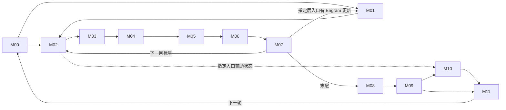

# 171 · DeepSeek‑V4.1‑Flash 融合优化研究工作台

**适用任务**　固定部署下的算子融合、数学化简、计算与通信重组、megakernel 设计及验证。更新日期 2026-11-09。接手顺序为环境核对、路径定位、价值初筛、证据与任务选择。

## 1. 冻结环境

目标资产 171，910C，16 个逻辑设备，CANN 9.2.0，DP2 / TP8 / EP16 / PP1。模型为 DeepSeek‑V4.1‑Flash‑1017 W8A8（DSpark、Engram），使用冻结 vLLM‑Ascend。MoE 当前分支为自有 DispatchFFNCombine。冻结镜像 ID 为 `sha256:ce42d65b2403992ad2e2b06c61f4f048babb57e455cfe307b018345e36c5e98b`，容器为 `wio-vllm-v41-repro171-20261102`，模型服务名为 `dsv41`。主负载为并发 8、输入 32,768、输出 1,024 token；六个普通请求分别评价。

同一 Codex 项目中，本机 `ENVIRONMENT.md` 保存 SSH、服务端点和离线证据定位方法，`HANDOFF.md` 保存详细研究断点。2026-11-09 已授权171复用已有密码认证；本机统一入口按资产编号核对主机并从钥匙串读取凭据。远端本轮只在 `/data/tiankuan/wio` 范围内操作，未重启或修改其它环境。换机器时恢复获授权的 SSH 配置、冻结源码和原始 profile；公开仓库能恢复研究决策与索引。当前服务健康须在实际连接时核对。[冻结配置与哈希](../scope.json) · [成本和负载基线](../baselines/) · [证据索引](../evidence-index.json)

## 2. 融合的目标、搜索尺度与性能单位

1. **沿执行路径分段。** 从模型输入走到输出及下一轮迭代，标出分支、汇合与跨层依赖。12 个模块用于分工和覆盖核对，候选区域可跨模块。
2. **按数据交付由大到小选区。** 从一段计算的最终输出反推，先将服务于该输出的生产者和消费者作为整体评估。逐一确认段外还需要哪些中间结果或状态、何时需要。能够在区域内按时交付就保留大范围；必须独立交付时，才沿该处切分。
3. **评估数学与执行融合。** 在满足输出、精度和状态语义的前提下，检查公式能否化简、公共项能否复用、归约能否合并；再判断中间写读、通信或提交能否减少，必要工作能否重叠。对较大区域，同时评估用 megakernel 在一次设备启动内调度多个阶段的可行性。
4. **用已有性能数据初筛。** 按匹配的 shape、dtype 和负载，把可省工作和新增开销折算为 µs/次，优先复用已有 profile、实测速率及同基线结论。整段的乐观净收益仍低，则结束同一预算内的子方案；收益可观，再深入源码核算，只补会改变去留的关键参数。分别记录算子局部净省与按命中次数、关键路径折算的请求收益。[单位成本与样本口径](../baselines/unit-costs.md)

## 3. 十二模块执行图

图示为逻辑交付。M02–M07 表示目标层重复体；M01 只在指定层触发。M10 依赖来自指定目标层入口的辅助状态和相应 seed。虚线表示该入口的旁路读者。S00–S11 是源码复核记录编号，与模块编号分别管理。

| 模块 | 计算边界 | 代码复核记录 |
|---|---|---|
| [M00 输入、词嵌入与元数据](../modules/M00.md) | 请求/缓存状态 → token、位置、slot | [S00](evidence/S00.md) · [S01](evidence/S01.md) · [S02](evidence/S02.md) · [S03](evidence/S03.md) · [S05](evidence/S05.md) |
| [M01 Engram](../modules/M01.md) | 指定层哈希查表 → WKV → 门控残差 | [S04](evidence/S04.md) |
| [M02 Attention 前 mHC/RMS](../modules/M02.md) | 残差及 premix → Attention 输入 | [S06](evidence/S06.md) |
| [M03 Attention 主体](../modules/M03.md) | Q/KV、cache、QLI → SMLA | [S07](evidence/S07.md) |
| [M04 Attention 输出](../modules/M04.md) | OA/OB、TP 交付 → Post | [S07](evidence/S07.md) |
| [M05 FFN 前 mHC/RMS](../modules/M05.md) | 残差 → router 与共享专家输入 | [S06](evidence/S06.md) · [S08](evidence/S08.md) |
| [M06 MoE](../modules/M06.md) | 路由 → dispatch → 专家 → return/combine；共享专家支路汇合 | [S08](evidence/S08.md) |
| [M07 FFN 输出与跨层状态](../modules/M07.md) | HcPost → 下一层，保留 Engram/aux 读者 | [S06](evidence/S06.md) · [S08](evidence/S08.md) |
| [M08 目标读出](../modules/M08.md) | 末层归约 → norm → 词表分数 | [S09](evidence/S09.md) |
| [M09 采样与验证](../modules/M09.md) | 分数、草稿 → token、接受数、seed | [S09](evidence/S09.md) · [S11](evidence/S11.md) |
| [M10 DSpark 草稿](../modules/M10.md) | aux → 三层 context/草稿 → 五步选词 | [S10](evidence/S10.md) |
| [M11 迭代交付](../modules/M11.md) | 输出、回收及 slot 状态 → 下一轮 M00 | [S11](evidence/S11.md) |

## 4. 优化地图与研究阶段

优化点按当前决定分为三组。点编号查看代码和证据，megakernel 标在方案类型里。[逐项说明](opportunities.md) · [早期 42 族](evidence/priority-42.md)

<!-- THREE-MEGA-PERFORMANCE-20261109-START -->
2026-11-09补价：[三个megakernel的净性能、敏感性与停止门槛](evidence/three-megakernel-performance.md)。三项仍为待确认；表中的数字是条件情景，新增设备实测0。K03的局部周期百分比不直接换成整请求收益，K01/K02不重复记owner/direct预算。
<!-- THREE-MEGA-PERFORMANCE-20261109-END -->

<!-- WORKBENCH-CONTINUATION-20261109-START -->
2026-11-09续扫：[计划、物理读序与整段停止条件](evidence/workbench-continuation.md)。从未闭合的目标→草稿DP交付开始，新增核对C04/C06/C09/C11/C12；其余模块引用原S00–S11覆盖。新增设备实测0。C04a与C12a是原机制内停止的子范围，不增加独立收益预算。

- **介绍**　核对实际消费者后确定可删工作，再用匹配原profile定价。
- **到了哪里**　静态首筛按12模块均有已扫去向或具名条件；候选实现/数值/性能验收仍分项待确认。
- **结果**　目标计数直接复用被反例否定；固定GEMM边界全免仍不足1%。SMLA补物理packed顺序合同，QLI补c/ρ/h门槛。旧实验的暂停记录单独保留。
<!-- WORKBENCH-CONTINUATION-20261109-END -->

### 待确认

实现条件或调优价值还有关键问题。优先看 C08、C09 和 K03。

| 介绍（模块、优化点与类型） | 到了哪里 | 结果 |
|---|---|---|
| [M03 Attention 主体](../modules/M03.md) · [📄 C08](opportunities.md#c08) 本地 KV 投影后窄 AllGather · 通信与计算重排 | 已估算，待验证投影精度、行序及窄通信 | 情景：长提示的四个 prefill 执行批次毛预算 60.54 ms，兑现 50% 省 30.27 ms（旧 TTFT 2.03%，旧整批 0.163%）。 |
| [M03 Attention 主体](../modules/M03.md) · [📄 C09](opportunities.md#c09) SMLA 分页 KV 直读（[历史 F07](opportunities.md#history46-f07)） · 读写融合 | 待确认；本次已核对具名合同/门槛 | 原KV pair有物理偏移重排、尾部fallback和负索引停止；新直读须匹配packed plane或过数值验收。原17.78ms仍为条件情景，实际K/整核速度待证。 |
| [M06 MoE](../modules/M06.md) · [📄 K03](opportunities.md#k03) DFC 尾部承接共享 GateUp · megakernel  | 待确认。条件净性能已复算；需τ/吞吐/覆盖 | τ20µs/h5µs、40层时：Up吞吐ρ1省0.600ms/周期（中位1.080%）；ρ0.9仅0.486ms（0.876%）。同一局部周期情景，不是整请求实测。 |
| [M00 输入与元数据](../modules/M00.md) · [📄 C01](opportunities.md#c01) 增量发布 block 表 · 提交合并 | 待核对可省的主机提交时间 | 部件预算：C8 旧整批 23.66 ms（0.127%），仅计上传数据。 |
| [M00 输入与元数据](../modules/M00.md) · [📄 C04](opportunities.md#c04) 目标与草稿共享 DP 计数 · 调度与同步 | 待确认；本次已核对具名合同/门槛 | 目标24行桶不能决定草稿5/20行；直接复用子项C04a停止。扩展packet须含B/K/角色/epoch及一致fallback；协调净关键省仍未知。 |
| [M01 Engram](../modules/M01.md) · [📄 C06](opportunities.md#c06) Engram 完整结果复用 · 计算消除与复用 | 待确认；本次已核对具名合同/门槛 | 71.1%–96.3%是需消除的可缓存耗时比例，不是row-hit率。部分miss可保留整次WKV；缺完整键命中和残余调用成本。 |
| [M02 Attention 前 mHC](../modules/M02.md) · [📄 C07](opportunities.md#c07) mHC 系数与残差复用 · 计算消除与复用 | 待确认可省归约与舍入边界 | 预算：HcPre 占同周期约 5.10%；周期降 1% 需净删 HcPre 耗时的 19.6%。 |
| [M03 Attention 主体](../modules/M03.md) · [📄 C11](opportunities.md#c11) QLI 按 key 压实评分 · 计算消除与复用 | 待确认；本次已核对具名合同/门槛 | 223完全关键波情景需每四次净省0.833667ms。等速零开销需评分主体占旧段≥84.024%；极有利全段评分时新增成本≤0.158514ms。缺c/ρ/h。 |
| [M04 Attention 输出](../modules/M04.md) · [📄 C10](opportunities.md#c10) OA 前移并直接生成发送布局 · 通信与计算重排 | 旧变体已关闭，新布局的形状覆盖待核对 | 成本余量：理想 OA 前移后，新传输与融合的额外开销中位仅容许 0.214 ms；新变体净值待定。 |
| [M06 MoE](../modules/M06.md) · [📄 C05](opportunities.md#c05) 裁掉无最终贡献的行 · 计算消除与复用 | 待核对假路由命中次数及末层读者 | 上界：末层 FFN 与读出合计 22.992 ms（长 prefill）；idle 波若有 100 次，旧整批达 1% 需净省 1.859 ms/次。 |
| [M06 MoE](../modules/M06.md) · [📄 C12](opportunities.md#c12) Norm、Router、TopK 联合生产 · 读写融合 | 待确认；本次已核对具名合同/门槛 | 固定GEMM的子项C12a停止：非GEMM全免目标最高0.8963%周期，连草稿最高0.9637%。大方案若改变GEMM主体，须另证净差。 |
| [M06 MoE](../modules/M06.md) · [📄 C13](opportunities.md#c13) 共享专家与路由专家联合排程 · 调度与同步 | 待核对计算与通信可重叠的窗口 | 情景：F21 独占资源且保留路由时可省 0.594 ms/周期，达到 1% 后新增成本余量中位仅 0.0427 ms。 |
| [M10 DSpark](../modules/M10.md) · [📄 C14](opportunities.md#c14) 三层 context KV 共同发布 · 读写融合 | 待核算额外权重、重排与同步 | 预算：原 context 前缀 1.050 ms（同周期 1.897%）；周期降 1% 需净省该段约 52.7%。 |
| [M11 下轮状态](../modules/M11.md) · [📄 C02](opportunities.md#c02) 合并生成 ID、位置及接受数 · 计算消除与复用 | 待核对必须保留的 CPU 镜像和索引 | 设备端上界：已定价部件全免为 61.73 ms（旧整批 0.332%）。 |
| [M11 下轮状态](../modules/M11.md) · [📄 C15](opportunities.md#c15) 客户端输出提前就绪 · 调度与同步 | 待核对普通请求的输出与页回收时点 | 上界：C8 即使去掉全部可释放等待也仅省 12.807 ms；普通 code-single 整响应达 1% 需净省 4.666 ms。 |
| [M11 下轮状态](../modules/M11.md) · [📄 F03](opportunities.md#history46-f03) 13 项 slot 批写扩形状 · 提交合并 | 13 项扩形状待判断 | 26项0.961ms/步时，13项需0.880ms/步才两轮整段均≥1% |
| M00、M11 · [📄 K07](opportunities.md#k07) 跨组slot与共同输入publisher · megakernel | 共同输入发布待判断，B4 批写实测见 C03 | 历史B4整批3.39%/2.22%；共同输入已定价设备全免61.73ms |
| M02、M03 · [📄 K01](opportunities.md#k01) Post/HcPre/RMS到本地KV-ready的前端 · megakernel  | 待确认。条件净性能已复算；总方案与融合增量分账 | owner毛包络分为计算22.412ms、通信38.132ms；各50%暴露再扣额外5ms省25.272ms（旧TTFT尺度1.694%）。megakernel独立边际待定。 |
| M03、M04 · [📄 K02](opportunities.md#k02) SMLA direct/partial到inverse RoPE与可选OA send producer · megakernel  | 待确认。条件净性能已复算；需direct速度与OA净增量 | K256等速direct基准17.777ms；OA净增关键惩罚≤2.859ms才守住旧TTFT尺度1%。仅PV读速75%时余量0.883ms；两侧75%时基准仅13.827ms。 |
| M06、M08 · [📄 K10](opportunities.md#k10) 末层需求驱动selected query/FFN/readout producer · megakernel | 待确认末层输出读者 | FFN+readout有利上界22.992ms；需净兑现64.89%；不是预计值 |
| M09、M10 · [📄 K05](opportunities.md#k05) aux owner到main norm与三套context KV · megakernel | 待确认权重搬运和发布成本 | 原prefix1.050ms；到同周期1%需净删52.71%；尚无新实现预计值 |
| M10 · [📄 K04](opportunities.md#k04) DSpark三层或whole-draft常驻 · megakernel | 待确认设备通信协议 | 三层仅gap免费后仍需删native24.32%；whole draft需11.62%；都是同周期门槛 |
| 全模型 · [📄 K09](opportunities.md#k09) 40层或跨迭代无限常驻 · megakernel | 待确认设备控制协议 | 当前未具备可接入实现或可报告性能值，不排在局部方案前 |
| [M04 Attention 输出](../modules/M04.md) · [📄 F08](opportunities.md#history46-f08) OA→OB 同核分块交付 · 读写融合 | 备选原型 | 长 prefill 的 TTFT 估省 15.34–17.94 ms（1.03%–1.20%），整批约 0.08%–0.10%。假设两种资源均达参考速率的 90%，短阶段可重叠 50%。 |

### 已确认可实现

已有代码或验证证据支持在指定条件下实现。收益注明估算或实测。

| 介绍（模块、优化点与类型） | 到了哪里 | 结果 |
|---|---|---|
| [M00 输入与元数据](../modules/M00.md) · [📄 F01](opportunities.md#history46-f01) slot 坐标与扁平索引双输出 · 提交合并 | 服务实测·限定基线 | 各自CP基线：15.034s→14.217s，整批-5.43% |
| [M03 Attention 主体](../modules/M03.md) · [📄 F05](opportunities.md#history46-f05) QLI 四层共享成员转换 · 计算消除与复用 | 服务实测·限定基线 | 单改整批-1.50%/-1.48%；slot基线上-1.27%/-1.56%，样本重叠 |
| [M06 MoE](../modules/M06.md) · [📄 K00](opportunities.md#k00) 既有 DispatchFFNCombine · megakernel | 冻结基线已在用 | 基线事实；无第二份融合收益 |
| [M11 下轮状态](../modules/M11.md) · [📄 C03](opportunities.md#c03) 26 项 slot 批写（[历史 F02](opportunities.md#history46-f02)） · 提交合并 | 服务实测 · B4 | 历史服务实测：B4 两组整批耗时分别下降 3.39% 和 2.22%。 |

### 已停止

当前版本和负载下结束排查。每项保留停止原因，条件改变可重开。

查看停止原因与已有结果

| 介绍（模块、优化点与类型） | 到了哪里 | 结果 |
|---|---|---|
| M00、M10、M11 · [📄 C04a](opportunities.md#c04a) 直接复用目标padded计数 · 计划复用 | 已停止；字段不足 | B1/B4目标同24行，草稿分别5/20行；扩展packet仍见C04。 |
| M05、M06 · [📄 C12a](opportunities.md#c12a) 固定router GEMM的全部边界融合 · 读写融合 | 已停止；整段乐观筛查不过线 | 112同窗：目标全免最高0.8963%周期，连草稿最高0.9637%；更小子方案一并停止。 |
| M01 · [📄 K06](opportunities.md#k06) Engram固定位置plane融合 · megakernel | 原局部方案已停止 | 所列gate+lookup全免最高约0.743%同周期，局部停止 |
| M09、M10 · [📄 K08](opportunities.md#k08) 五Markov与局部head融合 · megakernel | 原局部方案已停止 | 五步55任务即全免最高0.8504%周期；保持dot的target/draft联合旧整批179.925ms<185.908ms |
| M00 · [📄 U01](opportunities.md#history46-u01) 视觉条件入口 · 条件分支 | 范围外 | 当前收益0；图像负载未知 |
| M00、M01 · [📄 R01](opportunities.md#history46-r01) 词嵌入/Engram 输入交付 · 计算消除与复用 | 不立项 | embedding具名设备+launch整批0.482%，普通≤0.667%；协议常见组分别≤0.083%/0.085% |
| M00、M02 · [📄 R04](opportunities.md#history46-r04) 首层虚拟四路与草稿 padding · 计算消除与复用 | 不立项 | C8整批15.88ms(0.085%)，普通≤0.081% |
| M00、M10 · [📄 R22](opportunities.md#history46-r22) 输入bank与DSpark主投影转置 · 读写融合 | 不立项 | 合计有利TTFT0.623ms、整批8.05ms(0.043%) |
| M00、M11 · [📄 H01](opportunities.md#history46-h01) CP 局部长度与 CPU 计划公共项 · 提交合并 | 历史基线复用，不单独立项 | CP单改整批6.10%/4.89%；CPU复用10.36%/9.56% |
| M00、M11 · [📄 R02](opportunities.md#history46-r02) 元数据 tiling 多输出 · 提交合并 | 不立项 | 全部具名API免费：整批0.141%，普通≤0.161% |
| M01 · [📄 R03](opportunities.md#history46-r03) Engram 局部 gate/lookup 与尾部 · 计算消除与复用 | 不立项 | gate+lookup全免≤0.743%本地周期；尾部TTFT1.30–2.05ms |
| M01 · [📄 U02](opportunities.md#history46-u02) Engram 自然跨层/跨步缓存 · 计算消除与复用 | 暂不立项 | 原本地周期1%需消除约75.4%可缓存部分（常量免费假设） |
| M02、M03 · [📄 R05](opportunities.md#history46-r05) 独立提前本地 Q 与空侧提早 · 通信与计算重排 | 不立项 | TTFT最有利9.011ms<14.919ms；空侧对EP16到达0 |
| M02、M05 · [📄 U03](opportunities.md#history46-u03) Gram 对角化、范数归约与精度约束 · 计算消除与复用 | 暂不立项 | M3例Gram 5242880 MAC vs 61440平方；mix投影7864320 MAC仍保留；无通过精度的性能值 |
| M02、M05 · [📄 U04](opportunities.md#history46-u04) Sinkhorn 真正定点提前停止 · 计算消除与复用 | 暂不立项 | 两处需兑现中位差额77.6%；单侧最有利TTFT≤9.96ms |
| M02、M05、M07 · [📄 F04](opportunities.md#history46-f04) 两处 Post→mHC premix/RMS 共读残差 · 读写融合 | 暂不立项 | 同速字节模型9.12–18.23ms；宽写+25%时14.59ms；原生直连中位10.53/14.02ms |
| M02、M07 · [📄 R09](opportunities.md#history46-r09) 宽残差工作区交付 · 读写融合 | 不立项 | 双输出TTFT0.36–3.93ms；只存宽平面净省字节0 |
| M03 · [📄 F06](opportunities.md#history46-f06) QLI 四消费层内截短列表归并 · 计算消除与复用 | 暂不立项 | 七非生产层TTFT过线需约20%核时净减；修正版联合整批需消费层净减60.6%–63.5% |
| M03 · [📄 R06](opportunities.md#history46-r06) Attention 输入多投影/旋转/量化/cache 融合组 · 读写融合 | 不立项 | 直接搬运整批7.33–9.27ms；半向量工作+间隙全省0.68%–0.70% |
| M03 · [📄 R07](opportunities.md#history46-r07) C2 与索引输出接口联合 · 读写融合 | 不立项 | TTFT0.353ms、整批0.461ms；索引准备全免TTFT6.56–6.70ms |
| M03 · [📄 U05](opportunities.md#history46-u05) 同代 KV 面板驻留 · 读写融合 | 不独立立项 | 连续copy参考TTFT4.02–5.77ms；有效稀疏速率<约465GB/s可能改变优先级 |
| M04 · [📄 R08](opportunities.md#history46-r08) Attention 直接写发送布局/接收逆旋转 · 通信与计算重排 | 不立项 | 发送整批0.49%–0.51%；接收端新增免费也仅TTFT4.84–5.33ms |
| M05、M06 · [📄 R10](opportunities.md#history46-r10) Norm 同时产三种输入 · 读写融合 | 不立项 | TTFT慢2.01至快3.09ms；给路由首段50%附加净省仍8.40ms |
| M06 · [📄 F09](opportunities.md#history46-f09) 固定路由专家跨核激活交付 · 读写融合 | 暂不立项 | 单核最多3次读含前侧11.13ms(0.75%)；全部逻辑传输免费敏感性29.35ms(1.97%) |
| M06 · [📄 H02](opportunities.md#history46-h02) 前缀换 DP、冷热专家与权重放置 · 部署布局 | 范围外 | C8额外命中上界0 token；专家布局收益不纳入融合 |
| M06 · [📄 R11](opportunities.md#history46-r11) Router/TopK/ID/dispatch 入口 · 读写融合 | 不立项 | TTFT1.65–1.85ms、整批0.27%–0.36% |
| M06 · [📄 R12](opportunities.md#history46-r12) 路由专家单核激活承接 · 读写融合 | 不立项 | TTFT11.13ms(0.75%)，普通整段≤0.148% |
| M06 · [📄 R13](opportunities.md#history46-r13) 共享专家两处交接联合 · 读写融合 | 不立项 | 有利TTFT8.83ms(0.59%)、整批62.10ms(0.33%) |
| M06 · [📄 U06](opportunities.md#history46-u06) 其它合法 MoE 后端/selector · 条件分支 | 范围外 | 该固定profile无匹配后端预算，Nbranch及净开销未知 |
| M06 · [📄 U07](opportunities.md#history46-u07) 固定布局的专家返回有序直写 · 通信与计算重排 | 暂不立项 | 不把专家等待或冷热放置当成可删；新增净省量未证实 |
| M06、M07 · [📄 R14](opportunities.md#history46-r14) 共享 Down+加和+HcPost+直接 premix · 读写融合 | 服务反例·限定变体 · 不立项 | 三项有利TTFT7.30ms(0.49%)；M3服务慢0.31%/0.19% |
| M08 · [📄 R16](opportunities.md#history46-r16) 末层 Post 到词表 MM 整段 · 读写融合 | 不立项 | 整段全部免费TTFT14.41ms(0.966%)、整批78.69ms(0.423%) |
| M08、M09 · [📄 R17](opportunities.md#history46-r17) 目标词表选词与分片摘要 · 通信与计算重排 | 不立项 | 一次摘要交换整批27.48–47.78ms；完整logits额外ID半扫描4.23ms |
| M08、M09 · [📄 U09](opportunities.md#history46-u09) 有限 prompt 评分共同扫描/TP摘要 · 计算消除与复用 | 范围外 | 本地0.79–2.20ms；含跨卡2.42–4.82ms；固定请求无命中 |
| M08、M10 · [📄 R15](opportunities.md#history46-r15) 三检查点打包归集与草稿取行拼接 · 通信与计算重排 | 不立项 | 整批8.02–31.27ms；极有利全额最多0.39% |
| M09 · [📄 R20](opportunities.md#history46-r20) top-k/top-p 双阈值融合 · 计算消除与复用 | 不立项 | B4每次18.72us；随机外推整批0.046%/0.134%，普通<0.06% |
| M09 · [📄 R21](opportunities.md#history46-r21) 有限 token logprobs 与私有mask · 计算消除与复用 | 不立项 | 整批7.99–15.98ms；最有利附带mask24.53ms(0.132%) |
| M09、M10、M11 · [📄 R19](opportunities.md#history46-r19) 验证+草稿ID+下一轮状态联合 · 提交合并 | 不立项 | 设备+等待模型63.86ms(0.344%)；满批主机全给足约0.992% |
| M09、M10、M11 · [📄 U10](opportunities.md#history46-u10) 随机/概率草稿/换批/动态长度的状态交付 · 调度与同步 | 暂不立项 | 当前无该分支端点估值；不外推greedy/caller大间隙 |
| M09、M11 · [📄 R18](opportunities.md#history46-r18) 目标验证直接生成 seed/count · 提交合并 | 不立项 | 即使计数回传免费整批10.14ms；普通≤0.065% |
| M10 · [📄 R23](opportunities.md#history46-r23) 三层context RMS/RoPE/cache与提交 · 提交合并 | 不立项 | 半设备预算27.94–30.82ms；含主机整批0.21%–0.24% |
| M10 · [📄 R24](opportunities.md#history46-r24) 五步 Markov 校正到 ID 及W1/W2复用 · 计算消除与复用 | 不立项 | 具名任务含末轮全免整批67.65ms(0.364%)；普通≤0.170%；W1/W2免费0.213% |
| M10 · [📄 R25](opportunities.md#history46-r25) DSpark 可选共享 TopK hook · 条件分支 | 不立项 | 发生次数0，可省工作0 |
| 全模型 · [📄 U08](opportunities.md#history46-u08) 全层/跨层 megakernel 额外空间 · megakernel | 不独立立项 | 局部已归F04/F07/F08/F09；没有额外通用加速百分比 |

## 5. 已完成、待确认与任务分配

- **算子开发**：优先 C09 / 历史 F07，选一个真实长提示 shape，比对 SMLA 的分页 KV 直读与原有显存暂存路径。第一份交付是相同输入下的数值对照、真实有效 K 及完整 kernel 的 µs。
- **框架与通信联合**：C08，先验证单个普通 SWA 层换本地行数后的 BF16、行序与 cache，再比较窄 AllGather 的净交付时间。K01 和它共享工作预算。
- **待补证**：优先确认 K03。先查同 shape 下 DFC 最后 GMM2 到 Vector 收尾之间 Cube 真正可用的时间、并发 Up 吞吐、净新增成本及层覆盖。既有模型假设额外开销为每 FFN 5 µs 时，过参考线所需尾部时长中位约 18.89 µs；这个时长尚待确认。K02 与 C09 的 KV 交付部分重叠。理论估价和源码核对均未新增设备实测。
- **排查队列**：首批是大 prefill 的 OA→OB（历史 F08）、C11 QLI 压实、C07 mHC、B1 slot 扩形状（历史 F03）。下一批优先 C05 假路由、C06 Engram 完整键复用、C12 路由主体。按引导词选一项，结束时更新本节。

**已完成的范围**　冻结模型实际路径的离线首筛与条件记录、已有实现的历史基线复核，以及 megakernel 理论切分。当前 C08、C09、K03 仍分别处于原型待领或条件补证阶段。团队清单列出 2 个原型、4 个首批排查、8 个后备确认；K03 与 C13 复用同一 MoE 模块责任链。[团队工作单](team-work.md) · [megakernel 设计依据](evidence/megakernel.md) · [逐窗口模型](evidence/megakernel-window-model.json)

## 6. 性能定价与适用范围

| 成本项 | 已有参照 | 使用边界与来源 |
|---|---|---|
| BF16 GEMM | M416、K5120、N1280，DP0、prefill；8 rank 合计 320 条，单次中位 34.78 µs、P95 37.42 µs；按中位数约 80.3 TMAC/s | 一次乘加计一个 MAC。优先匹配完整 shape、dtype、布局与阶段。模型含 385,100 条设备记录、1,698 组条件。[单位成本说明](../baselines/unit-costs.md) · [逐 shape 记录](../baselines/profile-units.json) |
| TP8 AllGather | 每 rank 输入/输出 646,400 / 5,171,200 B；两组并发时 DP0/DP1 分别 58.47/59.95 µs，对应 88.449/86.255 GB/s | BF16，原表标 BFP16。吞吐以完整逻辑张量计，含启动和同步；换消息大小、拓扑、并发或改为 EP16 应重新匹配。[回放与字节口径](../baselines/collective-calibration.json) · [模型内通信](../baselines/communication.json) |
| 内存搬运 | 五个匹配 TensorMove 的逻辑输出速率约 1,109–1,210 GB/s | 用于相同条件的敏感性估算；稀疏、冷热缓存、UVA 需要各自样本。逐项标明是单向输出字节还是读写总字节。[搬运依据](../baselines/ffn-entry.json) |
| 启动、重叠与请求侧 | 已绑定的图内设备区间、node API 区间、TP8 最慢 rank、六普通请求和长提示 C8 | 局部时间与请求时间分别计算。并行卡时间不累加；原整网 1% 是参考，不是局部算子唯一准入条件。[成本目录](../baselines/atlas.json) · [共享测量](../baselines/shared-measurements.json) · [请求负载](../baselines/workloads.md) |

估算顺序：匹配原始耗时；缺样本时以可删 MAC / 有效 MAC 速率，或可删字节 / 匹配的有效带宽估计；扣除替代计算、重排、同步、争用。对可重叠工作按同 rank、同请求窗口取关键路径差。每项报告局部 µs、命中次数、TTFT 或整批 ms、估计条件。持续 HBM/L2/UVA 带宽与部分新 shape 的算力仍有缺口。[待校准项](../baselines/calibration-plan.json)

## 7. 研究成果来源与共同维护

| 来源 | 可复用成果 |
|---|---|
| 171 W8A8 框架排查 | [暂停记录](../STATUS-2026-11-08.md)、[分析日志](../analysis-log.jsonl)、[证据索引](../evidence-index.json) |
| 算子优先级及方案制定 | [历史42族登记](evidence/priority-42.md)、[后续优先级及组合基线](https://github.com/wio1997/Inference-Foundry/blob/c0cce2c6eb39eb1935d244d30deb9d5b6754dc54/operator-optimization/deepseek-v4.1-ascend/PRIORITY-PLAN.md)。CP＋Slot＋CPUplan 已有组合对照，后续比较须标记相同基线。 |
| F01 独立验证 | [mHC 双流原型与图回放](evidence/independent-hc.md)。当前重复计算版本已有局部反例，系数专算变体仍待实现。 |
| 全模型 Goal、megakernel 与团队复核 | 本页第 3 节逐阶段源码复核、第 4 节去重机制、第 5 节团队队列与专题切分。 |

**编号规则**　引用必须带来源，例如“优先级42/F01”是 mHC，“历史46/F01”是 slot 双输出。C09、历史46/F07、K02 的共同 KV 读写只有一份收益。台账行数不可跨来源相加。

### 阶段说明与上传流程

每个优化点、每次有进展，都更新同一张 📄，写三行。

- **介绍**　属于哪个模块，准备怎么改，想省掉什么。
- **到了哪里**　从「待确认、已确认可实现、已停止」中选一项，写明依据。估算、原型和实测进展写在结果里。
- **结果**　有数字就写负载、指标和数值，标明估算或实测。暂时算不出就写缺什么；决定停止就写原因。

### 每次怎样上传

在[逐项说明](opportunities.md)对应编号下按日期追加这三行，把代码、PR 或性能证据链接附在结果下。同次将该行移到对应进度组，保留模块、类型及原证据链接，更新结果，提交到研究分支或发 PR。下一位从这条记录接手。
