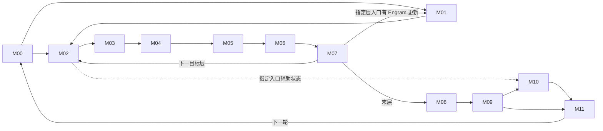

# 171 · DeepSeek‑V4.1‑Flash 融合优化研究工作台

**适用任务**　固定部署下的算子融合、数学化简、计算与通信重组、megakernel 设计及验证。更新日期 2026-11-09。接手顺序为环境核对、路径定位、价值初筛、证据与任务选择。

## 1. 冻结环境

目标资产 171，910C，16 个逻辑设备，CANN 9.2.0，DP2 / TP8 / EP16 / PP1。模型为 DeepSeek‑V4.1‑Flash‑1017 W8A8（DSpark、Engram），使用冻结 vLLM‑Ascend。MoE 当前分支为自有 DispatchFFNCombine。冻结镜像 ID 为 `sha256:ce42d65b2403992ad2e2b06c61f4f048babb57e455cfe307b018345e36c5e98b`，容器为 `wio-vllm-v41-repro171-20261102`，模型服务名为 `dsv41`。主负载为并发 8、输入 32,768、输出 1,024 token；六个普通请求分别评价。

同一 Codex 项目中，本机 `ENVIRONMENT.md` 保存 SSH、服务端点和离线证据定位方法，`HANDOFF.md` 保存详细研究断点。连接只用本机已授权的 key。换机器时恢复获授权的 SSH 配置、冻结源码和原始 profile；公开仓库能恢复研究决策与索引。当前服务健康须在实际连接时核对。[冻结配置与哈希](../scope.json) · [成本和负载基线](../baselines/) · [证据索引](../evidence-index.json)

## 2. 融合的目标、搜索尺度与性能单位

1. **沿执行路径分段。** 从模型输入走到输出及下一轮迭代，标出分支、汇合与跨层依赖。12 个模块用于分工和覆盖核对，候选区域可跨模块。
2. **按数据交付由大到小选区。** 从一段计算的最终输出反推，先将服务于该输出的生产者和消费者作为整体评估。逐一确认段外还需要哪些中间结果或状态、何时需要。能够在区域内按时交付就保留大范围；必须独立交付时，才沿该处切分。
3. **评估数学与执行融合。** 在满足输出、精度和状态语义的前提下，检查公式能否化简、公共项能否复用、归约能否合并；再判断中间写读、通信或提交能否减少，必要工作能否重叠。对较大区域，同时评估用 megakernel 在一次设备启动内调度多个阶段的可行性。
4. **用已有性能数据初筛。** 按匹配的 shape、dtype 和负载，把可省工作和新增开销折算为 µs/次，优先复用已有 profile、实测速率及同基线结论。整段的乐观净收益仍低，则结束同一预算内的子方案；收益可观，再深入源码核算，只补会改变去留的关键参数。分别记录算子局部净省与按命中次数、关键路径折算的请求收益。[单位成本与样本口径](../baselines/unit-costs.md)

## 3. 十二模块执行图

图示为逻辑交付。M02–M07 表示目标层重复体；M01 只在指定层触发。M10 依赖来自指定目标层入口的辅助状态和相应 seed。虚线表示该入口的旁路读者。S00–S11 是源码复核记录编号，与模块编号分别管理。

| 模块 | 计算边界 | 代码复核记录 |
|---|---|---|
| [M00 输入、词嵌入与元数据](../modules/M00.md) | 请求/缓存状态 → token、位置、slot | [S00](evidence/S00.md) · [S01](evidence/S01.md) · [S02](evidence/S02.md) · [S03](evidence/S03.md) · [S05](evidence/S05.md) |
| [M01 Engram](../modules/M01.md) | 指定层哈希查表 → WKV → 门控残差 | [S04](evidence/S04.md) |
| [M02 Attention 前 mHC/RMS](../modules/M02.md) | 残差及 premix → Attention 输入 | [S06](evidence/S06.md) |
| [M03 Attention 主体](../modules/M03.md) | Q/KV、cache、QLI → SMLA | [S07](evidence/S07.md) |
| [M04 Attention 输出](../modules/M04.md) | OA/OB、TP 交付 → Post | [S07](evidence/S07.md) |
| [M05 FFN 前 mHC/RMS](../modules/M05.md) | 残差 → router 与共享专家输入 | [S06](evidence/S06.md) · [S08](evidence/S08.md) |
| [M06 MoE](../modules/M06.md) | 路由 → dispatch → 专家 → return/combine；共享专家支路汇合 | [S08](evidence/S08.md) |
| [M07 FFN 输出与跨层状态](../modules/M07.md) | HcPost → 下一层，保留 Engram/aux 读者 | [S06](evidence/S06.md) · [S08](evidence/S08.md) |
| [M08 目标读出](../modules/M08.md) | 末层归约 → norm → 词表分数 | [S09](evidence/S09.md) |
| [M09 采样与验证](../modules/M09.md) | 分数、草稿 → token、接受数、seed | [S09](evidence/S09.md) · [S11](evidence/S11.md) |
| [M10 DSpark 草稿](../modules/M10.md) | aux → 三层 context/草稿 → 五步选词 | [S10](evidence/S10.md) |
| [M11 迭代交付](../modules/M11.md) | 输出、回收及 slot 状态 → 下一轮 M00 | [S11](evidence/S11.md) |

## 4. 优化地图与研究阶段

**按主责模块定位，按优化点阅读。** 主责模块是该项的维护入口，协作模块标明跨段依赖。同一机会跨模块时只建一行。以下列出当前 15 个机制，以及需独立区分状态的历史成果、备选原型和专题实现。专题切口可以实现同一机制，历史编号保留原始实验口径。

打开优化点编号可查看代码、改法、负载、收益依据及待证条件。[📄 全部逐项说明](opportunities.md) · [早期 42 族原始研究页](evidence/priority-42.md)

**当前 15 个机制**中，12 个处于初步判断，C08、C09 已有条件估算并待领原型，C03 的 B4 分支已有服务实测。

**进度口径**　**判断中**：已定位工作，证据尚不足以估净收益。**条件估算**：已有带假设的数值，尚待匹配形状验证。**局部确认 / 服务确认**：同基线实测，须注明范围和正负结果。**已有实现**说明代码存在；**已交付**另需版本、接入条件、验收和维护人。行动列标明应补证、做原型、停止还是复用。

| 主责模块 | 优化点 | 优化逻辑 | 当前阶段 | 收益与口径 | 下一步 | 协作／归属 |
|---|---|---|---|---|---|---|
| [M00 输入与元数据](../modules/M00.md) | [📄 C01](opportunities.md#c01) 增量发布 block 表 | 提交｜跳过未变化的行及其拷贝 | 初筛·已有预算或门槛 | 部件预算：C8 旧整批 23.66 ms（0.127%），仅计上传数据。 | 按实际调用点核对剩余可删的提交时间 | M11 |
| [M00 输入与元数据](../modules/M00.md) | [📄 C04](opportunities.md#c04) 目标与草稿共享 DP 计数 | 等待｜省去可预测的第二次主机协调 | 初筛·已有预算或门槛 | 门槛：旧整批若命中 200 次，每次净省至少 0.930 ms 才达 1%。 | 核对各 DP 是否能一致决策及回退 | M10/M11 |
| [M00 输入与元数据](../modules/M00.md) | [📄 F01](opportunities.md#history46-f01) slot 坐标与扁平索引双输出 | 计算｜一次索引计算写两份结果 | 服务实测·限定基线 | 各自CP基线：15.034s→14.217s，整批-5.43% | 已有实现，按该基线复用 | M11 |
| [M01 Engram](../modules/M01.md) | [📄 C06](opportunities.md#c06) Engram 完整结果复用（K06（局部变体已停）） | 计算｜相同完整键命中后复用查表和投影 | 初筛·已有预算或门槛 | 门槛：本地周期降 1% 需消除原可缓存耗时的 71.1%–96.3%（中位 75.4%），另扣缓存管理。 | 按层、权重版本及完整键回放 | — |
| [M02 Attention 前 mHC](../modules/M02.md) | [📄 C07](opportunities.md#c07) mHC 系数与残差复用（历史46/F04 · 独立 HC） | 计算／读写｜减少重复归约、工作区和残差读写 | 初筛·已有预算或门槛 | 预算：HcPre 占同周期约 5.10%；周期降 1% 需净删 HcPre 耗时的 19.6%。 | 定位可删主体并复核舍入；具体反例见独立 HC 记录 | M05/M07 |
| [M03 Attention 主体](../modules/M03.md) | [📄 C08](opportunities.md#c08) 本地 KV 投影后窄 AllGather（K01） | 通信／计算｜减少宽通信及重复投影 | 条件估算 | 情景：长提示的四个 prefill 执行批次毛预算 60.54 ms，兑现 50% 省 30.27 ms（旧 TTFT 2.03%，旧整批 0.163%）。 | 验证单层 BF16、行序、cache 和净通信时间 | M02 |
| [M03 Attention 主体](../modules/M03.md) | [📄 C09](opportunities.md#c09) SMLA 分页 KV 直读（历史46/F07 · K02） | 读写｜消除显存暂存写回与重读 | 条件估算 | 情景：有效 K=256、QK/PV 等速，TTFT 省 17.78 ms（1.19%），整批省 21.93 ms（0.118%）。 | 比较完整 kernel 的精度与耗时 | — |
| [M03 Attention 主体](../modules/M03.md) | [📄 C11](opportunities.md#c11) QLI 按 key 压实评分（历史46/F05（已验证的另一方案）） | 计算｜只给有效 key 打分 | 初筛·已有预算或门槛 | 工作量：理想少 50.09% 评分 MAC；若暴露 223 波，旧整批达 1% 需每四次 QLI 净省 0.834 ms。 | 扣除 gather、压实和次序恢复 | — |
| [M03 Attention 主体](../modules/M03.md) | [📄 F05](opportunities.md#history46-f05) QLI 四层共享成员转换 | 计算｜一次生成成员表示供四层共读 | 服务实测·限定基线 | 单改整批-1.50%/-1.48%；slot基线上-1.27%/-1.56%，样本重叠 | 已有实现；叠加批写的增量未确立 | — |
| [M04 Attention 输出](../modules/M04.md) | [📄 C10](opportunities.md#c10) OA 前移并直接生成发送布局（K02（输出端）） | 通信｜先压缩 head 数据再交换 | 初步判断 · 旧变体关闭 | 成本余量：理想 OA 前移后，新传输与融合的额外开销中位仅容许 0.214 ms；新变体净值待定。 | 查实际可覆盖形状及权重额外容量 | M03 |
| [M04 Attention 输出](../modules/M04.md) | [📄 F08](opportunities.md#history46-f08) OA→OB 同核分块交付 | 读写｜避免中间投影完整落显存 | 条件估算 · 备选原型 | 长 prefill 的 TTFT 估省 15.34–17.94 ms（1.03%–1.20%），整批约 0.08%–0.10%。假设两种资源均达参考速率的 90%，短阶段可重叠 50%。 | 先查片上容量、权重搬运与重叠 | — |
| [M05 FFN 前归一化](../modules/M05.md) | 协作模块 | 归一化与路由输入共同归两处主责记录 | 随 C07、C12 记录 | 见所列主责项 | 核对交付合同 | C07、C12 |
| [M06 MoE](../modules/M06.md) | [📄 C05](opportunities.md#c05) 裁掉无最终贡献的行（K10（末层）） | 计算｜减少空闲 DP 假路由及已退役行计算 | 初筛·已有预算或门槛 | 上界：末层 FFN 与读出合计 22.992 ms（长 prefill）；idle 波若有 100 次，旧整批达 1% 需净省 1.859 ms/次。 | 数真实 idle 波次；保留远端专家和 raw 读者 | M08/M10 |
| [M06 MoE](../modules/M06.md) | [📄 C12](opportunities.md#c12) Norm、Router、TopK 联合生产 | 读写｜减少门控投影周围的中间张量 | 初筛·已有预算或门槛 | 预算：Router 与 RMS 合计占同周期约 1.88%；周期降 1% 需净删该段约 53%。 | 分开核算必要 GEMM 和可删交付 | M05 |
| [M06 MoE](../modules/M06.md) | [📄 C13](opportunities.md#c13) 共享专家与路由专家联合排程（K03） | 等待｜用可用资源重叠计算与返回 | 初筛·已有预算或门槛 | 情景：F21 独占资源且保留路由时可省 0.594 ms/周期，达到 1% 后新增成本余量中位仅 0.0427 ms。 | 核对资源窗口；原 fork 不重测 | M07/M10 |
| [M06 MoE](../modules/M06.md) | [📄 K00](opportunities.md#k00) 既有 DispatchFFNCombine | 执行组织｜一次 launch 含分发、专家和返回 | 既有实现 | 基线事实；无第二份融合收益 | 作为参照，不重复计收益 | — |
| [M06 MoE](../modules/M06.md) | [📄 K03](opportunities.md#k03) DFC 尾部承接共享 GateUp | 等待｜利用 Vector 收尾时的 Cube 空档 | 设计与条件估算 | 每层可用尾部 20 µs、新增开销 5 µs 时，估省 0.60 ms/本地周期（中位 1.08%） | 先量可用尾部与新增争用 | C13 的实现分支 |
| [M07 FFN 输出与跨层状态](../modules/M07.md) | 协作模块 | 跨层残差与专家结果的下游读者 | 随 C07、C13 记录 | 见所列主责项 | 核对交付合同 | C07、C13 |
| [M08 目标读出](../modules/M08.md) | 协作模块 | 末层 raw 快照与有效输出行 | 随 C05 记录 | 见所列主责项 | 核对交付合同 | C05 |
| [M09 采样与验证](../modules/M09.md) | 协作模块 | context 的输入及 token 提前交付 | 随 C14、C15 记录 | 见所列主责项 | 核对交付合同 | C14、C15 |
| [M10 DSpark](../modules/M10.md) | [📄 C14](opportunities.md#c14) 三层 context KV 共同发布（K05） | 读写｜复用 aux 输入及前缀交付 | 初筛·已有预算或门槛 | 预算：原 context 前缀 1.050 ms（同周期 1.897%）；周期降 1% 需净省该段约 52.7%。 | 扣除权重移动、行重排和同步 | M09 |
| [M11 下轮状态](../modules/M11.md) | [📄 C02](opportunities.md#c02) 合并生成 ID、位置及接受数 | 计算｜多个状态输出共用一次请求映射 | 初筛·已有预算或门槛 | 设备端上界：已定价部件全免为 61.73 ms（旧整批 0.332%）。 | 找出必须保留的 CPU 镜像和索引读者 | M00 |
| [M11 下轮状态](../modules/M11.md) | [📄 C03](opportunities.md#c03) 26 项 slot 批写（历史46/F02 · K07（B4）） | 提交｜合并同一轮的 26 项 slot 写入 | 服务实测 · B4 | 历史服务实测：B4 两组整批耗时分别下降 3.39% 和 2.22%。 | 复用；小批量见历史46/F03 | M00 |
| [M11 下轮状态](../modules/M11.md) | [📄 C15](opportunities.md#c15) 客户端输出提前就绪 | 等待｜分开 token 可见与 cache 安全回收 | 初筛·已有预算或门槛 | 上界：C8 即使去掉全部可释放等待也仅省 12.807 ms；普通 code-single 整响应达 1% 需净省 4.666 ms。 | 核对普通请求端点、页生命周期及取消路径 | M09 |
| [M11 下轮状态](../modules/M11.md) | [📄 F03](opportunities.md#history46-f03) 13 项 slot 批写扩形状 | 提交｜将已验证 B4 方案扩至普通小批量 | 初步判断 · 13 项分支 | 26项0.961ms/步时，13项需0.880ms/步才两轮整段均≥1% | 查 13 项分支的 caller 净时间 | C03 的扩形状 |

**示例**　当前 C03 是已验证的 26 项批写，历史46/F03 是尚待验证的小批量扩展；当前 C11 是尚待判断的压实评分，历史46/F05 是已经实测的成员共享。相邻工作分别立项，证据独立。

专题实现：全部 11 个切口（按模块查看）

| 模块范围 | 来源编号与优化点 | 优化依据 | 已有证据 | 收益与口径 | 当前处置 |
|---|---|---|---|---|---|
| M00、M11 | [📄 K07](opportunities.md#k07) 跨组slot与共同输入publisher | 重复索引/slot任务、提交与共同plan交付 | B4 批写已实现并有服务实测，更大范围的输入发布仍在判断 | 历史B4整批3.39%/2.22%；共同输入已定价设备全免61.73ms | 复用 |
| M01 | [📄 K06](opportunities.md#k06) Engram固定位置plane融合 | 中间plane/局部lookup/gate交付 | 设计与条件估算 | 所列gate+lookup全免最高约0.743%同周期，局部停止 | 停止原范围 |
| M02、M03 | [📄 K01](opportunities.md#k01) Post/HcPre/RMS到本地KV-ready的前端 | 局部转发和少spill/调用；owner重排另消重复投影与宽AG | 设计与条件估算 | owner机制已有60.54ms毛包络，50%情景30.27ms；不是megakernel新增独占收益 | 与C08联合评估 |
| M03、M04 | [📄 K02](opportunities.md#k02) SMLA direct/partial到inverse RoPE与可选OA send producer | KV gather/partial交接；更大分支输出payload65536→16384B/query | 设计与条件估算 | direct+partial K256等速旧TTFT条件约17.78ms；direct+OA联合收益未知 | 与C09联合评估 |
| M06 | [📄 K00](opportunities.md#k00) 当前DFC megakernel | 基线已融合routing quant/EP/GMM1/act quant/GMM2/return/unpermute | 既有实现 | 基线事实；无第二份融合收益 | 复用 |
| M06 | [📄 K03](opportunities.md#k03) DFC内部Cube尾部承接shared GateUp | 隐藏原串行shared Up关键时间；必要MAC与EP保留 | 设计与条件估算 | 每层可用尾部 20 µs、新增开销 5 µs 时，估省 0.60 ms/本地周期（中位 1.08%） | 优先补尾部时长证据 |
| M06、M08 | [📄 K10](opportunities.md#k10) 末层需求驱动selected query/FFN/readout producer | 无读者的非logit行query/output、FFN/readout；不删远端服务 | 设计与条件估算 | FFN+readout有利上界22.992ms；需净兑现64.89%；不是预计值 | 待读者核对 |
| M09、M10 | [📄 K05](opportunities.md#k05) aux owner到main norm与三套context KV | 宽aux交付、重复重组与全局KV投影；主norm和不同WKV保留 | 设计与条件估算 | 原prefix1.050ms；到同周期1%需净删52.71%；尚无新实现预计值 | 待证 |
| M09、M10 | [📄 K08](opportunities.md#k08) 五Markov与局部head融合 | 局部add/argmax/copy/调用；必要dot保留 | 设计与条件估算 | 五步55任务即全免最高0.8504%周期；保持dot的target/draft联合旧整批179.925ms<185.908ms | 停止原范围 |
| M10 | [📄 K04](opportunities.md#k04) DSpark三层或whole-draft常驻 | 重复调用/交接/初始化；必要TP/EP、cache及GEMM保留 | 设计与条件估算 | 三层仅gap免费后仍需删native24.32%；whole draft需11.62%；都是同周期门槛 | 待协议 |
| 全模型 | [📄 K09](opportunities.md#k09) 40层或跨迭代无限常驻 | 潜在跨阶段提交/驻留，尚无可信净收益值 | 概念设计，尚无可报告的净收益 | 当前未具备可接入实现或可报告性能值，不排在局部方案前 | 待协议 |

历史归档：全部 46 个原始判断（按模块查看）

| 模块范围 | 来源编号与优化点 | 优化依据 | 已有证据 | 收益与口径 | 当前处置 |
|---|---|---|---|---|---|
| M00 | [📄 U01](opportunities.md#history46-u01) 视觉条件入口 | 冻结文本请求无视觉输入。 | 初筛处置·见原预算及条件 | 当前收益0；图像负载未知 | 范围外 |
| M00、M01 | [📄 R01](opportunities.md#history46-r01) 词嵌入/Engram 输入交付 | 按原范围停止。图外bank有其它读者则扣回；不同层权重不能缓存成同一WKV | 初筛处置·见原预算及条件 | embedding具名设备+launch整批0.482%，普通≤0.667%；协议常见组分别≤0.083%/0.085% | 不立项 |
| M00、M02 | [📄 R04](opportunities.md#history46-r04) 首层虚拟四路与草稿 padding | 按原范围停止。HcPre/HcPost都要适配原BF16行，不省后续残差输出 | 初筛处置·见原预算及条件 | C8整批15.88ms(0.085%)，普通≤0.081% | 不立项 |
| M00、M10 | [📄 R22](opportunities.md#history46-r22) 输入bank与DSpark主投影转置 | 按原范围停止。RMS仍归约全5120并读gamma；图copy命中未知用有利代理 | 初筛处置·见原预算及条件 | 合计有利TTFT0.623ms、整批8.05ms(0.043%) | 不立项 |
| M00、M11 | [📄 F01](opportunities.md#history46-f01) slot 坐标与 flat 索引双输出 | 双输出已有实现，沿用同轮基线。 | 服务实测·限定基线 | 各自CP基线：15.034s→14.217s，整批-5.43% | 已有实测 |
| M00、M11 | [📄 F02](opportunities.md#history46-f02) 26 项 slot writer 批量调用 | 26项批写已有实现。 | 服务实测·限定基线 | 13.083/12.926s→12.639s，整批-3.39%/-2.22% | 已有实测 |
| M00、M11 | [📄 F03](opportunities.md#history46-f03) 小批量 13/26 项 slot 批写 | 属于F02的小批量扩形状，13项分支尚无足够净省证据。 | 初筛处置·见原预算及条件 | 26项0.961ms/步时，13项需0.880ms/步才两轮整段均≥1% | 不独立立项 |
| M00、M11 | [📄 H01](opportunities.md#history46-h01) CP 局部长度与 CPU 计划公共项 | 已有调度与CPU计划基线。 | 初筛处置·见原预算及条件 | CP单改整批6.10%/4.89%；CPU复用10.36%/9.56% | 不独立立项 |
| M00、M11 | [📄 R02](opportunities.md#history46-r02) 元数据 tiling 多输出 | 按原范围停止。原就绪信号早于读者，不计整段异步等待 | 初筛处置·见原预算及条件 | 全部具名API免费：整批0.141%，普通≤0.161% | 不立项 |
| M01 | [📄 R03](opportunities.md#history46-r03) Engram 局部 gate/lookup 与尾部 | 按原范围停止。这是两种不同范围/分母；不能相加；联合尾部已在F04预算 | 初筛处置·见原预算及条件 | gate+lookup全免≤0.743%本地周期；尾部TTFT1.30–2.05ms | 不立项 |
| M01 | [📄 U02](opportunities.md#history46-u02) Engram 自然跨层/跨步缓存 | 按C06，完整内容命中且收益覆盖协调及容量才重开。 | 初筛处置·见原预算及条件 | 原本地周期1%需消除约75.4%可缓存部分（常量免费假设） | 暂不立项 |
| M02、M03 | [📄 R05](opportunities.md#history46-r05) 独立提前本地 Q 与空侧提早 | 按原范围停止。不把排程移动当作删掉计算 | 初筛处置·见原预算及条件 | TTFT最有利9.011ms<14.919ms；空侧对EP16到达0 | 不立项 |
| M02、M05 | [📄 U03](opportunities.md#history46-u03) Gram 对角化、范数归约与精度约束 | 有位差先例；尚缺满足精度的具体替代实现。 | 初筛处置·见原预算及条件 | M3例Gram 5242880 MAC vs 61440平方；mix投影7864320 MAC仍保留；无通过精度的性能值 | 暂不立项 |
| M02、M05 | [📄 U04](opportunities.md#history46-u04) Sinkhorn 真正定点提前停止 | 提前退出需满足真实定点及判定成本，尚无过线的实现证据。 | 初筛处置·见原预算及条件 | 两处需兑现中位差额77.6%；单侧最有利TTFT≤9.96ms | 暂不立项 |
| M02、M05、M07 | [📄 F04](opportunities.md#history46-f04) 两处 Post→mHC premix/RMS 共读残差 | 若新增扩宽写入，残差共读接近或低于历史请求门槛；跨层服务收益不稳定。 | 初筛处置·见原预算及条件 | 同速字节模型9.12–18.23ms；宽写+25%时14.59ms；原生直连中位10.53/14.02ms | 暂不立项 |
| M02、M07 | [📄 R09](opportunities.md#history46-r09) 宽残差工作区交付 | 按原范围停止。后读Y/FFNPost各多读宽面抵消；不支持免费UB→L1假设 | 初筛处置·见原预算及条件 | 双输出TTFT0.36–3.93ms；只存宽平面净省字节0 | 不立项 |
| M03 | [📄 F05](opportunities.md#history46-f05) 四 QLI 消费层共享一次候选成员转换 | 四层共享单改有效，已有批写基线下的增量尚不稳定。 | 服务实测·限定基线 | 单改整批-1.50%/-1.48%；slot基线上-1.27%/-1.56%，样本重叠 | 已有实测 |
| M03 | [📄 F06](opportunities.md#history46-f06) QLI 四消费层内截短列表归并 | 归并占旧核时的比例未证实；不能按整个QLI核时计收益。 | 初筛处置·见原预算及条件 | 七非生产层TTFT过线需约20%核时净减；修正版联合整批需消费层净减60.6%–63.5% | 暂不立项 |
| M03 | [📄 F07](opportunities.md#history46-f07) SMLA KV 直读与首段 PV 直写 | 沿C09，从真实分页KV写回和QK/PV重读入手，先做局部对照。 | 初筛处置·见原预算及条件 | 256位置、50%差额暴露：17.77–17.81ms(1.19%)；512位置KV单项23.72–23.77ms(1.59%) | 优先原型 |
| M03 | [📄 R06](opportunities.md#history46-r06) Attention 输入多投影/旋转/量化/cache 融合组 | 其中Qb/index-Q共享动态量化：八站点第二次量化合计22.58µs/图，未扣共享开销；不单开项目。 | 初筛处置·见原预算及条件 | 直接搬运整批7.33–9.27ms；半向量工作+间隙全省0.68%–0.70% | 不立项 |
| M03 | [📄 R07](opportunities.md#history46-r07) C2 与索引输出接口联合 | 按原范围停止。持久索引有后读者；第二流水组可并行须另证 | 初筛处置·见原预算及条件 | TTFT0.353ms、整批0.461ms；索引准备全免TTFT6.56–6.70ms | 不立项 |
| M03 | [📄 U05](opportunities.md#history46-u05) 同代 KV 面板驻留 | C09的一种替代实现，共用KV交付预算。 | 初筛处置·见原预算及条件 | 连续copy参考TTFT4.02–5.77ms；有效稀疏速率<约465GB/s可能改变优先级 | 不独立立项 |
| M04 | [📄 F08](opportunities.md#history46-f08) 大行 OA→OB 同核分块流水 | 大prefill有已绑定形状和可删除的投影交接，但依赖搬运/计算重叠；M24排除。 | 初筛处置·见原预算及条件 | 长 prefill 的 TTFT 估省 15.34–17.94 ms（1.03%–1.20%），整批约 0.08%–0.10%。假设两种资源均达参考速率的 90%，短阶段可重叠 50%。 | 备选原型 |
| M04 | [📄 R08](opportunities.md#history46-r08) Attention 直接写发送布局/接收逆旋转 | 按原范围停止。两者替代；448/64与正零及接收路径保留 | 初筛处置·见原预算及条件 | 发送整批0.49%–0.51%；接收端新增免费也仅TTFT4.84–5.33ms | 不立项 |
| M05、M06 | [📄 R10](opportunities.md#history46-r10) Norm 同时产三种输入 | 按原范围停止。router宽输入是规定舍入；六份dispatch行不是本地稠密输入 | 初筛处置·见原预算及条件 | TTFT慢2.01至快3.09ms；给路由首段50%附加净省仍8.40ms | 不立项 |
| M06 | [📄 F09](opportunities.md#history46-f09) 固定路由专家跨核激活交付 | 多核仍需同一激活；没有可兑现的新广播或驻留成本依据。 | 初筛处置·见原预算及条件 | 单核最多3次读含前侧11.13ms(0.75%)；全部逻辑传输免费敏感性29.35ms(1.97%) | 暂不立项 |
| M06 | [📄 H02](opportunities.md#history46-h02) 前缀换 DP、冷热专家与权重放置 | 部署放置调整。 | 初筛处置·见原预算及条件 | C8额外命中上界0 token；专家布局收益不纳入融合 | 范围外 |
| M06 | [📄 R11](opportunities.md#history46-r11) Router/TopK/ID/dispatch 入口 | 按原范围停止。MM与选中权重保留；归档未传固定表；主机晚提交另记 | 初筛处置·见原预算及条件 | TTFT1.65–1.85ms、整批0.27%–0.36% | 不立项 |
| M06 | [📄 R12](opportunities.md#history46-r12) 路由专家单核激活承接 | 按原范围停止。其余核仍读GM，不能删整行写回；跨核门槛另归F09 | 初筛处置·见原预算及条件 | TTFT11.13ms(0.75%)，普通整段≤0.148% | 不立项 |
| M06 | [📄 R13](opportunities.md#history46-r13) 共享专家两处交接联合 | 按原范围停止。保留激活顺序和点积；W8A8已有DequantSwigluQuant，无独立clamp/cat可再省 | 初筛处置·见原预算及条件 | 有利TTFT8.83ms(0.59%)、整批62.10ms(0.33%) | 不立项 |
| M06 | [📄 U06](opportunities.md#history46-u06) 其它合法 MoE 后端/selector | 备选后端没有冻结负载命中证据。 | 初筛处置·见原预算及条件 | 该固定profile无匹配后端预算，Nbranch及净开销未知 | 范围外 |
| M06 | [📄 U07](opportunities.md#history46-u07) 固定布局的专家返回有序直写 | 必要的远端服务与有序归并仍保留，可删的净关键时间未证实。 | 初筛处置·见原预算及条件 | 不把专家等待或冷热放置当成可删；新增净省量未证实 | 暂不立项 |
| M06、M07 | [📄 R14](opportunities.md#history46-r14) 共享 Down+加和+HcPost+直接 premix | 按原范围停止。先BF16加法舍入；premix读与F04重叠，不相加 | 服务反例·限定变体 | 三项有利TTFT7.30ms(0.49%)；M3服务慢0.31%/0.19% | 不立项 |
| M08 | [📄 R16](opportunities.md#history46-r16) 末层 Post 到词表 MM 整段 | 按原范围停止。同段子融合一起排除；仅裁行不算融合，24槽最长分片不变不省通信 | 初筛处置·见原预算及条件 | 整段全部免费TTFT14.41ms(0.966%)、整批78.69ms(0.423%) | 不立项 |
| M08、M09 | [📄 R17](opportunities.md#history46-r17) 目标词表选词与分片摘要 | 按原范围停止。完整raw/logprob读者不能删；tie/NaN/私有处理保持 | 初筛处置·见原预算及条件 | 一次摘要交换整批27.48–47.78ms；完整logits额外ID半扫描4.23ms | 不立项 |
| M08、M09 | [📄 U09](opportunities.md#history46-u09) 有限 prompt 评分共同扫描/TP摘要 | 原负载未命中有限提示评分。 | 初筛处置·见原预算及条件 | 本地0.79–2.20ms；含跨卡2.42–4.82ms；固定请求无命中 | 范围外 |
| M08、M10 | [📄 R15](opportunities.md#history46-r15) 三检查点打包归集与草稿取行拼接 | 按原范围停止。所有发送字节与原均值源时点保留 | 初筛处置·见原预算及条件 | 整批8.02–31.27ms；极有利全额最多0.39% | 不立项 |
| M09 | [📄 R20](opportunities.md#history46-r20) top-k/top-p 双阈值融合 | 按原范围停止。top-p依赖原概率累积；RNG及raw分数不能用argmax等价替代 | 初筛处置·见原预算及条件 | B4每次18.72us；随机外推整批0.046%/0.134%，普通<0.06% | 不立项 |
| M09 | [📄 R21](opportunities.md#history46-r21) 有限 token logprobs 与私有mask | 按原范围停止。prompt长行另U09；K=-1或raw读者继续完整发布 | 初筛处置·见原预算及条件 | 整批7.99–15.98ms；最有利附带mask24.53ms(0.132%) | 不立项 |
| M09、M10、M11 | [📄 R19](opportunities.md#history46-r19) 验证+草稿ID+下一轮状态联合 | 按原范围停止。时间轴去重；不同主机线程空档和换批不能照抄 | 初筛处置·见原预算及条件 | 设备+等待模型63.86ms(0.344%)；满批主机全给足约0.992% | 不立项 |
| M09、M10、M11 | [📄 U10](opportunities.md#history46-u10) 随机/概率草稿/换批/动态长度的状态交付 | 不同选择和换批条件混合，缺匹配负载的独立收益。 | 初筛处置·见原预算及条件 | 当前无该分支端点估值；不外推greedy/caller大间隙 | 暂不立项 |
| M09、M11 | [📄 R18](opportunities.md#history46-r18) 目标验证直接生成 seed/count | 按原范围停止。seed原位置、完整输出ID及host镜像保留 | 初筛处置·见原预算及条件 | 即使计数回传免费整批10.14ms；普通≤0.065% | 不立项 |
| M10 | [📄 R23](opportunities.md#history46-r23) 三层context RMS/RoPE/cache与提交 | 按原范围停止。三层WKV及各自norm不共用；计数等待与submit依赖保留 | 初筛处置·见原预算及条件 | 半设备预算27.94–30.82ms；含主机整批0.21%–0.24% | 不立项 |
| M10 | [📄 R24](opportunities.md#history46-r24) 五步 Markov 校正到 ID 及W1/W2复用 | 按原范围停止。五步串行自回归、BF16舍入和原词表映射保留 | 初筛处置·见原预算及条件 | 具名任务含末轮全免整批67.65ms(0.364%)；普通≤0.170%；W1/W2免费0.213% | 不立项 |
| M10 | [📄 R25](opportunities.md#history46-r25) DSpark 可选共享 TopK hook | 按原范围停止。hasattr为假；其它MTP模型的功能不能算到DSpark | 初筛处置·见原预算及条件 | 发生次数0，可省工作0 | 不立项 |
| 全模型 | [📄 U08](opportunities.md#history46-u08) 全层/跨层 megakernel 额外空间 | 需指明已有局部候选以外可新增消除的工作。 | 初筛处置·见原预算及条件 | 局部已归F04/F07/F08/F09；没有额外通用加速百分比 | 不独立立项 |

证据与基线：[当前机制](mechanisms.csv) · [历史处置](history-46.csv) · [专题模型](megakernel.csv) · [独立 HC 验证](evidence/independent-hc.md) · [另一个分支的早期 42 族与原始状态](evidence/priority-42.md)。新增或更新一个点时，同步填写主责模块、优化逻辑、证据阶段、下一步与出处；局部耗时、请求耗时、实现交付分别更新。

## 5. 已完成、待确认与任务分配

- **算子开发**：优先 C09 / 历史 F07，选一个真实长提示 shape，比对 SMLA 的分页 KV 直读与原有显存暂存路径。第一份交付是相同输入下的数值对照、真实有效 K 及完整 kernel 的 µs。
- **框架与通信联合**：C08，先验证单个普通 SWA 层换本地行数后的 BF16、行序与 cache，再比较窄 AllGather 的净交付时间。专题 K01 和它共享工作预算。
- **Megakernel 专题**：优先确认 K03。先查同 shape 下 DFC 最后 GMM2 到 Vector 收尾之间 Cube 真正可用的时间，以及新增争用。既有模型假设额外开销为每 FFN 5 µs 时，过参考线所需尾部时长中位约 18.89 µs；这个时长尚待确认。K02 与 C09 的 KV 交付部分重叠。理论估价和源码核对均未新增设备实测。
- **排查队列**：首批是大 prefill 的 OA→OB（历史 F08）、C11 QLI 压实、C07 mHC、B1 slot 扩形状（历史 F03）。下一批优先 C05 假路由、C06 Engram 完整键复用、C12 路由主体。按引导词选一项，结束时更新本节。

**已完成的范围**　冻结模型实际路径的离线首筛与条件记录、已有实现的历史基线复核，以及 megakernel 理论切分。当前 C08、C09、K03 仍分别处于原型待领或条件补证阶段。团队清单列出 2 个原型、4 个首批排查、8 个后备确认；专题 K03 与 C13 复用同一 MoE 模块责任链。[团队工作单](team-work.md) · [megakernel 设计依据](evidence/megakernel.md) · [逐窗口模型](evidence/megakernel-window-model.json)

## 6. 性能定价与适用范围

| 成本项 | 已有参照 | 使用边界与来源 |
|---|---|---|
| BF16 GEMM | M416、K5120、N1280，DP0、prefill；8 rank 合计 320 条，单次中位 34.78 µs、P95 37.42 µs；按中位数约 80.3 TMAC/s | 一次乘加计一个 MAC。优先匹配完整 shape、dtype、布局与阶段。模型含 385,100 条设备记录、1,698 组条件。[单位成本说明](../baselines/unit-costs.md) · [逐 shape 记录](../baselines/profile-units.json) |
| TP8 AllGather | 每 rank 输入/输出 646,400 / 5,171,200 B；两组并发时 DP0/DP1 分别 58.47/59.95 µs，对应 88.449/86.255 GB/s | BF16，原表标 BFP16。吞吐以完整逻辑张量计，含启动和同步；换消息大小、拓扑、并发或改为 EP16 应重新匹配。[回放与字节口径](../baselines/collective-calibration.json) · [模型内通信](../baselines/communication.json) |
| 内存搬运 | 五个匹配 TensorMove 的逻辑输出速率约 1,109–1,210 GB/s | 用于相同条件的敏感性估算；稀疏、冷热缓存、UVA 需要各自样本。逐项标明是单向输出字节还是读写总字节。[搬运依据](../baselines/ffn-entry.json) |
| 启动、重叠与请求侧 | 已绑定的图内设备区间、node API 区间、TP8 最慢 rank、六普通请求和长提示 C8 | 局部时间与请求时间分别计算。并行卡时间不累加；原整网 1% 是参考，不是局部算子唯一准入条件。[成本目录](../baselines/atlas.json) · [共享测量](../baselines/shared-measurements.json) · [请求负载](../baselines/workloads.md) |

估算顺序：匹配原始耗时；缺样本时以可删 MAC / 有效 MAC 速率，或可删字节 / 匹配的有效带宽估计；扣除替代计算、重排、同步、争用。对可重叠工作按同 rank、同请求窗口取关键路径差。每项报告局部 µs、命中次数、TTFT 或整批 ms、估计条件。持续 HBM/L2/UVA 带宽与部分新 shape 的算力仍有缺口。[待校准项](../baselines/calibration-plan.json)

## 7. 研究成果来源与共同维护

| 来源 | 可复用成果 |
|---|---|
| 171 W8A8 框架排查 | [暂停记录](../STATUS-2026-11-08.md)、[分析日志](../analysis-log.jsonl)、[证据索引](../evidence-index.json) |
| 算子优先级及方案制定 | [历史42族登记](evidence/priority-42.md)、[后续优先级及组合基线](https://github.com/wio1997/Inference-Foundry/blob/c0cce2c6eb39eb1935d244d30deb9d5b6754dc54/operator-optimization/deepseek-v4.1-ascend/PRIORITY-PLAN.md)。CP＋Slot＋CPUplan 已有组合对照，后续比较须标记相同基线。 |
| F01 独立验证 | [mHC 双流原型与图回放](evidence/independent-hc.md)。当前重复计算版本已有局部反例，系数专算变体仍待实现。 |
| 全模型 Goal、megakernel 与团队复核 | 本页第 3 节逐阶段源码复核、第 4 节去重机制、第 5 节团队队列与专题切分。 |

**编号规则**　引用必须带来源，例如“优先级42/F01”是 mHC，“历史46/F01”是 slot 双输出。C09、历史46/F07、K02 的共同 KV 读写只有一份收益。台账行数不可跨来源相加。

**协作流程**　新对话先读本页并定位当前任务的模块、机制及现有证据，再按任务要求选择初筛、理论估价、开发或验证。认领时在团队工作单写负责人和目标分支。贡献者可在研究分支编辑，或从工作分支/派生仓库提 PR；在同一变更中更新对应台账、证据和本页断点。审阅重点为复现条件、单位、基线、重复归因和状态依据。公开仓库只提交可公开的研究结果；SSH key、个人登录配置及原始凭据留在本机。

新增或更新记录使用：日期｜来源／机制 ID｜主模块及消费者｜优化类型｜适用配置与负载｜已有证据阶段｜收益与分母｜当前行动｜负责人｜下一处／停止条件｜证据或提交。局部确认、服务确认和已交付均须给出对应结果链接。

**新对话指令**　读取本页，先核对环境，定位【任务或模块】的证据阶段、已完成工作与下一步。从已有源码及性能资料开始，依据第 2 节的研究原则自主开展指定任务。结束时提交可审阅的增量、更新状态和接手位置。
