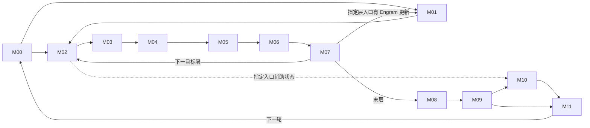

# 171 · DeepSeek‑V4.1‑Flash 融合优化研究工作台

**适用任务**　固定部署下的算子融合、数学化简、计算与通信重组、megakernel 设计及验证。更新日期 2026-11-09。接手顺序为环境核对、路径定位、价值初筛、证据与任务选择。

## 1. 冻结环境

目标资产 171，910C，16 个逻辑设备，CANN 9.2.0，DP2 / TP8 / EP16 / PP1。模型为 DeepSeek‑V4.1‑Flash‑1017 W8A8（DSpark、Engram），使用冻结 vLLM‑Ascend。MoE 当前分支为自有 DispatchFFNCombine。冻结镜像 ID 为 `sha256:ce42d65b2403992ad2e2b06c61f4f048babb57e455cfe307b018345e36c5e98b`，容器为 `wio-vllm-v41-repro171-20261102`，模型服务名为 `dsv41`。主负载为并发 8、输入 32,768、输出 1,024 token；六个普通请求分别评价。

同一 Codex 项目中，本机 `ENVIRONMENT.md` 保存 SSH、服务端点和离线证据定位方法，`HANDOFF.md` 保存详细研究断点。连接只用本机已授权的 key。换机器时恢复获授权的 SSH 配置、冻结源码和原始 profile；公开仓库能恢复研究决策与索引。当前服务健康须在实际连接时核对。[冻结配置与哈希](../scope.json) · [成本和负载基线](../baselines/) · [证据索引](../evidence-index.json)

## 2. 研究原则

在固定模型、运行环境和目标负载下，从完整推理过程理解局部计算的作用，寻找具有实际开发价值的优化机会。模块图用于明确覆盖范围与协作分工；研究者可根据任务自行选择分析起点、研究粒度和实现方式，也可跨模块提出新的数学改写、数据组织或执行方案。

研究深度取决于进一步分析能否改变开发决策。已有源码、性能数据和历史实验应按适用条件复用；提出新判断时，说明其依据、预期收益及仍待确认的关键假设。算子局部收益与端到端收益分别记录，供团队按任务目标取舍。

## 3. 十二模块执行图

图示为逻辑交付。M02–M07 表示目标层重复体；M01 只在指定层触发。M10 依赖来自指定目标层入口的辅助状态和相应 seed。虚线表示该入口的旁路读者。S00–S11 是源码复核记录编号，与模块编号分别管理。

| 模块 | 计算边界 | 代码复核记录 |
|---|---|---|
| [M00 输入、词嵌入与元数据](../modules/M00.md) | 请求/缓存状态 → token、位置、slot | [S00](evidence/S00.md) · [S01](evidence/S01.md) · [S02](evidence/S02.md) · [S03](evidence/S03.md) · [S05](evidence/S05.md) |
| [M01 Engram](../modules/M01.md) | 指定层哈希查表 → WKV → 门控残差 | [S04](evidence/S04.md) |
| [M02 Attention 前 mHC/RMS](../modules/M02.md) | 残差及 premix → Attention 输入 | [S06](evidence/S06.md) |
| [M03 Attention 主体](../modules/M03.md) | Q/KV、cache、QLI → SMLA | [S07](evidence/S07.md) |
| [M04 Attention 输出](../modules/M04.md) | OA/OB、TP 交付 → Post | [S07](evidence/S07.md) |
| [M05 FFN 前 mHC/RMS](../modules/M05.md) | 残差 → router 与共享专家输入 | [S06](evidence/S06.md) · [S08](evidence/S08.md) |
| [M06 MoE](../modules/M06.md) | 路由 → dispatch → 专家 → return/combine；共享专家支路汇合 | [S08](evidence/S08.md) |
| [M07 FFN 输出与跨层状态](../modules/M07.md) | HcPost → 下一层，保留 Engram/aux 读者 | [S06](evidence/S06.md) · [S08](evidence/S08.md) |
| [M08 目标读出](../modules/M08.md) | 末层归约 → norm → 词表分数 | [S09](evidence/S09.md) |
| [M09 采样与验证](../modules/M09.md) | 分数、草稿 → token、接受数、seed | [S09](evidence/S09.md) · [S11](evidence/S11.md) |
| [M10 DSpark 草稿](../modules/M10.md) | aux → 三层 context/草稿 → 五步选词 | [S10](evidence/S10.md) |
| [M11 迭代交付](../modules/M11.md) | 输出、回收及 slot 状态 → 下一轮 M00 | [S11](evidence/S11.md) |

## 4. 优化地图与研究阶段

每行代表一处值得判断的数据交接或计算。按模块找到位置，看“优化类型”理解为什么可能变快，再看“实现与判断”决定要不要派工。同一机制可以有几种实现；改用 megakernel 仍留在原行，只有新增了可消除的工作才另记收益。

**融合算子**描述哪些逻辑运算被组合；**megakernel**描述较大一段依赖计算怎样在一次设备 kernel 启动内组织。普通融合可以只有生产、消费两个环节；本项目把具有多阶段执行或资源调度的大 kernel 单列为 megakernel 实现。没有统一的算子个数门槛。框架的一次 API 调用是否对应一个设备 launch，需要后端证据。数学化简、跨层共用结果和通信重排也能独立产生收益。

优化类型按“省掉什么”选主类：**计算**（化简、复用或跳过算术）、**读写**（避免中间张量物化）、**通信**（减少传输字节或次数）、**提交**（减少启动或发布）、**等待**（重叠工作或提前交付）。多来源时先记录主收益，只有独立可计价的增量才附第二类。

| 所属模块 | 机会：从什么到什么 | 主优化类型 | 实现与当前判断 | 证据编号 |
|---|---|---|---|---|
| M00 输入、M11 下轮状态 | 请求映射 → slot 坐标、flat 索引及多个目标银行 | 提交／计算 | 多输出与批写。已有服务实测；B1 的 13 项分支单独查 caller。 | C03 · F01/F02/F03 · K07 · H01 |
| M00、M11 | block 表、接受数 → IDs、位置、长度、spec 元数据 | 提交 | 增量发布或共同生成；小张量的设备收益低，需证明主机关键提交能省。 | C01/C02 · R02/R18/R19 |
| M00 输入 → M01/M02 | 词嵌入 → Engram 或首层四路输入 | 读写 | 图内外重复查表和展开已估价；按原负载降级。 | R01/R04 |
| M01 Engram | 查表、WKV 与门控 → 当前层或后续复用者 | 计算／读写 | 同位置局部融合价值低。跨层/步缓存要按完整键和权重代际估命中，另审缓存代价。 | C06 · U02/R03 · K06 |
| M02、M05、M07 mHC | Post 残差 → 下个 Pre、系数与归一化 | 计算／读写 | 查可删的 Gram 或工作区成本，跨层交付保留 BF16/FP32 边界。已有失败精度样例；Sinkhorn 减迭代需单独证明。 | C07 · F04/R09/U03/U04 |
| M02 → M03 Attention 输入 | 本地 hidden → KV 投影 → 跨卡聚合 | 通信／计算 | C08 先做分卡投影再传窄 KV，可先用多个 kernel 验证；K01 是扩大前端融合的可选实现。联合原型。 | C08 · K01 · R05/R06/R07 |
| M03 稀疏 Attention | 分页 KV → 暂存面 → QK/PV | 读写 | C09 先做分页直读原型；共享面板是替代方案。K02 还可扩到输出端，重合的暂存写读只计一次。 | C09 · F07/U05 · K02 |
| M03 QLI 索引 | 同一候选成员表示 → 四层评分与选择 | 计算 | 成员转换共享有历史实测。逐 key 压实和缩短归并各自扣掉新增成本；不重新计入旧共享收益。 | C11 · F05/F06 |
| M04 Attention 输出 | OA 中间块 → OB | 读写／等待 | 两矩阵乘同核分块交付，大 prefill 备选；24 行分支已有成本反例。 | F08 |
| M03 → M04 | SMLA 输出 → inverse RoPE、OA、发送端 | 通信／读写 | OA 前移或直接生成发送布局；与 K02 输出端相交。旧显式 pack 方案已关闭。 | C10 · R08 · K02 |
| M05 → M06 路由 | 归一化输入 → Router GEMM、TopK、dispatch | 读写 | 检查主计算能否共用输入；单独转换 ID、打包和末端小融合按原范围降级。 | C12 · R10/R11 |
| M06 MoE 主体 → M07 | Dispatch → 专家两次 GMM → Return/Combine；共享专家在侧路汇合 | 等待／读写 | K00 是已有 DFC。K03 候选在同一 launch 的 Cube 尾部承接 shared GateUp，先查真实空闲窗口和争用。单核承接、共享专家小交接及旧 merge 变体已有处置。 | C13 · K00/K03 · F09/R12/R13/R14/U06/U07 |
| M06、M08、M10 | 空闲行、末层输出需求及已退役 context → 实际要计算的行 | 计算 | 按真实读者裁行；分别核对远端专家、raw 快照、缓存最后写入者。K10 是末层裁行的实现方向。 | C05 · K10 |
| M08 → M09 | 末层归约、词表投影 → 校验、采样和评分 | 读写／计算 | 按读者决定是否须交付完整 logits；固定 greedy、小分数接口多已降级，有限 prompt 评分依赖另一个负载。 | R16/R17/R20/R21/U09 |
| M09 → M10 DSpark | 检查点 aux → main/norm → 三路 context KV | 读写 | 可共用输入，不同权重仍需计算；K05 的大 producer 先扣权重搬移和发布开销。 | C14 · R15/R22/R23 · K05 |
| M10 草稿内部 | 三层草稿 → 五步 Markov → ID | 提交／等待 | K04 跨三层常驻需设备通信协议；K08 局部 head/Markov 已按原范围降级。可选 TopK hook 在该配置没有命中。 | K04/K08 · R24/R25 |
| M09、M10 → M11 | target/draft 计数协调、token 就绪 → 输出与状态退役 | 等待 | 共用 CPU 协调与输出提前交付分别计价；保留 EP 顺序和缓存生命周期。 | C04/C15 · U10 |
| 跨模块／条件范围 | 整层或跨迭代常驻、视觉入口、专家部署 | 依机制判定 | K09 全模型常驻需新的控制边界。视觉分支在本文本负载未命中，部署放置另作历史对照。 | U08/U01/H02 · K09 |

**以后怎样补一条**　按「所属模块 → 生产者/消费者 → 能消失的具体工作」查重。已有行就更新实现、证据或状态；不同的可删工作才加行。建议状态用“已实测、做原型、待确认、停止”，并写明适用形状或负载。证据编号链接到页末的原始台账；局部实测、端到端实测、模型估算分别标注。

### 阶段与处置口径

| 证据阶段 | 进入条件 | 记录要求 |
|---|---|---|
| 初步判断 | 明确运行分支、生产者、读者与可能消失的工作 | shape、负载、范围、关键未知 |
| 条件估算 | 有可复算的成本式或上下界 | 统计量、数据出处、暴露比例、替代开销 |
| 局部确认 | 同输入数值对照及配对计时完成 | 形状覆盖、基线、新旧 µs、波动；正/负结果分列 |
| 服务确认 | 固定部署和负载下完成端到端对照 | 指标、样本、基线是否包含其他优化、增量 |
| 已交付 | 有实现版本、接入条件、验收记录和维护人 | 版本或 PR、回退路径、负责人。已有服务实验不自动晋级为交付 |

“停止、复用、待补证、待领原型”是行动决策；局部或服务反例也可以确认某个方案应停止。每条登记的当前证据与处置在对应台账中查看。[历史46条](history-46.csv) · [当前15组机制](mechanisms.csv) · [11个megakernel切口](megakernel.csv)

## 5. 已完成、待确认与任务分配

- **算子开发**：优先 C09 / 历史 F07，选一个真实长提示 shape，比对 SMLA 的分页 KV 直读与原有显存暂存路径。第一份交付是相同输入下的数值对照、真实有效 K 及完整 kernel 的 µs。
- **框架与通信联合**：C08，先验证单个普通 SWA 层换本地行数后的 BF16、行序与 cache，再比较窄 AllGather 的净交付时间。专题 K01 和它共享工作预算。
- **Megakernel 专题**：优先确认 K03。先查同 shape 下 DFC 最后 GMM2 到 Vector 收尾之间 Cube 真正可用的时间，以及新增争用。既有模型假设额外开销为每 FFN 5 µs 时，过参考线所需尾部时长中位约 18.89 µs；这个时长尚待确认。K02 与 C09 的 KV 交付部分重叠。理论估价和源码核对均未新增设备实测。
- **排查队列**：首批是大 prefill 的 OA→OB（历史 F08）、C11 QLI 压实、C07 mHC、B1 slot 扩形状（历史 F03）。下一批优先 C05 假路由、C06 Engram 完整键复用、C12 路由主体。按引导词选一项，结束时更新本节。

**已完成的范围**　冻结模型实际路径的离线首筛与条件记录、已有实现的历史基线复核，以及 megakernel 理论切分。当前 C08、C09、K03 仍分别处于原型待领或条件补证阶段。团队清单列出 2 个原型、4 个首批排查、8 个后备确认；专题 K03 与 C13 复用同一 MoE 模块责任链。[团队工作单](team-work.md) · [megakernel 设计依据](evidence/megakernel.md) · [逐窗口模型](evidence/megakernel-window-model.json)

## 6. 性能定价与适用范围

| 成本项 | 已有参照 | 使用边界与来源 |
|---|---|---|
| BF16 GEMM | M416、K5120、N1280，DP0、prefill；8 rank 合计 320 条，单次中位 34.78 µs、P95 37.42 µs；按中位数约 80.3 TMAC/s | 一次乘加计一个 MAC。优先匹配完整 shape、dtype、布局与阶段。模型含 385,100 条设备记录、1,698 组条件。[单位成本说明](../baselines/unit-costs.md) · [逐 shape 记录](../baselines/profile-units.json) |
| TP8 AllGather | 每 rank 输入/输出 646,400 / 5,171,200 B；两组并发时 DP0/DP1 分别 58.47/59.95 µs，对应 88.449/86.255 GB/s | BF16，原表标 BFP16。吞吐以完整逻辑张量计，含启动和同步；换消息大小、拓扑、并发或改为 EP16 应重新匹配。[回放与字节口径](../baselines/collective-calibration.json) · [模型内通信](../baselines/communication.json) |
| 内存搬运 | 五个匹配 TensorMove 的逻辑输出速率约 1,109–1,210 GB/s | 用于相同条件的敏感性估算；稀疏、冷热缓存、UVA 需要各自样本。逐项标明是单向输出字节还是读写总字节。[搬运依据](../baselines/ffn-entry.json) |
| 启动、重叠与请求侧 | 已绑定的图内设备区间、node API 区间、TP8 最慢 rank、六普通请求和长提示 C8 | 局部时间与请求时间分别计算。并行卡时间不累加；原整网 1% 是参考，不是局部算子唯一准入条件。[成本目录](../baselines/atlas.json) · [共享测量](../baselines/shared-measurements.json) · [请求负载](../baselines/workloads.md) |

估算顺序：匹配原始耗时；缺样本时以可删 MAC / 有效 MAC 速率，或可删字节 / 匹配的有效带宽估计；扣除替代计算、重排、同步、争用。对可重叠工作按同 rank、同请求窗口取关键路径差。每项报告局部 µs、命中次数、TTFT 或整批 ms、估计条件。持续 HBM/L2/UVA 带宽与部分新 shape 的算力仍有缺口。[待校准项](../baselines/calibration-plan.json)

## 7. 研究成果来源与共同维护

| 来源 | 可复用成果 |
|---|---|
| 171 W8A8 框架排查 | [暂停记录](../STATUS-2026-11-08.md)、[分析日志](../analysis-log.jsonl)、[证据索引](../evidence-index.json) |
| 算子优先级及方案制定 | [历史42族登记](evidence/priority-42.md)、[后续优先级及组合基线](https://github.com/wio1997/Inference-Foundry/blob/c0cce2c6eb39eb1935d244d30deb9d5b6754dc54/operator-optimization/deepseek-v4.1-ascend/PRIORITY-PLAN.md)。CP＋Slot＋CPUplan 已有组合对照，后续比较须标记相同基线。 |
| F01 独立验证 | [mHC 双流原型与图回放](evidence/independent-hc.md)。当前重复计算版本已有局部反例，系数专算变体仍待实现。 |
| 全模型 Goal、megakernel 与团队复核 | 本页第 3 节逐阶段源码复核、第 4 节去重机制、第 5 节团队队列与专题切分。 |

**编号规则**　引用必须带来源，例如“优先级42/F01”是 mHC，“历史46/F01”是 slot 双输出。C09、历史46/F07、K02 的共同 KV 读写只有一份收益。台账行数不可跨来源相加。

**协作流程**　新对话先读本页并定位当前任务的模块、机制及现有证据，再按任务要求选择初筛、理论估价、开发或验证。认领时在团队工作单写负责人和目标分支。贡献者可在研究分支编辑，或从工作分支/派生仓库提 PR；在同一变更中更新对应台账、证据和本页断点。审阅重点为复现条件、单位、基线、重复归因和状态依据。公开仓库只提交可公开的研究结果；SSH key、个人登录配置及原始凭据留在本机。

新增或更新记录使用：日期｜来源／机制 ID｜主模块及消费者｜优化类型｜适用配置与负载｜已有证据阶段｜收益与分母｜当前行动｜负责人｜下一处／停止条件｜证据或提交。局部确认、服务确认和已交付均须给出对应结果链接。

**新对话指令**　读取本页，先核对环境，定位【任务或模块】的证据阶段、已完成工作与下一步。从已有源码及性能资料开始，依据第 2 节的研究原则自主开展指定任务。结束时提交可审阅的增量、更新状态和接手位置。
