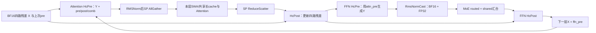

# S06：40层共同decoder和mHC交接

2026-11-08。本记录完成共同mHC及跨层交接的首轮价值判断；Attention内部、MoE内部和aux/终端仍分别待后续记录，不能因本图连通标全层已完成。

## 代码决定的重复体与例外

从冻结完整config和`model.py:510–558 build_layer_plan`纯定义直接生成`target-layer-plan.json`（脚本`tools/read_frozen_layer_plan.py`，不导入候选）。40层均走：

递归箭头表示重复体，具体40层的末层走collapse，不回到第0层。每层Attention/FFN各一次HcPre和Post。层0/1只有SWA；2–19为C2，KV源2/8/14各管6层，index同源。20–39为C1，KV全来自20，index20/24/28/32/36各管4层；index24以后继承20的candidate filter。Engram在1/14的layer body前更新X（S04）；aux在37/38/39进入body前取mean，不可挪到更新后；第39层随后collapse。没有hash-router层、PP传输；终端raw HC快照的实际分支/数值读者单独见S09，不能因DSpark用aux就断言raw发布不发生。

## 从最终需求反推数学/数据工作

把每token四路BF16残差写作X、上一次已就绪的premix写作p。HcPre的前向Y是`BF16(Σ_c p_c FP32(X_c))`；另一路由当前X产生24个mix logits，经scale/base、sigmoid/exp与20次Sinkhorn得到新的pre、post和comb。当前pre给**下一子层**的Y；post/comb给**本子层结果返回后**的残差更新。Y与新系数不是同一截止时间。

原A3 key0 HcPre两阶段：Stage1发FP32 cast workspace、投影与norm的Gram块；Stage2归并K分片，norm只取Gram对角，然后处理系数和Y。已核对归档remote source pin对应本机C++ SHA：`hc_pre.cpp:92–107`，`hc_pre_cube_compute.h:418–477`，`hc_pre_m_k_split_core.h:348–435`。不能把A5 key1003套到当前A3。Gram计算含跨token非对角值，而下游norm只读对角；可以研究只求行平方和，或由前一Post在BF16 rounding后产生所需norm/源packet，保留mix projection。MmadAB明确启用HF32/TransMode1；不能把普通FP32 reduction自动等同原结果。

HcPost的数学形态`X' = BF16(C·X + b·z)`。若只需要下一Y，实数可提取`pᵀC`与`pᵀb`；实际X'的BF16逐元素舍入仍被下一HcPre系数、后续Post残差及Engram/aux/最终collapse读，通常不能让整份X'消失。合法融合应在原rounding后转发/复用，从而少一次或多次GM读；存给迟到残差读者仍必要。直接取消中间rounding的展开式不是原模型等价实现。

可考虑完整producer→consumer常驻段：Post产生rounded X'，同处计算下一Y/规范化输入、系数所需片段和可选aux mean，并保留迟到X'。第一层四路X相同是S05的特例，只能减少那次重复输入/权重和初始化，不能推广80次。两处Engram改变X代际；三处aux要更新前mean；合并时逐一保留。跨多个decoder的megakernel也受Attention/EP集合通信和这些读者约束，不能从“放进一核”推导无重复读写。

Sinkhorn的20次4×4交替行列归一化是checkpoint固定非线性过程，不能一般性抵消或合并为一次归约。小matrix可驻留寄存器/UB并与系数生成融合，当前本来已在同HcPre调用内，不存在20次独立调用可删。改变迭代数/终止条件必须证明所需精度，且先受整段价值门槛约束。

## 整段价值与适用结论

形成上述工作后匹配`ORDERED-MHC-VALUE.json`：112个同profile周期按40+40调用绑定，HcPre合计中位约2.846ms，占周期约5.10%，有价值。**C07保留mHC核心计算/producer常驻联合机会**，到同周期1%需净删旧HcPre约19.6%。设可删Gram/workspace/重复输入占比f、替代计算与同步成本c（以原HcPre时间归一），须`f-c≥0.196`，而非把Gram MAC减16倍当整段16倍。

- **紧邻norm/cast单独融合：低值整组排除。** Attention 40次norm最多0.304%周期，FFN 40次normcast最多0.224%，两者合计最多0.516%，即全免费也不到1%。只删Y落地/读回及Cast的子变体一起停止；如改变更大HcPre核心，只计新增工作。
- **旧row-norm两版停止。** 第一版capture执行失败；修正barrier版第一个eager BF16 Y/pre虽相同，FP32 post有1元素差约1.19e-7、comb有7元素差最大2.98e-8，按原exact门槛停止，无性能测量。说明该实现不满足当前合同，不证明数学化简或所有行归约不可能。任何新实现先说明如何保存归约/rounding或获得明确模型精度合同，才进入性能工作，不原样重跑。
- **仅复制早Y并fork QA的原方案停止。** 相符native原48.426→47.537µs，配对净中位0.876µs，未达当时13.893µs门槛；不能据此排除真正把norm/投影/通信前移且不重复HcPre工作的全段方案。若只40次Attention入口贡献，需重新证明整段净省而不是拿40×0.876µs扩成服务收益。
- **只转发BF16 residual/Y、工作区仍在：不足TTFT目标。** 既有同shape流量模型给两次残差读+Y最多9.831ms，对应TTFT目标14.919ms；加router的最有利小读写项也仅13.764ms。说明仅靠这些小plane，整组无需追缓存细节。扩大到FP32 workspace后有条件空间：有利payload模型中，除双读+Y外还需去掉至少32.34% workspace；另一copy计价模型即全去仍不够。1.203TB/s为实测copy代理，不是物理硬上界，改变实际有效带宽/关键暴露会改变该条件。与C07全部HcPre预算扣重。
- **跨层完整调度只留更大机制。** 旧九轮producer融合重价，warm/pressure中位TTFT约10.53/14.02ms，未满足14.92ms门槛，且原服务对照没有成立收益。不能原样重测。加快迟到coeff尾的反事实在相同EP join上增益0，不单独优化这段尾部；若改变整个producer/驻留/通信，需新的净关键路径账。
- **Engram/aux少见边界单独做：一次排除。** 保留gather与其它任务，只给相关Engram末6/7任务和3次mean全免费，旧C8有利参考TTFT3.272ms、整批32.927ms，均低于1%；不逐个设计专核。它们仍是C07融合正确性边界，不能当没有读者。

历史都按同工作范围引用，没有新增HcPre性能或全模型测量。C07的19.6%是当前profile周期门槛，workspace的32.34%属于另一旧TTFT流量模型；两者不相乘、不相加。下一处进入上述Attention内部：Q/KV生产、共享cache、QLI/SMLA、输出投影与CP交换。然后再走MoE并回检S03的idle mask。
