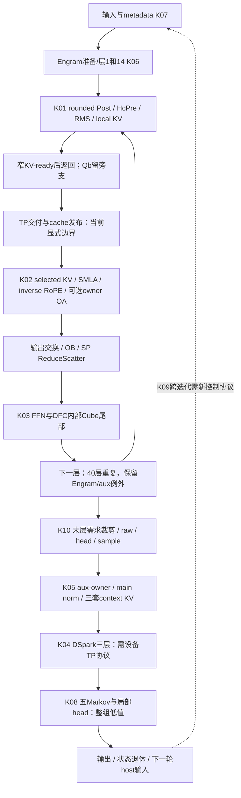
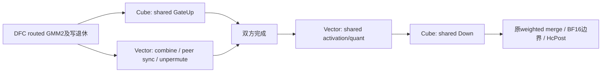

# 171：按可消除工作寻找 megakernel

2026-11-09。适用171冻结镜像、CANN9.2.0、910C、TP8/DP2/EP16/PP1、W8A8及既定C8/六普通文本请求。本轮是代码与离线价值模型，未SSH、未实现或部署新内核、新增NPU测量0。沿用`kernel-optimization`及`operator-task-loop`记录证据。

结论：可以给出具体的局部单launch设计候选。优先补证 **DFC Cube尾部承接shared GateUp**；长prefill另保留 **行owner的KV-ready前端**、**SMLA内部交付及输出producer**。这些均未证明可编译/数值正确/有服务收益。DSpark跨三层与40层/跨迭代常驻需要新设备通信或控制协议，不能把Python循环、ACL图或一次API调用当作一份新megakernel实现。

这里megakernel指一个设备launch内由Cube/Vector承担多个依赖阶段；它仍可有GM工作区、多核及多rank通信。判断收益按真正消失的工作，不能因变成一个launch就将全部中间结果、等待和通信算作免费。

## 代码先决定切口

从`model.py:879–920`的真实重复体、`dsa_v41.py:350–438,613–717`的Q/cache与输出、DFC的AIC/AIV入口，以及`dspark.py:248–309`的三层和context生产划分K00–K10，见`code-cuts.json`。先确定结果和同步边界，再取同范围旧profile定价，没有导入历史候选集合来生成切口。

净收益使用同一关键路径：

`净省 = 可删除计算 + 可删除交付/提交 + 实际隐藏的必需工作 − 新计算/交付/屏障/资源争用`。

一个结果被多个切口省到时只计一次。当前约55ms的profile周期、旧TTFT P90约1491.85ms、旧整批18590.77ms和不同服务对照保留各自分母；本报告没有将它们相加或重算出新的端到端P90。

## K00/K03：先利用现有DFC的内部阶段

### 已有megakernel范围

`dispatch_ffn_combine_kernel.hpp:218–230`：AIC分支是GMM1→等activation→GMM2；AIV分支是DispatchAndCombine。后者已有routing quant、EP计数/通信、activation、combine、peer同步和unpermute，不能再给它们一次“融合收益”。`:253–255`按物理M×K选CombineV1/V2，两个分支都保护。

`:539–636`的GMM2在所有必要写入退休后可以释放Cube阶段；AIV随后仍有`:958–977`的combine、计数清理、跨rank同步及unpermute。**由这个真实阶段差形成K03：在同一个launch内，让已完成routed GMM2的Cube承接本rank shared GateUp。** 等原AIV阶段结束、shared Up也完成后，再做shared activation/Down、原merge与Post。

基础版本只隐藏shared第一段GEMM，后续activation/Down仍保持必要次序。原Vector全核`SyncAll`还在，不允许直接抽几条Vector去做shared activation，否则可能使剩余核永久等待。`dispatch_ffn_combine.h:266–275`的21/3是专家epilogue分段，**不代表空闲3个Cube**。AIC现有入口均参加GMM阶段。

数学上没有少算shared或routed GEMM：它们权重不同。消失的是shared Up原先串行占用的关键路径时间，可进一步少一些调用；目前模型没有给额外调用/DQ节省信用。shared Up的中间INT32/scale若仍由迟到activation读取，就仍需安全交付，不能因同launch断言可去掉GM。两支结果及`routed×1.5+shared`、Post的原dtype/舍入边界全部保留。

shared原边界又追到`shared_experts.py:471–482,534–564`：GateUp显式输出INT32，后续dequant-SwiGLU-quant读取原weight/activation scale，Down输出原hidden dtype。不能直接套routed的dequant/激活epilogue代替它；“都叫GateUp”不能证明中间精度相同。新Cube阶段必须产出这份原INT32和scale合同。

### 新增的尾长模型

形成切口后匹配`CURRENT-MOE-SCHEDULE-VALUE.json`的112个rank-local周期，每周期40层、每层保留原shared Up实际耗时`u_i`。定义：

- `τ_i`：该层需要的routed Cube工作全部退休后，Vector返回/归并仍在FFN关键路径上的可利用时长。不是整个F21 duration，也不是某个先完成core的空闲时间。
- `h_i`：新屏障、量化变化、流水调整和争用造成的**净新增关键成本**。必须包括AIC间就绪仲裁、event/flag复用等新成本。
- `ΔT = Σ_i min(u_i,τ_i) − Σ_i h_i`，要求`ΔT ≥ 0.01 P`。`P`取该窗口自己的周期。

在保持原shared Up吞吐、所有40层都适用、τ/h均匀的情景下：

尾长表只对应当前保存的target小shape周期（SP本地M3），不按这个µs值外推大prefill或draft。普通请求即使进入同图桶，也须使用自己的τ、适用步数和响应端点；要到某请求1%，仍要求其实际关键步净省之和≥该请求端点的1%。各DP不能直接相加。

首个模型范围M3×K6=18，走CombineV2；大prefill的CombineV1不能套这个尾长。idle DP的shared结果无真实读者时优先判断删除，而不是再给它一份“隐藏shared Up”的收益；与无贡献行裁剪扣重。

| 新成本h / FFN | 达到同周期1%的τ门槛中位 | 112窗口的门槛范围 |
|---|---:|---:|
| 0µs | 13.89µs | 13.41–17.26µs |
| 2µs | 15.89µs | 15.41–19.26µs |
| 5µs | 18.89µs | 18.41–22.26µs |

例：τ=20µs、h=5µs，每周期净省0.60ms；同窗口中位1.08%，范围0.869%–1.118%，96/112窗口跨1%。112窗口来自16rank重复观测，不是112次独立服务实验；**没有测得τ，不能说已取得0.60ms**。只一部分层有尾部时，应逐层用min和实际h重算，不按40层外推。

必须补证的条件很集中：Cube最后写退休到Vector最后必要操作之间的τ；共享权重流量是否拖慢return，以及额外仲裁/同步h。原外部stream fork的native profile虽然有启动时间重叠，shared Up duration却从约34µs延长到数百µs，不能当作有用重叠证据。原fork/21→12分段实验保持关闭；K03把工作嵌入DFC的Cube阶段，需自己的代码与资源证明，不重跑旧flag。

## K01：行owner的KV-ready前端

基础切口：`前一Post产生rounded四路X → 当前HcPre → RMS → 本地SWA Wkv/norm/RoPE（层20另产C1 latent）→ 窄packet就绪`。Q_a/Q_b暂留旁支；后续仍发必要窄AG、写全局cache。三处C2源保留原raw路径。

层0没有前一Post，以初始化后的X进入；层1/14先完成Engram更新再进入；37/38/39必须保留原时点的pre-layer mean aux。统一front kernel需要这些变体或显式输出，不能跨过它们改X代次。37个owner投影位置不等于40个完全相同的Post→Pre融合站点，原raw终端快照也保持其合同。

这个切口同时面对早、晚结果：KV通信需要尽早启动，pre/post/comb和残差还在后面消费。**不能为扩大kernel把较晚的Qb硬塞进基础launch，导致KV-ready变晚。** 现有host发起的collective和event不能自动观察一个大kernel内部的任意milestone；若要kernel未返回就发通信，需要另证设备通信/发布协议，其成本不在基础估算中。

实数有`pᵀ(CX+bz)`展开式，但当前仍需要`BF16(CX+bz)`后的逐元素值来算下一组系数/残差/Engram/aux/raw。合法方案保留这次rounding，再同处消费/转发，不能将四路状态直接代数消失。HcPre Gram对角化及HF32/FP32合同继续保护，旧两版row-norm失败不重做。

价值匹配之前的row-owner需求是：不再重复投影其它7/8的行，并将H5120通信改为SWA512（层20双512）。对应既有估价四carrier毛包络60.54ms，50%情景30.27ms，旧TTFT尺度约2.03%；净兑现≥24.64%才到旧TTFT1%。**这些收益属于改变owner/减少重复投影和宽AG，未证明必须靠megakernel获得。** 同算法分成几个好kernel也可能得到，应以较简单方案作为后续对照。融合新增收益仅是少spill/调用/重复统计，扣新依赖后另算，不能再加一遍30.27ms。

按本轮切口重算：如果只优化Attention位置40次HcPre，达到同周期1%需净删其耗时中位**39.05%**；不是原80次合计的19.6%。只覆盖FFN的40次则是**39.31%**。这一限制防止给局部megakernel错误认领另一半mHC预算。

容量：一行四路rounded BF16为40,960B，FP32展开81,920B，Y为10,240B，三者133,120B；尚未加double buffer、其它输入和权重。24个mix权重共1,966,080B，必须分tile，不宣称全驻UB。local M3仅rounded残差也有122,880B；最终tiling与通信代价仍需明确。

## K02：SMLA到输出producer

基础可删工作由原源码指向：Vector把选中KV写`kvMergeGm_`（arch22 vector:635–653），Cube QK/PV再读（cube:466–469,716–719）；第一非final partial还存在可消恒等交付。先保留direct reader＋partial这一有条件大范围，再考虑inverse RoPE、8-head一组的owner OA和send-layout联合生产。

SMLA softmax最终还要合并不同key分块的max/sum/partial，sink也参与。OA是线性的，但不能绕过原SMLA输出BF16、inverse RoPE的边界，把OA先施于任意FP32 partial再相加当成严格等价。需等原组内输出完成后按原精度投影；保持物理配对gather顺序、tie/NaN和bank代次。

理论量级：有效K256、QK/PV稀疏读不降速时，既有direct＋partial模型旧TTFT条件省约17.78ms，整批21.93ms；读速相对参考至少约0.805才跨旧TTFT1%。单独partial全部省≤11.874ms，不足目标。单纯把RoPE/pack后缀合进SMLA不能领取direct KV的收益。

更大的OA-send分支，将每query的64head BF16输出65,536B变成8组OA后的16,384B，payload少75%，但startup/归并不消失。每个OA组至少要汇齐8head输入8,192B，另有1024维FP32 accumulator4,096B及SMLA自身工作区。旧SMLA布局剩余空间不足直接追加大输出bank，必须重做tiling、交接和资源账，不能泛称UB→L1即零GM。

完整40层owner OA权重为2560MiB/rank，原各rank触达320MiB，**额外2240MiB（约2.19GiB）/rank**；不允许挤掉既定KV容量。旧stock owner OA＋显式pack增加约1.010ms，失败变体保持关闭。理想OA-only后留给新transport/融合开销的同模型空间0.013–0.382ms、中位0.214ms；这是混cohort筛查，不是可加到17.78ms的收益。联合切口需要同一carrier/关键路径重价；当前没有可信的direct＋OA总收益值。

## K04/K05：DSpark的大小切分

`dspark.py:263–275`是一次三层五query，再末层collapse/AG；每层仍有TP/CP、cache写和EP16专家服务。三层权重不同、存在norm/activation/attention，不能合并成一次线性变换。K04单launch需把这些算术和设备TP/EP协议都接入，参数bank、flag代次和跨rank参与者一致；当前Python `for layer`不满足该条件。

形成此cut后匹配同112个窗口：

| 范围 | 原span中位 | 仅全部未覆盖gap免费 | 若gap全免，仍须净删native工作比例中位 |
|---|---:|---:|---:|
| 三层decoder | 2.141ms | 0.03653ms | **24.32%** |
| context完整prefix | 1.050ms | 0.01153ms | **52.18%** |
| whole draft | 4.004ms | 0.09186ms | **11.62%** |

native工作包括算术、交接及kernel内部初始化，未覆盖gap也不一定是host launch。一个异常窗口gap较大，不支持用它给典型负载报收益。纯删可见dispatch gap不足，不能因为调用多就实施三层megakernel。whole draft仍有条件空间，但需指出至少约11.62%的native工作从哪里消失，加全部新协议成本；没有给一个已经验证的预计收益。

K05是相对局部的producer：三份aux在SP row owner就绪后，以完整main权重做15360→5120、保留BF16和main norm，再用三个不同Wkv生成KV，发布到各自physical slot。这样可避免先三份宽aux gather、输出分片gather和重复全局投影，但额外main权重137.63MB/rank。`RMS(AW)Wkv`不能一般折为`A(WWkv)`；三层KV也不相同。

完整prefix到同周期1%需净删52.71%span，旧固定primitive producer扣必要工作后新成本余量仅4.61µs，原样拼接不做。只有改变row-owner/需求行/交付的更大cut才保留。C05窗口退休和K10末层裁行带来的行数收益只归一个需求预算，不能再给K04/K05各记一份。

## 其余整组判断

| 切口 | 本轮处置与依据 |
|---|---|
| K06 Engram | 固定位置gate/lookup等小plane即全免费最高约0.743%同周期，局部融合停止。完整内容缓存/重新安排WKV是不同算法条件：要旧cacheable工作消失71.1%–96.3%再扣cache/miss成本；不能把缓存命中当作megakernel自动获得。 |
| K07 输入/metadata | 26-job B4批写有历史服务价值，可作为已有批量多任务kernel。共同输入GPU已定价并集全免费仅61.73ms/旧整批；更大publisher还需其它净省124.17ms。CPU状态镜像、DP协调和真实mutator保留；不能把host等待一并算成NPU可删。 |
| K08 Markov/局部head | 五步55任务全免也最高0.8504%同周期，单独Markov megakernel整组停止。保留必要dot后的target/draft联合score旧整批全免费179.925ms仍低于185.908ms；新大controller只计新增净省。 |
| K10 最后一层需求切分 | raw bank实际写入，先合法退役其发布/observer/图合同；仍为所有实际行保留SWA KV和EP远端服务。扩大到selected query/FFN/readout可改变工作量；FFN＋readout有利上界22.992ms，需要净兑现64.89%，不能按路由条目比例报加速。仅把原末层算子装一核没有这份收益。 |
| K09 全40层或跨迭代 | 不是当前可接入cut。每层需TP/CP/EP，跨迭代还依赖CPU scheduler、DP计数、新/完成/重排请求。当前async copy等主流完成，scheduler据此回收页；无限常驻会破坏这个完成边界。需要命令/epoch队列、可观测输出ready及独立cache退休、新设备TP协议。未给此大改报性能值，不排在局部候选前。 |

同kernel中的全核屏障也不免费：参与core、flag发布/可见性、跨rank顺序以及缓冲末读者均要证实。不能从“当前DFC能做EP通信”推出“所有TP collective和跨迭代host交互都能原样放进去”。

## 结果归属与下一步

K01的owner位置机制、K02 direct/partial/OA、K05 aux/context及大MoE/DSpark的方向在历史已有，不作为首次发现。**本轮新增的是megakernel边界与就绪时间约束、按40次位置拆分的mHC门槛、DFC两类core尾部承接shared Up的具体阶段模型，以及DSpark去gap后仍需删除native工作的门槛。** K03是历史C13范围内更具体的派生设计，不主张历史中从未有人考虑该机制。

第一步补证K03的τ与h：先看同一shape原件是否已有Cube最后GMM2写退休、Vector末尾时戳；缺失时只需最小阶段诊断，不重跑完整服务或旧fork。若典型τ明显小于约14µs（零新增成本门槛）或包含新成本后达不到门槛，即整组停止。若通过，再核AIC就绪仲裁、shared quant/权重、L1/flag安全和原dtype边界，才值得实现。

长prefill并行优先K01的KV-ready合同与更简单分kernel owner方案净差；K02先定direct reader有效K/速度，再谈owner OA联合重价。K04当前不直接做全三层原型。这里的顺序按补证成本和决策价值，不是可相加的服务收益排名。

证据：`source-pins.json`为冻结源与本轮范围，`value-models.json`为原件hash、逐窗口算式及情景；重算`python3 tools/price_megakernel_cuts.py`。纯离线模型不构成候选正确性或性能验收。
