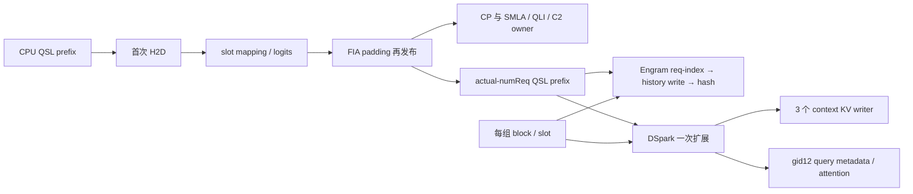

# 实际资源组、Engram/DSpark 坐标与退役

介绍：沿当前 Ascend group patch，而非仅用 upstream 通用分组，走 V1 global QSL/物理 block-slot→Engram slot-cache→DSpark 扩展、context writer 和 query metadata 消费者。先独立推导资源域，再核旧 C8 同名原生任务与价格。每个替换原语逐位一致，数学等价或源控制通过均不作原语准入。

到了哪里：30 份当前源码身份；包内 756 个 Python 文件仅作特定词的文本调用点盘点，不代表逐文件审阅。原 dataclass、planner、DSpark initializer 的受限标量控制，19 个原 Python 退役/CPU guard 控制，两个坐标域反例；原 C8 16 rank/3696 窗中 3624 活跃窗全部匹配。新增 13 处受限源码绑定，原 156 位现 90 绑定、66 待追；不是算子数、运行覆盖率或完整递归调用图。

结果：停止不存在的 draft 多组重复扩展、当前基线 mask-ready 等待后移，以及原 C8 固定 native 小边界的独立开发。较大 CPU/scalar/coordinate frame 和提前发布仍待确认。新增原语/框架准入 0，旧封闭 CPU 租约原型 1 的资格保留。没有新 Torch/NPU/模型/profile/请求/服务操作或远端写入。

## 已停止：重复扩展的前提不成立

介绍：先确认 `for attn_group in draft_attn_groups` 到底执行几次，再判断公共字段重复计算是否存在。

到了哪里：实际 platform patch 的 `_ascend_get_packed_kv_cache_groups` 对 V4.1 调用 `group_cache_specs/make_cache_groups`；仅分析 upstream generic grouping 会漏掉这条派发。冻结 40 target/3 draft、KV source 2/8/14/20、block128、910C 标量计划得到：

|层次|数量|含义|
|---|---:|---|
|cache 资源|54|40 target SWA、3 draft SWA、4 LongKV、4 IndexK、3 compressor ring|
|framework KV 组|13|1 full、1 ring、10 target SWA、1 draft SWA|
|runner backend/spec builder 组|26|4 full、1 ring、20 target SWA、1 draft|
|drafter builder 组|1|gid12，mtp.0/1/2，layer-group 索引均为12|

这些是原 spec dataclass/page 属性和 planner/initializer 的源码计划，使用显式 dtype-size、hardware capability、uniform-base registry/backend 和 allocation descriptor stub；没有构造 framework Tensor 或读取 live 对象。原 caller 诊断每 frame 的 runner26+draft1 在推导之后作对照；不能称 runner26 全是 target-only。改动一个 padded page 的反事实使原 draft initializer 产生 2 个 attention 组，说明“同一个 KV 组”本身也不足以证明只调用一次。

原 C8 3624 个活跃 rank 窗，每窗恰好 1 次 `copy_and_expand_dflash_and_dspark_inputs_kernel`，位置在当前 target head 完成之后、首 draft context 计算之前，0 个计数不符窗。全部 3696 窗和未归入窗口的同名任务仍保留原记录。source plan 在此原生人口核对之前形成。

结果：**已停止**“删多次相同公共字段生成”的具体方案：冻结结构和原生人口都没有这些额外调用。把公共坐标、物理映射与更大 input producer 合并是另一个边界，不因此停止。54/13/26/1 也不代表这些资源的 payload 或 packet 可以直接互相复用。

## 已停止：当前 A3 没有待后移的 mask-ready 等待

介绍：将上轮待确认的 SP mask 等待与实际默认参数相接，区分当前路径和新增 overlap 方案。

到了哪里：保存 serve SHA c297 未变；additional-config 没有 `multistream_engram_overlap`。原 `AscendConfig` default factory 仅 FP8_OPTIMIZED（A5）默认启用，A3 的 STANDARD family 为 False。原 factory 的 A3/A5 两种显式 namespace 控制分别 False/True。不是 live 对象 dump。

冻结 V1 正常准备与 FULL capture input binding 不发布 Engram pending/mask-ready event；因此 model:1535、1572 的相应 wait 条件在这条源码路径为 False。旧 C8 每活跃窗有一次 request-index、一次 slot-cache write、一次 hash，保留原三段顺序。

结果：**已停止**“把当前已有 mask-ready wait 延到首 Engram 层”的配方；当前没有该等待。上轮保留的较大输入 parent 继续有效，但应显式区别“启用/提前独立 producer”的新方案。不能把 A5 slotless capture helper 的适用条件直接搬到 V1 SP+slot-cache。

## 已停止的价格范围：固定 native 小岛；大 host parent 保留

介绍：用旧 C8 原生同名任务给最小完整 native 岛定价，避免为低值子范围新跑 NPU。

到了哪里：hash 岛取首 request-index 开始到末 hash 完成，含三 kernel 内部 gap；扩展岛取唯一 input-expansion kernel。用原 clock 包围、每波有利 active DP 和原请求固定调度 replay：

|全免范围|TTFT P90 乐观百分比|整批乐观百分比|TP8 局部中位包络|
|---|---:|---:|---:|
|三个 Engram hash kernel 及其内部 gap|0.346498%|0.456831%|0.332780ms|
|一次 DSpark input expansion|0.018656%|0.067472%|0.055220ms|
|两岛合计|0.365136%|0.524144%|0.388099ms|

全免还放松了必需 hash 数学、历史写回和全部新增成本，不是可实现收益。假设仅 50% 可删且能暴露、每波新增 0.02ms，合计条件净约 0.175865% TTFT、0.237651% 整批。该价覆盖 453 个有实际请求 TP8 组；454 物理组中的 8 个 synthetic rank 窗未赋请求收益。

结果：**已停止原 C8 下固定派发、仅此 native 边界的独立小方案**，不做新的 NPU 点测；1% 是此前排序参考，不是用户硬验收线。hash 岛之前的 dead-mask/分配、之后的 gather/lookup/events 及更大的 CPU frame 都不在此上界里；不能据此停止整个 Engram preparation、共同 frame 或改变跨 consumer 布局的 megakernel。六普通新岛价格未测，不迁移 C8 百分比，也不和上轮大 input parent 5.058344% 或另一 cohort 的 self-Free 价相加。

## 待确认：实际请求、FIA padding 与 draft 坐标的共同 frame

介绍：共享原始计数/长度与整数投影，而不是给不同物理资源复用整份 metadata。

到了哪里：

V1 Engram 用 `query_start_loc[:num_reqs+1]` 与其源 SWA 的物理 block/slot，request-index 对尾行 clamp 到最后一个实际 request。FIA 的 QSL 可以另外插入 dummy row。例 actual `[0,6]`、FIA `[0,6,24]`：行 6..23 在 Engram map 中仍为 request0，在 FIA map 中为 request1；第二例 `[0,3,9]` 与 `[0,3,9,16]` 的行9..15亦不同。它们只是原二分搜索/clamp 语义的整数域反例，不是原生 Triton 测试。

Engram hash 按当前 chunk→已知 prompt lookback→物理 slot-cache fallback 选值。原独立 write kernel 先写压缩 token-map 值与 dead sentinel；原 hash 再读。`ensure_cache()` 按 SWA KV Tensor 对象身份弱引用重建/清空历史，不能按相同底层地址或字节大小认定历史代次不变。对重复 slot、跨 request/迭代、padding、rejected context、负位置的重排，必须保留原状态和整数运算；既有分离 launch 不能仅靠删除 barrier 改成无同步跨 block 读写。

DSpark setter 保存 alias。一次扩展写公共 IDs/positions/sampleindices，以及 gid12 的 context/query slot。context 切片进入 DFlash adapter→三个 WKV/RMS/RoPE/cache scatter writer；query slot/table 进入 per-group CP builder/native metadata→draft attention/cache writer。padding/tailfill、下一次扩展或 block/slot upload 是后续覆写边界；cad 属性改绑没有使旧 Tensor storage 退役。`unpadded()` 切 QSL/seq，但保留 block/slot bank，不是拷贝快照。

cache allocator 本身又将资源映射到四个独立物理 layer slot 和同一全局 block-ID pool，层间 alias 由组/块所有权决定。13 个逻辑组、26 个 builder、4 个物理 slot 是不同概念；公共 frame 仍须保留各 owner 的地址、容量和代次。

结果：**待确认且值得深入**。资源域还暴露了下一处具体交付：target 准备阶段也构建 gid12 的 draft metadata，而 target body 不执行 draft 层，供 proposer 的 CM 与原物理视图在 builder 外选定。应先核其 private cache、first-owner task、FULL capture 和后续 build_for_drafting 的全部读者，不能只因 target 无数值调用就宣称整段已死；再用旧逐 call 记录给完整 builder 交付定价。大 CPU/scalar/coordinate frame 的之前条件净价仍保留；需以 actual/FIA/draft 三种域提供正确视图，保留 canonical-QSL 输入重绑、每物理组首 producer、原 native 完整4096B packet 和尾部资格、所有末读与成本。停止盲目共享 padded request-index map，不停止带视图转换和代次的共享 producer。

## 待确认：CPU、producer 与 consumer 的退役分别闭合

介绍：追谁实际执行 cleanup，而不是因 helper 名称或 API 存在便认定调用发生。

到了哪里：原 Python opaque-stub 控制共19例：V1 normal/FULL/capture、model/prep callback 异常，V2 finish、captured-helper producer/consumer 异常、显式 retire reset、CPU input-prep guard。V1 `_model_forward` 的 `finally` 只 release metadata executor；其准备 callback 在这个 try 之前。V2 `EngramModelState.finish_execution` 才显式 retire Engram 并在 finally 调用 superclass；captured slotless helper 的 finally 则显式 join auxiliary stream。这两条均不能当 selected V1 的清理保证。当前 A3 默认同步，没有据此观测到辅助流竞态或服务故障。

继承的 `synchronize_input_prep` 在有 prepare-inputs event 时先等该 copy event，再允许 CPU 写，退出（含异常）时 record。此事件保护已覆盖的 CPU→device 输入搬运；不代表之后的所有 metadata/Engram/draft producer 或 device consumer 已结束。扩大异步 producer 后，原输入 lease 和最早写边界也随之扩大。

结果：**待确认**。新增 overlap/提前 producer 的方案需覆盖 prep、model、graph-param 和失败/跳过 consumer 的统一清理，明确 CPU H2D-read-complete、producer_done、consumer_done 及 acquire-before-first-storage-write。现有 metadata release 不作全任务 join；首次 globalQSL H2D 的中间 slot/logits 读者仍保留。源码控制不是 NPU 事件/原语位验收。

## 下一段与证据

已确认可实现：本轮0，旧受限 CPU 原型1保留。全链路尚未扫完；66 位之外仍有递归 helper 与 opaque native 边界。下一段继续实际 execute_model 状态/DP 空批/异步修正/metadata provider 的剩余合法分支及消费者，不反复重开本轮停止的独立小方案。没有 live 任务等待。

证据：[90/66逐位账与消费者](input-resource-source-review.json) · [资源源码计划](input-resource-source-plan.json) · [19原方法控制](input-retirement-controls.json) · [原C8同名任务资格](input-kernel-windows-receipt.json) · [岛内价格](input-kernel-island-price.json) · [当前默认/保存启动](input-frozen-flags.json) · [消费行段](input-resource-consumer-source-excerpts.json) · [原planner/spec行段](input-resource-group-source-excerpts.json)。完整窗口保存在 `input-kernel-windows-raw.json.zlib`，公开镜像 Base64 压缩原件可完整还原逐rank的全部 Task/stream/model/timestamp。原 Python3.9 `dataclass(kw_only)` 不支持的本机失败留档；改用已有 Python3.12 执行原 dataclass，未改源函数、未重采数据或另启动环境。
