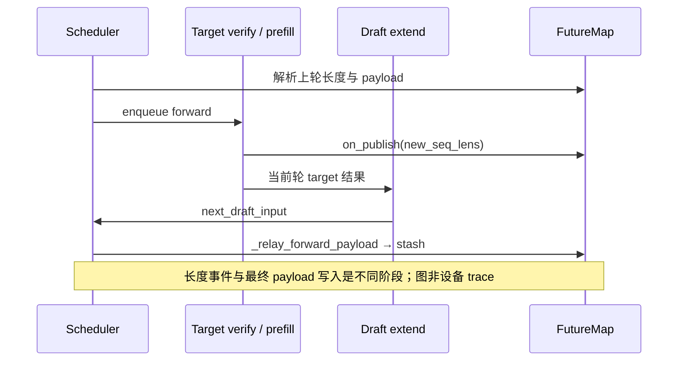

# M004/M016：PD overlap relay 的最终写入者

当前流程把真实长度提前 publish，将 draft payload 留到 worker 返回后 stash。若研究减少 relay 工作，必须先确定字段最后在哪里产生、下一轮是否消费。不能把长度的早期发布点直接当作所有 payload 的最终写入点。

本轮没有实现融合补丁。固定源码已有的消费者 gather 已把 top-k、bonus、可选 hidden 合并为一次 Triton launch；它属于现有能力，实际 Ascend backend / kernel 运行仍待原生核验。

## 复用旧证据，补齐全字段

L002 已执行长度 `publish/resolve_seq_lens_cpu` 的 324 个 CPU 场景和 636 个反事实检查，覆盖重排、长度增量与槽复用；未覆盖完整 stash、hidden、top-k 或 DSA seed。本轮没有重跑或重复计数这些场景。

本轮从固定 commit `ce0a8fea5f4245839d174b2b8c55692be1810a7f` 取得 [11 个公开 Git blob](source-index.json)，核对 SHA1 / SHA256 和已有快照，补齐实际算法注册类依赖。公开源码校验不是远端运行状态复查。

## 默认 PD 路径的顺序

在 PD Decode、overlap、对应 PP 选择成立时，独立 D loop 先处理接收队列再规划下一批。prebuilt 请求经校验和检查 / `process_prebuilt`，随后处理结果、过滤结束请求、合入 running batch、更新 running batch、执行 DP 同步准备，再提交 forward。[D 规划](sources/installed/python/sglang/srt/disaggregation/decode.py#L2965)。

请求键保持为 `req_pool_indices / future_indices`。`EagleDraftInput.filter_batch` 在 future 模式只重排索引，payload 在 forward 入口再取；它不要求 schedule 在当时就拿到 draft 的最终值。本轮审阅了该路径，没有执行完整到达回放、取消、失败、槽 generation、KV 回收或公平性预算实验。[过滤](sources/installed/python/sglang/srt/speculative/eagle_info.py#L210)。

实际绑定见 [Scheduler.run_batch](sources/installed/python/sglang/srt/managers/scheduler.py#L4372)、[worker callback](sources/installed/python/sglang/srt/speculative/eagle_worker_v2.py#L1419)、[最终 producer](sources/installed/python/sglang/srt/managers/scheduler.py#L4660)。两迭代 tensor 引用保留是现有实现，不能独自证明请求槽不会过早复用，也不能替代原生流依赖。

## 345 项组件检查 / 15 场景

[R005 结果](payload-cpu-result.json)使用原始 `RelayPayload`、`ConfidenceRelay` / `ResolvedConfidence` Struct、`FutureMap` 构造和完整 Scheduler producer 方法；算法为实际 `SpeculativeAlgorithm.EAGLE3` 源类，hidden gate 也执行原始函数。执行环境为任务自有 CPU Torch 2.8.0、msgspec 0.19.0；没有完整导入 SGLang 模块。源码声明完整载入，不代表类的每一个方法都执行。

| 场景 | 覆盖 | 限制 |
| --- | --- | --- |
| 12 组 full payload | 6 种索引排列 × 2 种复用后的 optional 状态 | worker 输出、survivor 集合、配置 / beam 边界明确 |
| stash 所有者 | bonus、top-k p/index、hidden6144、draft_probs、DSA seed2048；producer 后续改写不污染已 stash 行 | 真实 CPU tensor，不是物理 KV |
| 消费者重排与复用 | slot2 被新请求数据覆盖；optional seed 缺失时保持 None，池中旧数据不可误读 | 主 top-k/bonus/hidden gather 使用独立 CPU 映射 oracle |
| 1 组原生边界 | 取消 oracle 后到 fused gather 边界即停止 | **不是 native 成功** |
| 1 组 DP 空 stash | 未写字段 / 现有已写行不变 | 不读 `torch.empty` 的未初始化行 |
| 1 组 warm 不完整 payload | buffer lazy-init 后缺少所需字段会拒绝 | 未证明真实 worker 产生该输入，不认定现有服务故障 |

对事件、`record_stream`、配置、worker 输出和 beam 协调使用明确边界。消费者 CPU oracle 只解释行映射；没有执行 [fused Triton gather](sources/installed/python/sglang/kernels/ops/speculative/gather_spec_extras.py#L58)。DSA availability / draft-prob 分支的源代码仍由实际 `FutureMap` 方法执行。该划分与结果 JSON 一致，不能将 oracle 的数值一致性转成 NPU kernel 正确性。

检查证明了早期长度 publish 并不写最终 bonus / hidden。随后原始 producer / stash 才写入六类字段；CPU 条件下复制与行对应正确。它没有证明 schedule / forward / H2D / PD/free 的异步安全或性能收益。

R003 在类声明阶段因漏载实际 `CustomSpecAlgo` 默认参数依赖失败，数值检查计零，见[原始错误](receipts/L028-R003-stderr.log)。未重跑该 Run；R004 补齐原始类，v2 harness 在[零数值计分的声明预检查](declarations-preflight.json)通过后登记、冻结并执行 R005。原 script / frozen spec / 失败回执均保留。

## 必要工作与候选门槛

`stash` 当前为各 buffer 写槽，消费端已合并四类 gather；DSA seed / draft_probs 还有各自条件读取。因此“融合消费者 gather”不能当新发明；“将所有最终字段搬到 on_publish”也缺少时点依据。

若字段确被消费，至少要完成它对应的信息传递。每请求 payload 的参数化字节量包括 hidden `H × s_h`、top-k `K × (s_p+s_i)`、bonus、以及按需 seed / draft_probs。CPU 夹具的 hidden6144 / float32 单方向为 24 KiB/请求；这是夹具数据量，实际 activation dtype 和暴露时间未知，不能换算成原生加速比。

`spec_need_hidden_states` 有“step==1 时也可考虑跳过”的 TODO，而观察过的参考服务使用过单步 EAGLE3。它只是下一条可证伪线索：必须逐一追踪 eager、graph、draft / extend、PP / mixed 的 hidden 消费者和 shape 前提，确认该字段在下一轮读前是否已被替代；不能仅凭 TODO 或循环次数删掉 hidden。[gate](sources/installed/python/sglang/srt/speculative/spec_utils.py#L324)。该参考服务不是本任务的 PD＋MTP baseline，实际任务配置仍未确认。

融合写入会增加 producer 地址处理 / graph 约束；删除字段可能破坏模型输入、形状或可选分支。只有同条件实测证明重复或未用工作且输出一致后才接受；任何字段、行对应、slot generation 或输出差异即否定。未建立实际 Ascend 路径与暴露成本时不应用候选。

[原生准入合同](native-next-contract.json)保留固定 Ascend、PD 分离、推测解码/MTP和全部36机制：成功的小 native allocator、真实 gather、各阶段流事件、完整请求取消与回收、跨 rank 一致性、输出 / 接受长度和同条件性能都仍需证据。本轮整体 **E0**，accepted baseline 为 null，无生产修改或接受候选。
